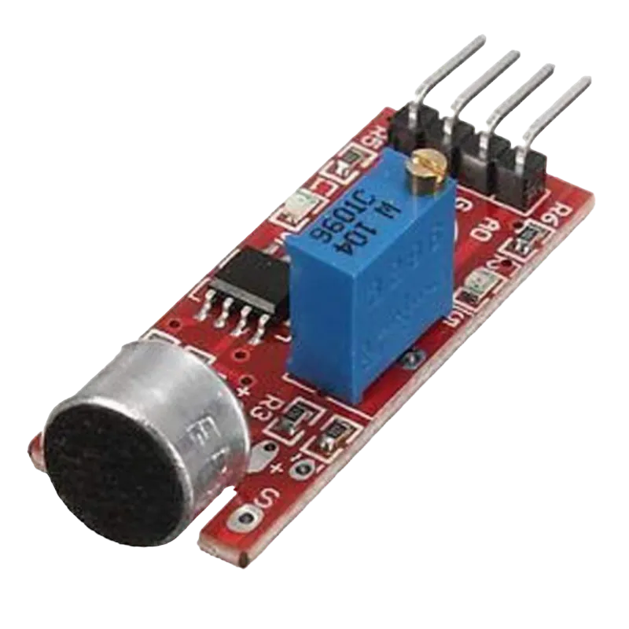
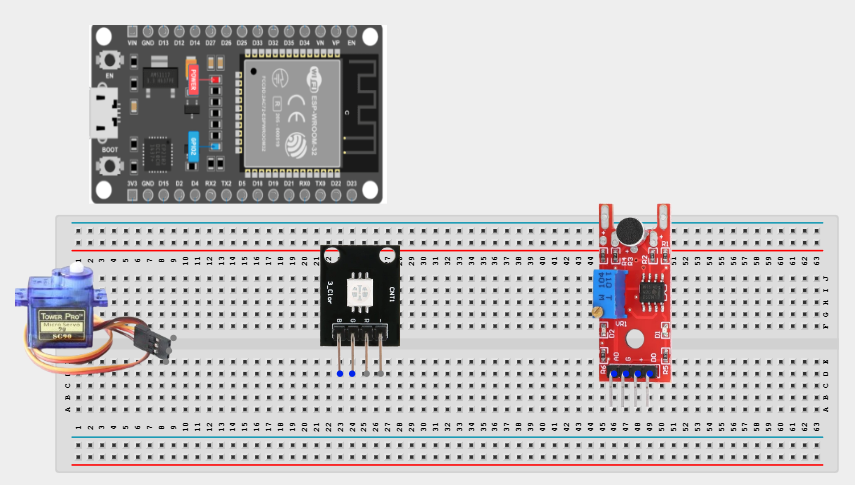
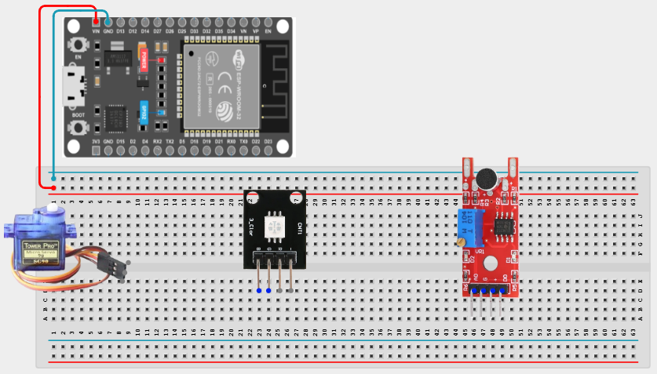
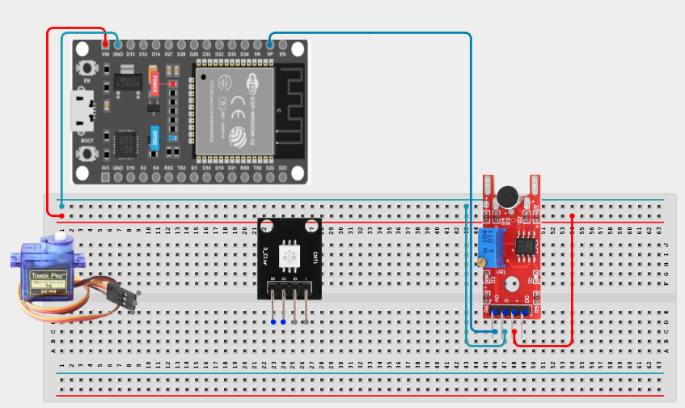
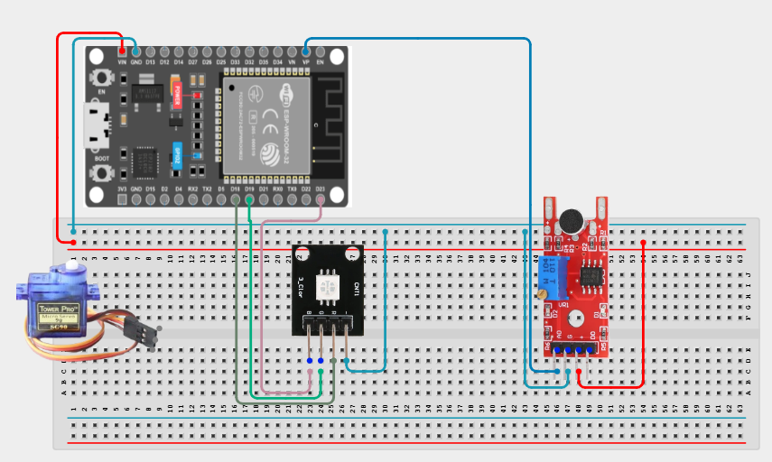
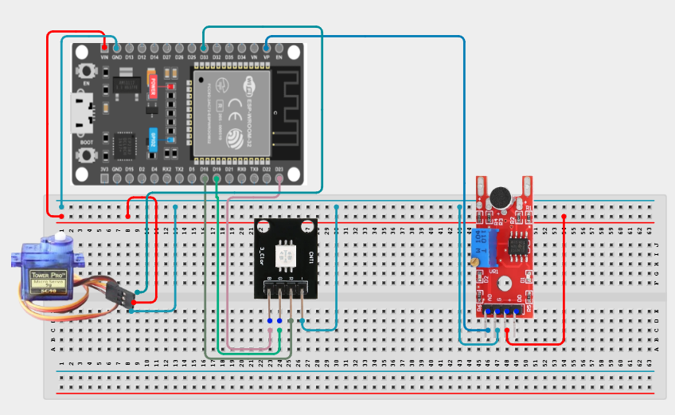

# Project 3.17.1: Sound-Reactive Servo Display

| **Description** |This project demonstrates how to create a sound-reactive display using a sound sensor, an RGB LED module, and a servo motor. The ESP32 board continuously monitors the surrounding sound level and converts it into physical movement and colourful visual feedback. As the sound intensity increases, the servo motor rotates to a larger angle while the RGB LED changes colour and brightness, creating a physical volume (VU) meter effect. This project introduces the concepts of analog sensor reading, PWM output, servo motor control, and sensor-actuator integration. |
|------------------|----------------------------------------------------------------|
| **Use case**     | This project can be used as a sound level indicator, music visualizer, interactive art display, noise monitoring system, classroom demonstration tool, or smart automation system that responds to changes in environmental sound. |

## Components (Things You will need)

|  |  |  |  |  |  | |
| --------------------------------------------------- | ------------------------------------------------------ | ----------------------------------------------------------- | --------------------------------------------------------- | ------------------------------------------------------ | ------------------------------------------------------ | ------------------------------------------------------ |

## Building the circuit

> **Tip:** Use the [ESP32 Pin Mapping](../../assets/esp32_pin_mapping.png) image to locate the correct GPIO pins on your ESP32 board.


Things Needed:

- ESP32 board = 1

- Micro USB cable = 1

- Sound sensor module = 1

- RGB LED module = 1

- Servo motor = 1

- Jumper Wires


## Mounting the component on the breadboard

**Step 1:** Take the sound sensor module, RGB LED module, servo motor, and breadboard.

Insert the sound sensor module and RGB LED module into the breadboard, ensuring there is enough space between them for wiring.

Place the servo motor beside the breadboard where its wires can easily reach the ESP32 board.



## Wiring the circuit

**Step 2:** Connect the power rails:

- Connect the 5V pin on the ESP32 board to the positive rail on the breadboard.
- Connect a GND pin on the ESP32 board to the negative rail on the breadboard.



**Step 3:** Connect the sound sensor module:

- Connect the **(+)** pin to the positive rail.
- Connect the **GND** pin to the negative rail.
- Connect the **AO** (Analog Output) pin to **GPIO 36** on the ESP32 board.



**Step 4:** Connect the RGB LED module:

- Connect the **R (Red)** pin to **GPIO 18** on the ESP32 board.
- Connect the **G (Green)** pin to **GPIO 19** on the ESP32 board.
- Connect the **B (Blue)** pin to **GPIO 23** on the ESP32 board.
- Connect the **GND (-)** pin to the negative rail.



**Step 5:** Connect the servo motor:

- Connect the red (**VCC**) wire to the positive rail.
- Connect the brown or black (**GND**) wire to the negative rail.
- Connect the orange or yellow (**Signal**) wire to **GPIO 33** on the ESP32 board.




_Make sure to connect the Micro USB cable to the ESP32 board._

## PROGRAMMING

**Step 1:** Open your Arduino IDE. See how to set up here: [Getting Started](../../Getting Started/Arduino_IDE_Setup.md).

**Step 2:** Write the complete program implementing the system logic with appropriate pin definitions, setup configuration, and the main control loop.

```cpp
#include <ESP32Servo.h>

// Pin Definitions
const int SOUND_PIN = 36;
const int RED_PIN = 18;
const int GREEN_PIN = 19;
const int BLUE_PIN = 23;
const int SERVO_PIN = 33;

Servo myServo;

int soundValue;
int servoAngle;
int brightness;

void setup() {

  pinMode(RED_PIN, OUTPUT);
  pinMode(GREEN_PIN, OUTPUT);
  pinMode(BLUE_PIN, OUTPUT);

  myServo.attach(SERVO_PIN);

  Serial.begin(9600);
}

void loop() {

  // Read sound sensor
  soundValue = analogRead(SOUND_PIN);

  // Display value on Serial Monitor
  Serial.print("Sound Level: ");
  Serial.println(soundValue);

  // Convert sound value to servo angle
  servoAngle = map(soundValue, 0, 4095, 0, 180);
  myServo.write(servoAngle);

  // Convert sound value to LED brightness
  brightness = map(soundValue, 0, 4095, 0, 255);

  // RGB colour transitions
  analogWrite(RED_PIN, brightness);
  analogWrite(GREEN_PIN, 255 - brightness);
  analogWrite(BLUE_PIN, brightness / 2);

  delay(50);
}
```

**Step 7:** Save your code. _See the [Getting Started](../../Getting Started/Arduino_IDE_Setup.md) section_

**Step 8:** Select the ESP32 board and port _See the [Getting Started](../../Getting Started/Arduino_IDE_Setup.md) section:Selecting ESP32 board Type and Uploading your code_.

**Step 9:** Upload your code. _See the [Getting Started](../../Getting Started/Arduino_IDE_Setup.md) section:Selecting ESP32 board Type and Uploading your code_

## EXPLANATION

This advanced project integrates multiple components (SND + RGB + SRV) to create a sophisticated system. The ESP32 board coordinates sensor inputs and actuator outputs through programmed logic, demonstrating key concepts in multi-sensor fusion, state machine design, and feedback control systems.

## CONCLUSION

This project demonstrates how to build complex interactive systems by combining multiple sensors and actuators with ESP32 board. It reinforces advanced programming concepts and system integration skills.