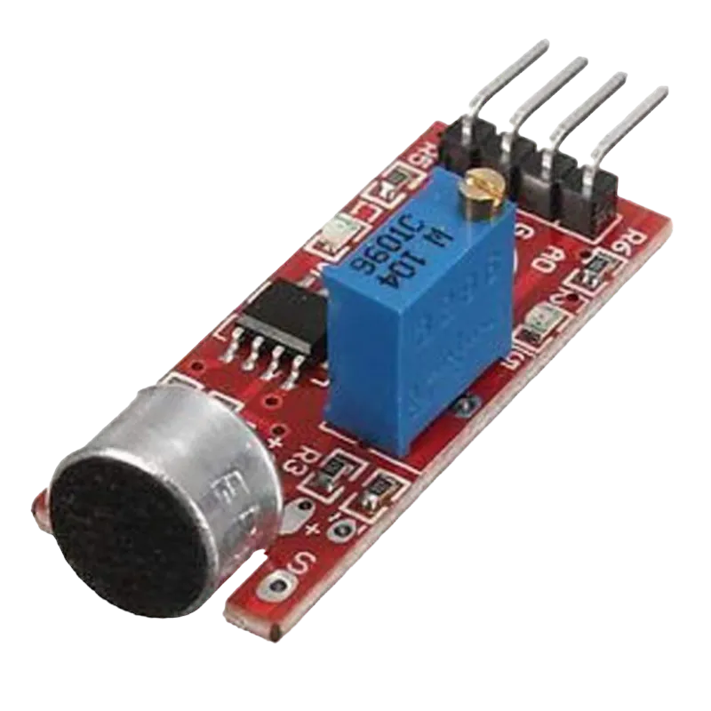
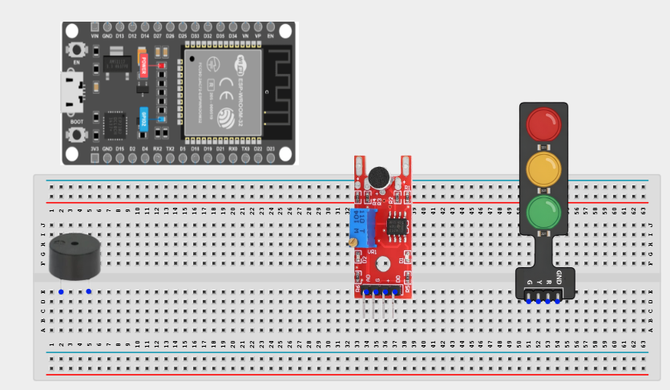
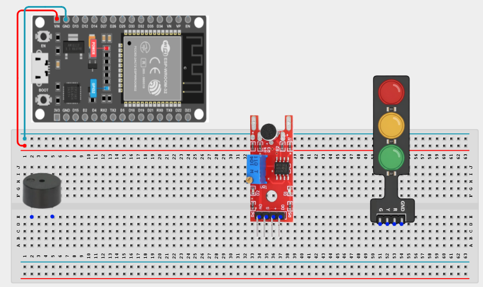
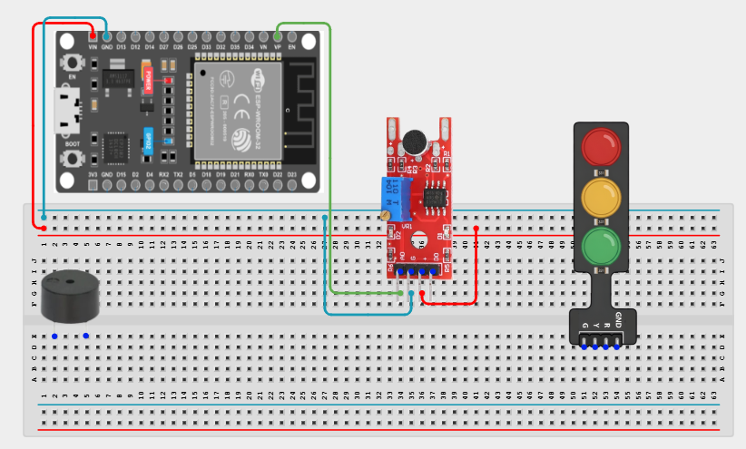
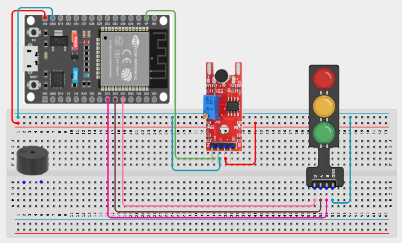
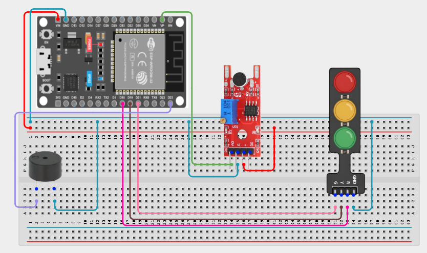

# Project 3.18.1: Noise Pollution Monitor

| **Description** | This project demonstrates how to build a noise pollution monitoring system using a sound sensor, a traffic light module, and a buzzer. The ESP32 board continuously measures the surrounding sound level and classifies it into low, moderate, or high noise levels. The traffic light module provides a visual indication of the detected noise level, while the buzzer emits a warning sound whenever excessive noise is detected. This project introduces analog sensor reading, threshold-based decision making, and the integration of multiple output devices for real-time environmental monitoring. |
|------------------|----------------------------------------------------------------|
| **Use case**     | This project can be used in classrooms, libraries, hospitals, offices, factories, construction sites, and smart buildings to monitor environmental noise levels and alert users when noise exceeds acceptable limits. |

## Components (Things You will need)

|  |  |  | | | ||
|-------------------------|-------------------------|-------------------------|-------------------------|-------------------------|--------------------------|--------------------------|

## Building the circuit

> **Tip:** Use the [ESP32 Pin Mapping](../../assets/esp32_pin_mapping.png) image to locate the correct GPIO pins on your ESP32 board.


Things Needed:

- ESP32 board = 1

- Micro USB cable = 1

- Sound sensor module = 1

- Traffic light module = 1

- Buzzer = 1

- Jumper Wires


## Mounting the component on the breadboard

**Step 1:** Take the sound sensor module, traffic light module, buzzer and insert it into the horizontal connectors on the breadboard.



_**NB:** For complex circuits, plan your component placement to minimize wire crossing and ensure clean connections._

## Wiring the circuit

**Step 2:** Connect the power rails:

- Connect the 5V pin on the ESP32 board to the positive rail on the breadboard.
- Connect a GND pin on the ESP32 board to the negative rail on the breadboard.




**Step 3:** Connect the sound sensor:

- Connect the **VCC** pin to the positive (5V) rail.
- Connect the **GND** pin to the negative (GND) rail.
- Connect the **AO** (Analog Output) pin to **GPIO 36** on the ESP32 board.




**Step 4:** Connect the traffic light module:

- Connect the **GND** pin to a GND pin on the ESP32 board.
- Connect the **Red (R)** pin to **GPIO 18** on the ESP32 board.
- Connect the **Yellow (Y)** pin to **GPIO 19** on the ESP32 board.
- Connect the **Green (G)** pin to **GPIO 21** on the ESP32 board.




**Step 5:** Connect the buzzer:

- Connect the positive (+) pin to **GPIO 23** on the ESP32 board.
- Connect the negative (-) pin to a GND pin on the ESP32 board.



_Make sure to connect the Micro USB cable to the ESP32 board._

## PROGRAMMING

**Step 1:** Open your Arduino IDE. See how to set up here: [Getting Started](../../Getting Started/Arduino_IDE_Setup.md).

**Step 2:** Write the complete program implementing the system logic with appropriate pin definitions, setup configuration, and the main control loop.

```cpp
// Noise Pollution Monitor

const int SOUND_PIN = 36;

const int RED_LED = 18;
const int YELLOW_LED = 19;
const int GREEN_LED = 21;

const int BUZZER = 23;

int soundValue;

void setup() {

  pinMode(RED_LED, OUTPUT);
  pinMode(YELLOW_LED, OUTPUT);
  pinMode(GREEN_LED, OUTPUT);
  pinMode(BUZZER, OUTPUT);

  Serial.begin(9600);
}

void loop() {

  soundValue = analogRead(SOUND_PIN);

  Serial.print("Sound Level: ");
  Serial.println(soundValue);

  // Quiet environment
  if (soundValue < 300) {

    digitalWrite(GREEN_LED, HIGH);
    digitalWrite(YELLOW_LED, LOW);
    digitalWrite(RED_LED, LOW);

    noTone(BUZZER);

  }

  // Moderate noise
  else if (soundValue < 700) {

    digitalWrite(GREEN_LED, LOW);
    digitalWrite(YELLOW_LED, HIGH);
    digitalWrite(RED_LED, LOW);

    noTone(BUZZER);

  }

  // High noise level
  else {

    digitalWrite(GREEN_LED, LOW);
    digitalWrite(YELLOW_LED, LOW);
    digitalWrite(RED_LED, HIGH);

    tone(BUZZER, 1000);
    delay(200);
    noTone(BUZZER);
    delay(200);
  }

  delay(100);
}
```

**Step 7:** Save your code. _See the [Getting Started](../../Getting Started/Arduino_IDE_Setup.md) section_

**Step 8:** Select the ESP32 board and port _See the [Getting Started](../../Getting Started/Arduino_IDE_Setup.md) section:Selecting ESP32 board Type and Uploading your code_.

**Step 9:** Upload your code. _See the [Getting Started](../../Getting Started/Arduino_IDE_Setup.md) section:Selecting ESP32 board Type and Uploading your code_

## CONCLUSION

Congratulations! You have successfully built a Noise Pollution Monitor. In this project, you learned how to use a sound sensor to measure environmental noise, classify different sound levels using programmed thresholds, display the results with a traffic light module, and generate audible warnings using a buzzer. This project introduces important concepts such as analog sensor reading, threshold-based decision making, and multi-device integration, providing a solid foundation for developing smart monitoring and safety systems used in schools, workplaces, public spaces, and industrial environments.