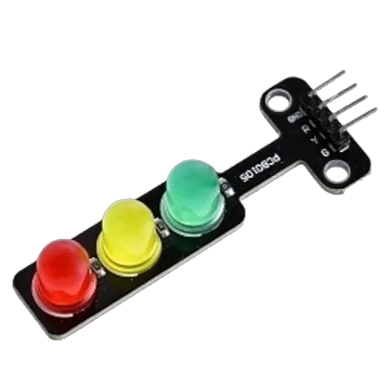
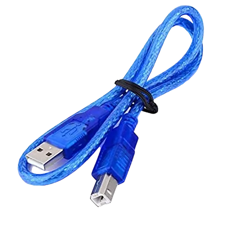
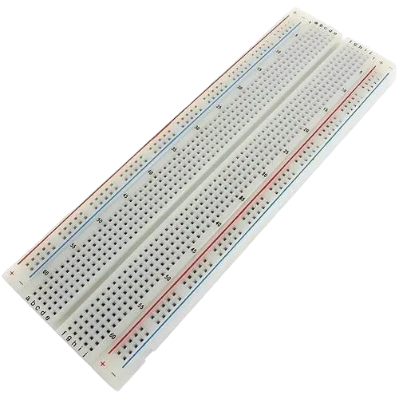
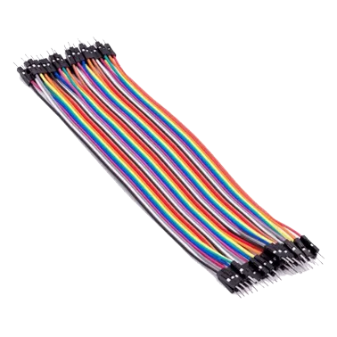
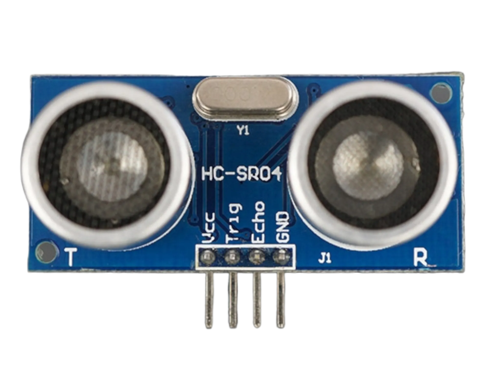
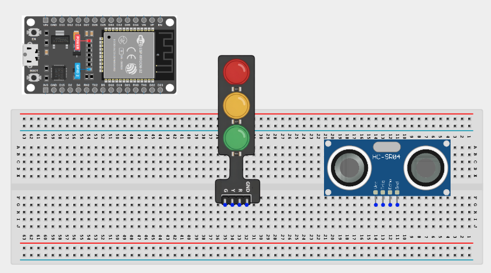
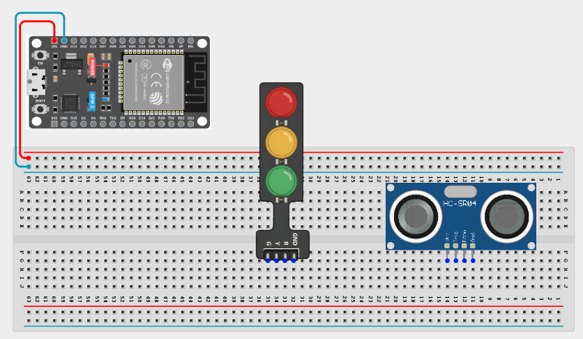
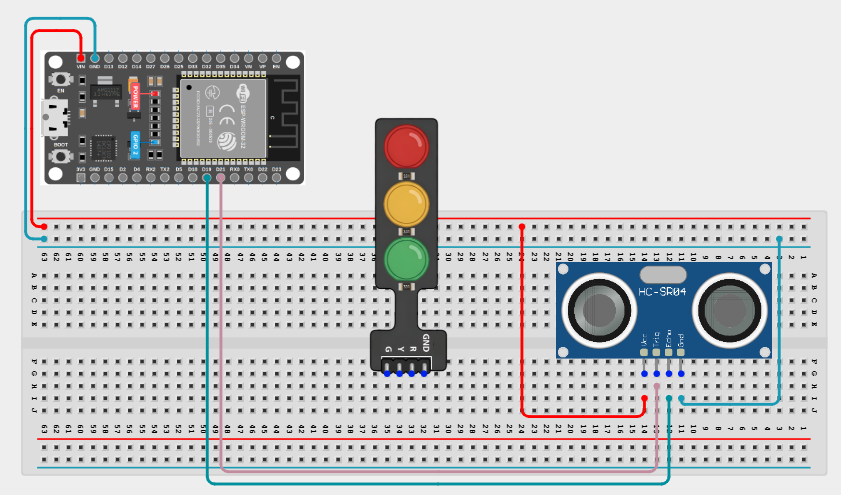
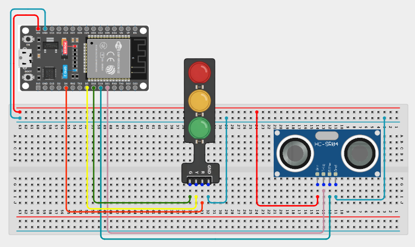

# Project 3.5.1: Smart Trafic Light System. 

| **Description** | This project demonstrates a smart pedestrian traffic light system using an ultrasonic sensor and a traffic light module. The ultrasonic sensor detects the presence of pedestrians near the crossing area, and the traffic lights respond automatically to allow safe crossing and improve pedestrian safety. |
|------------------|----------------------------------------------------------------|
| **Use case**     | This project can be used at pedestrian crossings where the ultrasonic sensor detects people waiting to cross the road and automatically changes the traffic lights to allow safe pedestrian movement.|

## Components (Things You will need)

|  |  |  |  || |
|-------------------------|-------------------------|-------------------------|-------------------------|-------------------------|-------------------------|

## Building the circuit

> **Tip:** Use the [ESP32 Pin Mapping](../../assets/esp32_pin_mapping.png) image to locate the correct GPIO pins on your ESP32 board.


Things Needed:

-	ESP32 board: 1

-	Micro USB cable: 1

-	Breadboard: 1

-	Traffic Light 1

-	Jumper Wires

-	Ultrasonic sensor: 1

## Mounting the component on the breadboard

**Step 1:** Insert the ultrasonic sensor into the breadboard.

Then place the traffic light module beside it, ensuring all the pins are properly inserted and firmly connected.



## Wiring the circuit

Follow these step-by-step connection details using your jumper wires:

**Step 1:** Create Power and Ground Rails

- Connect the **5V** or **VIN** pin on the ESP32 board to the positive (red) rail on the breadboard.

- Connect a **GND** pin on the ESP32 board to the negative (blue/black) rail on the breadboard.



**Step 2:** Wire the Ultrasonic Sensor

- Connect **VCC** of the ultrasonic sensor to the positive power rail.

- Connect **GND** of the ultrasonic sensor to the negative power rail.

- Connect the **TRIG** pin to **GPIO 21** on the ESP32 board.

- Connect the sensor **ECHO** pin to **GPIO 19** on the ESP32 board




**Step 3:** Wire the Traffic Light Module

- Connect the traffic light module **GND** pin to the negative power rail.

- Connect the **Red** pin to **GPIO 4** on the ESP32 board.

- Connect the **Yellow** pin to **GPIO 5** on the ESP32 board.

- Connect the **Green** pin to **GPIO 18** on the ESP32 board.



## PROGRAMMING

**Step 1:** Open your Arduino IDE. See how to set up here: [Getting Started](../../Getting Started/Arduino_IDE_Setup.md).

**Step 2:**  Write the following codes as flows.

``` cpp
const int trigPin = 21;    // Ultrasonic Sensor Trig Pin
const int echoPin = 19;   // Ultrasonic Sensor Echo Pin
const int redLed = 4;     // Red Light
const int yellowLed = 5;  // Yellow Light
const int greenLed = 18;   // Green Light

// Variables for Distance Measurement
long duration;
int distance;

void setup() {
  // Initialize Sensor Pins
  pinMode(trigPin, OUTPUT);
  pinMode(echoPin, INPUT);

  // Initialize Traffic Light Pins
  pinMode(redLed, OUTPUT);
  pinMode(yellowLed, OUTPUT);
  pinMode(greenLed, OUTPUT);

  // Begin Serial Communication (for debugging)
  Serial.begin(9600);
}

void loop() {
  // Measure distance using the ultrasonic sensor
  digitalWrite(trigPin, LOW);
  delayMicroseconds(2);
  digitalWrite(trigPin, HIGH);
  delayMicroseconds(10);
  digitalWrite(trigPin, LOW);
  
  // Calculate the distance in cm
  duration = pulseIn(echoPin, HIGH);
  distance = duration * 0.034 / 2;

  // Print the distance to the Serial Monitor
  Serial.print("Distance: ");
  Serial.print(distance);
  Serial.println(" cm");

  // Control the Traffic Light Based on Distance
  if (distance <= 10) { // Vehicle detected close to the intersection
    digitalWrite(redLed, HIGH);   // Red Light ON
    digitalWrite(yellowLed, LOW);
    digitalWrite(greenLed, LOW);
    delay(5000); // Wait for 5 seconds

  } else { // No vehicle detected or vehicle is far
    digitalWrite(redLed, LOW);
    digitalWrite(yellowLed, LOW);
    digitalWrite(greenLed, HIGH); // Green Light ON
    delay(5000); // Wait for 5 seconds
    
    digitalWrite(greenLed, LOW);
    digitalWrite(yellowLed, HIGH); // Yellow Light ON
    delay(2000); // Wait for 2 seconds
    digitalWrite(yellowLed, LOW);
  }
}

```

**Step 19:** Save your code. _See the [Getting Started](../../Getting Started/Arduino_IDE_Setup.md) section_

**Step 20:** Select the ESP32 board and port _See the [Getting Started](../../Getting Started/Arduino_IDE_Setup.md) section:Selecting ESP32 board Type and Uploading your code_.

**Step 21:** Upload your code. _See the [Getting Started](../../Getting Started/Arduino_IDE_Setup.md) section:Selecting ESP32 board Type and Uploading your code_


## CONCLUSION
This project demonstrated how an ultrasonic sensor can be used with a traffic light module and an ESP32 board to create a smart pedestrian traffic light system. It helped in understanding object detection, automatic traffic control, and how sensors can improve pedestrian safety in real-life applications.

