# Project 3.6.1: Smart Gauge System 

| **Description** | This project demonstrates how to build a water level monitoring system using an ultrasonic sensor, LEDs, and a buzzer. The ultrasonic sensor measures the water level, the LEDs indicate different water levels, and the buzzer provides an alert when the water reaches a certain point.  |
|------------------|----------------------------------------------------------------|
| **Use case**     | This project can be used in water storage tanks to monitor water levels automatically. For example, the LEDs can indicate whether the tank is low, medium, or full, while the buzzer alerts users when the tank is completely full to prevent water overflow. |


## Components (Things You will need)

| 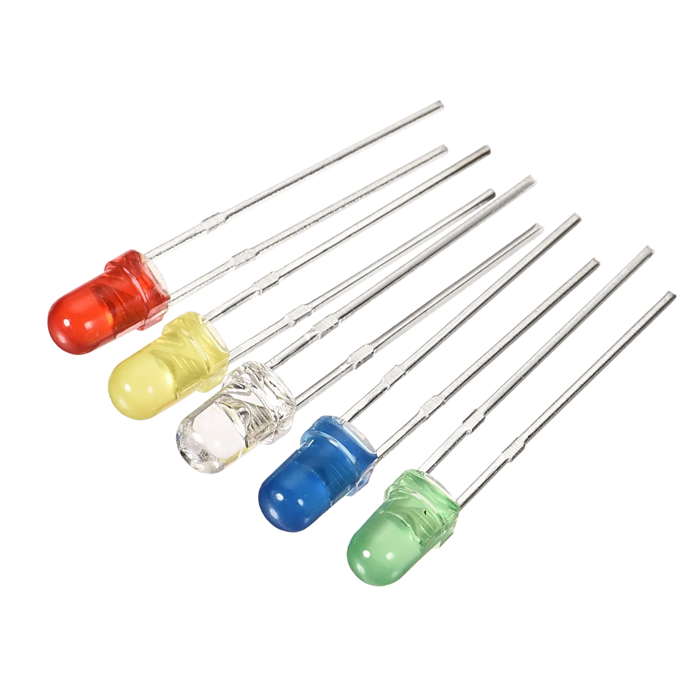 |  | 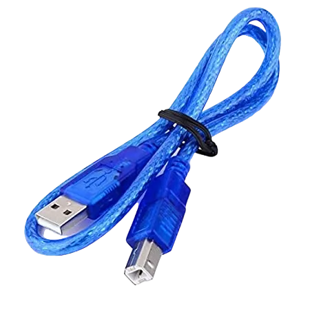 | 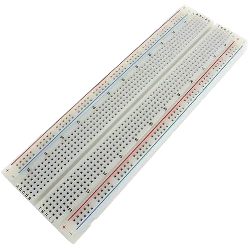 |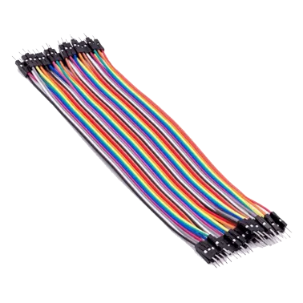| 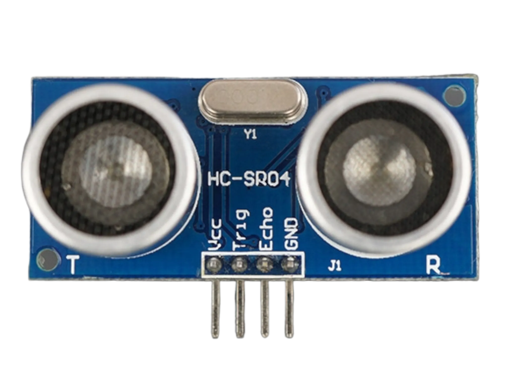| 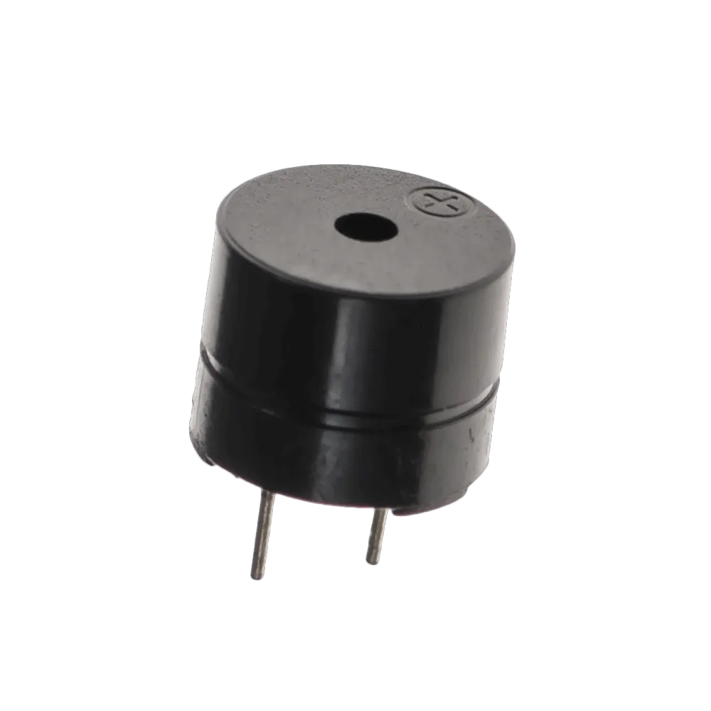|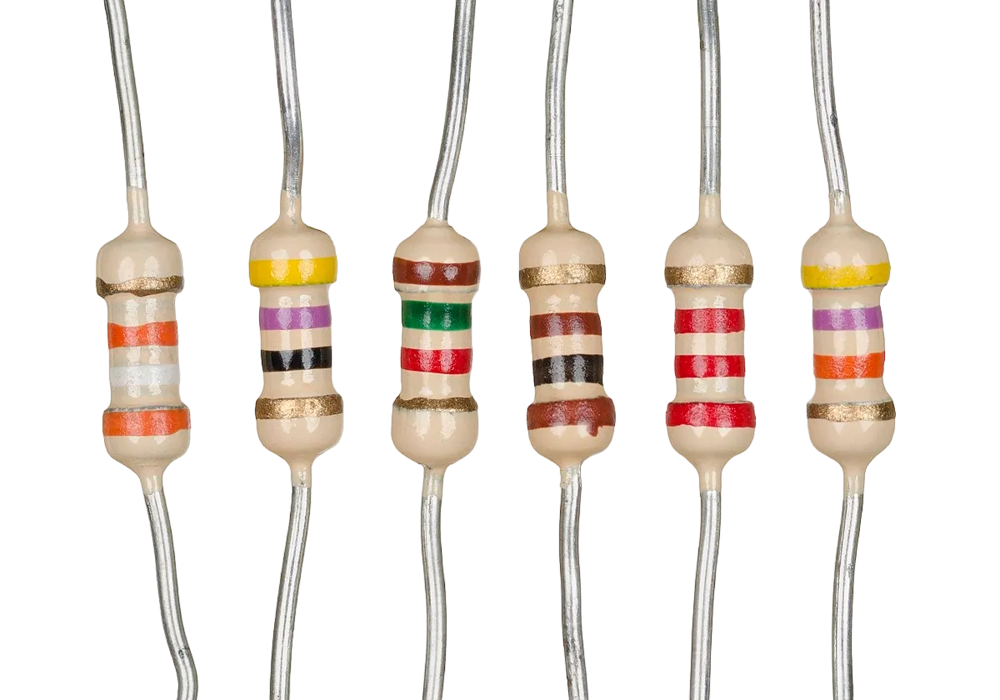|
|-------------------------|-------------------------|-------------------------|-------------------------|-------------------------|-------------------------|-------------------------|-------------------------|


## Building the circuit

> **Tip:** Use the [ESP32 Pin Mapping](../../assets/esp32_pin_mapping.png) image to locate the correct GPIO pins on your ESP32 board.


Things Needed:

-	ESP32 board = 1

-	Micro USB cable = 1

-	Breadboard = 1

-	LEDs = 3

-	Ultrasonic sensor = 1

-	Jumper Wires

- Buzzer

- Resistor


## Mounting the component on the breadboard

**Step 1:** Insert the ultrasonic sensor into the breadboard.

Then place the red, green, and yellow LEDs beside the sensor, ensuring the positive and negative pins are correctly identified.

Connect a resistor to the positive pin of each LED, and insert the buzzer into the breadboard with the positive and negative pins properly positioned.

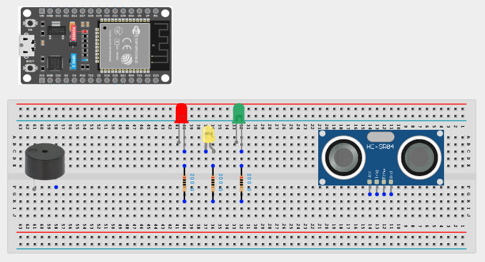.

## Wiring the circuit

Follow these step-by-step connection details using your jumper wires:

**Step 1:** Create Power and Ground Rails

- Connect the **5V** or **VIN** pin on the ESP32 board to the positive (red) rail on the breadboard.

- Connect a **GND** pin on the ESP32 board to the negative (blue/black) rail on the breadboard.

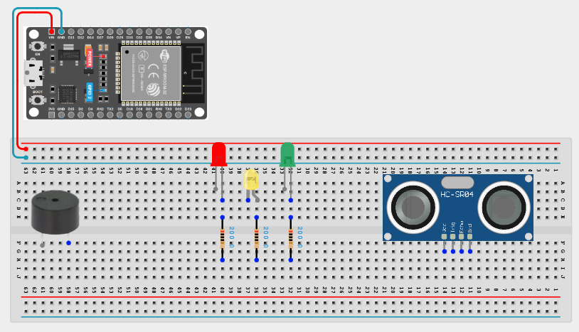.

**Step 2:** Wire the Ultrasonic Sensor

- Connect **VCC** of the ultrasonic sensor to the positive power rail.

- Connect **GND** of the ultrasonic sensor to the negative power rail.

- Connect the **TRIG** pin to **GPIO 19** on the ESP32 board.

- Connect the sensor **ECHO** pin to **GPIO 21** on the ESP32.


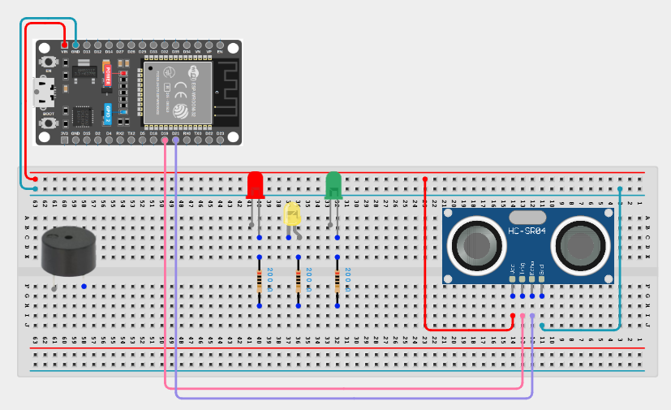.

**Step 3:** Wire the LEDs

- Connect each LED's **negative (short) leg** to the negative power rail.

- Connect each LED's **positive (long) leg** in series with its own **220 Ω resistor** to an ESP32 GPIO: red to **GPIO 5**, yellow to **GPIO 4**, and green to **GPIO 2**.

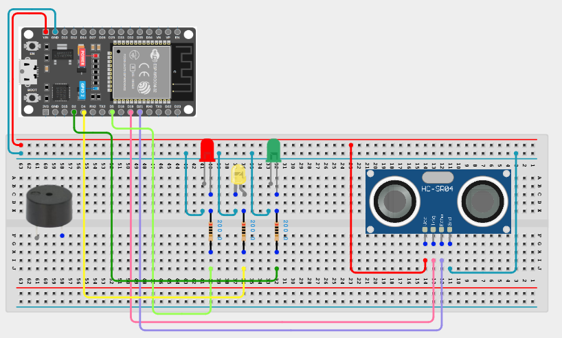.

**Step 4:** Wire the Buzzer

- Connect the buzzer **positive (+)** pin to **GPIO 22** on the ESP32 board.

- Connect the buzzer **negative (−)** pin to the negative power rail.

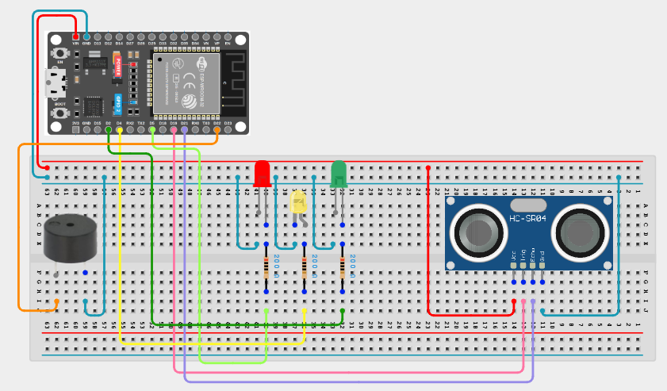.

## PROGRAMMING

**Step 1:** Open your Arduino IDE. See how to set up here: [Getting Started](../../Getting Started/Arduino_IDE_Setup.md).

**Step 2:** Before the void setup() function, type:

``` cpp
const int trigPin = 19;    // HC-SR04 TRIG pin connected to GPIO 19
const int echoPin = 21;    // HC-SR04 ECHO pin connected to GPIO 21 (via voltage divider)
const int redLedPin = 5;  // Red LED connected to GPIO 5
const int yellowLedPin = 4; // Yellow LED connected to GPIO 4
const int greenLedPin = 2;  // Green LED connected to GPIO 2
const int buzzerPin = 22;  // Buzzer connected to GPIO 22
```

**Step 3:** Inside the void setup() function, type:

```cpp
pinMode(trigPin, OUTPUT);  // Set TRIG pin as output
  pinMode(echoPin, INPUT);   // Set ECHO pin as input
  pinMode(redLedPin, OUTPUT);  // Set Red LED pin as output
  pinMode(yellowLedPin, OUTPUT); // Set Yellow LED pin as output
  pinMode(greenLedPin, OUTPUT);  // Set Green LED pin as output
  pinMode(buzzerPin, OUTPUT);  // Set Buzzer pin as output
  Serial.begin(9600);  // Initialize serial communication
```

**Step 4:** Inside the void loop() function, type:

```cpp
long duration, distance;

// Clear the TRIG pin
digitalWrite(trigPin, LOW);
delayMicroseconds(2);

// Send trigger pulse
digitalWrite(trigPin, HIGH);
delayMicroseconds(10);
digitalWrite(trigPin, LOW);

// Read echo time
duration = pulseIn(echoPin, HIGH);

// Calculate distance in cm
distance = (duration / 2) / 29.1;

Serial.print("Distance: ");
Serial.print(distance);
Serial.println(" cm");

// Water level control
if (distance < 10) {
  digitalWrite(redLedPin, HIGH);
  digitalWrite(yellowLedPin, LOW);
  digitalWrite(greenLedPin, LOW);
  digitalWrite(buzzerPin, HIGH);
}
else if (distance < 20) {
  digitalWrite(redLedPin, LOW);
  digitalWrite(yellowLedPin, HIGH);
  digitalWrite(greenLedPin, LOW);
  digitalWrite(buzzerPin, LOW);
}
else {
  digitalWrite(redLedPin, LOW);
  digitalWrite(yellowLedPin, LOW);
  digitalWrite(greenLedPin, HIGH);
  digitalWrite(buzzerPin, LOW);
}

delay(1000);

```

**Step 4:** Save your code. _See the [Getting Started](../../Getting Started/Arduino_IDE_Setup.md) section_

**Step 5:** Select the ESP32 board and port _See the [Getting Started](../../Getting Started/Arduino_IDE_Setup.md) section:Selecting ESP32 board Type and Uploading your code_.

**Step 6:** Upload your code. _See the [Getting Started](../../Getting Started/Arduino_IDE_Setup.md) section:Selecting ESP32 board Type and Uploading your code_


## CONCLUSION
This project demonstrated how an ultrasonic sensor, LEDs, and a buzzer can be used together to monitor water levels in a tank. It helped in understanding how distance sensing works and how outputs like LEDs and buzzers can provide visual and audio alerts for real-life applications such as water level monitoring systems.

