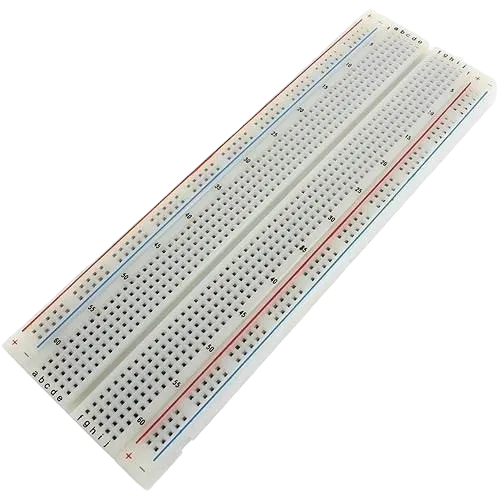
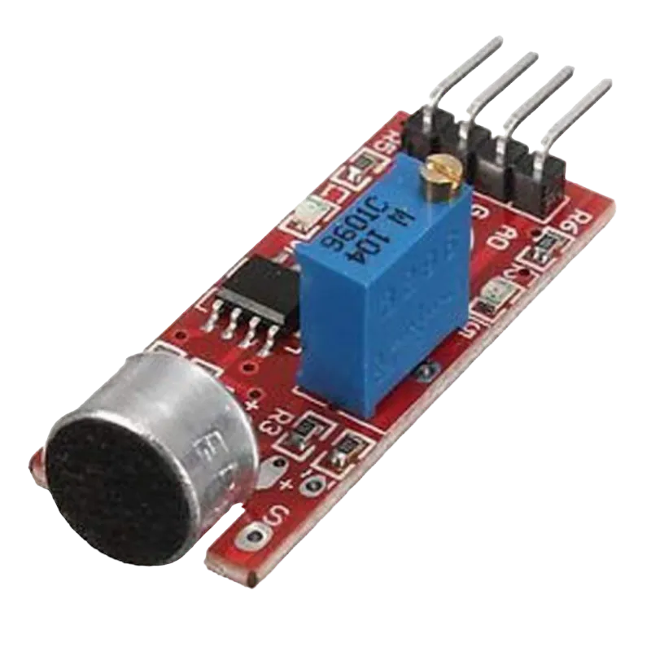
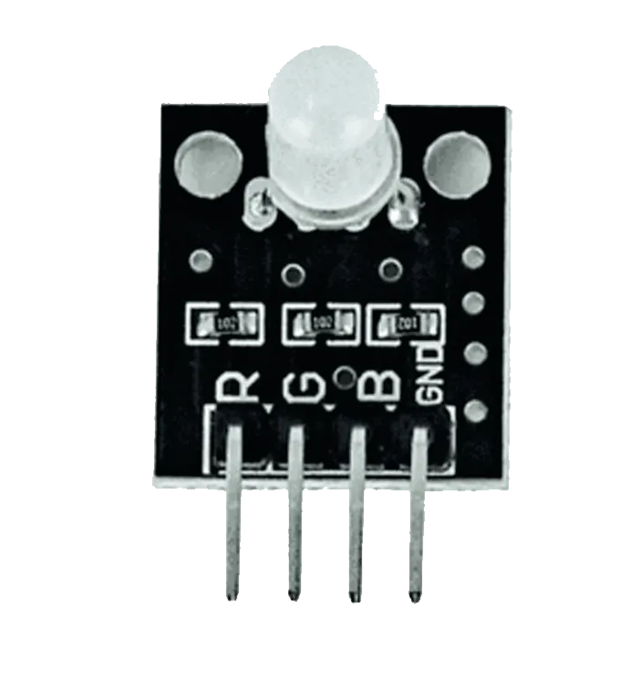
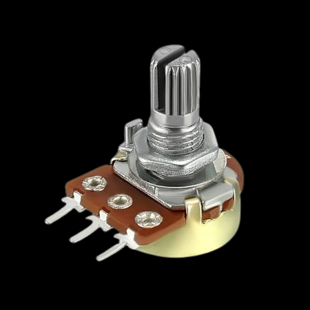
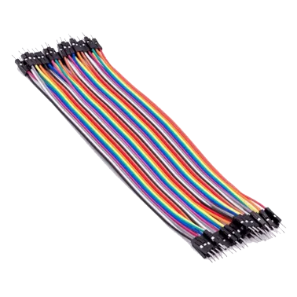
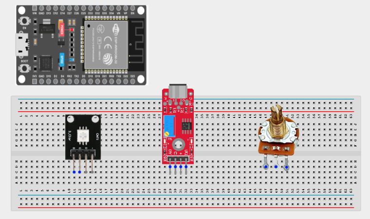
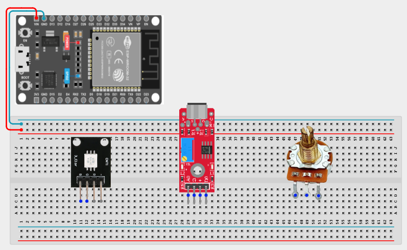
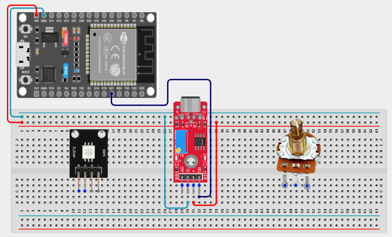
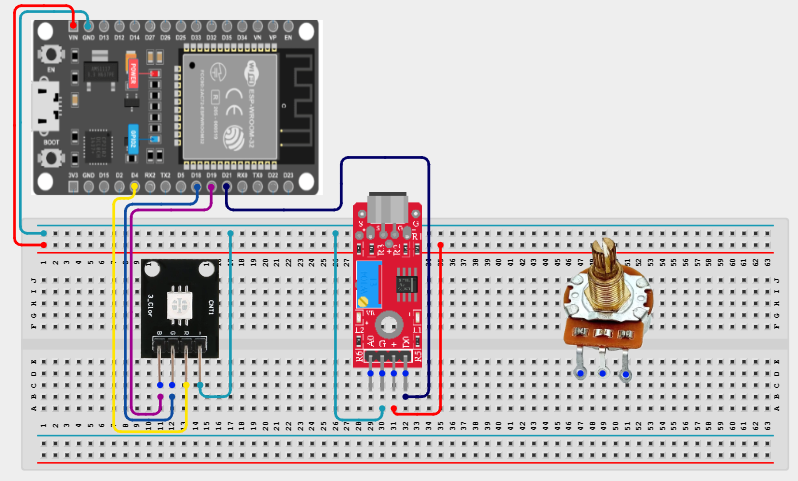
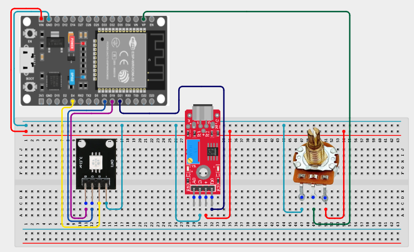

# Project 3.7.1: Sound-Controlled Desk Lamp

| **Description** | This project creates a desk lamp that can be controlled by claps or other loud sounds. A sound sensor detects the audio input, while a potentiometer adjusts the brightness and color intensity of the RGB LED. |
|------------------|----------------------------------------------------------------------------------------------------------------------------------------------------------------------------------------------------------------------------------------------|
| **Use case**     | This project can be used for hands-free lighting, smart desk lamps, bedroom lighting, and interactive electronic displays that respond to sound.                                                                                             |

## Components (Things You will need)

|  |  |  |  |  |  |  |
|--------------------------------------------------------|-----------------------------------------------------------|---------------------------------------------------------------|---------------------------------------------------------------|---------------------------------------------------|---------------------------------------------------------------|---------------------------------------------------------------|

## Building the circuit

> **Tip:** Use the [ESP32 Pin Mapping](../../assets/esp32_pin_mapping.png) image to locate the correct GPIO pins on your ESP32 board.

Things Needed:

- ESP32 board = 1

- Micro USB cable = 1

- Breadboard = 1

- Sound sensor module = 1

- RGB LED = 1

- Potentiometer = 1

- Jumper wires

## Mounting the component on the breadboard

**Step 1:** Insert the sound sensor into the breadboard.

Then place the RGB LED and the potentiometer on the breadboard in a clear layout so the pins are easy to connect and identify.



## Wiring the circuit

Follow these step-by-step connection details using your jumper wires:

**Step 1:** Create Power and Ground Rails

- Connect the **5V** pin on the ESP32 board to the positive (red) rail on the breadboard.

- Connect a **GND** pin on the ESP32 board to the negative (blue/black) rail on the breadboard.



**Step 2:** Wire the Sound Sensor

- Connect **VCC** of the sound sensor to the positive power rail.

- Connect **GND** of the sound sensor to the negative power rail.

- Connect the **DO** pin to **GPIO 21** on the ESP32 board.



**Step 3:** Wire the RGB LED

- Connect the **red** leg of the RGB LED to **GPIO 4**.

- Connect the **green** leg of the RGB LED to **GPIO 18**.

- Connect the **blue** leg of the RGB LED to **GPIO 19**.

- Connect the common ground leg of the RGB LED to the negative power rail.



**Step 4:** Wire the Potentiometer

- Connect the left pin of the potentiometer to **5V**.

- Connect the right pin of the potentiometer to **GND**.

- Connect the middle pin of the potentiometer to **GPIO 36**.



**Step 5:** After completing the wiring, connect the ESP32 board to the computer using the USB cable.

## PROGRAMMING

**Step 1:** Open your Arduino IDE. See how to set up here: [Getting Started](../../Getting Started/Arduino_IDE_Setup.md).

**Step 2:** Before the void setup() function, type:

```cpp
const int soundPin = 21;
const int redPin = 4;
const int greenPin = 18;
const int bluePin = 19;
const int potPin = 36;

int mode = 0; // 0 = Red, 1 = Green, 2 = Blue, 3 = White
bool lastSoundState = HIGH;
```

**Step 3:** Inside the void setup() function, type:

```cpp
pinMode(soundPin, INPUT);   // Set sound sensor pin as input
pinMode(redPin, OUTPUT);    // Set red LED pin as output
pinMode(greenPin, OUTPUT);  // Set green LED pin as output
pinMode(bluePin, OUTPUT);   // Set blue LED pin as output
Serial.begin(9600);         // Initialize serial communication
```

**Step 4:** Inside the void loop() function, type:

```cpp
int soundState = digitalRead(soundPin);

// Detect clap/sound trigger
if (soundState == LOW && lastSoundState == HIGH) {
  mode++;

  if (mode > 3) {
    mode = 0;
  }

  delay(200);
}

lastSoundState = soundState;

// Read potentiometer value
int potValue = analogRead(potPin);

// Convert 0-4095 to LED brightness 0-255
int brightness = map(potValue, 0, 4095, 0, 255);

// Select RGB color mode
if (mode == 0) {
  analogWrite(redPin, brightness);
  analogWrite(greenPin, 0);
  analogWrite(bluePin, 0);
}
else if (mode == 1) {
  analogWrite(redPin, 0);
  analogWrite(greenPin, brightness);
  analogWrite(bluePin, 0);
}
else if (mode == 2) {
  analogWrite(redPin, 0);
  analogWrite(greenPin, 0);
  analogWrite(bluePin, brightness);
}
else if (mode == 3) {
  analogWrite(redPin, brightness);
  analogWrite(greenPin, brightness);
  analogWrite(bluePin, brightness);
}

Serial.print("Mode: ");
Serial.println(mode);

Serial.print("Brightness: ");
Serial.println(brightness);

delay(50);
```

**Step 5:** Save your code. _See the [Getting Started](../../Getting Started/Arduino_IDE_Setup.md) section_.

**Step 6:** Select the ESP32 board and port. _See the [Getting Started](../../Getting Started/Arduino_IDE_Setup.md) section: Selecting ESP32 Board Type and Uploading Your Code_.

**Step 7:** Upload your code. _See the [Getting Started](../../Getting Started/Arduino_IDE_Setup.md) section: Selecting ESP32 Board Type and Uploading Your Code_.

## OBSERVATION

- Each clap or loud sound changes the lamp mode.

- The potentiometer adjusts the brightness.

- The RGB LED changes between red, green, blue, and white modes.

## CONCLUSION

This project demonstrates sound sensing, PWM control, RGB color mixing, and analog input processing. It shows how a simple sound sensor and an RGB LED can be combined to create a practical hands-free desk lamp.

