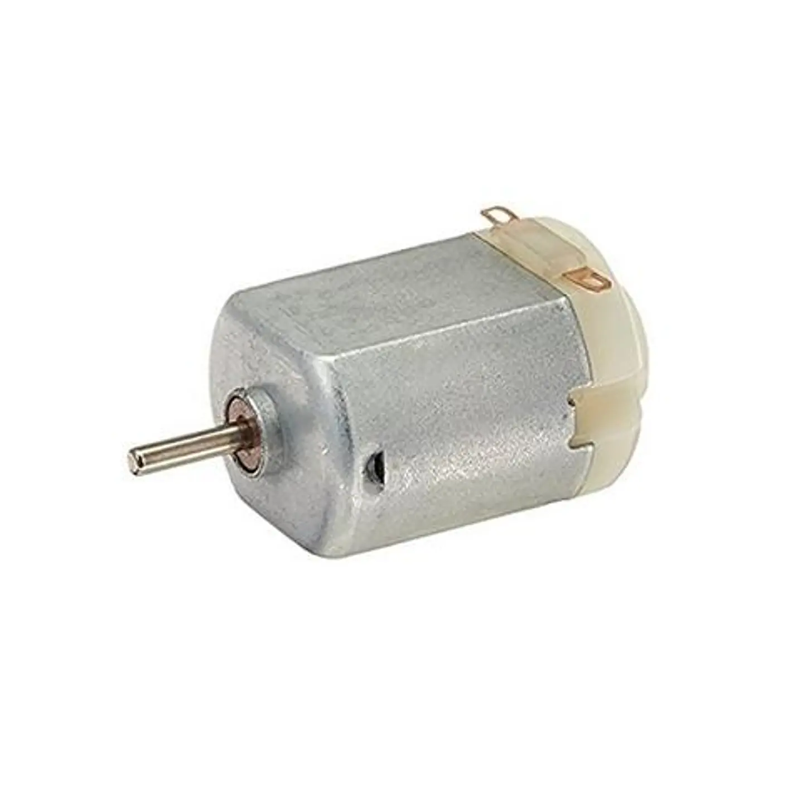
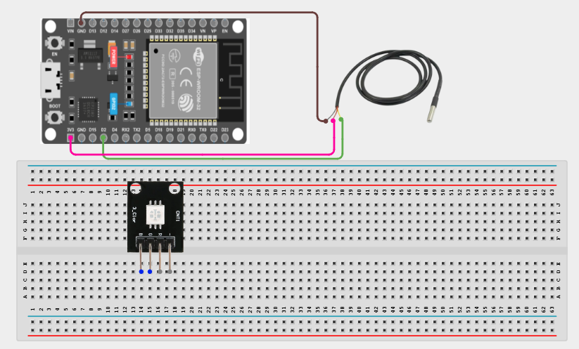
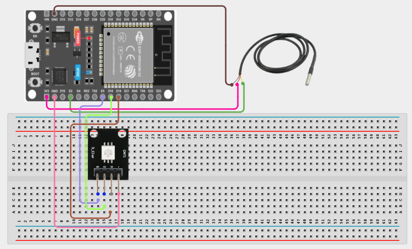

# 4.1.10. Temperature Triggered Cooling Fan

| **Description**| In this project, learners will engineer an advanced 'Temperature-Triggered Cooling Fan' multi-component system. This design integrates DS18B20 + DC Motor + L298N Driver + RGB LED into a cohesive industrial automation unit.|
|------------------|----------------------------------------------------------------|
| **Use case**     |This project can be applied to real-world IoT, safety, and control systems while developing essential master-level engineering skills.|

## Components (Things You will need)

|  |  |  |  |  |  | Motor Driver |  |  |  |
| --- | --- | --- | --- | --- | --- | --- | --- | --- | --- |

## Building the circuit

> **Tip:** Use the [ESP32 Pin Mapping](../../assets/esp32_pin_mapping.png) image to locate the correct GPIO pins on your ESP32 board.


Things Needed:

- ESP32 board = 1

- DS18B20 Temperature Sensor = 1

- DC Motor = 1

- L298N Driver = 1

- USB Cable = 1 

- Jumper Wires

- Bread Board

- RGB LED (common cathode) = 1

- Fan Blades

- Resistors = 1 x 4.7 kohm pull-up and 3 x 220 ohm LED resistors
## Wiring the circuit

**Step 1:** Connect the DS18B20 temperature sensor:

- Connect **VDD** to **3.3V**
- Connect **GND** to **GND**
- Connect **DQ** to **GPIO 2**.
- Connect a **4.7 kohm** pull-up resistor between DQ and **3.3V**.



**Step 2:** Connect the L298N motor driver and DC fan motor:

- Connect **ENA** to **GPIO 23**
- Connect **IN1** to **GPIO 22**
- Connect **IN2** to **GPIO 21**.
- Connect the motor to **OUT1/OUT2**.
- Connect the motor-rated external supply to the driver's motor-power input.
- Connect driver **GND** to ESP32 **GND**.
- Connect the external supply negative to common **GND**.
- Remove the ENA jumper for PWM control; never power the motor from an ESP32 pin.



**Step 3:** Connect the RGB LED:

- Connect the common cathode to **GND**.
- Connect **R** through a **220 ohm** resistor to **GPIO 19**.
- Connect **G** through a **220 ohm** resistor to **GPIO 18**.
- Connect **B** through a **220 ohm** resistor to **GPIO 5**.


**Step 4:** Final wiring check:

- Verify the sensor pull-up, LED resistors, motor supply polarity, and shared ground before USB.


## PROGRAMMING

**Step 1:** Open your Arduino IDE. See how to set up here: [Getting Started](../../Getting Started/Arduino_IDE_Setup.md).

**Step 2:** Write the complete program implementing the system logic with appropriate pin definitions, setup configuration, and the main control loop.

```cpp
#include <OneWire.h>
#include <DallasTemperature.h>

// Pins
const int oneWireBus = 2; // DS18B20 data pin
const int enA = 23;        // L298N Enable A
const int in1 = 22;        // L298N Input 1
const int in2 = 21;        // L298N Input 2
const int redPin = 19;
const int greenPin = 18;
const int bluePin = 5;

// Threshold
const float tempThreshold = 25.0; // Set your desired threshold

OneWire oneWire(oneWireBus);
DallasTemperature sensors(&oneWire);

void setup() {
  Serial.begin(9600);
  sensors.begin();
  
  pinMode(enA, OUTPUT);
  pinMode(in1, OUTPUT);
  pinMode(in2, OUTPUT);
  pinMode(redPin, OUTPUT);
  pinMode(greenPin, OUTPUT);
  pinMode(bluePin, OUTPUT);
}

void loop() {
  sensors.requestTemperatures();
  float tempC = sensors.getTempCByIndex(0);
  
  Serial.print("Temperature: ");
  Serial.print(tempC);
  Serial.println(" C");

  if (tempC > tempThreshold) {
    // Fan ON
    digitalWrite(in1, HIGH);
    digitalWrite(in2, LOW);
    analogWrite(enA, 200); // Set motor speed (0-255)
    
    // LED RED
    analogWrite(redPin, 255);
    analogWrite(greenPin, 0);
    analogWrite(bluePin, 0);
  } else {
    // Fan OFF
    digitalWrite(in1, LOW);
    digitalWrite(in2, LOW);
    
    // LED GREEN
    analogWrite(redPin, 0);
    analogWrite(greenPin, 255);
    analogWrite(bluePin, 0);
  }
  delay(1000);
}
```

**Step 3:** Save your code. _See the [Getting Started](../../Getting Started/Arduino_IDE_Setup.md) section_

**Step 4:** Select the ESP32 board and port _See the [Getting Started](../../Getting Started/Arduino_IDE_Setup.md) section:Selecting ESP32 board Type and Uploading your code_.

**Step 5:** Upload your code. _See the [Getting Started](../../Getting Started/Arduino_IDE_Setup.md) section:Selecting ESP32 board Type and Uploading your code_

## CONCLUSION

The system responds dynamically when physical conditions cross pre-programmed setpoints, driving output devices reliably.
