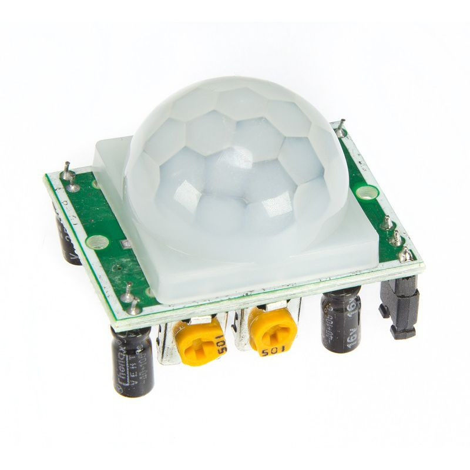
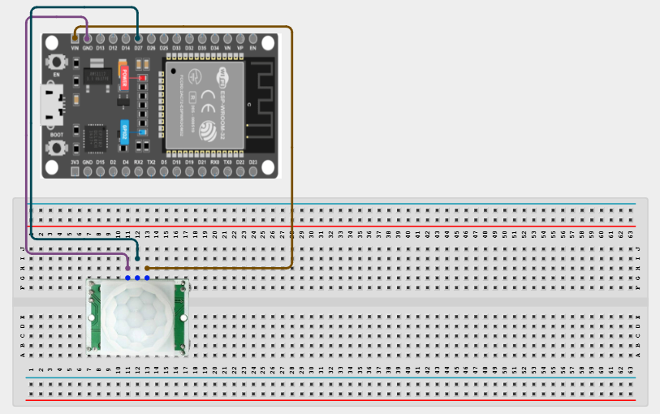
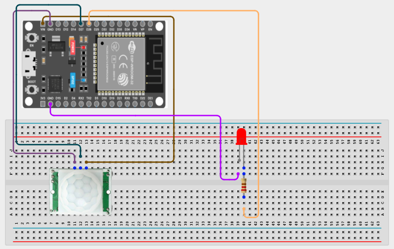

# 4.1.12. Motion-Activated LED Indicator

| **Description** | In Project 67, learners will build a motion-activated LED indicator using a PIR motion sensor and an LED connected to an ESP32 GPIO through a current-limiting resistor. |
|------------------|----------------------------------------------------------------|
| **Use case**     | This project demonstrates motion sensing and visual indication for entry alerts, occupancy signaling, and simple automation prototypes. |

## Components (Things You will need)

|  |  |  |  |  |  |  |
| --- | --- | --- | --- | --- | --- | ---|

## Building the circuit

> **Tip:** Use the [ESP32 Pin Mapping](../../assets/esp32_pin_mapping.png) image to locate the correct GPIO pins on your ESP32 board.


Things Needed:

- ESP32 board Core Board = 1

- PIR Motion Sensor = 1

- LED = 1

- 220 ohm resistor = 1

- USB Cable & Jumper Wires = 1

- Bread Board
## Wiring the circuit

**Step 1:** Connect the PIR motion sensor:

- Connect **VCC** to **5V**
- Connect **GND** to common **GND**
- Connect **OUT** to **GPIO 27**.



**Step 2:** Connect the LED indicator:

- Connect **GPIO 26** to a **220 ohm** resistor.
- Connect the resistor to the LED anode (long leg).
- Connect the LED cathode (short leg/flat side) to common **GND**.




## PROGRAMMING

**Step 1:** Open your Arduino IDE. See how to set up here: [Getting Started](../../Getting Started/Arduino_IDE_Setup.md).

**Step 2:** Enter and upload this complete program. It turns the LED on while the PIR sensor detects motion and turns it off otherwise.

```cpp
// Project 67: Motion-Activated LED Indicator
const int pirPin = 27;
const int ledPin = 26;
bool previousMotionState = false;

void setup() {
  Serial.begin(9600);
  pinMode(pirPin, INPUT);
  pinMode(ledPin, OUTPUT);
  digitalWrite(ledPin, LOW);
  Serial.println("Project 67: Motion-Activated LED Indicator ready.");
}

void loop() {
  bool motionDetected = digitalRead(pirPin) == HIGH;
  digitalWrite(ledPin, motionDetected ? HIGH : LOW);

  if (motionDetected != previousMotionState) {
    Serial.println(motionDetected ? "Motion detected: LED ON" : "No motion: LED OFF");
    previousMotionState = motionDetected;
  }

  delay(50);
}
```

**Step 3:** Save your code. _See the [Getting Started](../../Getting Started/Arduino_IDE_Setup.md) section._

**Step 4:** Select the ESP32 board and port. See [Selecting ESP32 board Type and Uploading your code](../../Getting Started/Arduino_IDE_Setup.md).

**Step 5:** Upload your code. See [Selecting ESP32 board Type and Uploading your code](../../Getting Started/Arduino_IDE_Setup.md).

## CONCLUSION

The system responds dynamically when physical conditions cross pre-programmed setpoints, driving output devices reliably.