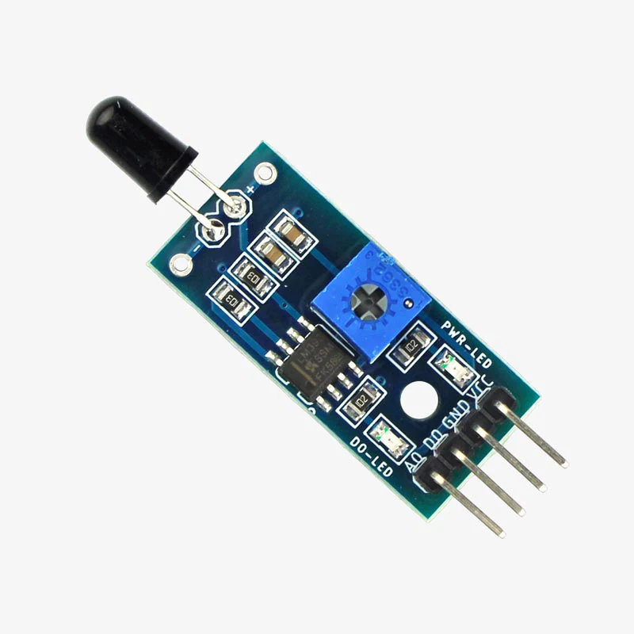
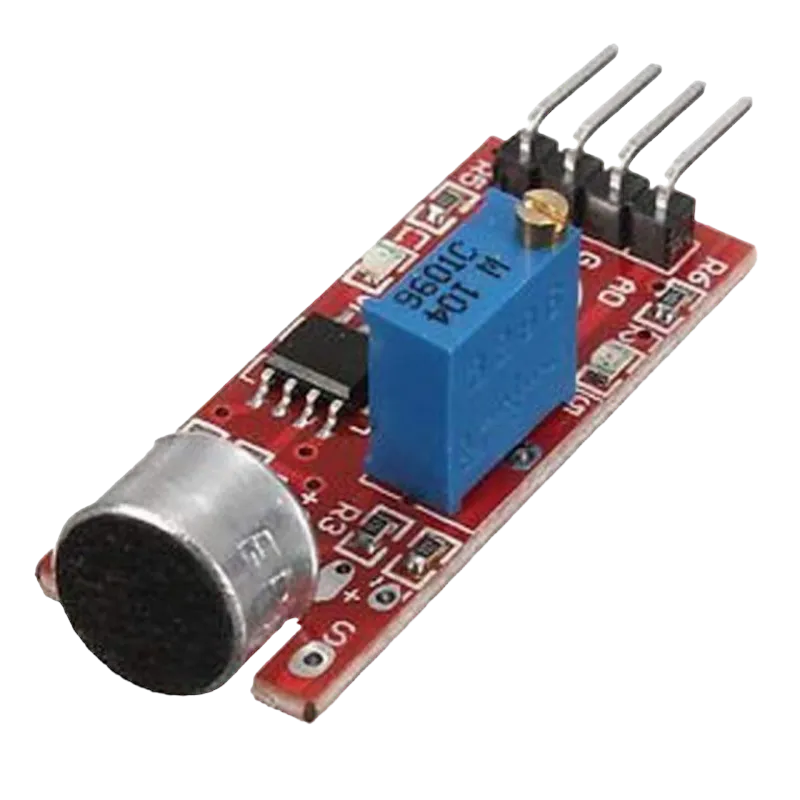
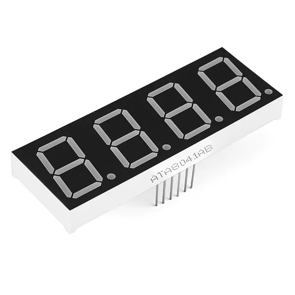
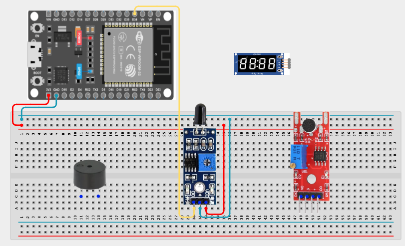
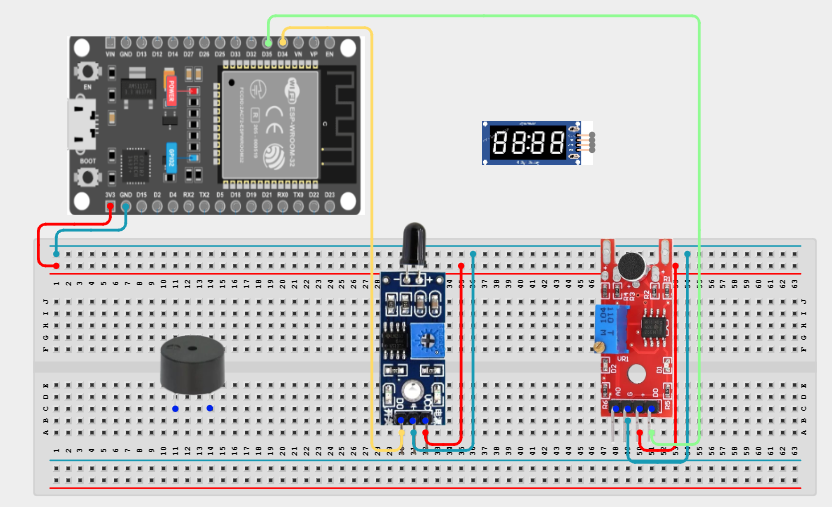
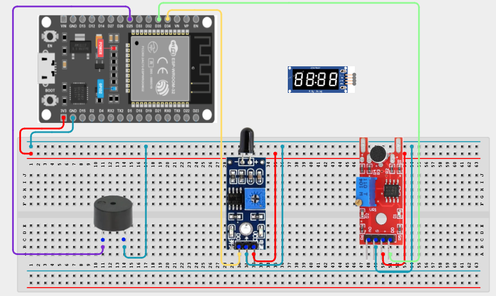
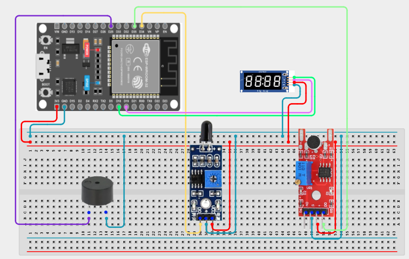

# 4.1.13. Multi Stage Gas  Flame Guardian

| **Description** | In Project 68, learners will engineer an advanced 'Multi-Stage Gas & Flame Guardian' multi-component system. This design integrates Flame Sensor + Sound Sensor + Buzzer + 4-Digit TM1637 Display into a cohesive industrial automation unit. |
|------------------|----------------------------------------------------------------|
| **Use case**     |This project can be applied to real-world IoT, safety, and control systems while developing essential master-level engineering skills.|

## Components (Things You will need)

|  |  |  |  |  |  |  |  |
| --- | --- | --- | --- | --- | --- | --- | --- |

## Building the circuit

> **Tip:** Use the [ESP32 Pin Mapping](../../assets/esp32_pin_mapping.png) image to locate the correct GPIO pins on your ESP32 board.


Things Needed:

- ESP32 board Core Board = 1

- Flame Sensor = 1

- Sound Sensor = 1

- Buzzer = 1

- USB Cable & Jumper Wires = 1

- Bread Board

- 4-Digit Display


## Wiring the circuit

**Step 1:** Connect the Flame sensor:

- Connect **DO** to **GPIO 34**
- Connect **VCC** to **3.3V**
- Connect **GND** to common **GND**.



**Step 2:** Connect the Sound sensor:

- Connect digital **DO** to **GPIO 35**
- Connect **VCC** to **3.3V**
- Connect **GND** to common **GND**.



**Step 3:** Connect the Active buzzer:

- Connect **signal/+** to **GPIO 25**.
- Connect **GND/-** to common **GND**.



**Step 4:** Connect the TM1637 4-digit display:

- Connect **CLK** to **GPIO 18**
- Connect **DIO** to **GPIO 19**
- Connect **VCC** to **3.3V** if supported
- Connect **GND** to common **GND**. 




## PROGRAMMING

**Step 1:** Open your Arduino IDE. See how to set up here: [Getting Started](../../Getting Started/Arduino_IDE_Setup.md).

**Step 2:** Install the **TM1637Display** library from Arduino IDE Library Manager, then enter and upload this complete program.

```cpp
#include <TM1637Display.h>

// Project 68: Multi-Stage Gas & Flame Guardian
const int flamePin = 34;
const int soundPin = 35;
const int buzzerPin = 25;
const int displayClockPin = 18;
const int displayDataPin = 19;
const int flameActiveLevel = LOW; // Change to HIGH for an active-high sensor output.
const int soundActiveLevel = LOW; // Change to HIGH if the sound module is active-high.

TM1637Display display(displayClockPin, displayDataPin);

void setup() {
  Serial.begin(9600);
  pinMode(flamePin, INPUT);
  pinMode(soundPin, INPUT);
  pinMode(buzzerPin, OUTPUT);
  digitalWrite(buzzerPin, LOW);
  display.setBrightness(0x07);
  display.clear();
  Serial.println("Project 68: Multi-Stage Gas & Flame Guardian Initialized...");
}

void loop() {
  const bool flameDetected = digitalRead(flamePin) == flameActiveLevel;
  const bool loudSoundDetected = digitalRead(soundPin) == soundActiveLevel;
  const int alertStage = flameDetected ? (loudSoundDetected ? 3 : 2)
                                       : (loudSoundDetected ? 1 : 0);

  digitalWrite(buzzerPin, alertStage > 0 ? HIGH : LOW);
  display.showNumberDec(alertStage, false);

  Serial.print("Flame: ");
  Serial.print(flameDetected ? "YES" : "no");
  Serial.print(" | Loud sound: ");
  Serial.print(loudSoundDetected ? "YES" : "no");
  Serial.print(" | Alert stage: ");
  Serial.println(alertStage);
  delay(100);
}
```

**Step 3:** Save your code. _See the [Getting Started](../../Getting Started/Arduino_IDE_Setup.md) section._

**Step 4:** Select the ESP32 board and port. See the [Getting Started](../../Getting Started/Arduino_IDE_Setup.md) section.

**Step 5:** Upload your code. See the [Getting Started](../../Getting Started/Arduino_IDE_Setup.md) section.

## CONCLUSION

The system responds dynamically when physical conditions cross pre-programmed setpoints, driving output devices reliably.