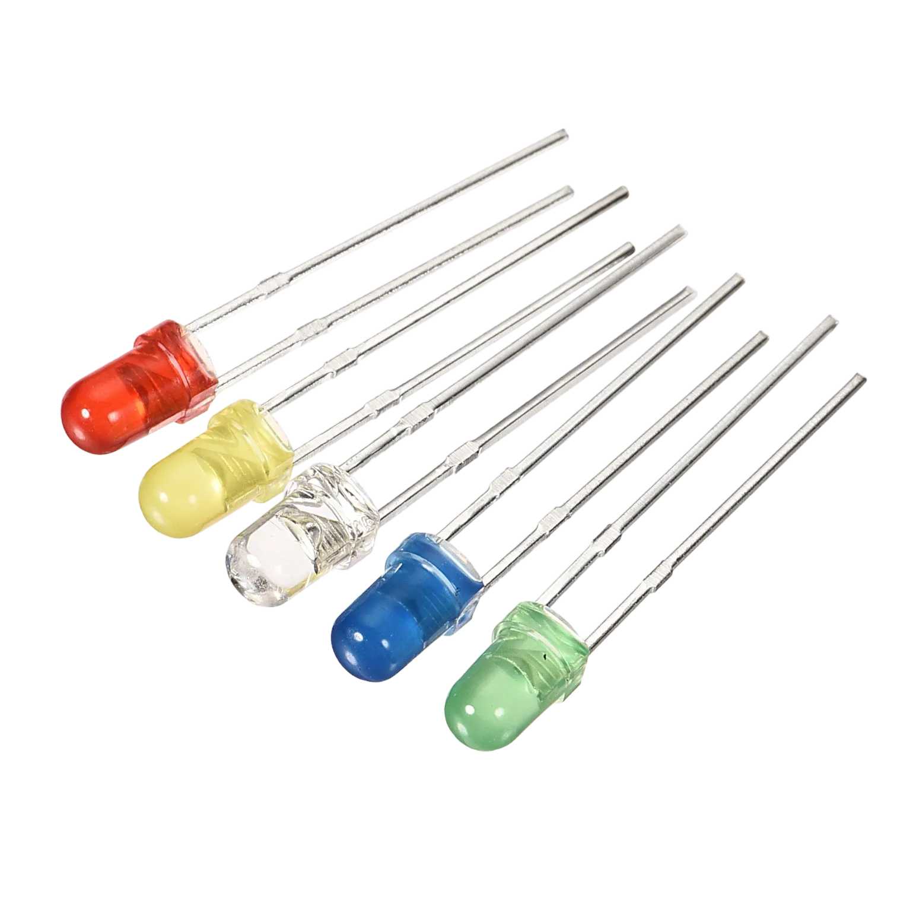
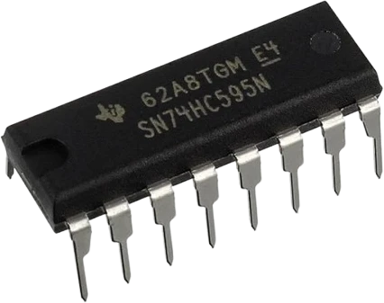
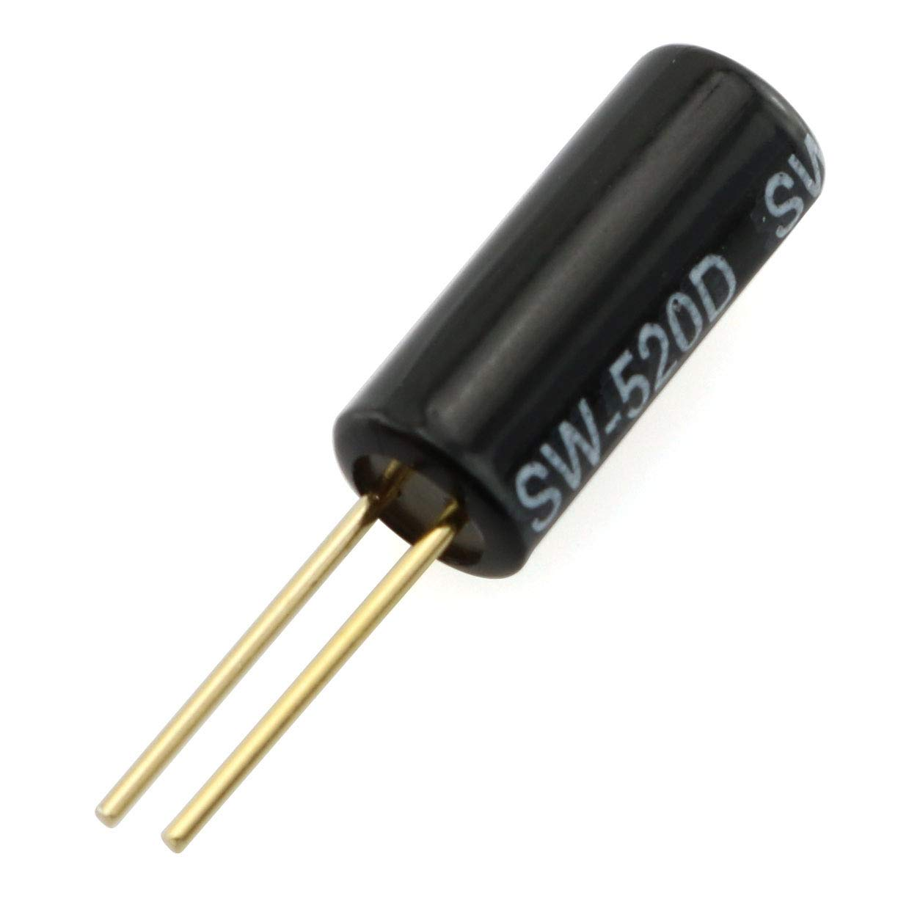
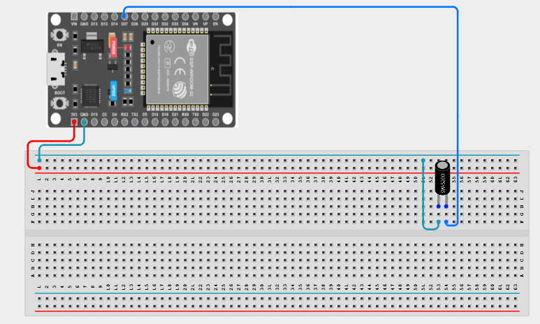
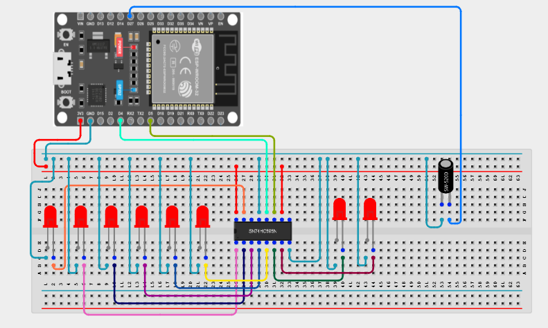
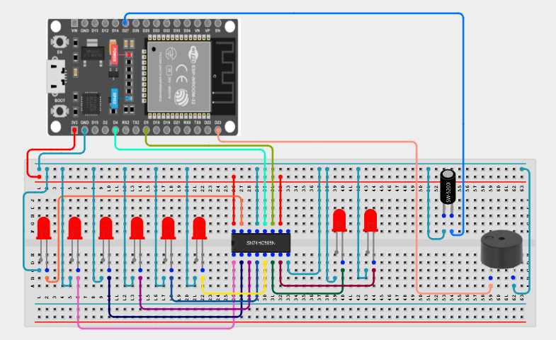

# 4.1.14. Industrial Tilt  Shock Alarm

| **Description** | In Project 69, learners will engineer an advanced 'Industrial Tilt & Shock Alarm' multi-component system. This design integrates Ball Switch + Active Buzzer + 74HC595 Shift Register + 8 LEDs into a cohesive industrial automation unit. |
|------------------|----------------------------------------------------------------|
| **Use case**     |This project can be applied to real-world IoT, safety, and control systems while developing essential master-level engineering skills.|

## Components (Things You will need)

|  |  |  |  |  |  |  |  |  
| --- | --- | --- | --- | --- | --- | --- | --- |

## Building the circuit

> **Tip:** Use the [ESP32 Pin Mapping](../../assets/esp32_pin_mapping.png) image to locate the correct GPIO pins on your ESP32 board.


Things Needed:

- ESP32 board Core Board = 1

- Ball Switch = 1

- Active Buzzer = 1

- 74HC595 Shift Register = 1

- USB Cable & Jumper Wires = 1

- Bread Board

- 8 LEDs = 8


## Wiring the circuit

**Step 1:** Connect the Ball switch:

- Connect one switch terminal to **GPIO 27**.
- Connect the other switch terminal to **GND**. Configure GPIO 27 as `INPUT_PULLUP`.



**Step 2:** Connect the 74HC595 and eight LEDs:

- Connect **DS** to **GPIO 2**
- Connect **ST_CP/latch** to **GPIO 4**
- Connect **SH_CP/clock** to **GPIO 5**.
- Connect **VCC** to **3.3V**
- Connect **GND** to **GND**
- Connect **MR/SRCLR** to **3.3V**
- Connect **OE** to **GND**.
- Connect **Q0** to an LED anode.
- Connect **Q1** to an LED anode.
- Connect **Q2** to an LED anode.
- Connect **Q3** to an LED anode.
- Connect **Q4** to an LED anode.
- Connect **Q5** to an LED anode.
- Connect **Q6** to an LED anode.
- Connect **Q7** to an LED anode.
- Connect each LED cathode to **GND**.



**Step 3:** Connect the Active buzzer:

- Connect **signal/+** to **GPIO 23**.
- Connect **GND/-** to common **GND**.




## PROGRAMMING

**Step 1:** Open your Arduino IDE. See how to set up here: [Getting Started](../../Getting Started/Arduino_IDE_Setup.md).

**Step 2:** Write the complete program implementing the system logic with appropriate pin definitions, setup configuration, and the main control loop.

```cpp
#include <Arduino.h>

// Project 69: Industrial Tilt & Shock Alarm
const int switchPin = 27;
const int dataPin = 2;
const int latchPin = 4;
const int clockPin = 5;
const int buzzerPin = 23;

bool previousTiltState = false;

void writeLedPattern(byte pattern) {
  digitalWrite(latchPin, LOW);
  shiftOut(dataPin, clockPin, MSBFIRST, pattern);
  digitalWrite(latchPin, HIGH);
}

void setup() {
  Serial.begin(9600);
  pinMode(switchPin, INPUT_PULLUP);
  pinMode(dataPin, OUTPUT);
  pinMode(latchPin, OUTPUT);
  pinMode(clockPin, OUTPUT);
  pinMode(buzzerPin, OUTPUT);
  digitalWrite(buzzerPin, LOW);
  writeLedPattern(0);
  Serial.println("Project 69: Industrial Tilt & Shock Alarm Initialized...");
}

void loop() {
  const bool tiltDetected = digitalRead(switchPin) == LOW;
  digitalWrite(buzzerPin, tiltDetected ? HIGH : LOW);

  if (tiltDetected) {
    const byte pattern = (millis() / 150) % 2 == 0 ? 0xAA : 0x55;
    writeLedPattern(pattern);
  } else {
    writeLedPattern(0);
  }

  if (tiltDetected != previousTiltState) {
    Serial.println(tiltDetected ? "Tilt detected: alarm active"
                                : "Level restored: alarm cleared");
    previousTiltState = tiltDetected;
  }
  delay(20);
}
```

**Step 3:** Save your code. _See the [Getting Started](../../Getting Started/Arduino_IDE_Setup.md) section._

**Step 4:** Select the ESP32 board and port. See the [Getting Started](../../Getting Started/Arduino_IDE_Setup.md) section.

**Step 5:** Upload your code. See the [Getting Started](../../Getting Started/Arduino_IDE_Setup.md) section.

## CONCLUSION

The system responds dynamically when physical conditions cross pre-programmed setpoints, driving output devices reliably.
