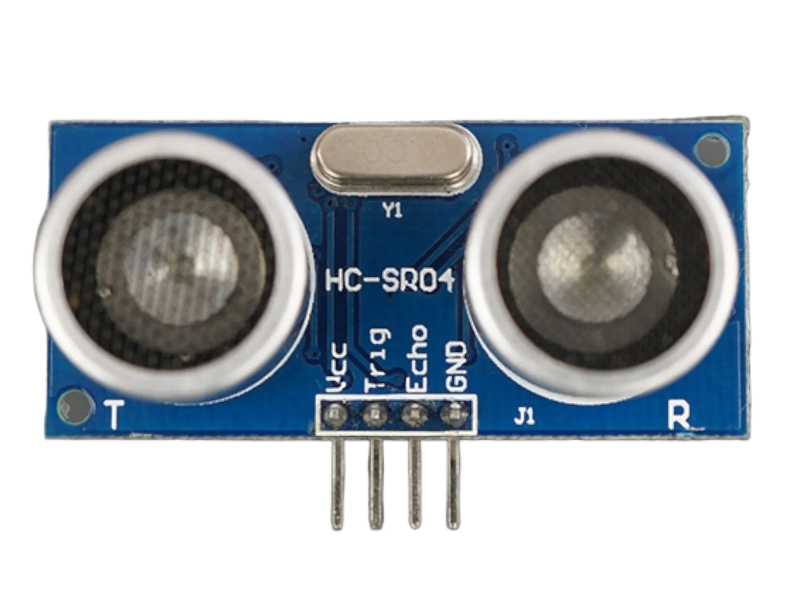
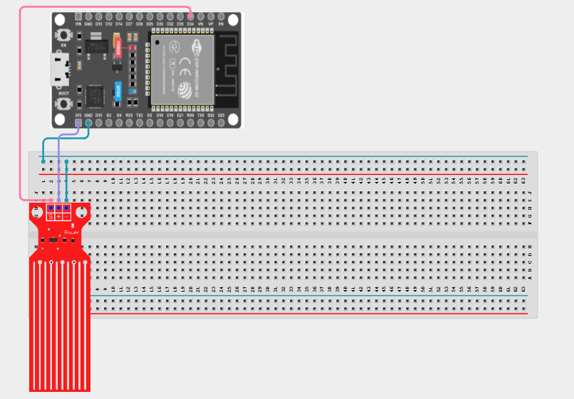
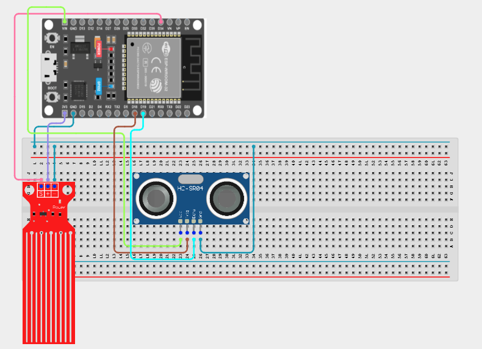
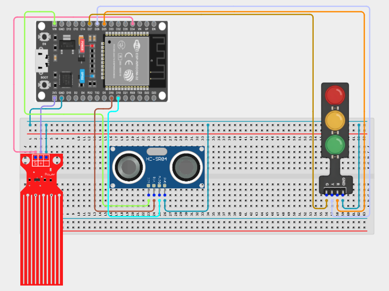
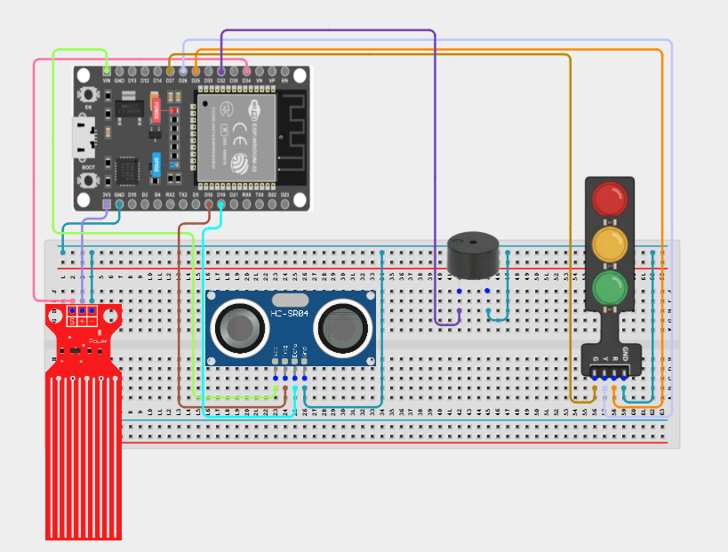

# 4.1.16. Smart Water Tank Overfill Alarm

| **Description** | In Project 71, learners will engineer an advanced 'Smart Water Tank Overfill Alarm' multi-component system. This design integrates Water Test Module + HC-SR04 Ultrasonic + Buzzer + Traffic Light Module into a cohesive industrial automation unit. |
|------------------|----------------------------------------------------------------|
| **Use case**     |This project can be applied to real-world IoT, safety, and control systems while developing essential master-level engineering skills.|

## Components (Things You will need)

|  |  |  |  |  |  |  |  |  
| --- | --- | --- | --- | --- | --- | --- | --- |

## Building the circuit

> **Tip:** Use the [ESP32 Pin Mapping](../../assets/esp32_pin_mapping.png) image to locate the correct GPIO pins on your ESP32 board.


Things Needed:

- ESP32 board Core Board = 1

- Water Test Module = 1

- HC-SR04 Ultrasonic = 1

- Buzzer = 1

- USB Cable & Jumper Wires = 1

- Bread Board

- Traffic Light Module

- Resistors = 1 x 1 kohm and 1 x 2 kohm (HC-SR04 Echo divider)
## Wiring the circuit

**Step 1:** Connect the Water test module:

- Connect **AO** to **GPIO 34**
- Connect **VCC** to **3.3V**
- Connect **GND** to common **GND**.



**Step 2:** Connect the HC-SR04 ultrasonic sensor:

- Connect **VCC** to **5V/VIN**
- Connect **GND** to **GND**
- Connect **TRIG** to **GPIO 18**.
- Connect sensor **ECHO** to **GPIO 19**.




**Step 3:** Connect the Traffic light module:

- Connect **R** to **GPIO 25**
- Connect **Y** to **GPIO 26**
- Connect **G** to **GPIO 27**
- Connect **GND** to common **GND**.




**Step 4:** Connect the Active buzzer:

- Connect **signal/+** to **GPIO 32**.
- Connect **GND/-** to common **GND**.




## PROGRAMMING

**Step 1:** Open your Arduino IDE. See how to set up here: [Getting Started](../../Getting Started/Arduino_IDE_Setup.md).

**Step 2:** Write the complete program implementing the system logic with appropriate pin definitions, setup configuration, and the main control loop.

```cpp
// Project 71: Smart Water Tank Overfill Alarm
const int waterPin = 34;
const int trigPin = 18;
const int echoPin = 19;
const int redPin = 25;
const int yellowPin = 26;
const int greenPin = 27;
const int buzzerPin = 32;
const int waterWarningThreshold = 1800;  // Calibrate for the water module.
const int waterOverflowThreshold = 2600; // Calibrate for the water module.
const float warningDistanceCm = 25.0;
const float overflowDistanceCm = 10.0;

float readDistanceCm() {
  digitalWrite(trigPin, LOW);
  delayMicroseconds(2);
  digitalWrite(trigPin, HIGH);
  delayMicroseconds(10);
  digitalWrite(trigPin, LOW);

  const unsigned long duration = pulseIn(echoPin, HIGH, 30000);
  if (duration == 0) return -1.0;
  return duration * 0.0343 / 2.0;
}

void setup() {
  Serial.begin(9600);
  pinMode(trigPin, OUTPUT);
  pinMode(echoPin, INPUT);
  pinMode(redPin, OUTPUT);
  pinMode(yellowPin, OUTPUT);
  pinMode(greenPin, OUTPUT);
  pinMode(buzzerPin, OUTPUT);
  digitalWrite(trigPin, LOW);
  digitalWrite(buzzerPin, LOW);
  Serial.println("Project 71: Smart Water Tank Overfill Alarm Initialized...");
}

void loop() {
  const int waterValue = analogRead(waterPin);
  const float distanceCm = readDistanceCm();
  const bool overflow = waterValue >= waterOverflowThreshold ||
                        (distanceCm >= 0 && distanceCm <= overflowDistanceCm);
  const bool warning = overflow || waterValue >= waterWarningThreshold ||
                       (distanceCm >= 0 && distanceCm <= warningDistanceCm);

  digitalWrite(redPin, overflow ? HIGH : LOW);
  digitalWrite(yellowPin, warning && !overflow ? HIGH : LOW);
  digitalWrite(greenPin, warning ? LOW : HIGH);
  digitalWrite(buzzerPin, overflow ? HIGH : LOW);

  Serial.print("Water reading: ");
  Serial.print(waterValue);
  Serial.print(" | Distance: ");
  if (distanceCm < 0) Serial.print("no echo");
  else {
    Serial.print(distanceCm, 1);
    Serial.print(" cm");
  }
  Serial.print(" | Status: ");
  Serial.println(overflow ? "OVERFLOW" : warning ? "WARNING" : "NORMAL");
  delay(300);
}
```

**Step 3:** Save your code. _See the [Getting Started](../../Getting Started/Arduino_IDE_Setup.md) section._

**Step 4:** Select the ESP32 board and port. See the [Getting Started](../../Getting Started/Arduino_IDE_Setup.md) section.

**Step 5:** Upload your code. See the [Getting Started](../../Getting Started/Arduino_IDE_Setup.md) section.

## CONCLUSION

The system responds dynamically when physical conditions cross pre-programmed setpoints, driving output devices reliably.
