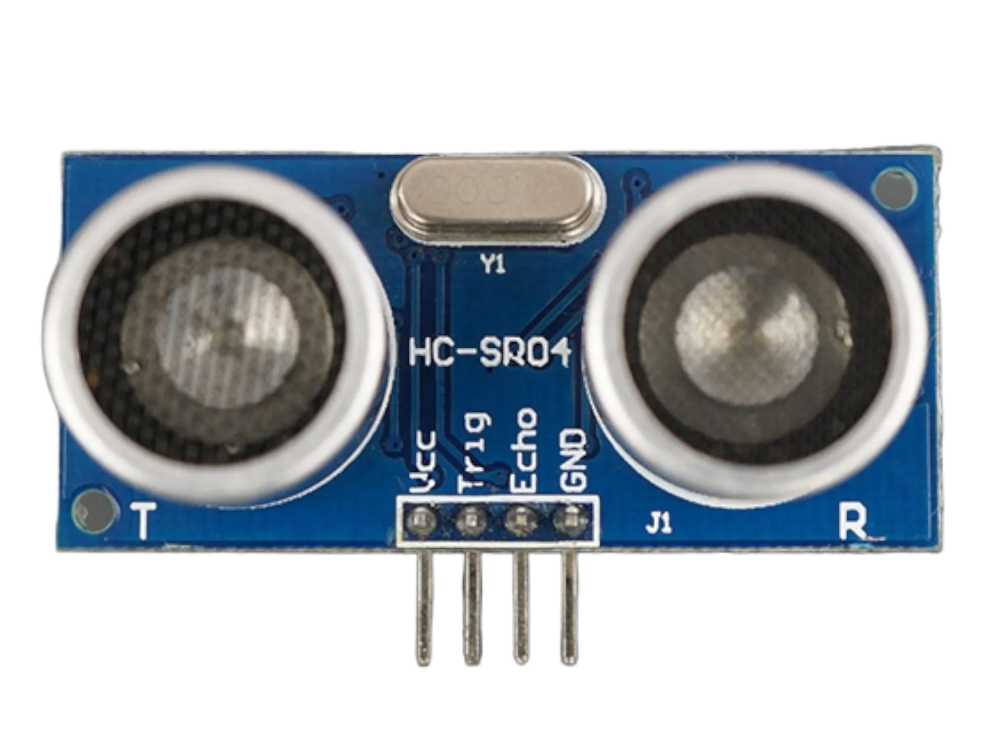
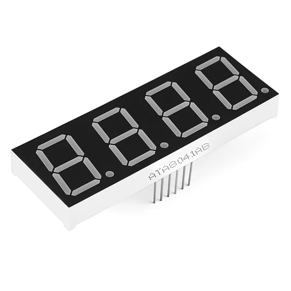
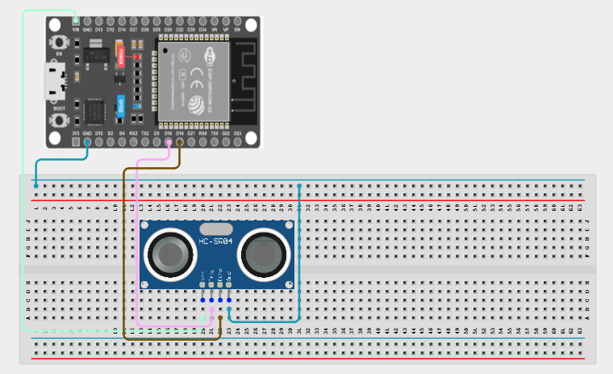
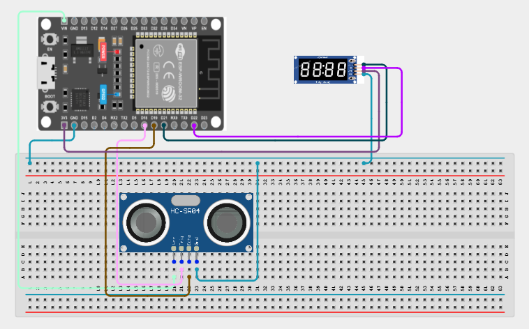
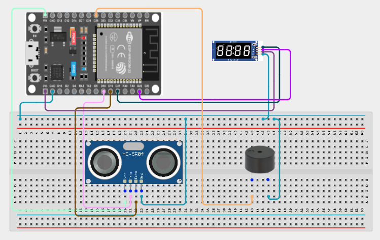

# 4.1.17. Ultrasonic Height  Distance Scale

| **Description** | In Project 72, learners will engineer an advanced 'Ultrasonic Height & Distance Scale' multi-component system. This design integrates HC-SR04 Ultrasonic + TM1637 4-Digit Display + Active Buzzer into a cohesive industrial automation unit. |
|------------------|----------------------------------------------------------------|
| **Use case**     |This project can be applied to real-world IoT, safety, and control systems while developing essential master-level engineering skills.|

## Components (Things You will need)

|  |  |  |  |  |  |  | 
| --- | --- | --- | --- | --- | --- | --- |

## Building the circuit

> **Tip:** Use the [ESP32 Pin Mapping](../../assets/esp32_pin_mapping.png) image to locate the correct GPIO pins on your ESP32 board.


Things Needed:

- ESP32 board Core Board = 1

- HC-SR04 Ultrasonic = 1

- TM1637 4-Digit Display = 1

- Active Buzzer = 1

- USB Cable & Jumper Wires = 1

- Bread Board


## Wiring the circuit

**Step 1:** Connect the HC-SR04 ultrasonic sensor:

- Connect **VCC** to **5V/VIN**
- Connect **GND** to **GND**
- Connect **TRIG** to **GPIO 18**.
- Connect sensor **ECHO** to **GPIO 19**.




**Step 2:** Connect the TM1637 display:

- Connect **CLK** to **GPIO 21**
- Connect **DIO** to **GPIO 22**
- Connect **VCC** to **3.3V** if supported
- Connect **GND** to common **GND**. 



**Step 3:** Connect the Active buzzer:

- Connect **signal/+** to **GPIO 25**.
- Connect **GND/-** to common **GND**.




## PROGRAMMING

**Step 1:** Open your Arduino IDE. See how to set up here: [Getting Started](../../Getting Started/Arduino_IDE_Setup.md).

**Step 2:** Install the **TM1637Display** library from Arduino IDE Library Manager, then enter and upload this complete program.

```cpp
#include <TM1637Display.h>

// Project 72: Ultrasonic Height & Distance Scale
const int trigPin = 18;
const int echoPin = 19;
const int displayClockPin = 21;
const int displayDataPin = 22;
const int buzzerPin = 25;
const float closeDistanceCm = 20.0;

TM1637Display display(displayClockPin, displayDataPin);

float readDistanceCm() {
  digitalWrite(trigPin, LOW);
  delayMicroseconds(2);
  digitalWrite(trigPin, HIGH);
  delayMicroseconds(10);
  digitalWrite(trigPin, LOW);

  const unsigned long duration = pulseIn(echoPin, HIGH, 30000);
  if (duration == 0) return -1.0;
  return duration * 0.0343 / 2.0;
}

void setup() {
  Serial.begin(9600);
  pinMode(trigPin, OUTPUT);
  pinMode(echoPin, INPUT);
  pinMode(buzzerPin, OUTPUT);
  digitalWrite(trigPin, LOW);
  digitalWrite(buzzerPin, LOW);
  display.setBrightness(0x07);
  display.clear();
  Serial.println("Project 72: Ultrasonic Height & Distance Scale Initialized...");
}

void loop() {
  const float distanceCm = readDistanceCm();
  const bool tooClose = distanceCm >= 0 && distanceCm <= closeDistanceCm;
  digitalWrite(buzzerPin, tooClose ? HIGH : LOW);

  if (distanceCm >= 0) {
    const int displayValue = constrain((int)(distanceCm + 0.5), 0, 9999);
    display.showNumberDec(displayValue, false);
    Serial.print("Distance: ");
    Serial.print(distanceCm, 1);
    Serial.println(" cm");
  } else {
    display.clear();
    Serial.println("Distance: no echo");
  }
  delay(100);
}
```

**Step 3:** Save your code. _See the [Getting Started](../../Getting Started/Arduino_IDE_Setup.md) section._

**Step 4:** Select the ESP32 board and port. See the [Getting Started](../../Getting Started/Arduino_IDE_Setup.md) section.

**Step 5:** Upload your code. See the [Getting Started](../../Getting Started/Arduino_IDE_Setup.md) section.

## CONCLUSION

The system responds dynamically when physical conditions cross pre-programmed setpoints, driving output devices reliably.
