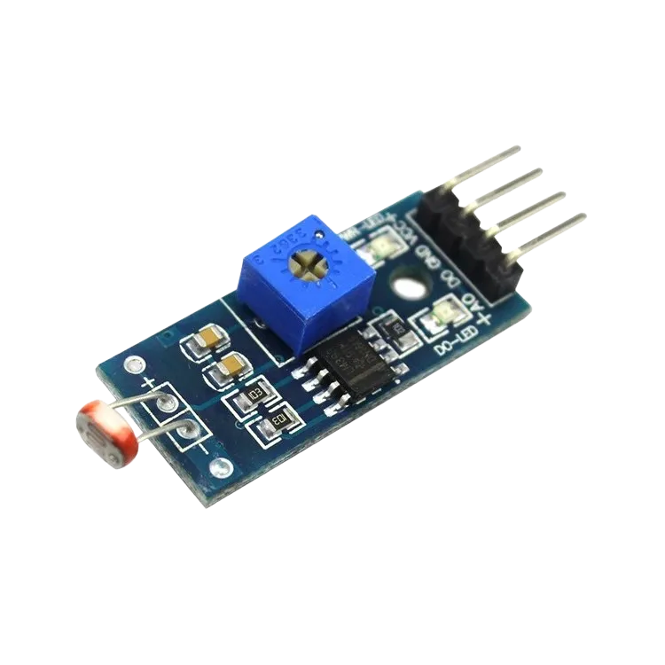
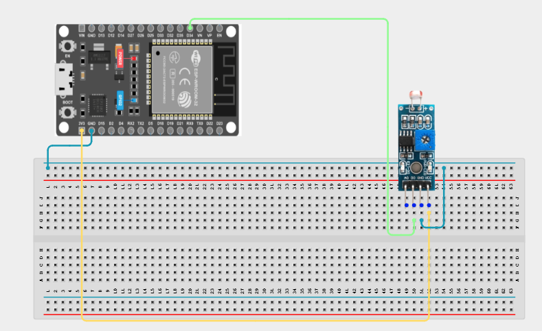
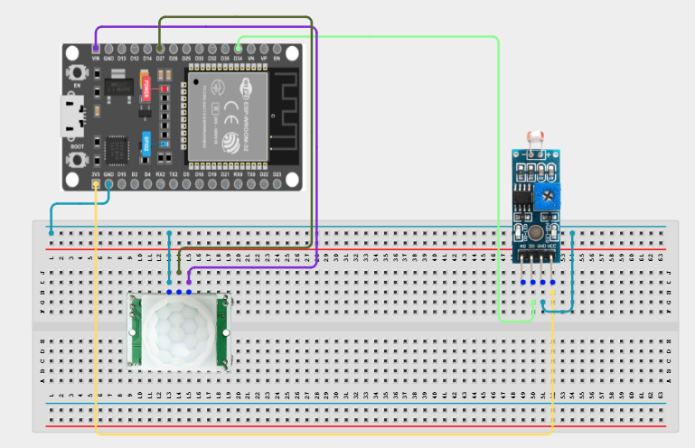
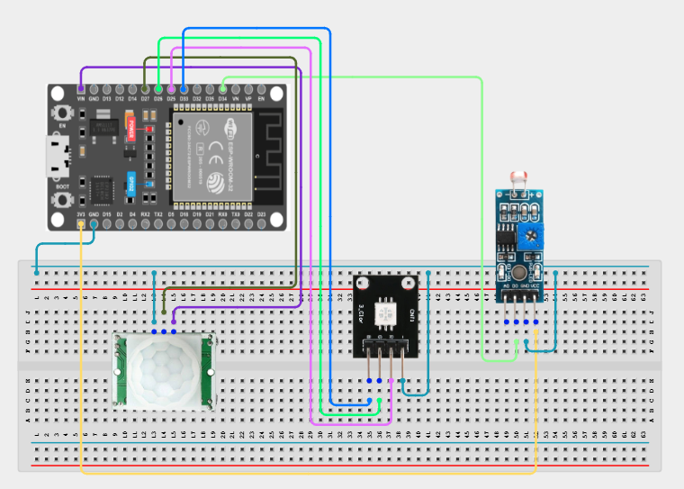

# 4.1.18. Smart Night Light with Motion Override

| **Description** | In Project 73, learners will engineer an advanced 'Smart Night Light with Motion Override' multi-component system. This design integrates Photoresistor LDR + PIR Motion Sensor + RGB LED Module into a cohesive industrial automation unit. |
|------------------|----------------------------------------------------------------|
| **Use case**     |This project can be applied to real-world IoT, safety, and control systems while developing essential master-level engineering skills.|

## Components (Things You will need)

|  |  |  |  |  |   |  |  
| --- | --- | --- | --- | --- | --- | --- |

## Building the circuit

> **Tip:** Use the [ESP32 Pin Mapping](../../assets/esp32_pin_mapping.png) image to locate the correct GPIO pins on your ESP32 board.


Things Needed:

- ESP32 board Core Board = 1

- Photoresistor LDR = 1

- PIR Motion Sensor = 1

- RGB LED Module = 1

- USB Cable & Jumper Wires = 1

- Bread Board


## Wiring the circuit

**Step 1:** Connect the Photoresistor :

- Connect one LDR lead to **3.3V**.
- Connect the other LDR lead to **GPIO 34**.
- Connect **GND** to **GND** on the negative power rail.



**Step 2:** Connect the PIR motion sensor:

- Connect **VCC** to **5V**
- Connect **GND** to common **GND**
- Connect **OUT** to **GPIO 27**.



**Step 3:** Connect the RGB LED module:

- Connect **R** to **GPIO 25**
- Connect **G** to **GPIO 26**
- Connect **B** to **GPIO 33**
- Connect common **GND** to **GND**.




## PROGRAMMING

**Step 1:** Open your Arduino IDE. See how to set up here: [Getting Started](../../Getting Started/Arduino_IDE_Setup.md).

**Step 2:** Write the complete program implementing the system logic with appropriate pin definitions, setup configuration, and the main control loop.

```cpp
// Project 73: Smart Night Light with Motion Override
const int ldrPin = 34;
const int pirPin = 27;
const int redPin = 25;
const int greenPin = 26;
const int bluePin = 33;
const int darkThreshold = 1500; // Calibrate for the installed LDR divider.

void setRgb(bool red, bool green, bool blue) {
  digitalWrite(redPin, red ? HIGH : LOW);
  digitalWrite(greenPin, green ? HIGH : LOW);
  digitalWrite(bluePin, blue ? HIGH : LOW);
}

void setup() {
  Serial.begin(9600);
  pinMode(ldrPin, INPUT);
  pinMode(pirPin, INPUT);
  pinMode(redPin, OUTPUT);
  pinMode(greenPin, OUTPUT);
  pinMode(bluePin, OUTPUT);
  setRgb(false, false, false);
  Serial.println("Project 73: Smart Night Light with Motion Override Initialized...");
}

void loop() {
  const int lightLevel = analogRead(ldrPin);
  const bool motionDetected = digitalRead(pirPin) == HIGH;
  const bool dark = lightLevel < darkThreshold;

  if (!motionDetected) {
    setRgb(false, false, false);
  } else if (dark) {
    setRgb(true, true, true);   // White light in darkness.
  } else {
    setRgb(false, false, true); // Motion override remains visible in daylight.
  }

  Serial.print("Light level: ");
  Serial.print(lightLevel);
  Serial.print(" | Motion: ");
  Serial.print(motionDetected ? "yes" : "no");
  Serial.print(" | Mode: ");
  Serial.println(motionDetected ? (dark ? "night light" : "motion override")
                                : "standby");
  delay(100);
}
```

**Step 3:** Save your code. _See the [Getting Started](../../Getting Started/Arduino_IDE_Setup.md) section._

**Step 4:** Select the ESP32 board and port. See the [Getting Started](../../Getting Started/Arduino_IDE_Setup.md) section.

**Step 5:** Upload your code. See the [Getting Started](../../Getting Started/Arduino_IDE_Setup.md) section.

## CONCLUSION

The system responds dynamically when physical conditions cross pre-programmed setpoints, driving output devices reliably.
