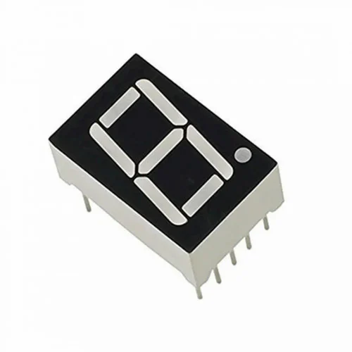
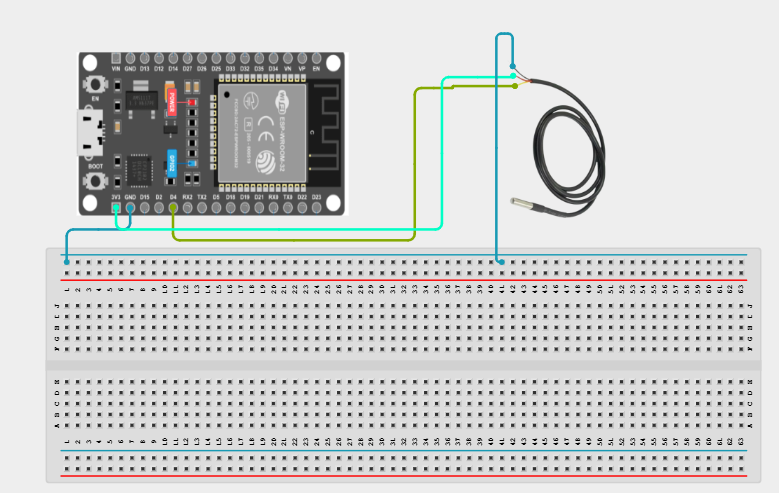
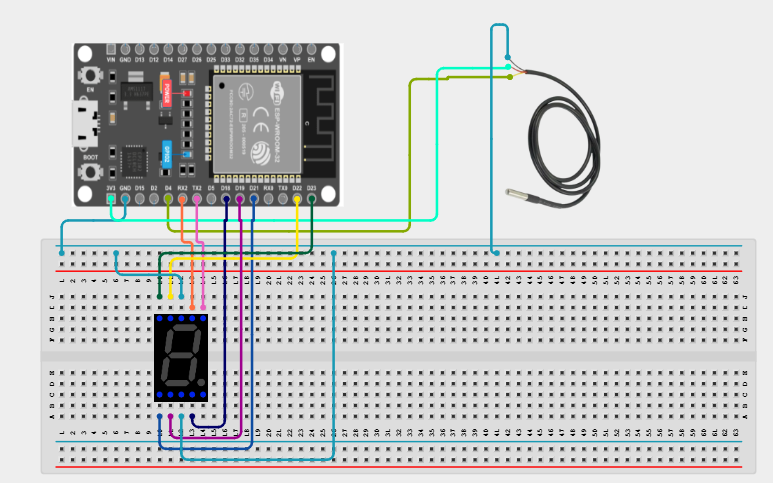
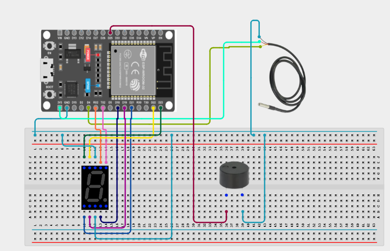

# 4.1.19. High Temperature Industrial Guard

| **Description** | In Project 74, learners will engineer an advanced 'High-Temperature Industrial Guard' multi-component system. This design integrates DS18B20 + Active Buzzer + 1-Digit 7-Segment Display into a cohesive industrial automation unit. |
|------------------|----------------------------------------------------------------|
| **Use case**     |This project can be applied to real-world IoT, safety, and control systems while developing essential master-level engineering skills.|

## Components (Things You will need)

|  |  |  |  |  |  |  |  
| --- | --- | --- | --- | --- | --- | --- |

## Building the circuit

> **Tip:** Use the [ESP32 Pin Mapping](../../assets/esp32_pin_mapping.png) image to locate the correct GPIO pins on your ESP32 board.


Things Needed:

- ESP32 board Core Board = 1

- DS18B20 = 1

- Active Buzzer = 1

- 1-Digit 7-Segment Display = 1

- USB Cable & Jumper Wires = 1

- Bread Board

- Temperature Sensor

## Wiring the circuit

**Step 1:** Connect the DS18B20 temperature sensor:

- Connect **VDD** to **3.3V**
- Connect **GND** to common **GND**
- Connect **DQ** to **GPIO 4**. 



**Step 2:** Connect the Single-digit seven-segment display:

- Connect segment **a** to **GPIO 16**.
- Connect segment **b** to **GPIO 17**.
- Connect segment **c** to **GPIO 18**.
- Connect segment **d** to **GPIO 19**.
- Connect segment **e** to **GPIO 21**.
- Connect segment **f** to **GPIO 22**.
- Connect segment **g** to **GPIO 23**.
- Connect the common-cathode pin to **GND**, or the common-anode pin to **3.3V**.
- Follow the display pinout and use matching logic polarity.



**Step 3:** Connect the Active buzzer:

- Connect **signal/+** to **GPIO 25**.
- Connect **GND/-** to common **GND**.




## PROGRAMMING

**Step 1:** Open your Arduino IDE. See how to set up here: [Getting Started](../../Getting Started/Arduino_IDE_Setup.md).

**Step 2:** Install the **OneWire** and **DallasTemperature** libraries from Arduino IDE Library Manager, then enter and upload this complete program.

```cpp
#include <OneWire.h>
#include <DallasTemperature.h>

// Project 74: High-Temperature Industrial Guard
const int oneWireBus = 4;
const int buzzerPin = 25;
const int segA = 16;
const int segB = 17;
const int segC = 18;
const int segD = 19;
const int segE = 21;
const int segF = 22;
const int segG = 23;
const float alarmTemperatureC = 50.0;
const bool commonAnodeDisplay = false;

OneWire oneWire(oneWireBus);
DallasTemperature temperatureSensor(&oneWire);
const int segmentPins[] = {segA, segB, segC, segD, segE, segF, segG};
const byte digitPatterns[] = {
  0b00111111, 0b00000110, 0b01011011, 0b01001111, 0b01100110,
  0b01101101, 0b01111101, 0b00000111, 0b01111111, 0b01101111
};

void showDigit(int digit) {
  const byte pattern = digitPatterns[digit];
  for (int i = 0; i < 7; ++i) {
    const bool segmentOn = pattern & (1 << i);
    digitalWrite(segmentPins[i],
                 (segmentOn != commonAnodeDisplay) ? HIGH : LOW);
  }
}

void setup() {
  Serial.begin(9600);
  temperatureSensor.begin();
  pinMode(buzzerPin, OUTPUT);
  for (int pin : segmentPins) pinMode(pin, OUTPUT);
  digitalWrite(buzzerPin, LOW);
  showDigit(0);
  Serial.println("Project 74: High-Temperature Industrial Guard Initialized...");
}

void loop() {
  temperatureSensor.requestTemperatures();
  const float temperatureC = temperatureSensor.getTempCByIndex(0);
  const bool sensorValid = temperatureC != DEVICE_DISCONNECTED_C;
  const bool alarm = sensorValid && temperatureC >= alarmTemperatureC;

  if (sensorValid) {
    // The single-digit display shows the tens digit (50 C is displayed as 5).
    const int displayDigit = constrain((int)(temperatureC + 0.5) / 10, 0, 9);
    showDigit(displayDigit);
  } else {
    const int offLevel = commonAnodeDisplay ? HIGH : LOW;
    for (int pin : segmentPins) digitalWrite(pin, offLevel);
  }
  digitalWrite(buzzerPin, alarm ? HIGH : LOW);

  Serial.print("Temperature: ");
  if (sensorValid) {
    Serial.print(temperatureC, 1);
    Serial.println(" C");
  } else {
    Serial.println("sensor error");
  }
  delay(1000);
}
```

**Step 3:** Save your code. _See the [Getting Started](../../Getting Started/Arduino_IDE_Setup.md) section._

**Step 4:** Select the ESP32 board and port. See the [Getting Started](../../Getting Started/Arduino_IDE_Setup.md) section.

**Step 5:** Upload your code. See the [Getting Started](../../Getting Started/Arduino_IDE_Setup.md) section.

## CONCLUSION

The system responds dynamically when physical conditions cross pre-programmed setpoints, driving output devices reliably.
