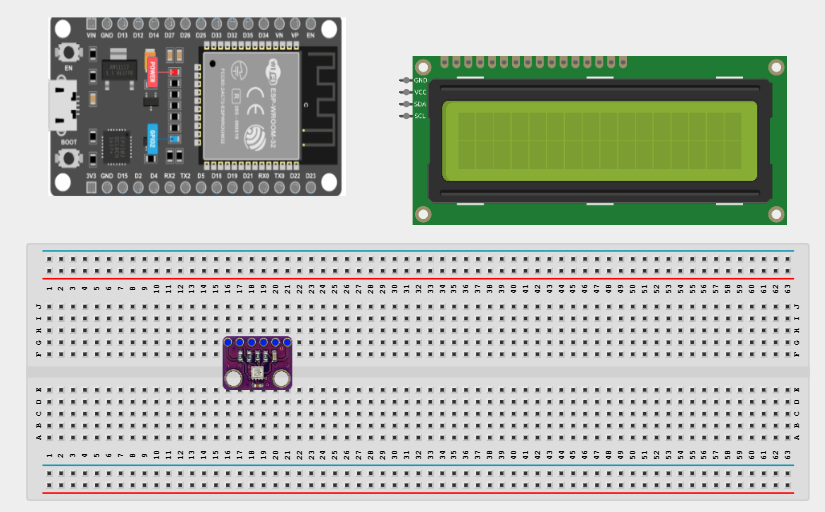
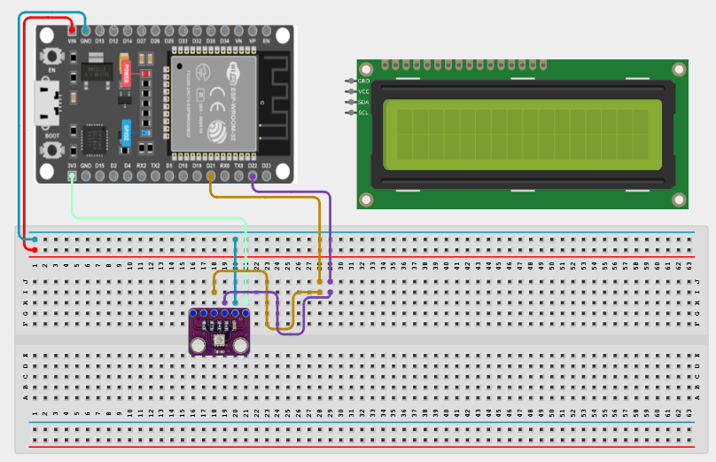
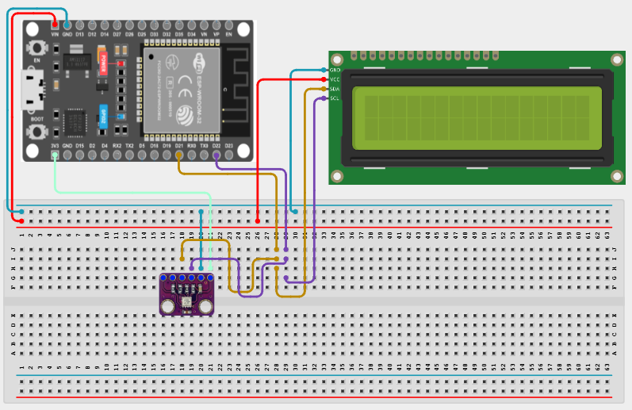

# 4.1.1. BME280 LCD Environmental Monitor

| **Description** | This project teaches multi-device I2C bus sharing, screen layout formatting, and sensor data presentation. These skills are fundamental to weather station displays, HVAC climate controllers, and portable environmental diagnostic tools. |
|------------------|----------------------------------------------------------------|
| **Use case**     | This project connects to real-world industrial and IoT applications such as: weather stations, climate-control systems, and environmental monitoring devices. It demonstrates how multiple sensors and displays can share one communication bus efficiently. |

## Components (Things You will need)

|  |  |  |  |  |  |
| --- | --- | --- | --- | --- | --- |

## Building the circuit

> **Tip:** Use the [ESP32 Pin Mapping](../../assets/esp32_pin_mapping.png) image to locate the correct GPIO pins on your ESP32 board.


Things Needed:

- ESP32 board = 1

- Micro USB cable = 1

- Breadboard = 1

- Jumper Wires

- Bidirectional I²C logic-level shifter = 1 (if the LCD module requires 5V)

- BME Sensor
0
- LCD Display

## Mounting the component on the breadboard

**Step 1:** Place the BME280 sensor, ESP32 board, and I²C LCD display on the breadboard.


## Wiring the circuit

**Step 2:** Connect the BME280 sensor:

- Connect **VCC** to **3.3V** on the ESP32 board.
- Connect **GND** to a GND pin on the ESP32 board.
- Connect **SDA** to **GPIO 21 (SDA)**.
- Connect **SCL** to **GPIO 22 (SCL)**.



**Step 3:** Connect the I²C LCD display:

- Connect **VCC** to **3.3V** if supported; otherwise connect it to **5V** and route **SDA** and **SCL** through a bidirectional I²C logic-level shifter.
- Connect **GND** to a GND pin on the ESP32 board.
- Connect **SDA** to **GPIO 32**.
- Connect **SCL** to **GPIO 33**.




_Make sure to connect the Micro USB cable to the ESP32 board._

## PROGRAMMING

**Step 1:** Open your Arduino IDE. See how to set up here: [Getting Started](../../Getting Started/Arduino_IDE_Setup.md).

**Step 2:** Enter and upload this complete program. It uses separate I²C buses for the BME280 and LCD.

```cpp
// Project 62: BME280 LCD Environmental Monitor
#include <Wire.h>
#include <Adafruit_BME280.h>

Adafruit_BME280 bme;
TwoWire lcdBus(1);
const int lcdSdaPin = 32;
const int lcdSclPin = 33;
const uint8_t lcdAddress = 0x27;
const uint8_t lcdRs = 0x01;
const uint8_t lcdEnable = 0x04;
const uint8_t lcdBacklight = 0x08;

unsigned long lastUpdate = 0;
const long interval = 2000;

void lcdWriteExpander(uint8_t value) {
  lcdBus.beginTransmission(lcdAddress);
  lcdBus.write(value | lcdBacklight);
  lcdBus.endTransmission();
}

void lcdPulseEnable(uint8_t value) {
  lcdWriteExpander(value | lcdEnable);
  delayMicroseconds(1);
  lcdWriteExpander(value & ~lcdEnable);
  delayMicroseconds(50);
}

void lcdWriteNibble(uint8_t value, bool data) {
  const uint8_t output = (value & 0xF0) | (data ? lcdRs : 0);
  lcdWriteExpander(output);
  lcdPulseEnable(output);
}

void lcdSend(uint8_t value, bool data) {
  lcdWriteNibble(value, data);
  lcdWriteNibble(value << 4, data);
}

void lcdCommand(uint8_t command) {
  lcdSend(command, false);
  if (command == 0x01 || command == 0x02) delay(2);
}

void lcdInit() {
  delay(50);
  lcdWriteNibble(0x30, false);
  delay(5);
  lcdWriteNibble(0x30, false);
  delayMicroseconds(150);
  lcdWriteNibble(0x30, false);
  lcdWriteNibble(0x20, false);
  lcdCommand(0x28);
  lcdCommand(0x0C);
  lcdCommand(0x06);
  lcdCommand(0x01);
}

void lcdSetCursor(uint8_t column, uint8_t row) {
  const uint8_t rowOffsets[] = {0x00, 0x40};
  lcdCommand(0x80 | (column + rowOffsets[row % 2]));
}

void lcdPrint(const char *text) {
  while (*text) lcdSend(static_cast<uint8_t>(*text++), true);
}

void setup() {
  Wire.begin(21, 22);
  lcdBus.begin(lcdSdaPin, lcdSclPin, 100000);
  lcdInit();
  lcdSetCursor(0, 0);
  lcdPrint("BME280 Station");
  lcdSetCursor(0, 1);
  lcdPrint("Initializing...");
  delay(1500);

  if (!bme.begin(0x76) && !bme.begin(0x77)) {
    lcdCommand(0x01);
    lcdPrint("BME280 Error!");
    while (1);
  }
  lcdCommand(0x01);
}

void loop() {
  if (millis() - lastUpdate >= interval) {
    lastUpdate = millis();
    float temp = bme.readTemperature();
    float hum = bme.readHumidity();
    float pres = bme.readPressure() / 100.0F;

    char row[17];
    snprintf(row, sizeof(row), "T:%4.1fC H:%2.0f%%", temp, hum);
    lcdSetCursor(0, 0);
    lcdPrint(row);
    snprintf(row, sizeof(row), "P:%6.1f hPa", pres);
    lcdSetCursor(0, 1);
    lcdPrint(row);
  }
}

```

**Step 3:** Save your code. _See the [Getting Started](../../Getting Started/Arduino_IDE_Setup.md) section_

**Step 4:** Select the ESP32 board and port _See the [Getting Started](../../Getting Started/Arduino_IDE_Setup.md) section:Selecting ESP32 board Type and Uploading your code_.

**Step 5:** Upload your code. _See the [Getting Started](../../Getting Started/Arduino_IDE_Setup.md) section:Selecting ESP32 board Type and Uploading your code_

## CONCLUSION

The screen shows initialization text for 1.5 seconds, then presents continuous live temperature, humidity, and atmospheric pressure.