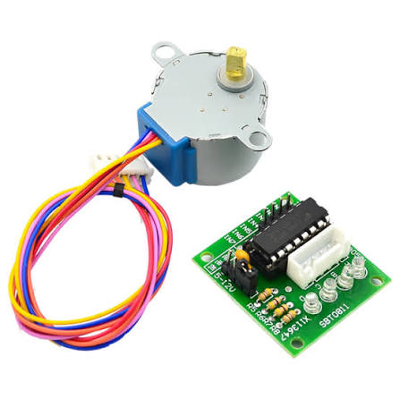
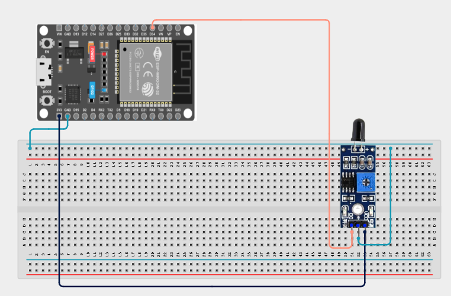
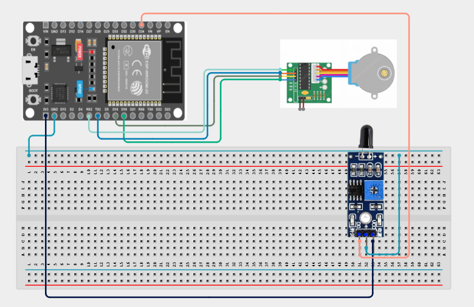
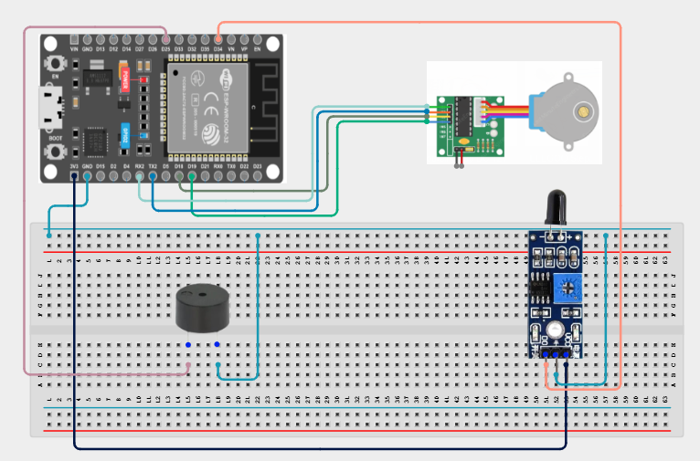

# 4.1.20. Fire  Smoke Evacuation Siren

| **Description** | In Project 75, learners will engineer an advanced 'Fire & Smoke Evacuation Siren' multi-component system. This design integrates Flame Sensor + Active Buzzer + Stepper Motor Valve Indicator into a cohesive industrial automation unit. |
|------------------|----------------------------------------------------------------|
| **Use case**     |This project can be applied to real-world IoT, safety, and control systems while developing essential master-level engineering skills.|

## Components (Things You will need)

|  |  |  |  |  |  |  |
| --- | --- | --- | --- | --- | --- | --- |

## Building the circuit

> **Tip:** Use the [ESP32 Pin Mapping](../../assets/esp32_pin_mapping.png) image to locate the correct GPIO pins on your ESP32 board.


Things Needed:

- ESP32 board Core Board = 1

- Flame Sensor = 1

- Active Buzzer = 1

- Stepper Motor Valve Indicator with Stepper motor driver 

- USB Cable & Jumper Wires = 1

- Bread Board

- Motor-rated external power supply = 1
## Wiring the circuit

**Step 1:** Connect the Flame sensor:

- Connect digital **DO** to **GPIO 34**
- Connect **VCC** to **3.3V**
- Connect **GND** to common **GND**.



**Step 2:** Connect the Stepper motor driver and valve indicator:

- Connect driver **IN1** to **GPIO 16**.
- Connect driver **IN2** to **GPIO 17**.
- Connect driver **IN3** to **GPIO 18**.
- Connect driver **IN4** to **GPIO 19**.




**Step 3:** Connect the Active buzzer:

- Connect **signal/+** to **GPIO 25**.
- Connect **GND/-** to common **GND**.




## PROGRAMMING

**Step 1:** Open your Arduino IDE. See how to set up here: [Getting Started](../../Getting Started/Arduino_IDE_Setup.md).

**Step 2:** Write the complete program implementing the system logic with appropriate pin definitions, setup configuration, and the main control loop.

```cpp
#include <Arduino.h>

// Project 75: Fire & Smoke Evacuation Siren
const int flamePin = 34;
const int motorPins[] = {16, 17, 18, 19};
const int buzzerPin = 25;
const int flameActiveLevel = LOW; // Change to HIGH for an active-high sensor output.
const int valveTravelHalfSteps = 512; // About 90 degrees for a 28BYJ-48.
const byte halfStepPattern[] = {
  0b0001, 0b0011, 0b0010, 0b0110,
  0b0100, 0b1100, 0b1000, 0b1001
};
bool valveOpen = false;

void releaseStepper() {
  for (int pin : motorPins) digitalWrite(pin, LOW);
}

void moveValve(bool open) {
  const int direction = open ? 1 : -1;
  int sequenceIndex = open ? 0 : 7;
  for (int step = 0; step < valveTravelHalfSteps; ++step) {
    const byte pattern = halfStepPattern[sequenceIndex];
    for (int coil = 0; coil < 4; ++coil) {
      digitalWrite(motorPins[coil], (pattern >> coil) & 1);
    }
    sequenceIndex = (sequenceIndex + direction + 8) % 8;
    delay(2);
  }
  releaseStepper();
}

void setup() {
  Serial.begin(9600);
  pinMode(flamePin, INPUT);
  pinMode(buzzerPin, OUTPUT);
  digitalWrite(buzzerPin, LOW);
  for (int pin : motorPins) pinMode(pin, OUTPUT);
  releaseStepper();
  Serial.println("Project 75: Fire & Smoke Evacuation Siren Initialized...");
}

void loop() {
  const bool fireDetected = digitalRead(flamePin) == flameActiveLevel;
  digitalWrite(buzzerPin, fireDetected ? HIGH : LOW);

  if (fireDetected != valveOpen) {
    Serial.println(fireDetected ? "Fire detected: opening valve"
                                : "Fire cleared: returning valve");
    moveValve(fireDetected);
    valveOpen = fireDetected;
  }
  delay(50);
}
```

**Step 3:** Save your code. _See the [Getting Started](../../Getting Started/Arduino_IDE_Setup.md) section._

**Step 4:** Select the ESP32 board and port. See the [Getting Started](../../Getting Started/Arduino_IDE_Setup.md) section.

**Step 5:** Upload your code. See the [Getting Started](../../Getting Started/Arduino_IDE_Setup.md) section.

## CONCLUSION

The system responds dynamically when physical conditions cross pre-programmed setpoints, driving output devices reliably.
