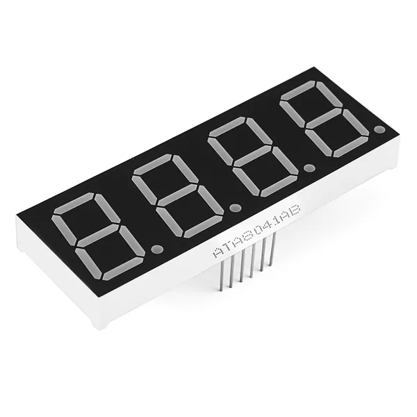
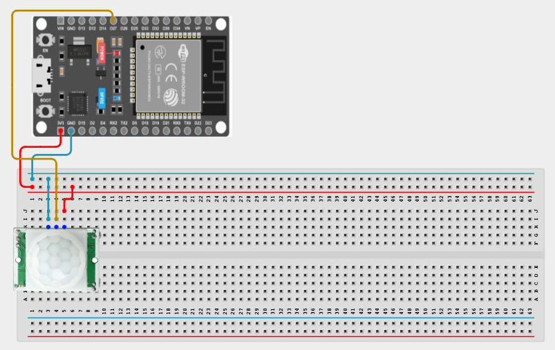
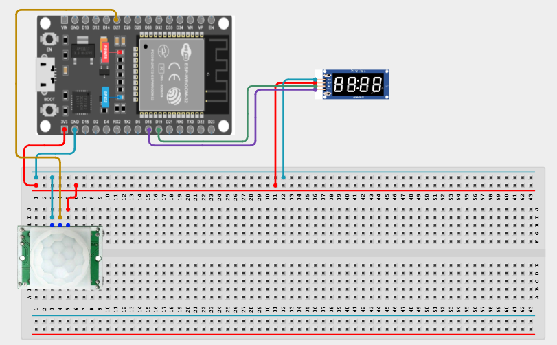
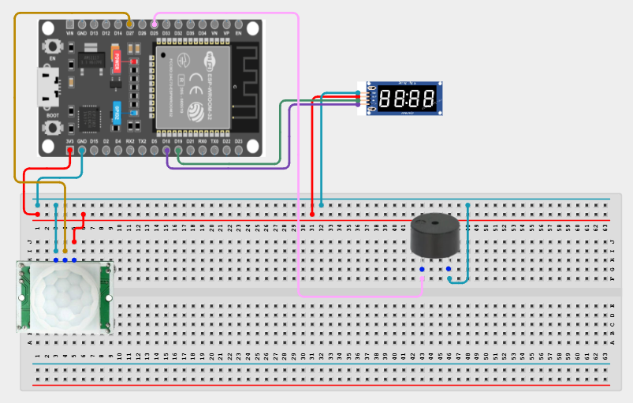

# 4.1.23. Intruder Perimeter Access Counter

| **Description** | In Project 78, learners will engineer an advanced 'Intruder Perimeter Access Counter' multi-component system. This design integrates PIR Motion Sensor + TM1637 4-Digit Display + Active Buzzer into a cohesive industrial automation unit. |
|------------------|----------------------------------------------------------------|
| **Use case**     |This project can be applied to real-world IoT, safety, and control systems while developing essential master-level engineering skills.|

## Components (Things You will need)

|  |  |  |  |  |  |  |
| --- | --- | --- | --- | --- | --- | --- |

## Building the circuit

> **Tip:** Use the [ESP32 Pin Mapping](../../assets/esp32_pin_mapping.png) image to locate the correct GPIO pins on your ESP32 board.


Things Needed:

- ESP32 board Core Board = 1

- PIR Motion Sensor = 1

- TM1637 4-Digit Display = 1

- Active Buzzer = 1

- USB Cable & Jumper Wires = 1

- Bread Board

## Wiring the circuit

**Step 1:** Connect the PIR motion sensor:

- Connect **VCC** to **5V**
- Connect **GND** to common **GND**
- Connect **OUT** to **GPIO 27**.



**Step 2:** Connect the TM1637 display:

- Connect **CLK** to **GPIO 18**
- Connect **DIO** to **GPIO 19**
- Connect **VCC** to **3.3V** if supported
- Connect **GND** to common **GND**. 



**Step 3:** Connect the Active buzzer:

- Connect **signal/+** to **GPIO 25**.
- Connect **GND/-** to common **GND**.




## PROGRAMMING

**Step 1:** Open your Arduino IDE. See how to set up here: [Getting Started](../../Getting Started/Arduino_IDE_Setup.md).

**Step 2:** Install the **TM1637Display** library from Arduino IDE Library Manager, then enter and upload this complete program.

```cpp
#include <TM1637Display.h>

// Project 78: Intruder Perimeter Access Counter
const int pirPin = 27;
const int displayClockPin = 18;
const int displayDataPin = 19;
const int buzzerPin = 25;
unsigned int accessCount = 0;
bool previousMotionState = false;

TM1637Display display(displayClockPin, displayDataPin);

void setup() {
  Serial.begin(9600);
  pinMode(pirPin, INPUT);
  pinMode(buzzerPin, OUTPUT);
  digitalWrite(buzzerPin, LOW);
  display.setBrightness(0x07);
  display.showNumberDec(0, true);
  Serial.println("Project 78: Intruder Perimeter Access Counter Initialized...");
}

void loop() {
  const bool motionDetected = digitalRead(pirPin) == HIGH;
  if (motionDetected && !previousMotionState) {
    accessCount = (accessCount + 1) % 10000;
    display.showNumberDec(accessCount, true);
    digitalWrite(buzzerPin, HIGH);
    Serial.print("Motion event counted. Total: ");
    Serial.println(accessCount);
    delay(100);
    digitalWrite(buzzerPin, LOW);
  }
  previousMotionState = motionDetected;
  delay(20);
}
```

**Step 3:** Save your code. _See the [Getting Started](../../Getting Started/Arduino_IDE_Setup.md) section._

**Step 4:** Select the ESP32 board and port. See the [Getting Started](../../Getting Started/Arduino_IDE_Setup.md) section.

**Step 5:** Upload your code. See the [Getting Started](../../Getting Started/Arduino_IDE_Setup.md) section.

## CONCLUSION

The system responds dynamically when physical conditions cross pre-programmed setpoints, driving output devices reliably.