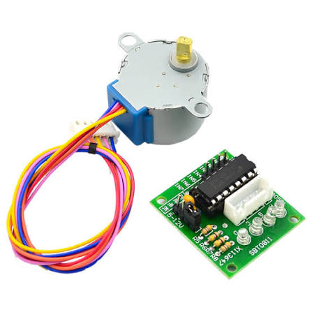
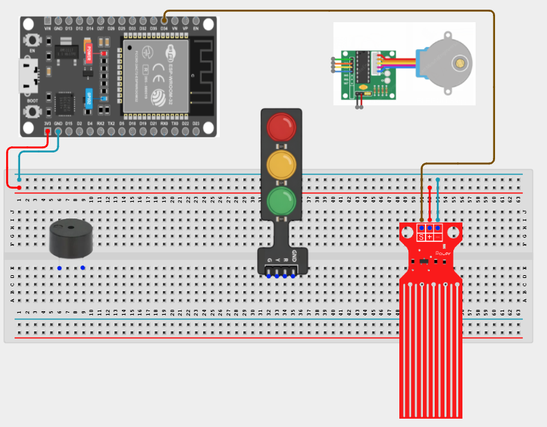
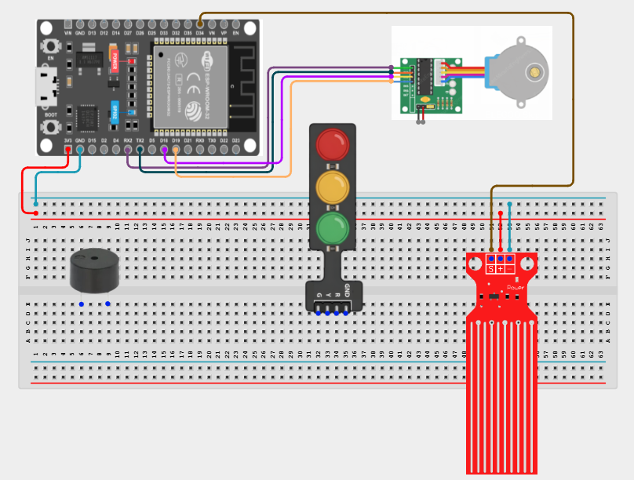
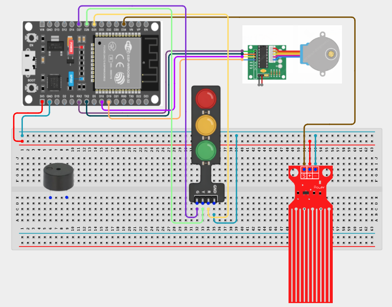
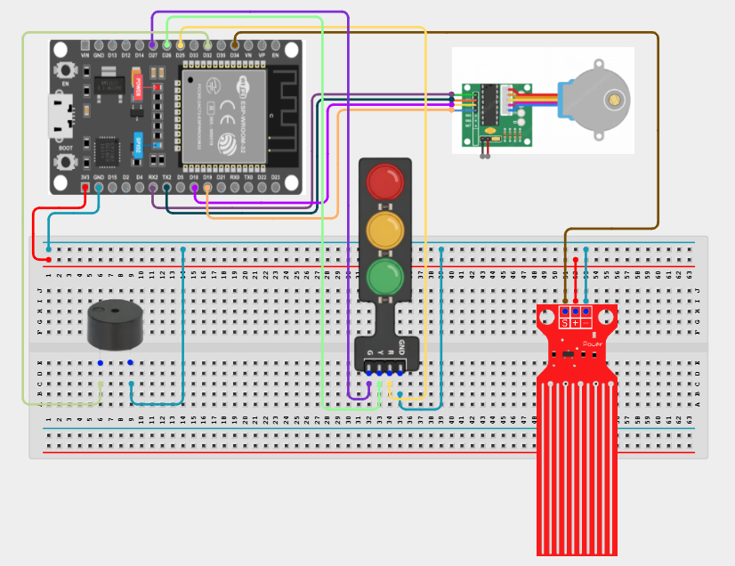

# 4.1.24. Automated Flood Warning Gate

| **Description** | In Project 79, learners will engineer an advanced 'Automated Flood Warning Gate' multi-component system. This design integrates Water Test Module + Stepper Motor Gate + Active Buzzer + Traffic Light Module into a cohesive industrial automation unit. |
|------------------|----------------------------------------------------------------|
| **Use case**     |This project can be applied to real-world IoT, safety, and control systems while developing essential master-level engineering skills.|

## Components (Things You will need)

|  |  |  |  |  |  |  |  |
| --- | --- | --- | --- | --- | --- | --- | --- |

## Building the circuit

> **Tip:** Use the [ESP32 Pin Mapping](../../assets/esp32_pin_mapping.png) image to locate the correct GPIO pins on your ESP32 board.


Things Needed:

- ESP32 board Core Board = 1

- Water Test Module = 1

- Stepper Motor Gate = 1

- Active Buzzer = 1

- USB Cable & Jumper Wires = 1

- Bread Board

- Traffic Light Module

- Stepper motor driver compatible with the supplied motor = 1

- Motor-rated external power supply = 1
## Wiring the circuit

**Step 1:** Connect the Water test module:

- Connect **AO** to **GPIO 34**
- Connect **VCC** to **3.3V**
- Connect **GND** to common **GND**.



**Step 2:** Connect the Stepper motor driver and gate motor:

- Connect driver **IN1** to **GPIO 16**.
- Connect driver **IN2** to **GPIO 17**.
- Connect driver **IN3** to **GPIO 18**.
- Connect driver **IN4** to **GPIO 19**.



**Step 3:** Connect the Traffic light module:

- Connect **R** to **GPIO 25**
- Connect **Y** to **GPIO 26**
- Connect **G** to **GPIO 27**
- Connect **GND** to common **GND**. 



**Step 4:** Connect the Active buzzer:

- Connect **signal/+** to **GPIO 32**.
- Connect **GND/-** to common **GND**.




## PROGRAMMING

**Step 1:** Open your Arduino IDE. See how to set up here: [Getting Started](../../Getting Started/Arduino_IDE_Setup.md).

**Step 2:** Write the complete program implementing the system logic with appropriate pin definitions, setup configuration, and the main control loop.

```cpp
#include <Arduino.h>

// Project 79: Automated Flood Warning Gate
// Target Integration: Water Test Module + Stepper Motor Gate + Active Buzzer + Traffic Light Module
const int waterPin = 34;
const int motorPins[] = {16, 17, 18, 19};
const int redPin = 25;
const int yellowPin = 26;
const int greenPin = 27;
const int buzzerPin = 32;
const int warningLevel = 1800; // Calibrate for the water module.
const int floodLevel = 2600;   // Calibrate for the water module.
const int gateTravelHalfSteps = 512;
const byte halfStepPattern[] = {
  0b0001, 0b0011, 0b0010, 0b0110,
  0b0100, 0b1100, 0b1000, 0b1001
};
bool gateOpen = false;

void releaseStepper() {
  for (int pin : motorPins) digitalWrite(pin, LOW);
}

void moveGate(bool open) {
  const int direction = open ? 1 : -1;
  int sequenceIndex = open ? 0 : 7;
  for (int step = 0; step < gateTravelHalfSteps; ++step) {
    const byte pattern = halfStepPattern[sequenceIndex];
    for (int coil = 0; coil < 4; ++coil) {
      digitalWrite(motorPins[coil], (pattern >> coil) & 1);
    }
    sequenceIndex = (sequenceIndex + direction + 8) % 8;
    delay(2);
  }
  releaseStepper();
}

void setup() {
  Serial.begin(9600);
  pinMode(waterPin, INPUT);
  pinMode(redPin, OUTPUT);
  pinMode(yellowPin, OUTPUT);
  pinMode(greenPin, OUTPUT);
  pinMode(buzzerPin, OUTPUT);
  for (int pin : motorPins) pinMode(pin, OUTPUT);
  digitalWrite(buzzerPin, LOW);
  releaseStepper();
  Serial.println("Project 79: Automated Flood Warning Gate Initialized...");
}

void loop() {
  const int waterValue = analogRead(waterPin);
  const bool flood = waterValue >= floodLevel;
  const bool warning = waterValue >= warningLevel;

  digitalWrite(redPin, flood ? HIGH : LOW);
  digitalWrite(yellowPin, warning && !flood ? HIGH : LOW);
  digitalWrite(greenPin, warning ? LOW : HIGH);
  digitalWrite(buzzerPin, flood ? HIGH : LOW);

  if (flood != gateOpen) {
    Serial.println(flood ? "Flood level reached: opening gate"
                         : "Water level receded: closing gate");
    moveGate(flood);
    gateOpen = flood;
  }
  Serial.print("Water reading: ");
  Serial.print(waterValue);
  Serial.print(" | Status: ");
  Serial.println(flood ? "FLOOD" : warning ? "WARNING" : "NORMAL");
  delay(100);
}
```

**Step 3:** Save your code. _See the [Getting Started](../../Getting Started/Arduino_IDE_Setup.md) section._

**Step 4:** Select the ESP32 board and port. See the [Getting Started](../../Getting Started/Arduino_IDE_Setup.md) section.

**Step 5:** Upload your code. See the [Getting Started](../../Getting Started/Arduino_IDE_Setup.md) section.

## CONCLUSION

The system responds dynamically when physical conditions cross pre-programmed setpoints, driving output devices reliably.
