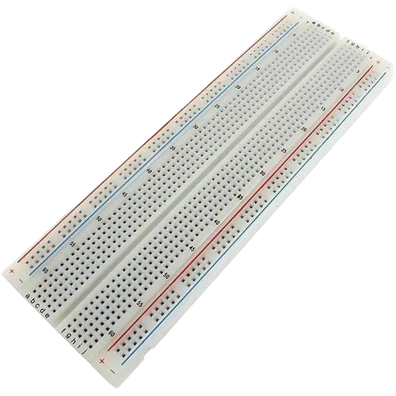
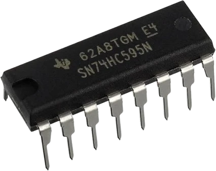
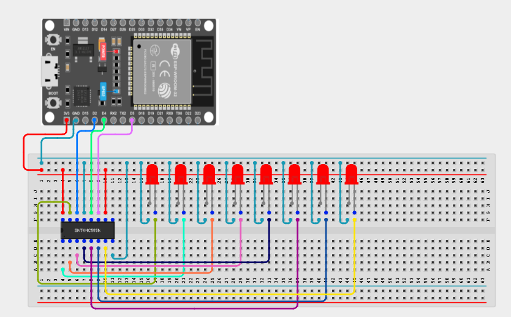
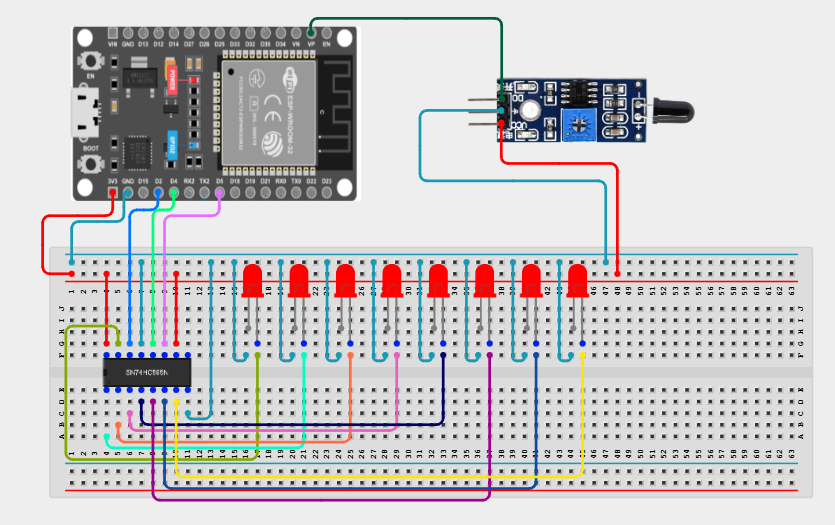
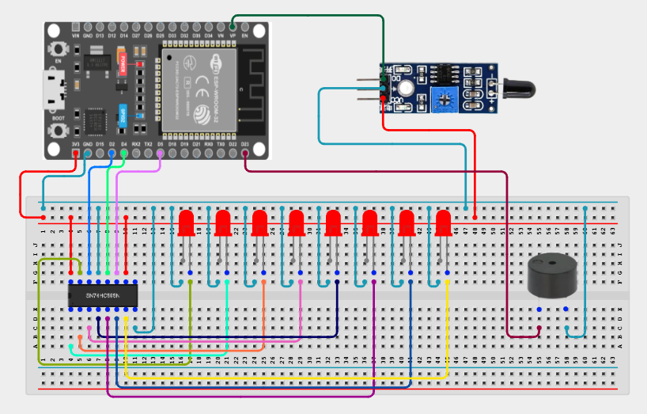

# 4.1.25. Multi Channel LED Safety Array

| **Description** | In Project 80, learners will engineer an advanced 'Multi-Channel LED Safety Array' multi-component system. This design integrates 74HC595 Shift Register + Flame Sensor + Active Buzzer into a cohesive industrial automation unit. |
|------------------|----------------------------------------------------------------|
| **Use case**     |This project can be applied to real-world IoT, safety, and control systems while developing essential master-level engineering skills.|

## Components (Things You will need)

|  |  |  |  |  |  |  |  |  
| --- | --- | --- | --- | --- | --- | --- | --- |

## Building the circuit

> **Tip:** Use the [ESP32 Pin Mapping](../../assets/esp32_pin_mapping.png) image to locate the correct GPIO pins on your ESP32 board.


Things Needed:

- ESP32 board Core Board = 1

- 74HC595 Shift Register = 1

- Flame Sensor = 1

- Active Buzzer = 1

- USB Cable & Jumper Wires = 1

- Bread Board

- 8 LEDs = 8

## Wiring the circuit

**Step 1:** Connect the 74HC595 and eight LEDs:

- Connect **DS** to **GPIO 2**
- Connect **ST_CP/latch** to **GPIO 4**
- Connect **SH_CP/clock** to **GPIO 5**.
- Connect **VCC** to **3.3V**
- Connect **GND** to **GND**
- Connect **MR/SRCLR** to **3.3V**
- Connect **OE** to **GND**.
- Connect **Q0** to an LED anode.
- Connect **Q1** to an LED anode.
- Connect **Q2** to an LED anode.
- Connect **Q3** to an LED anode.
- Connect **Q4** to an LED anode.
- Connect **Q5** to an LED anode.
- Connect **Q6** to an LED anode.
- Connect **Q7** to an LED anode.
- Connect each LED cathode to **GND**.



**Step 2:** Connect the Flame sensor:

- Connect analog **AO** to **GPIO 36**
- Connect **VCC** to **3.3V**
- Connect **GND** to common **GND**.



**Step 3:** Connect the Active buzzer:

- Connect **signal/+** to **GPIO 23**.
- Connect **GND/-** to common **GND**.




## PROGRAMMING

**Step 1:** Open your Arduino IDE. See how to set up here: [Getting Started](../../Getting Started/Arduino_IDE_Setup.md).

**Step 2:** Write the complete program implementing the system logic with appropriate pin definitions, setup configuration, and the main control loop.

```cpp
// Project 80: Multi-Channel LED Safety Array
// Pin Definitions
const int DS_PIN = 2;     // Data Pin (74HC595)
const int ST_CP_PIN = 4;  // Latch Pin (74HC595)
const int SH_CP_PIN = 5;  // Clock Pin (74HC595)
const int FLAME_PIN = 36; // Flame Sensor
const int BUZZER_PIN = 23; // Active Buzzer

void setup() {
  pinMode(DS_PIN, OUTPUT);
  pinMode(ST_CP_PIN, OUTPUT);
  pinMode(SH_CP_PIN, OUTPUT);
  pinMode(FLAME_PIN, INPUT);
  pinMode(BUZZER_PIN, OUTPUT);
  
  Serial.begin(9600);
  Serial.println("System Initialized...");
}

void loop() {
  int flameValue = analogRead(FLAME_PIN);
  
  if (flameValue < 500) { // Threshold met
    digitalWrite(BUZZER_PIN, HIGH);
    updateShiftRegister(0xFF); // Turn on all LEDs
    Serial.println("WARNING: Flame Detected!");
  } else {
    digitalWrite(BUZZER_PIN, LOW);
    updateShiftRegister(0x00); // Turn off all LEDs
  }
  delay(100);
}

void updateShiftRegister(byte data) {
  digitalWrite(ST_CP_PIN, LOW);
  shiftOut(DS_PIN, SH_CP_PIN, MSBFIRST, data);
  digitalWrite(ST_CP_PIN, HIGH);
}
```

**Step 7:** Save your code. _See the [Getting Started](../../Getting Started/Arduino_IDE_Setup.md) section_

**Step 8:** Select the ESP32 board and port _See the [Getting Started](../../Getting Started/Arduino_IDE_Setup.md) section:Selecting ESP32 board Type and Uploading your code_.

**Step 9:** Upload your code. _See the [Getting Started](../../Getting Started/Arduino_IDE_Setup.md) section:Selecting ESP32 board Type and Uploading your code_

## CONCLUSION

The system responds dynamically when physical conditions cross pre-programmed setpoints, driving output devices reliably.
