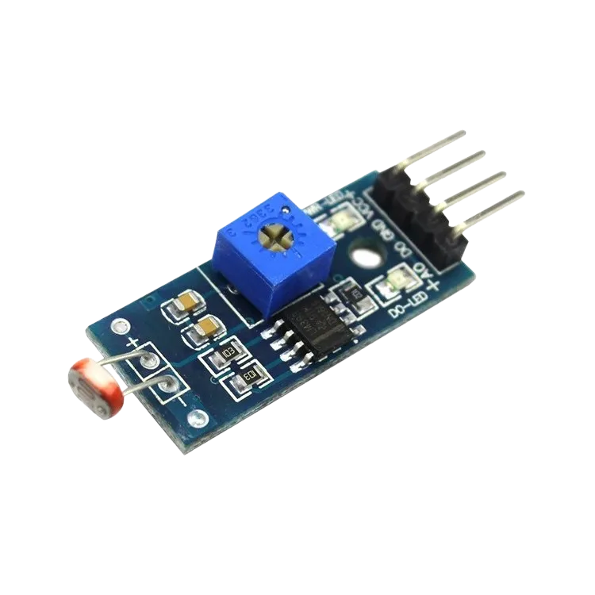
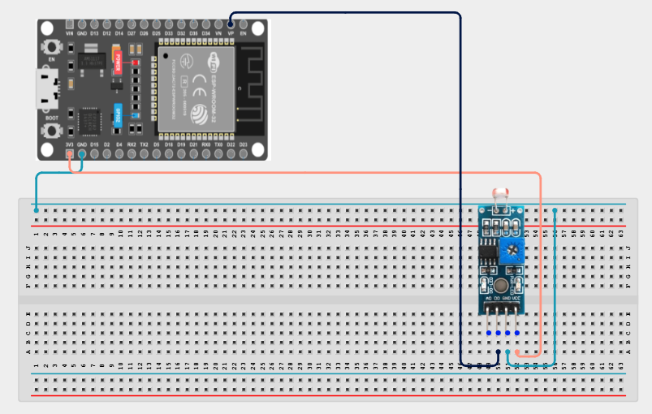
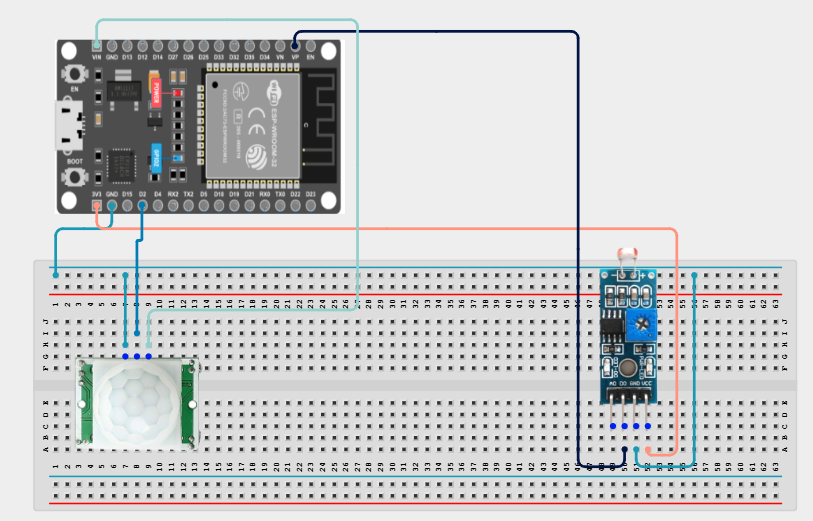
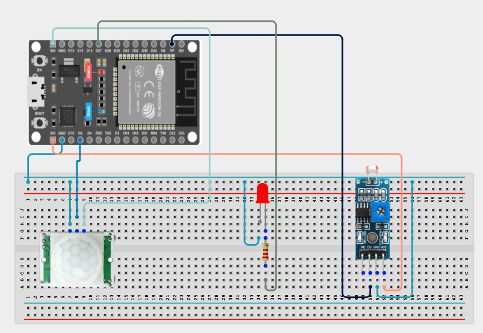

# 4.1.26. Ambient Light  Motion Streetlight

| **Description** | In Project 81, learners will build an ambient-light and motion-activated streetlight using a photoresistor, PIR motion sensor, and LED. The LED turns on when darkness or motion is detected. |
|------------------|----------------------------------------------------------------|
| **Use case**     |This project can be applied to real-world IoT, safety, and control systems while developing essential master-level engineering skills.|

## Components (Things You will need)

|  |  |  |  |  |  |  |  |
| --- | --- | --- | --- | --- | --- | --- | --- |

## Building the circuit

> **Tip:** Use the [ESP32 Pin Mapping](../../assets/esp32_pin_mapping.png) image to locate the correct GPIO pins on your ESP32 board.


Things Needed:

- ESP32 board Core Board = 1

- Photoresistor = 1

- PIR Motion Sensor = 1

- USB Cable & Jumper Wires = 1

- Bread Board

- LED = 1

- 220 ohm resistor = 1
## Wiring the circuit

**Step 1:** Connect the Photoresistor:

- Connect LDR **VCC** to **3.3V**.
- Connect LDR **DO**  to **GPIO 36**.
- Connect LDR **GND** to **GND**.



**Step 2:** Connect the PIR motion sensor:

- Connect **VCC** to **5V**
- Connect **GND** to common **GND**
- Connect **OUT** to **GPIO 2**.



**Step 3:** Connect the LED streetlight:

- Connect **GPIO 27** to one end of a **220 ohm** current-limiting resistor.
- Connect the other end of the resistor to the LED anode (long leg).
- Connect the LED cathode (short leg) to common **GND**.




## PROGRAMMING

**Step 1:** Open your Arduino IDE. See how to set up here: [Getting Started](../../Getting Started/Arduino_IDE_Setup.md).

**Step 2:** Write the complete program implementing the system logic with appropriate pin definitions, setup configuration, and the main control loop.

```cpp
// Project 81: Ambient Light & Motion Streetlight
const int LDR_PIN = 36;
const int PIR_PIN = 2;
const int LED_PIN = 27;
const int LIGHT_THRESHOLD = 300;

void setup() {
  pinMode(LDR_PIN, INPUT);
  pinMode(PIR_PIN, INPUT);
  pinMode(LED_PIN, OUTPUT);
  digitalWrite(LED_PIN, LOW);
  Serial.begin(9600);
  Serial.println("System Initialized...");
}

void loop() {
  int lightLevel = analogRead(LDR_PIN);
  int motionStatus = digitalRead(PIR_PIN);
  if (lightLevel < LIGHT_THRESHOLD || motionStatus == HIGH) {
    digitalWrite(LED_PIN, HIGH);
    Serial.println("Darkness or motion detected: Streetlight ON");
  } else {
    digitalWrite(LED_PIN, LOW);
    Serial.println("Streetlight OFF");
  }
  delay(500);
}
```

**Step 3:** Save your code. _See the [Getting Started](../../Getting Started/Arduino_IDE_Setup.md) section_

**Step 4:** Select the ESP32 board and port. See the [Getting Started](../../Getting Started/Arduino_IDE_Setup.md) section for selecting the ESP32 board and uploading code.

**Step 5:** Upload your code. _See the [Getting Started](../../Getting Started/Arduino_IDE_Setup.md) section._

## CONCLUSION

The system responds dynamically when physical conditions cross pre-programmed setpoints, driving output devices reliably.
