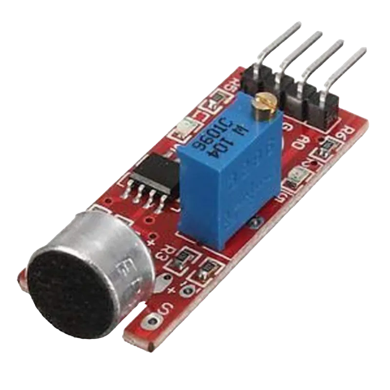
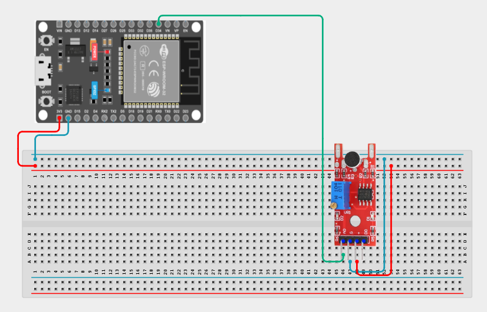
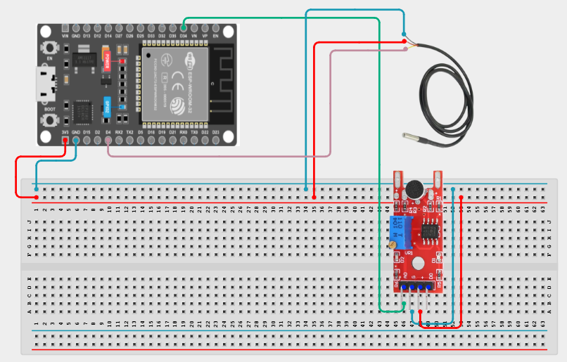
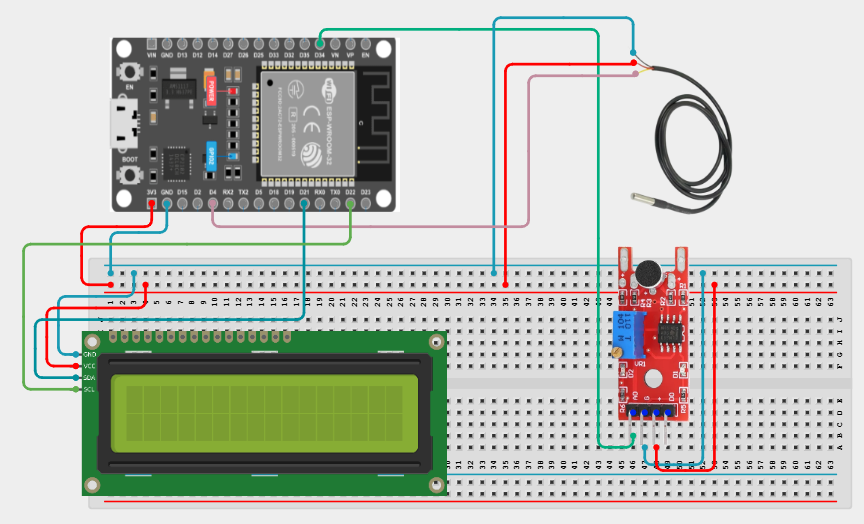
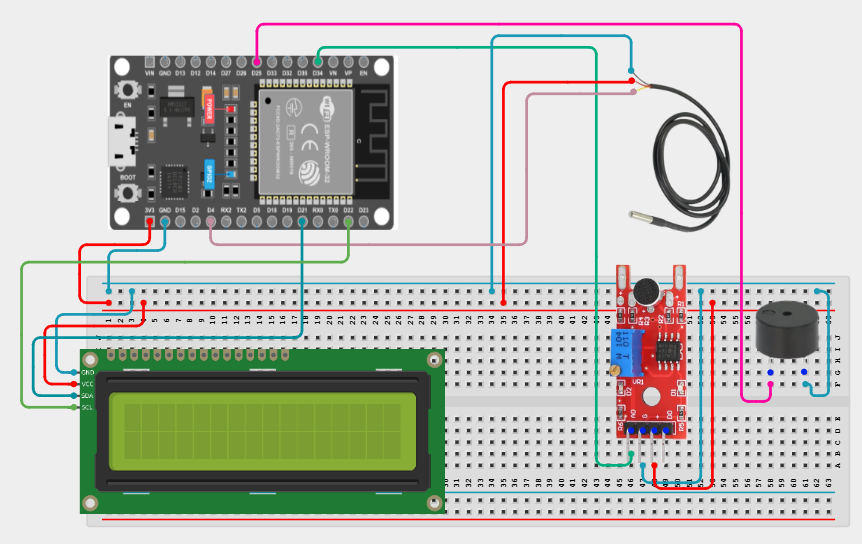

# 4.1.27. Sound  Thermal Industrial Sentinel

| **Description** | In Project 82, learners will engineer an advanced 'Sound & Thermal Industrial Sentinel' multi-component system. This design integrates Sound Sensor + DS18B20 + IIC 1602 LCD + Active Buzzer into a cohesive industrial automation unit. |
|------------------|----------------------------------------------------------------|
| **Use case**     |This project can be applied to real-world IoT, safety, and control systems while developing essential master-level engineering skills.|

## Components (Things You will need)

|  |  |  |  |  |  |  |  |  
| --- | --- | --- | --- | --- | --- | --- | --- |

## Building the circuit

> **Tip:** Use the [ESP32 Pin Mapping](../../assets/esp32_pin_mapping.png) image to locate the correct GPIO pins on your ESP32 board.


Things Needed:

- ESP32 board Core Board = 1

- Sound Sensor = 1

- DS18B20 = 1

- IIC 1602 LCD = 1

- USB Cable & Jumper Wires = 1

- Bread Board

- Buzzer

## Wiring the circuit

**Step 1:** Connect the Sound sensor:

- Connect analog **AO** to **GPIO 34**
- Connect **VCC** to **3.3V**
- Connect **GND** to common **GND**.



**Step 2:** Connect the DS18B20 temperature sensor:

- Connect **VDD** to **3.3V**
- Connect **GND** to common **GND**
- Connect **DQ** to **GPIO 4**. 



**Step 3:** Connect the I2C LCD:

- Connect **SDA** to **GPIO 21**
- Connect **SCL** to **GPIO 22**
- Connect **GND** to common **GND**.
- Connect **VCC** to **3.3V** 



**Step 4:** Connect the Active buzzer:

- Connect **signal/+** to **GPIO 25**.
- Connect **GND/-** to common **GND**.




## PROGRAMMING

**Step 1:** Open your Arduino IDE. See how to set up here: [Getting Started](../../Getting Started/Arduino_IDE_Setup.md).

**Step 2:** Install the **LiquidCrystal_I2C**, **OneWire**, and **DallasTemperature** libraries from Arduino IDE Library Manager, then enter and upload this complete program.

```cpp
#include <Wire.h>
#include <LiquidCrystal_I2C.h>
#include <OneWire.h>
#include <DallasTemperature.h>

// Project 82: Sound & Thermal Industrial Sentinel
const int soundPin = 34;
const int oneWireBus = 4;
const int buzzerPin = 25;
const int soundThreshold = 2000; // Calibrate against the analog sound module.
const float temperatureThresholdC = 45.0;

LiquidCrystal_I2C lcd(0x27, 16, 2);
OneWire oneWire(oneWireBus);
DallasTemperature temperatureSensor(&oneWire);

void setup() {
  Serial.begin(9600);
  Wire.begin(21, 22);
  pinMode(soundPin, INPUT);
  pinMode(buzzerPin, OUTPUT);
  digitalWrite(buzzerPin, LOW);
  lcd.init();
  lcd.backlight();
  temperatureSensor.begin();
  Serial.println("Project 82: Sound & Thermal Industrial Sentinel Initialized...");
}

void loop() {
  temperatureSensor.requestTemperatures();
  const float temperatureC = temperatureSensor.getTempCByIndex(0);
  const int soundLevel = analogRead(soundPin);
  const bool temperatureValid = temperatureC != DEVICE_DISCONNECTED_C;
  const bool alarm = soundLevel >= soundThreshold ||
                     (temperatureValid && temperatureC >= temperatureThresholdC);
  digitalWrite(buzzerPin, alarm ? HIGH : LOW);

  lcd.setCursor(0, 0);
  lcd.print("Temp:");
  if (temperatureValid) {
    lcd.print(temperatureC, 1);
    lcd.print((char)223);
    lcd.print("C   ");
  } else {
    lcd.print("sensor error   ");
  }
  lcd.setCursor(0, 1);
  lcd.print("S:");
  lcd.print(soundLevel);
  lcd.print(alarm ? " ALARM " : "       ");

  Serial.print("Sound level: ");
  Serial.print(soundLevel);
  Serial.print(" | Temperature: ");
  if (temperatureValid) Serial.print(temperatureC, 1);
  else Serial.print("sensor error");
  Serial.print(" C | Alarm: ");
  Serial.println(alarm ? "ON" : "OFF");
  delay(250);
}
```

**Step 3:** Save your code. _See the [Getting Started](../../Getting Started/Arduino_IDE_Setup.md) section._

**Step 4:** Select the ESP32 board and port. See the [Getting Started](../../Getting Started/Arduino_IDE_Setup.md) section.

**Step 5:** Upload your code. See the [Getting Started](../../Getting Started/Arduino_IDE_Setup.md) section.

## CONCLUSION

The system responds dynamically when physical conditions cross pre-programmed setpoints, driving output devices reliably.
