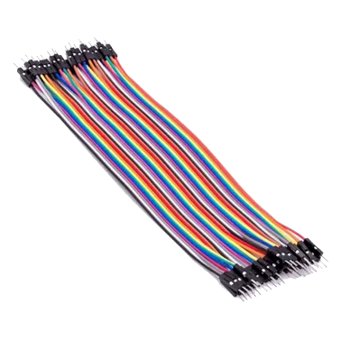
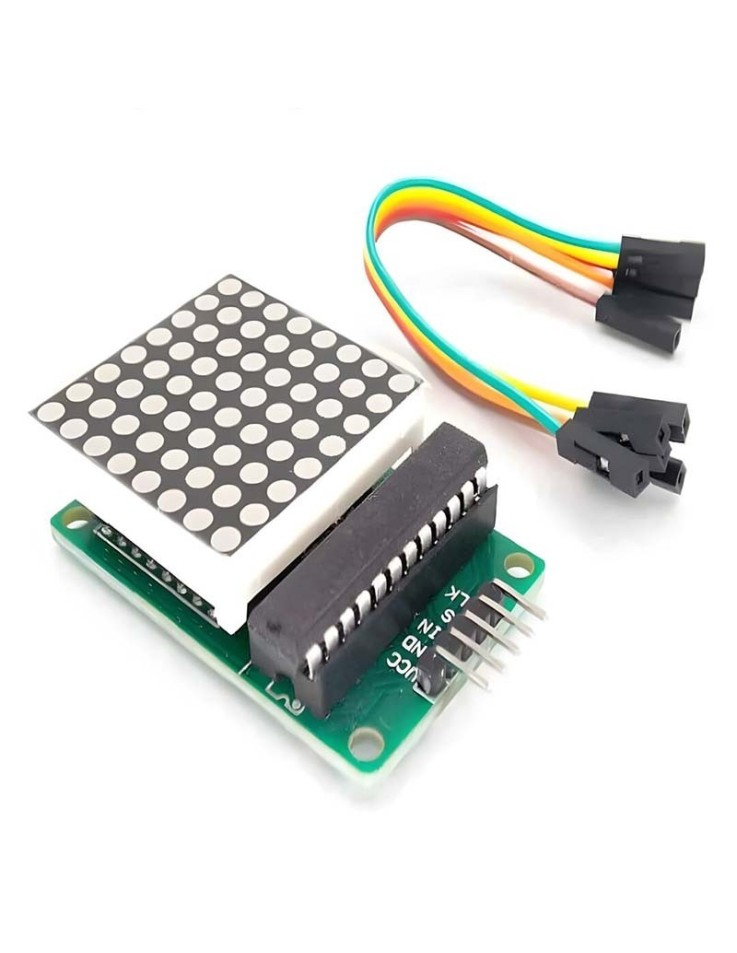
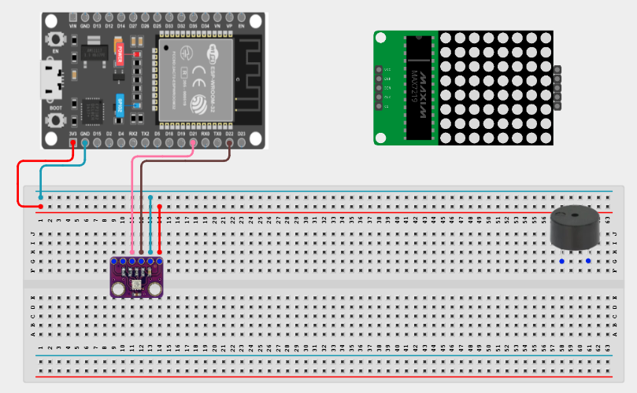
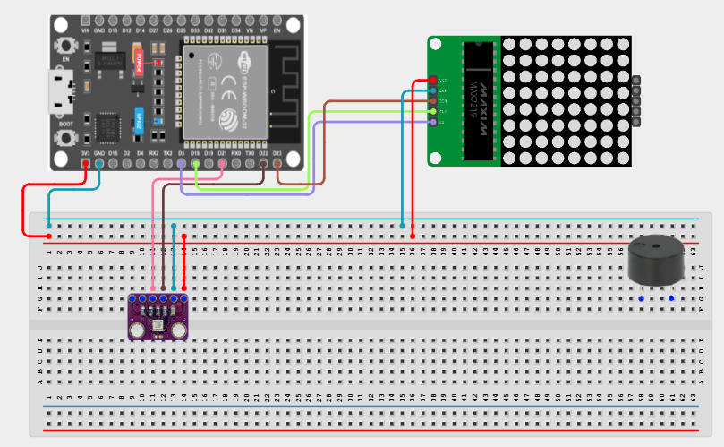
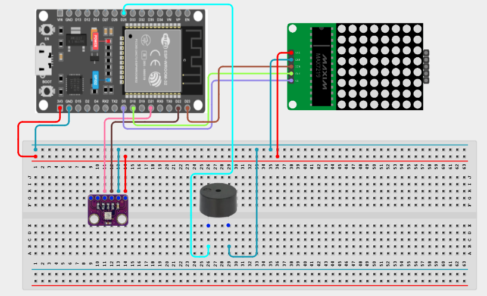

# 4.1.28. Weather Condition Matrix Console

| **Description** | In Project 83, learners will engineer an advanced 'Weather Condition Matrix Console' multi-component system. This design integrates BME280 + MAX7219 8x8 Dot Matrix + Active Buzzer into a cohesive industrial automation unit. |
|------------------|----------------------------------------------------------------|
| **Use case**     |This project can be applied to real-world IoT, safety, and control systems while developing essential master-level engineering skills.|

## Components (Things You will need)

|  |  |  |  |  |  |  |
| --- | --- | --- | --- | --- | --- | --- |

## Building the circuit

> **Tip:** Use the [ESP32 Pin Mapping](../../assets/esp32_pin_mapping.png) image to locate the correct GPIO pins on your ESP32 board.


Things Needed:

- ESP32 board Core Board = 1

- BME280 = 1

- MAX7219 8x8 Dot Matrix = 1

- Active Buzzer = 1

- USB Cable & Jumper Wires = 1

- Bread Board
## Wiring the circuit

**Step 1:** Connect the BME280:
- Connect **VCC** to **3.3V**
- Connect **GND** to **GND**
- Connect **SDA** to **GPIO 21**
- Connect **SCL** to **GPIO 22**.



**Step 2:** Connect the MAX7219 8x8 matrix:
- Connect **DIN** to **GPIO 23**
- Connect **CLK** to **GPIO 18**
- Connect **CS/LOAD** to **GPIO 5**
- Connect **VCC** to **3.3V**
- Connect **GND** to common **GND**.



**Step 3:** Connect the Active buzzer:
- Connect **signal/+** to **GPIO 25**.
- Connect **GND/-** to common **GND**.



**Step 4:** Final wiring check:
- Verify 3.3 V I2C logic and common ground before USB.


## PROGRAMMING

**Step 1:** Open your Arduino IDE. See how to set up here: [Getting Started](../../Getting Started/Arduino_IDE_Setup.md).

**Step 2:** Install the **Adafruit BME280**, **Adafruit Unified Sensor**, and **LedControl** libraries from Arduino IDE Library Manager, then enter and upload this complete program.

```cpp
#include <Wire.h>
#include <Adafruit_BME280.h>
#include <LedControl.h>

// Project 83: Weather Condition Matrix Console
const int matrixDataPin = 23;
const int matrixClockPin = 18;
const int matrixLoadPin = 5;
const int buzzerPin = 25;
const byte sunIcon[8] = {0x18, 0x5A, 0x3C, 0xFF, 0x3C, 0x5A, 0x18, 0x00};
const byte alertIcon[8] = {0x18, 0x3C, 0x7E, 0x18, 0x24, 0x48, 0x24, 0x00};

Adafruit_BME280 bme;
LedControl matrix(matrixDataPin, matrixClockPin, matrixLoadPin, 1);

void setup() {
  Serial.begin(9600);
  Wire.begin(21, 22);
  pinMode(buzzerPin, OUTPUT);
  digitalWrite(buzzerPin, LOW);
  matrix.shutdown(0, false);
  matrix.setIntensity(0, 5);
  matrix.clearDisplay(0);
  if (!bme.begin(0x76) && !bme.begin(0x77)) {
    Serial.println("BME280 not found at 0x76 or 0x77.");
    while (true) delay(100);
  }
  Serial.println("Project 83: Weather Condition Matrix Console Initialized...");
}

void showIcon(const byte icon[8]) {
  for (int row = 0; row < 8; ++row) matrix.setRow(0, row, icon[row]);
}

void loop() {
  const float temperatureC = bme.readTemperature();
  const float humidity = bme.readHumidity();
  const bool hotOrHumid = temperatureC > 30.0 || humidity > 75.0;
  const bool coldOrDry = temperatureC < 10.0 || humidity < 25.0;

  if (hotOrHumid) showIcon(sunIcon);
  else if (coldOrDry) showIcon(alertIcon);
  else matrix.clearDisplay(0);

  const bool alert = hotOrHumid || coldOrDry;
  digitalWrite(buzzerPin, alert ? HIGH : LOW);
  Serial.print("Temperature: ");
  Serial.print(temperatureC, 1);
  Serial.print(" C | Humidity: ");
  Serial.print(humidity, 1);
  Serial.print(" % | Status: ");
  Serial.println(hotOrHumid ? "hot/humid" : coldOrDry ? "cold/dry" : "moderate");
  delay(1000);
}
```

**Step 3:** Save your code. _See the [Getting Started](../../Getting Started/Arduino_IDE_Setup.md) section._

**Step 4:** Select the ESP32 board and port. See the [Getting Started](../../Getting Started/Arduino_IDE_Setup.md) section.

**Step 5:** Upload your code. See the [Getting Started](../../Getting Started/Arduino_IDE_Setup.md) section.

## CONCLUSION

The system responds dynamically when physical conditions cross pre-programmed setpoints, driving output devices reliably.