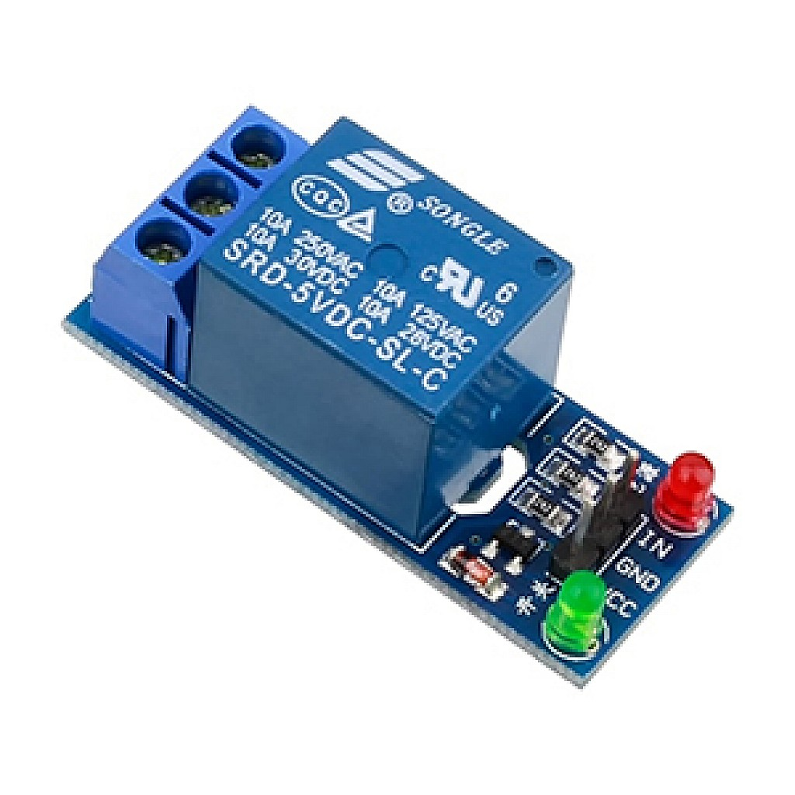
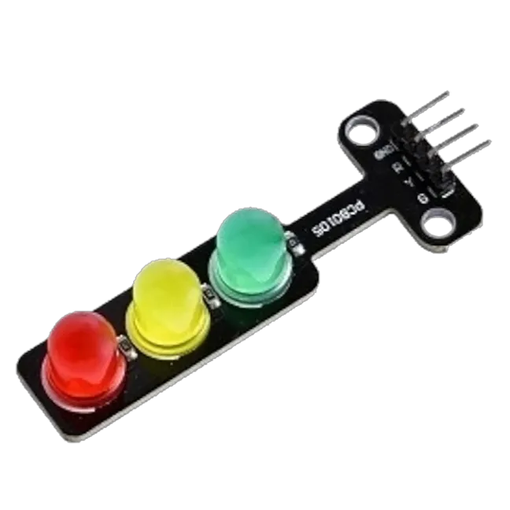
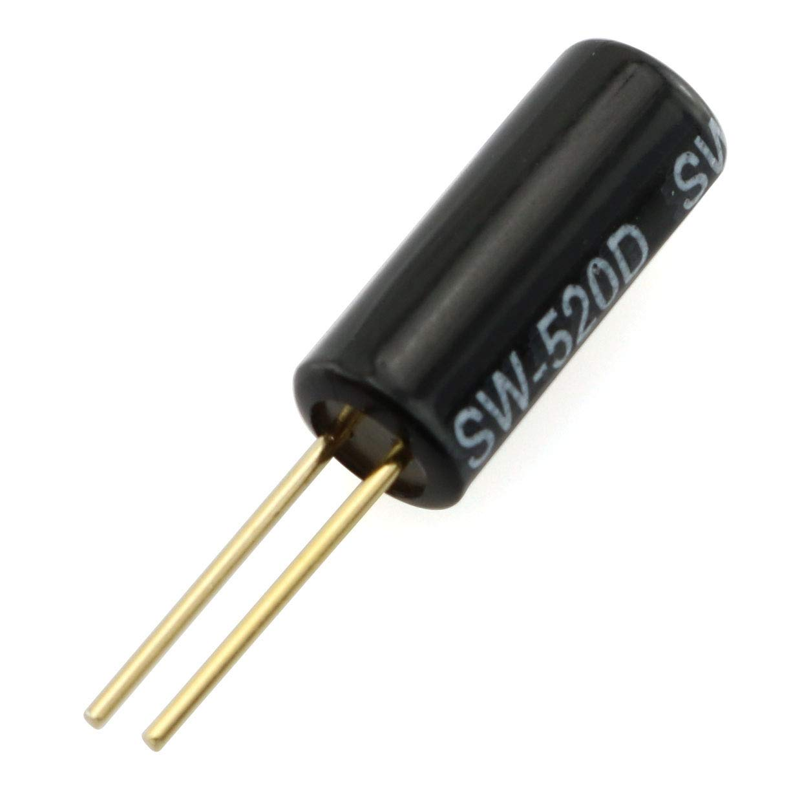
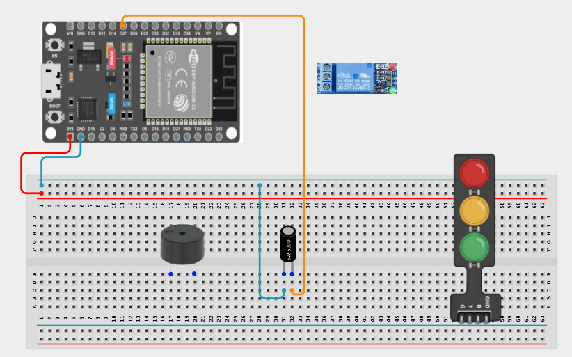
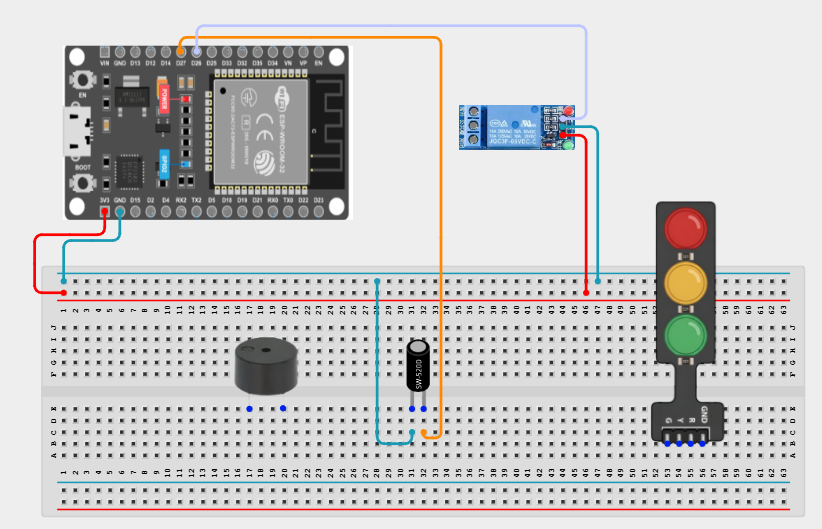
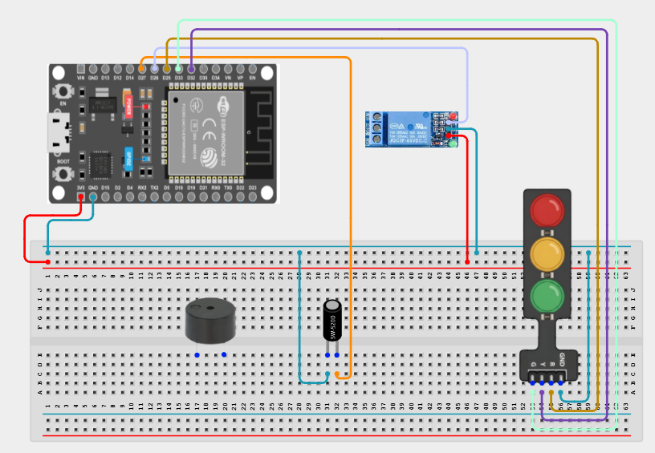
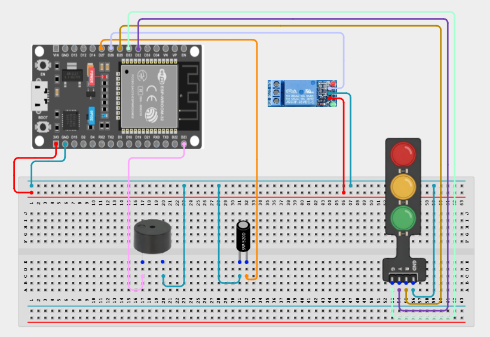

# 4.1.29. Emergency Equipment Tilt Interlock

| **Description** | In Project 84, learners will engineer an advanced 'Emergency Equipment Tilt Interlock' multi-component system. This design integrates Ball Switch + Relay Module + Traffic Light Module + Buzzer into a cohesive industrial automation unit. |
|------------------|----------------------------------------------------------------|
| **Use case**     |This project can be applied to real-world IoT, safety, and control systems while developing essential master-level engineering skills.|

## Components (Things You will need)

|  |  |  |  |  |  |  |  |
| --- | --- | --- | --- | --- | --- | --- | --- |

## Building the circuit

> **Tip:** Use the [ESP32 Pin Mapping](../../assets/esp32_pin_mapping.png) image to locate the correct GPIO pins on your ESP32 board.


Things Needed:

- ESP32 board Core Board = 1

- Ball Switch = 1

- Relay Module = 1

- Traffic Light Module = 1

- USB Cable & Jumper Wires = 1

- Bread Board

- Buzzer
## Wiring the circuit

**Step 1:** Connect the Ball switch:

- Connect one switch terminal to **GPIO 27**.
- Connect the other switch terminal to **GND**; configure GPIO 27 as `INPUT_PULLUP`.



**Step 2:** Connect the Relay module:

- Connect relay **IN** to **GPIO 26**
- Connect **VCC** to its rated supply
- Connect **GND** to common **GND**. Use its contacts only for a correctly rated low-voltage load.



**Step 3:** Connect the Traffic light module:

- Connect **R** to **GPIO 25**
- Connect **Y** to **GPIO 32**
- Connect **G** to **GPIO 33**
- Connect **GND** to common **GND**.



**Step 4:** Connect the Buzzer:

- Connect active buzzer **signal/+** to **GPIO 23**.
- Connect active buzzer **GND/-** to common **GND**.




## PROGRAMMING

**Step 1:** Open your Arduino IDE. See how to set up here: [Getting Started](../../Getting Started/Arduino_IDE_Setup.md).

**Step 2:** Write the complete program implementing the system logic with appropriate pin definitions, setup configuration, and the main control loop.

```cpp
// Project 84: Emergency Equipment Tilt Interlock
const int tiltPin = 27;
const int relayPin = 26;
const int redPin = 25;
const int yellowPin = 32;
const int greenPin = 33;
const int buzzerPin = 23;
const bool relayActiveLow = false;
bool stableTiltState = true;
bool lastRawTiltState = false;
unsigned long lastStateChangeMs = 0;
const unsigned long debounceMs = 40;

void setRelay(bool energized) {
  const bool outputHigh = energized != relayActiveLow;
  digitalWrite(relayPin, outputHigh ? HIGH : LOW);
}

void setup() {
  Serial.begin(9600);
  pinMode(tiltPin, INPUT_PULLUP);
  pinMode(relayPin, OUTPUT);
  pinMode(redPin, OUTPUT);
  pinMode(yellowPin, OUTPUT);
  pinMode(greenPin, OUTPUT);
  pinMode(buzzerPin, OUTPUT);
  setRelay(false);
  digitalWrite(redPin, LOW);
  digitalWrite(yellowPin, HIGH);
  digitalWrite(greenPin, LOW);
  digitalWrite(buzzerPin, LOW);
  Serial.println("Project 84: Emergency Equipment Tilt Interlock Initialized...");
}

void loop() {
  const bool rawTiltState = digitalRead(tiltPin) == LOW;
  if (rawTiltState != lastRawTiltState) {
    lastRawTiltState = rawTiltState;
    lastStateChangeMs = millis();
  }
  if (millis() - lastStateChangeMs >= debounceMs &&
      stableTiltState != rawTiltState) {
    stableTiltState = rawTiltState;
    Serial.println(stableTiltState ? "Tilt detected: equipment interlocked"
                                   : "Equipment level: interlock cleared");
  }

  const bool safeToRun = !stableTiltState;
  setRelay(safeToRun);
  digitalWrite(redPin, safeToRun ? LOW : HIGH);
  digitalWrite(yellowPin, LOW);
  digitalWrite(greenPin, safeToRun ? HIGH : LOW);
  digitalWrite(buzzerPin, safeToRun ? LOW : HIGH);
  delay(5);
}
```

**Step 3:** Save your code. _See the [Getting Started](../../Getting Started/Arduino_IDE_Setup.md) section._

**Step 4:** Select the ESP32 board and port. See the [Getting Started](../../Getting Started/Arduino_IDE_Setup.md) section.

**Step 5:** Upload your code. See the [Getting Started](../../Getting Started/Arduino_IDE_Setup.md) section.

## CONCLUSION

The system responds dynamically when physical conditions cross pre-programmed setpoints, driving output devices reliably.