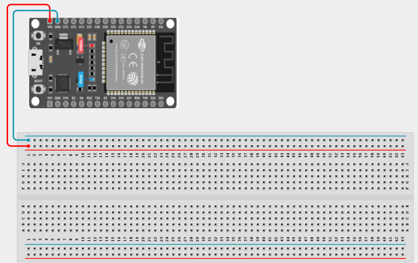
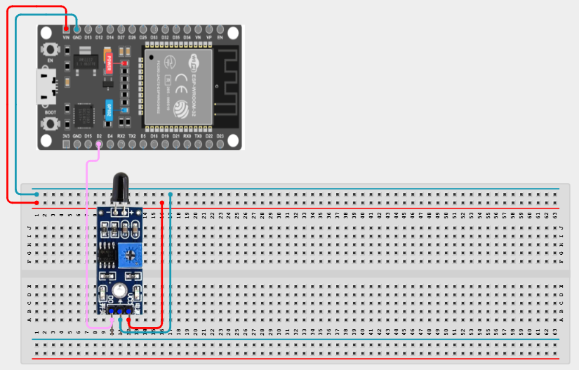
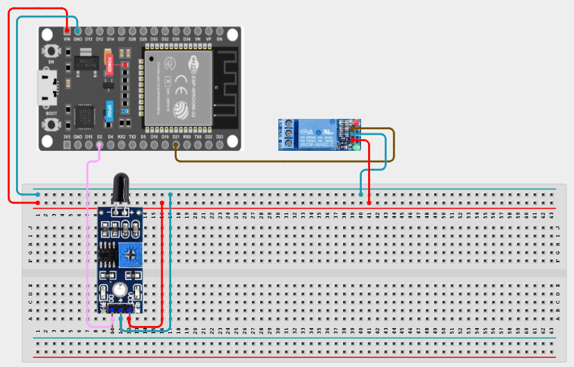
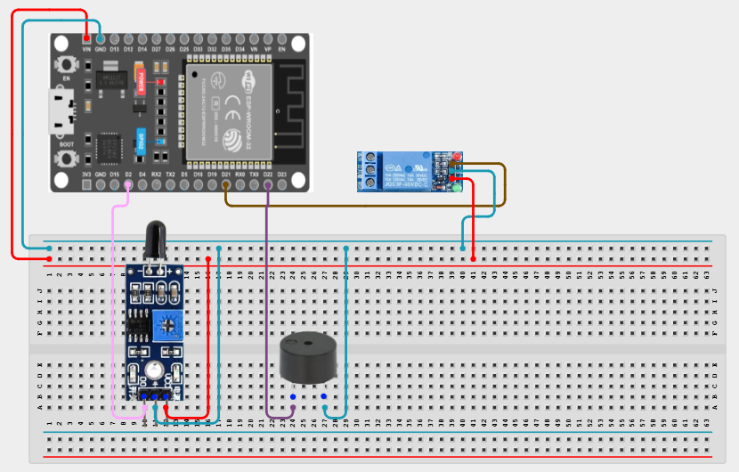

# 4.1.2. Smart Fire Safety & Alarm System

| **Description** | In this project, learners will combine a Flame Sensor Module, a 5V Relay Module, an Active Buzzer, and a Red LED. Upon flame detection, the system triggers audio alarms, flashes emergency LEDs, and trips an isolation relay.|
|------------------|---------------------------------------------------------------- |
| **Use case**     | This project connects to real-world industrial and IoT applications such as: Essential multi-stage safety framework for industrial fire suppression installations. |

## Components (Things You will need)

|  |  |  |  |  |  |  |  |  |
| --- | --- | --- | --- | --- | --- | --- | --- | --- |

## Building the circuit

> **Tip:** Use the [ESP32 Pin Mapping](../../assets/esp32_pin_mapping.png) image to locate the correct GPIO pins on your ESP32 board.


Things Needed:

- ESP32 board = 1

- Micro USB cable = 1

- Breadboard = 1

- Jumper Wires

- Flame Sensor

- Relay Module

- Buzzer

- LEDs

- Resistors
## Wiring the circuit

**Step 1:** Connect the power rails:

- Connect **5V** on the ESP32 board to the positive (+) rail.
- Connect a **GND** pin on the ESP32 board to the negative (−) rail.



**Step 2:** Connect the flame sensor:

- Connect **VCC** to the 5V rail.
- Connect **GND** to the ground rail.
- Connect **DO** (Digital Output) to **GPIO 2**.



**Step 3:** Connect the relay module:

- Connect **VCC** to the 5V rail.
- Connect **GND** to the ground rail.
- Connect **IN** (Signal) to **GPIO 21**.
- Connect the relay **COM** terminal to the load supply.
- Connect either **NO** or **NC** to the load, according to the required switching behavior; do not connect both terminals to the load.



**Step 4:** Connect the buzzer:

- Connect the positive (+) pin to **GPIO 22**.
- Connect the negative (−) pin to the ground rail.



**Step 5:** Connect the LED:

- Connect the anode (+) to **GPIO 27** through a **220Ω resistor**.
- Connect the cathode (−) to the ground rail.


_Make sure to connect the Micro USB cable to the ESP32 board after checking all connections._


## PROGRAMMING

**Step 1:** Open your Arduino IDE. See how to set up here: [Getting Started](../../Getting Started/Arduino_IDE_Setup.md).

**Step 2:** Write the complete program implementing the system logic with appropriate pin definitions, setup configuration, and the main control loop.

```cpp
// Project 63: Smart Fire Safety & Alarm System
const int flamePin = 2;
const int relayPin = 21;
const int buzzerPin = 22;
const int ledPin = 27;

void setup() {
  pinMode(flamePin, INPUT);
  pinMode(relayPin, OUTPUT);
  pinMode(buzzerPin, OUTPUT);
  pinMode(ledPin, OUTPUT);
  digitalWrite(relayPin, LOW);
  digitalWrite(buzzerPin, LOW);
  digitalWrite(ledPin, LOW);
}

void loop() {
  if (digitalRead(flamePin) == LOW) {
    digitalWrite(relayPin, HIGH);
    digitalWrite(ledPin, HIGH);
    digitalWrite(buzzerPin, HIGH);
    delay(100);
    digitalWrite(buzzerPin, LOW);
    delay(100);
  } else {
    digitalWrite(relayPin, LOW);
    digitalWrite(ledPin, LOW);
    digitalWrite(buzzerPin, LOW);
    delay(200);
  }
}

```

**Step 3:** Save your code. _See the [Getting Started](../../Getting Started/Arduino_IDE_Setup.md) section_

**Step 4:** Select the ESP32 board and port _See the [Getting Started](../../Getting Started/Arduino_IDE_Setup.md) section:Selecting ESP32 board Type and Uploading your code_.

**Step 5:** Upload your code. _See the [Getting Started](../../Getting Started/Arduino_IDE_Setup.md) section:Selecting ESP32 board Type and Uploading your code_

## CONCLUSION

Detecting fire immediately trips the power relay and triggers pulsing alarms.