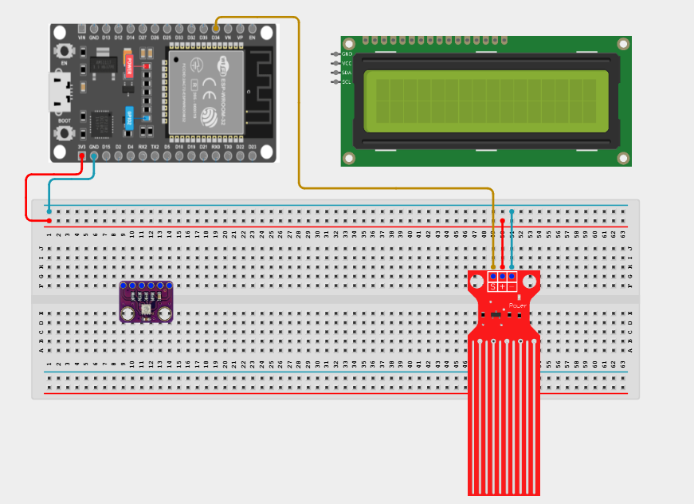
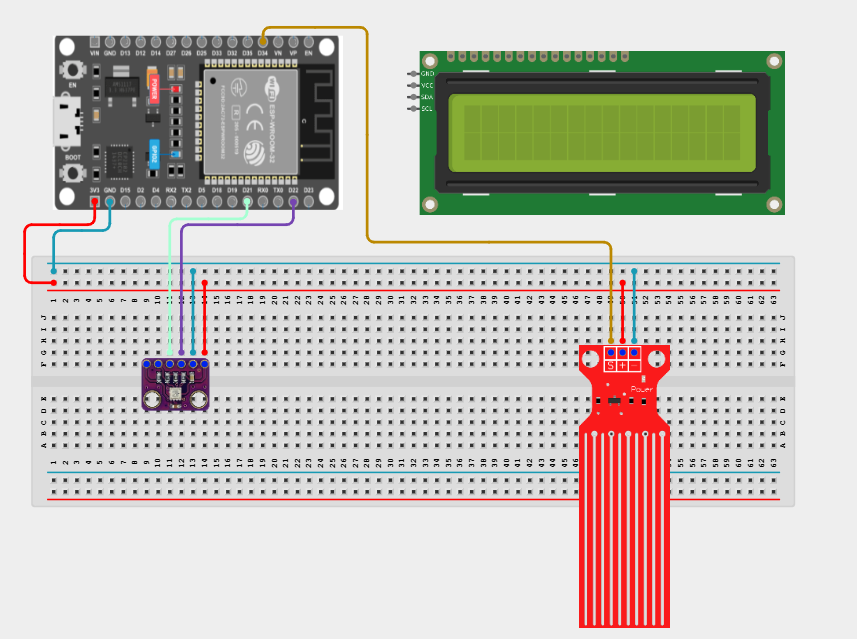
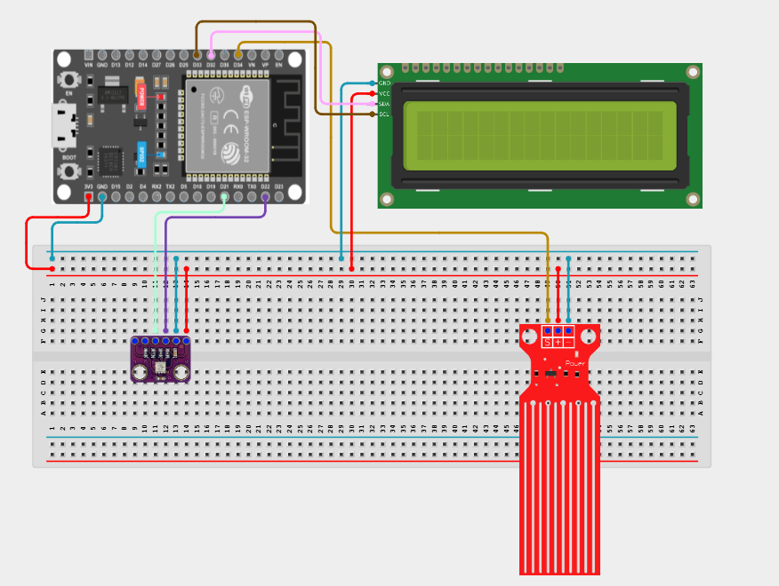

# 4.1.30. Smart Aquaponics Environment Station

| **Description** | In Project 85, learners will build a Smart Aquaponics Environment Station that monitors water readings and ambient temperature and humidity with a water test module, BME280, and IIC 1602 LCD. |
|------------------|----------------------------------------------------------------|
| **Use case**     |This project can be applied to real-world IoT, safety, and control systems while developing essential master-level engineering skills.|

## Components (Things You will need)

|  |  |  |  |  |  |  |
| --- | --- | --- | --- | --- | --- | --- |

## Building the circuit

> **Tip:** Use the [ESP32 Pin Mapping](../../assets/esp32_pin_mapping.png) image to locate the correct GPIO pins on your ESP32 board.


Things Needed:

- ESP32 board Core Board = 1

- Water Test Module = 1

- BME280 = 1

- IIC 1602 LCD = 1

- USB Cable & Jumper Wires = 1

- Bread Board

## Wiring the circuit

**Step 1:** Connect the Water test module:

- Connect **AO** to **GPIO 34**
- Connect **VCC** to **3.3V**
- Connect **GND** to common **GND**.



**Step 2:** Connect the BME280 to its I2C bus:

- Connect the BME280 **SDA** to **GPIO 21**.
- Connect the BME280 **SCL** to **GPIO 22**.
- Connect the BME280 **GND** to common **GND**.
- Connect the BME280 **VCC** to **3.3V**.




**Step 3:** Connect the I2C LCD display to a separate I2C bus:

- Connect the LCD **SDA** to **GPIO 32**.
- Connect the LCD **SCL** to **GPIO 33**.
- Connect the LCD **GND** to common **GND**.
- Connect the LCD **VCC** to **3.3V** 




## PROGRAMMING

**Step 1:** Open your Arduino IDE. See how to set up here: [Getting Started](../../Getting Started/Arduino_IDE_Setup.md).

**Step 2:** Install the **Adafruit BME280** and **Adafruit Unified Sensor** libraries from Arduino IDE Library Manager, then enter and upload this complete program.

```cpp
#include <Wire.h>
#include <Adafruit_BME280.h>

// Project 85: Smart Aquaponics Environment Station
const int waterPin = 34;
const int minimumWaterReading = 1200; // Calibrate for the water test module.
const float maximumWaterTemperatureC = 32.0;
const int lcdSdaPin = 32;
const int lcdSclPin = 33;
const uint8_t lcdAddress = 0x27;
const uint8_t lcdRs = 0x01;
const uint8_t lcdEnable = 0x04;
const uint8_t lcdBacklight = 0x08;

TwoWire lcdBus(1);
Adafruit_BME280 bme;

void lcdWriteExpander(uint8_t value) {
  lcdBus.beginTransmission(lcdAddress);
  lcdBus.write(value | lcdBacklight);
  lcdBus.endTransmission();
}

void lcdPulseEnable(uint8_t value) {
  lcdWriteExpander(value | lcdEnable);
  delayMicroseconds(1);
  lcdWriteExpander(value & ~lcdEnable);
  delayMicroseconds(50);
}

void lcdWriteNibble(uint8_t value, bool data) {
  const uint8_t output = (value & 0xF0) | (data ? lcdRs : 0);
  lcdWriteExpander(output);
  lcdPulseEnable(output);
}

void lcdSend(uint8_t value, bool data) {
  lcdWriteNibble(value, data);
  lcdWriteNibble(value << 4, data);
}

void lcdCommand(uint8_t command) {
  lcdSend(command, false);
  if (command == 0x01 || command == 0x02) delay(2);
}

void lcdInit() {
  delay(50);
  lcdWriteNibble(0x30, false);
  delay(5);
  lcdWriteNibble(0x30, false);
  delayMicroseconds(150);
  lcdWriteNibble(0x30, false);
  lcdWriteNibble(0x20, false);
  lcdCommand(0x28);
  lcdCommand(0x0C);
  lcdCommand(0x06);
  lcdCommand(0x01);
}

void lcdSetCursor(uint8_t column, uint8_t row) {
  const uint8_t rowOffsets[] = {0x00, 0x40};
  lcdCommand(0x80 | (column + rowOffsets[row % 2]));
}

void lcdPrint(const char *text) {
  while (*text) lcdSend(static_cast<uint8_t>(*text++), true);
}

void lcdPrint(int value) {
  char text[12];
  snprintf(text, sizeof(text), "%d", value);
  lcdPrint(text);
}

void lcdPrint(float value, uint8_t decimals) {
  char text[16];
  dtostrf(value, 1, decimals, text);
  lcdPrint(text);
}

void setup() {
  Serial.begin(9600);
  // BME280 uses I2C controller 0; the LCD uses controller 1 on separate pins.
  Wire.begin(21, 22);
  pinMode(waterPin, INPUT);
  lcdBus.begin(lcdSdaPin, lcdSclPin, 100000);
  lcdInit();
  if (!bme.begin(0x76) && !bme.begin(0x77)) {
    Serial.println("BME280 not found at 0x76 or 0x77.");
    while (true) delay(100);
  }
  Serial.println("Project 85: Smart Aquaponics Environment Station Initialized...");
}

void loop() {
  const int waterReading = analogRead(waterPin);
  const float temperatureC = bme.readTemperature();
  const float humidity = bme.readHumidity();
  const bool waterReadingLow = waterReading < minimumWaterReading;
  const bool waterTooWarm = temperatureC > maximumWaterTemperatureC;
  const bool alert = waterReadingLow || waterTooWarm;

  lcdSetCursor(0, 0);
  lcdPrint("Water:");
  lcdPrint(waterReading);
  lcdPrint(waterReadingLow ? " LOW " : " OK  ");
  lcdSetCursor(0, 1);
  lcdPrint("T:");
  lcdPrint(temperatureC, 1);
  lcdSend(0xDF, true);
  lcdPrint(" H:");
  lcdPrint(humidity, 0);
  lcdPrint("% ");

  Serial.print("Water reading: ");
  Serial.print(waterReading);
  Serial.print(" | Temperature: ");
  Serial.print(temperatureC, 1);
  Serial.print(" C | Humidity: ");
  Serial.print(humidity, 1);
  Serial.print(" % | Status: ");
  Serial.println(alert ? "Attention: configured limit exceeded" : "Readings within configured limits");
  delay(1000);
}
```

**Step 3:** Save your code. _See the [Getting Started](../../Getting Started/Arduino_IDE_Setup.md) section._

**Step 4:** Select the ESP32 board and port. See the [Getting Started](../../Getting Started/Arduino_IDE_Setup.md) section.

**Step 5:** Upload your code. See the [Getting Started](../../Getting Started/Arduino_IDE_Setup.md) section.

## CONCLUSION

The system responds dynamically when physical conditions cross pre-programmed setpoints, driving output devices reliably.