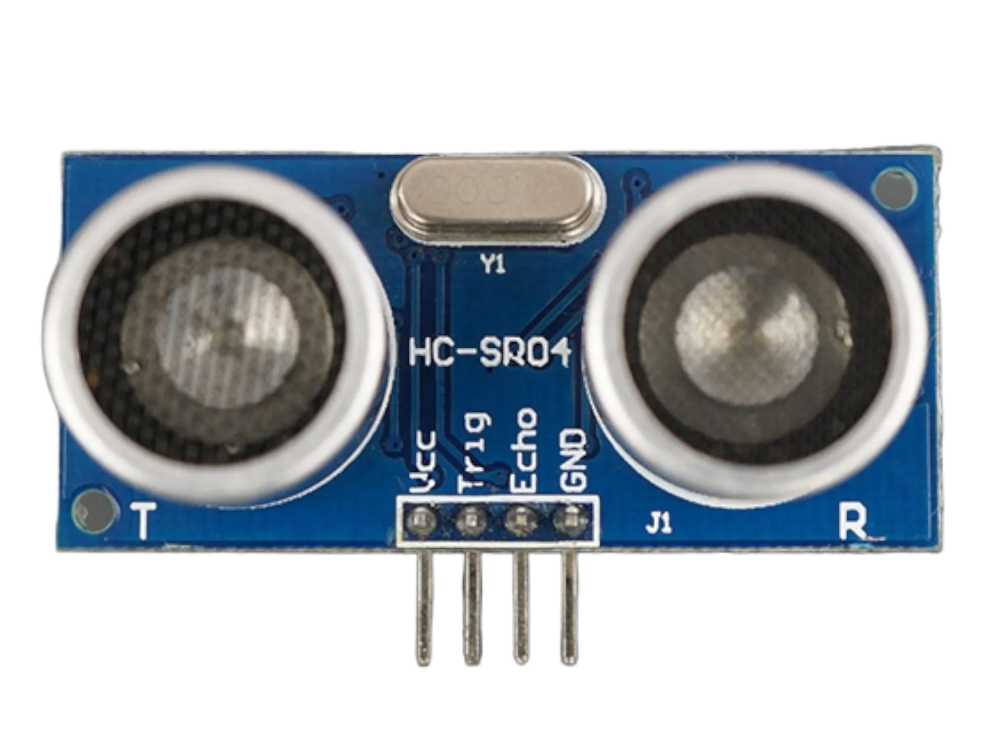
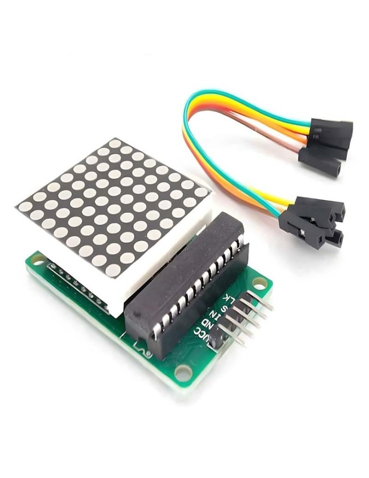
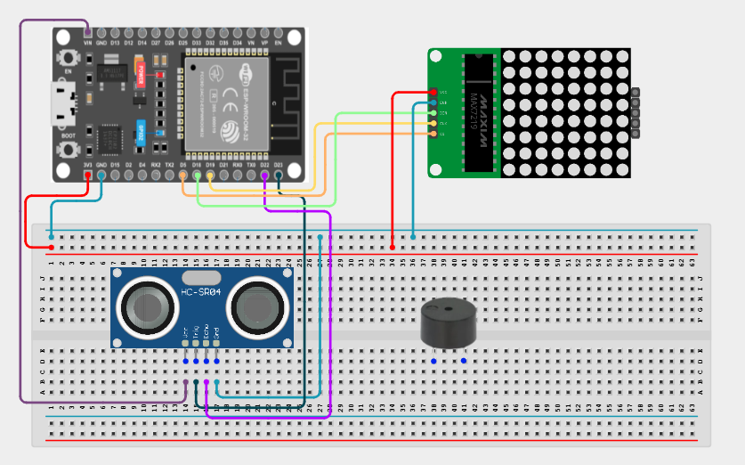
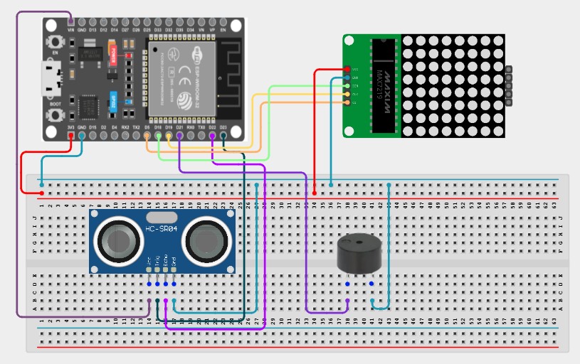

# 4.1.31. High Precision Liquid Level Meter

| **Description** | In Project 86, learners will engineer an advanced 'High-Precision Liquid Level Meter' multi-component system. This design integrates HC-SR04 Ultrasonic + 8x8 Dot Matrix + Active Buzzer into a cohesive industrial automation unit. |
|------------------|----------------------------------------------------------------|
| **Use case**     |This project can be applied to real-world IoT, safety, and control systems while developing essential master-level engineering skills.|

## Components (Things You will need)

|  |  |  |  |  |  |  |
| --- | --- | --- | --- | --- | --- | --- |

## Building the circuit

> **Tip:** Use the [ESP32 Pin Mapping](../../assets/esp32_pin_mapping.png) image to locate the correct GPIO pins on your ESP32 board.


Things Needed:

- ESP32 board Core Board = 1

- HC-SR04 Ultrasonic = 1

- 8x8 Dot Matrix = 1

- Active Buzzer = 1

- USB Cable & Jumper Wires = 1

- Bread Board

## Wiring the circuit

**Step 1:** Connect the HC-SR04 ultrasonic sensor:

- Connect **VCC** to **5V/VIN**
- Connect **GND** to **GND**
- Connect **TRIG** to **GPIO 23**.
- Connect sensor **ECHO** to **GPIO 22**.


**Step 2:** Connect the MAX7219 8x8 matrix:

- Connect **DIN** to **GPIO 18**
- Connect **CLK** to **GPIO 19**
- Connect **CS/LOAD** to **GPIO 5**
- Connect **VCC** to **3.3V**
- Connect **GND** to common **GND**.



**Step 3:** Connect the Active buzzer:

- Connect **signal/+** to **GPIO 21**.
- Connect **GND/-** to common **GND**.




## PROGRAMMING

**Step 1:** Open your Arduino IDE. See how to set up here: [Getting Started](../../Getting Started/Arduino_IDE_Setup.md).

**Step 2:** Write the complete program implementing the system logic with appropriate pin definitions, setup configuration, and the main control loop.

```cpp
#include <LedControl.h>

// Pin Definitions
const int trigPin = 23;
const int echoPin = 22;
const int buzzerPin = 21;

// Dot Matrix Pins (DIN, CLK, CS)
// Wiring: DIN=18, CLK=19, CS=5
LedControl lc = LedControl(18, 19, 5, 1);

void setup() {
  Serial.begin(9600);
  pinMode(trigPin, OUTPUT);
  pinMode(echoPin, INPUT);
  pinMode(buzzerPin, OUTPUT);

  lc.shutdown(0, false);
  lc.setIntensity(0, 8);
  lc.clearDisplay(0);
  Serial.println("Project 86: High-Precision Liquid Level Meter Initialized...");
}

void loop() {
  long duration;
  int distance;

  // Trigger pulse
  digitalWrite(trigPin, LOW);
  delayMicroseconds(2);
  digitalWrite(trigPin, HIGH);
  delayMicroseconds(10);
  digitalWrite(trigPin, LOW);

  // Measure echo
  duration = pulseIn(echoPin, HIGH);
  distance = duration * 0.034 / 2;

  Serial.print("Distance: ");
  Serial.print(distance);
  Serial.println(" cm");

  // If liquid is too high (distance < 10cm), trigger alarm and display
  if (distance > 0 && distance < 10) {
    digitalWrite(buzzerPin, HIGH);
    // Display alert pattern on 8x8 matrix
    for(int i=0; i<8; i++) lc.setRow(0, i, B00011000); 
  } else {
    digitalWrite(buzzerPin, LOW);
    lc.clearDisplay(0);
  }
  delay(500);
}
```

**Step 7:** Save your code. _See the [Getting Started](../../Getting Started/Arduino_IDE_Setup.md) section_

**Step 8:** Select the ESP32 board and port _See the [Getting Started](../../Getting Started/Arduino_IDE_Setup.md) section:Selecting ESP32 board Type and Uploading your code_.

**Step 9:** Upload your code. _See the [Getting Started](../../Getting Started/Arduino_IDE_Setup.md) section:Selecting ESP32 board Type and Uploading your code_

## CONCLUSION

The system responds dynamically when physical conditions cross pre-programmed setpoints, driving output devices reliably.
