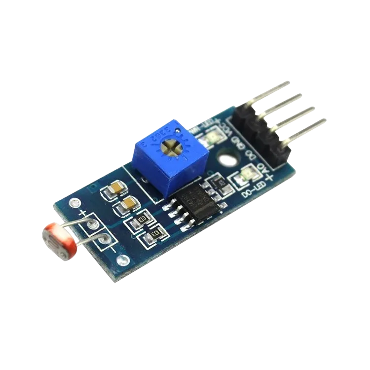
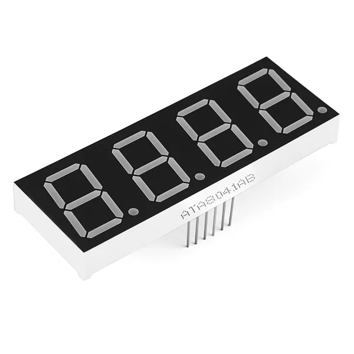
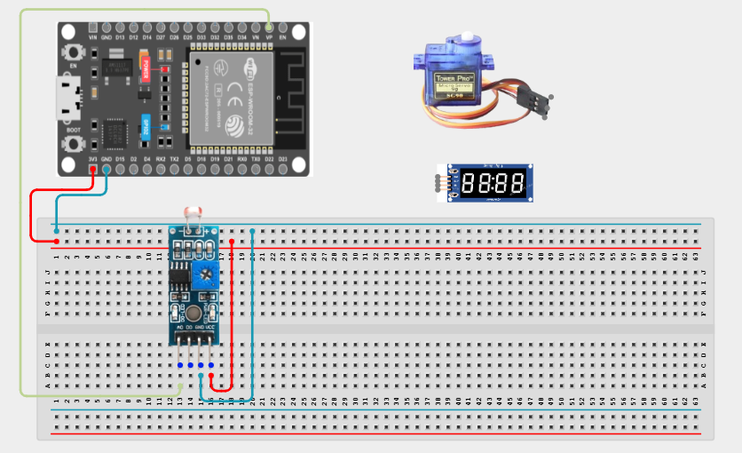
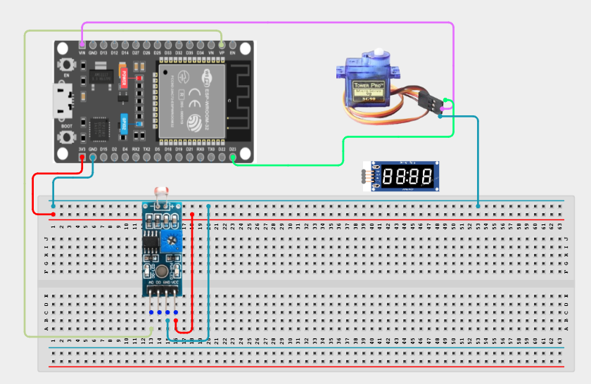
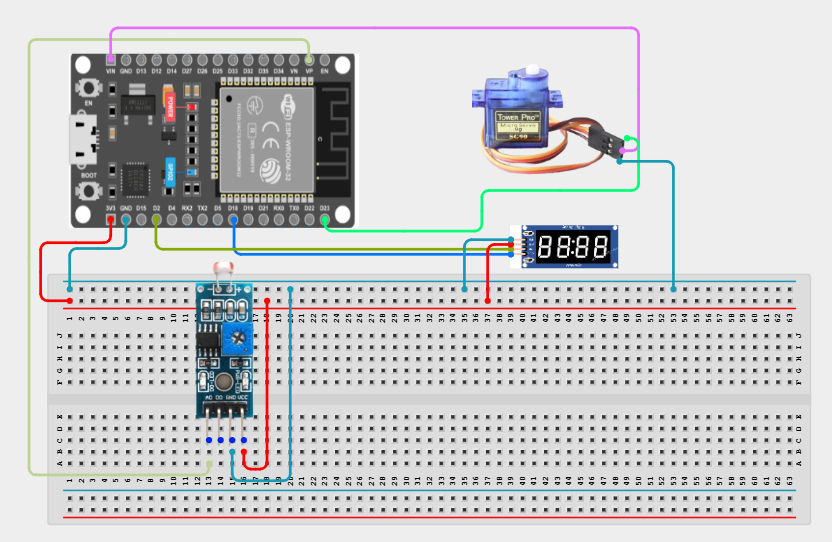

# 4.1.32. Solar Tracker Position Simulator

| **Description** | In Project 87, learners will engineer an advanced 'Solar Tracker Position Simulator' multi-component system. This design integrates Photoresistor + Servo Motor SG90 + TM1637 4-Digit Display into a cohesive industrial automation unit. |
|------------------|----------------------------------------------------------------|
| **Use case**     |This project can be applied to real-world IoT, safety, and control systems while developing essential master-level engineering skills.|

## Components (Things You will need)

|  |  |  |  |  |  |  |    |
| --- | --- | --- | --- | --- | --- | --- | --- |

## Building the circuit

> **Tip:** Use the [ESP32 Pin Mapping](../../assets/esp32_pin_mapping.png) image to locate the correct GPIO pins on your ESP32 board.


Things Needed:

- ESP32 board Core Board = 1

- Photoresistor = 1

- Servo Motor SG90 = 1

- TM1637 4-Digit Display = 1

- USB Cable & Jumper Wires = 1

- Bread Board

- Resistors = 1 x 10 kohm (photoresistor divider)
## Wiring the circuit

**Step 1:** Connect the Photoresistor divider:
- Connect one LDR lead to **3.3V**.
- Connect the other LDR lead to **GPIO 36**.
- Connect a **10 kohm** resistor from **GPIO 36** to **GND**.



**Step 2:** Connect the SG90 servo:
- Connect servo signal to **GPIO 23**.
- Connect the servo power input to a separate regulated **5V** supply sized for its stall current.
- Connect the supply ground to ESP32 **GND**.
- Do not power the servo from the ESP32 3.3 V pin.



**Step 3:** Connect the TM1637 display:
- Connect **CLK** to **GPIO 18**
- Connect **DIO** to **GPIO 2**
- Connect **VCC** to **3.3V** if supported
- Connect **GND** to common **GND**.



**Step 4:** Final wiring check:
- Verify the LDR divider and separate servo supply/common ground before USB.


## PROGRAMMING

**Step 1:** Open your Arduino IDE. See how to set up here: [Getting Started](../../Getting Started/Arduino_IDE_Setup.md).

**Step 2:** Write the complete program implementing the system logic with appropriate pin definitions, setup configuration, and the main control loop.

```cpp
#include <ESP32Servo.h>
#include <TM1637Display.h>

const int photoResistorPin = 36;
const int servoPin = 23;
const int CLK = 18;
const int DIO = 2;

Servo myservo;
TM1637Display display(CLK, DIO);

void setup() {
  Serial.begin(9600);
  myservo.attach(servoPin);
  display.setBrightness(0x0f);
  Serial.println("Project 87: Solar Tracker Position Simulator Initialized...");
}

void loop() {
  int sensorValue = analogRead(photoResistorPin);
  int angle = map(sensorValue, 0, 4095, 0, 180);
  myservo.write(angle);
  display.showNumberDec(sensorValue);
  delay(500);
}
```

**Step 7:** Save your code. _See the [Getting Started](../../Getting Started/Arduino_IDE_Setup.md) section_

**Step 8:** Select the ESP32 board and port _See the [Getting Started](../../Getting Started/Arduino_IDE_Setup.md) section:Selecting ESP32 board Type and Uploading your code_.

**Step 9:** Upload your code. _See the [Getting Started](../../Getting Started/Arduino_IDE_Setup.md) section:Selecting ESP32 board Type and Uploading your code_

## CONCLUSION

The system responds dynamically when physical conditions cross pre-programmed setpoints, driving output devices reliably.
