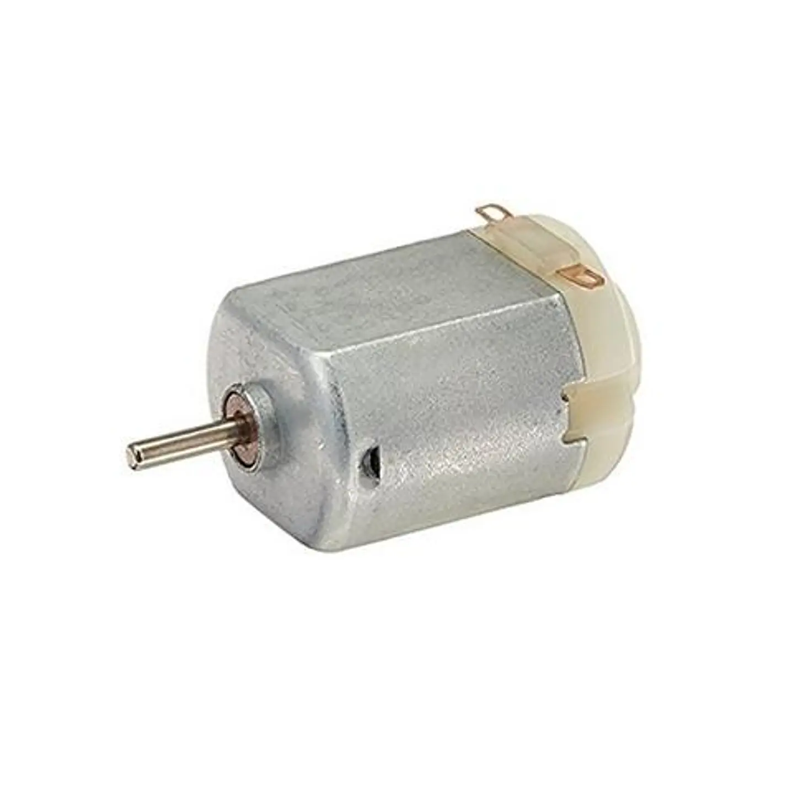
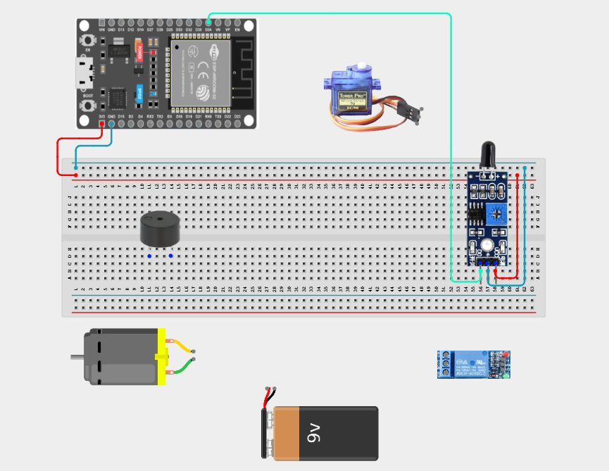
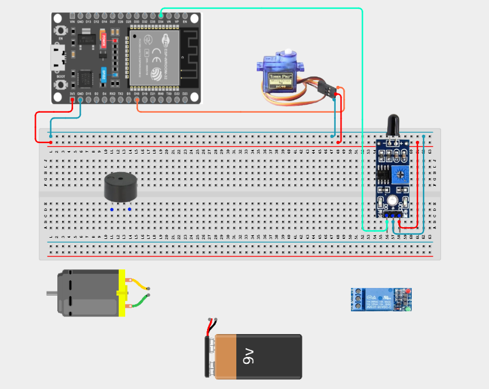
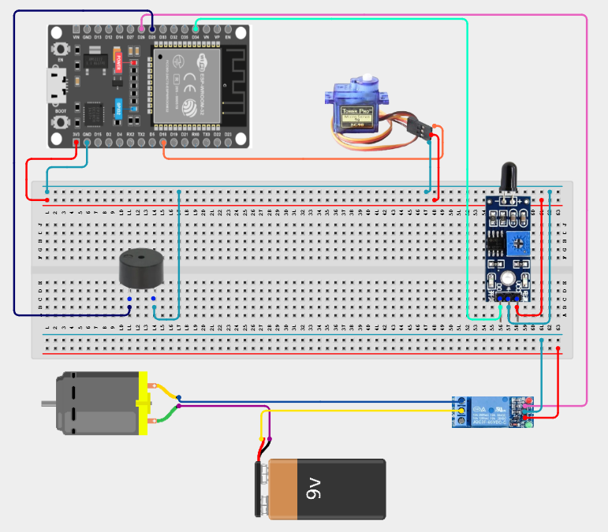

# 4.1.33. Intelligent Flame  Gas Containment

| **Description** | In Project 88, learners will engineer an advanced 'Intelligent Flame & Gas Containment' multi-component system. This design integrates Flame Sensor + Servo Motor Valve + Relay Fan + Buzzer into a cohesive industrial automation unit. |
|------------------|----------------------------------------------------------------|
| **Use case**     |This project can be applied to real-world IoT, safety, and control systems while developing essential master-level engineering skills.|

## Components (Things You will need)

|  |  |  |  |  | Relay Module |  |  |  |
| --- | --- | --- | --- | --- | --- | --- | --- | --- |

## Building the circuit

> **Tip:** Use the [ESP32 Pin Mapping](../../assets/esp32_pin_mapping.png) image to locate the correct GPIO pins on your ESP32 board.


Things Needed:

- ESP32 board Core Board = 1

- Flame Sensor = 1

- Servo Motor Valve = 1

- Relay Fan = 1

- USB Cable & Jumper Wires = 1

- Bread Board

- Active Buzzer = 1

- DC fan/load compatible with relay = 1

- Regulated 5 V servo supply = 1
## Wiring the circuit

**Step 1:** Connect the Flame sensor:
- Connect digital **DO** to **GPIO 34**
- Connect **VCC** to **3.3V**
- Connect sensor **GND** to common **GND**.



**Step 2:** Connect the Servo valve:
- Connect servo signal to **GPIO 18**.
- Connect the servo power input to a regulated external **5V** supply sized for the servo.
- Connect the external supply ground to ESP32 **GND**.



**Step 3:** Connect the Relay fan and active buzzer:
- Connect relay **IN** to **GPIO 26**
- Connect **VCC** to its rated supply
- Connect **GND** to common **GND**.
- Connect the active buzzer **signal/+** to **GPIO 25**.
- Connect the active buzzer **GND/-** to common ground.
- Connect relay **COM** to the fan-rated external supply.
- Connect relay **NO** to the fan load.
- Connect the fan return to the external supply negative.
- Never power the fan from an ESP32 pin.



**Step 4:** Final wiring check:
- Check the servo supply, relay/load rating, and common ground before USB.


## PROGRAMMING

**Step 1:** Open your Arduino IDE. See how to set up here: [Getting Started](../../Getting Started/Arduino_IDE_Setup.md).

**Step 2:** Install the **ESP32Servo** library from Arduino IDE Library Manager, then enter and upload this complete program.

```cpp
#include <ESP32Servo.h>

// Project 88: Intelligent Flame & Gas Containment
const int flamePin = 34;
const int servoPin = 18;
const int relayPin = 26;
const int buzzerPin = 25;
const int flameActiveLevel = LOW; // Change to HIGH for an active-high sensor output.
const int valveOpenAngle = 90;
const int valveClosedAngle = 0;
const bool relayActiveLow = false;
Servo valveServo;
bool previousFlameState = false;
bool flameStateInitialized = false;

void setRelay(bool energized) {
  const bool outputHigh = energized != relayActiveLow;
  digitalWrite(relayPin, outputHigh ? HIGH : LOW);
}

void setSafeState(bool flameDetected) {
  valveServo.write(flameDetected ? valveClosedAngle : valveOpenAngle);
  digitalWrite(buzzerPin, flameDetected ? HIGH : LOW);
  setRelay(!flameDetected); // De-energize the fan relay while flame is detected.
}

void setup() {
  Serial.begin(9600);
  pinMode(flamePin, INPUT);
  pinMode(relayPin, OUTPUT);
  pinMode(buzzerPin, OUTPUT);
  setRelay(false);
  digitalWrite(buzzerPin, LOW);
  valveServo.setPeriodHertz(50);
  valveServo.attach(servoPin, 500, 2400);
  valveServo.write(valveClosedAngle);
  Serial.println("Project 88: Intelligent Flame & Gas Containment Initialized...");
}

void loop() {
  const bool flameDetected = digitalRead(flamePin) == flameActiveLevel;

  if (!flameStateInitialized || flameDetected != previousFlameState) {
    setSafeState(flameDetected);
    if (flameStateInitialized) {
      Serial.println(flameDetected ? "Flame detected: valve closed, fan interlocked, alarm on"
                                   : "Flame cleared: valve returned to normal, fan enabled");
    }
    previousFlameState = flameDetected;
    flameStateInitialized = true;
  }
  delay(50);
}
```

**Step 3:** Save your code. _See the [Getting Started](../../Getting Started/Arduino_IDE_Setup.md) section._

**Step 4:** Select the ESP32 board and port. See the [Getting Started](../../Getting Started/Arduino_IDE_Setup.md) section.

**Step 5:** Upload your code. See the [Getting Started](../../Getting Started/Arduino_IDE_Setup.md) section.

## CONCLUSION

The system responds dynamically when physical conditions cross pre-programmed setpoints, driving output devices reliably.
