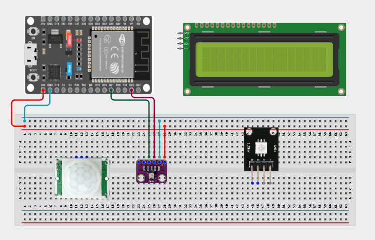
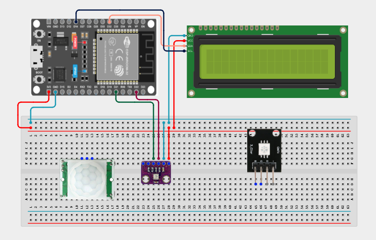
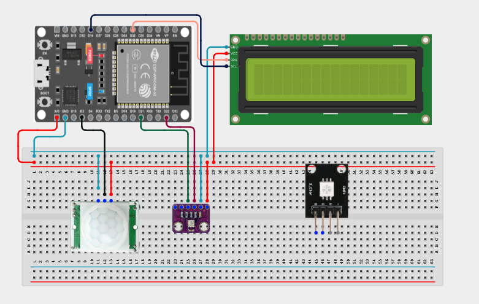
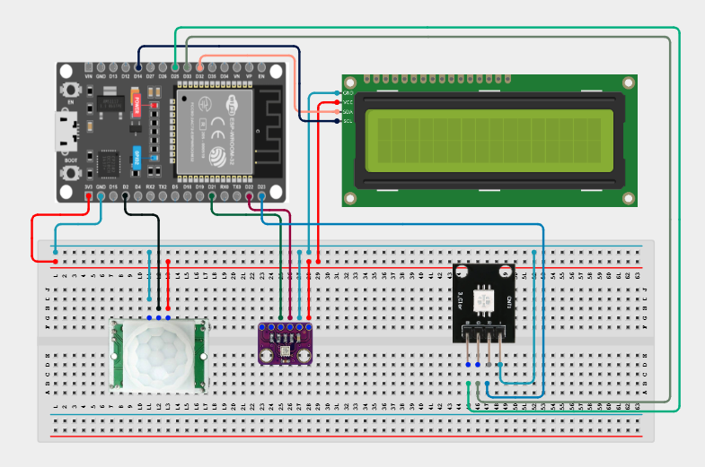

# 4.1.34. Smart Warehouse Environmental Monitor

| **Description** | In Project 89, learners will engineer an advanced 'Smart Warehouse Environmental Monitor' multi-component system. This design integrates BME280 + PIR Motion Sensor + IIC 1602 LCD + RGB LED into a cohesive industrial automation unit. |
|------------------|----------------------------------------------------------------|
| **Use case**     |This project can be applied to real-world IoT, safety, and control systems while developing essential master-level engineering skills.|

## Components (Things You will need)

|  |  |  |  |  |  |  |  |
| --- | --- | --- | --- | --- | --- | --- | --- |

## Building the circuit

> **Tip:** Use the [ESP32 Pin Mapping](../../assets/esp32_pin_mapping.png) image to locate the correct GPIO pins on your ESP32 board.


Things Needed:

- ESP32 board Core Board = 1

- BME280 = 1

- PIR Motion Sensor = 1

- IIC 1602 LCD = 1

- USB Cable & Jumper Wires = 1

- Bread Board

- RGB Module


## Wiring the circuit

**Step 1:** Connect the BME280 sensor:

- Connect **VCC** to **3.3V** on the ESP32 board.
- Connect **GND** to a GND pin on the ESP32 board.
- Connect **SDA** to **GPIO 21**.
- Connect **SCL** to **GPIO 22**.



**Step 2:** Connect the I²C LCD:

- Connect **VCC** to **3.3V**
- Connect **GND** to a GND pin on the ESP32 board.
- Connect **SDA** to **GPIO 32**.
- Connect **SCL** to **GPIO 14**.



**Step 3:** Connect the PIR motion sensor:

- Connect **VCC** to **5V**.
- Connect **GND** to the common ground.
- Connect **OUT** to **GPIO 2**.



**Step 4:** Connect the RGB LED module:

- Connect **R** to **GPIO 23**.
- Connect **G** to **GPIO 33**.
- Connect **B** to **GPIO 25**.
- Connect the module's **GND** to ESP32 **GND**.


_Make sure to connect the Micro USB cable to the ESP32 board._



## PROGRAMMING

**Step 1:** Open your Arduino IDE. See how to set up here: [Getting Started](../../Getting Started/Arduino_IDE_Setup.md).

**Step 2:** Install the **Adafruit BME280** and **Adafruit Unified Sensor** libraries from Arduino IDE Library Manager, then enter and upload this complete program. The LCD uses a separate I²C bus from the BME280.

```cpp
// Project 89: Smart Warehouse Environmental Monitor
#include <Wire.h>
#include <Adafruit_BME280.h>

Adafruit_BME280 bme;
TwoWire lcdBus(1);
const int lcdSdaPin = 32;
const int lcdSclPin = 14;
const uint8_t lcdAddress = 0x27;
const uint8_t lcdRs = 0x01;
const uint8_t lcdEnable = 0x04;
const uint8_t lcdBacklight = 0x08;
const int pirPin = 2;
const int redPin = 23;
const int greenPin = 33;
const int bluePin = 25;

void lcdWriteExpander(uint8_t value) {
  lcdBus.beginTransmission(lcdAddress);
  lcdBus.write(value | lcdBacklight);
  lcdBus.endTransmission();
}

void lcdPulseEnable(uint8_t value) {
  lcdWriteExpander(value | lcdEnable);
  delayMicroseconds(1);
  lcdWriteExpander(value & ~lcdEnable);
  delayMicroseconds(50);
}

void lcdWriteNibble(uint8_t value, bool data) {
  const uint8_t output = (value & 0xF0) | (data ? lcdRs : 0);
  lcdWriteExpander(output);
  lcdPulseEnable(output);
}

void lcdSend(uint8_t value, bool data) {
  lcdWriteNibble(value, data);
  lcdWriteNibble(value << 4, data);
}

void lcdCommand(uint8_t command) {
  lcdSend(command, false);
  if (command == 0x01 || command == 0x02) delay(2);
}

void lcdInit() {
  delay(50);
  lcdWriteNibble(0x30, false);
  delay(5);
  lcdWriteNibble(0x30, false);
  delayMicroseconds(150);
  lcdWriteNibble(0x30, false);
  lcdWriteNibble(0x20, false);
  lcdCommand(0x28);
  lcdCommand(0x0C);
  lcdCommand(0x06);
  lcdCommand(0x01);
}

void lcdSetCursor(uint8_t column, uint8_t row) {
  const uint8_t rowOffsets[] = {0x00, 0x40};
  lcdCommand(0x80 | (column + rowOffsets[row % 2]));
}

void lcdPrint(const char *text) {
  while (*text) lcdSend(static_cast<uint8_t>(*text++), true);
}

void lcdPrint(float value, uint8_t decimals) {
  char text[16];
  dtostrf(value, 1, decimals, text);
  lcdPrint(text);
}

void setup() {
  Serial.begin(9600);
  Wire.begin(21, 22);
  lcdBus.begin(lcdSdaPin, lcdSclPin, 100000);
  lcdInit();
  
  pinMode(pirPin, INPUT);
  pinMode(redPin, OUTPUT);
  pinMode(greenPin, OUTPUT);
  pinMode(bluePin, OUTPUT);

  if (!bme.begin(0x76) && !bme.begin(0x77)) {
    Serial.println("Could not find BME280 sensor!");
    while (1);
  }

  lcdSetCursor(0, 0);
  lcdPrint("Warehouse Monitor");
}

void loop() {
  float temp = bme.readTemperature();
  int motion = digitalRead(pirPin);

  lcdSetCursor(0, 1);
  lcdPrint("Temp: ");
  lcdPrint(temp, 1);
  lcdPrint("C");

  if (motion == HIGH) {
    digitalWrite(redPin, HIGH);
    digitalWrite(greenPin, LOW);
    digitalWrite(bluePin, LOW);
  } else {
    digitalWrite(redPin, LOW);
    digitalWrite(greenPin, HIGH);
    digitalWrite(bluePin, LOW);
  }
  
  delay(1000);
}
```

**Step 7:** Save your code. _See the [Getting Started](../../Getting Started/Arduino_IDE_Setup.md) section_

**Step 8:** Select the ESP32 board and port _See the [Getting Started](../../Getting Started/Arduino_IDE_Setup.md) section:Selecting ESP32 board Type and Uploading your code_.

**Step 9:** Upload your code. _See the [Getting Started](../../Getting Started/Arduino_IDE_Setup.md) section:Selecting ESP32 board Type and Uploading your code_

## CONCLUSION

The system responds dynamically when physical conditions cross pre-programmed setpoints, driving output devices reliably.