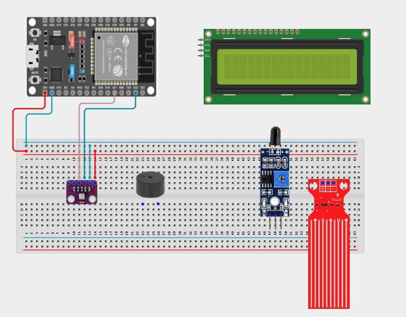
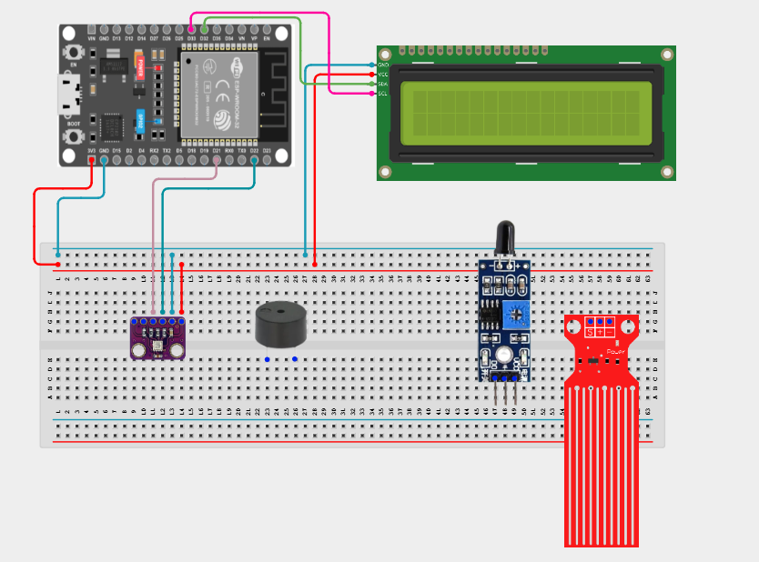
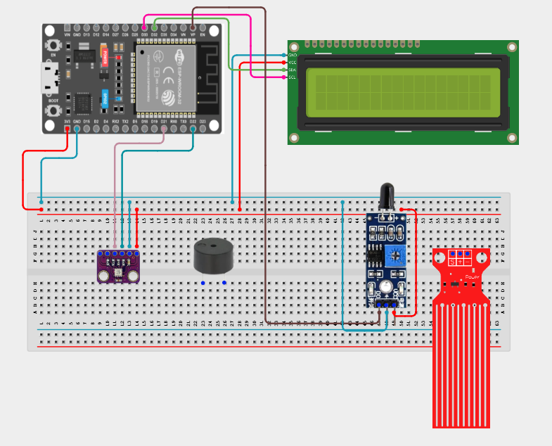
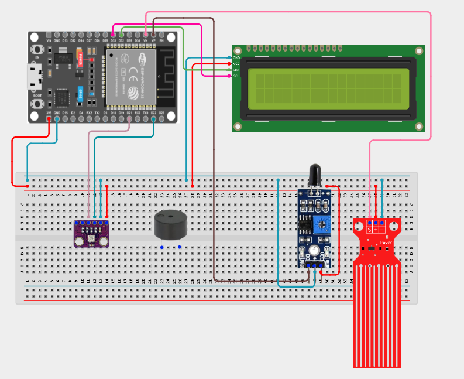
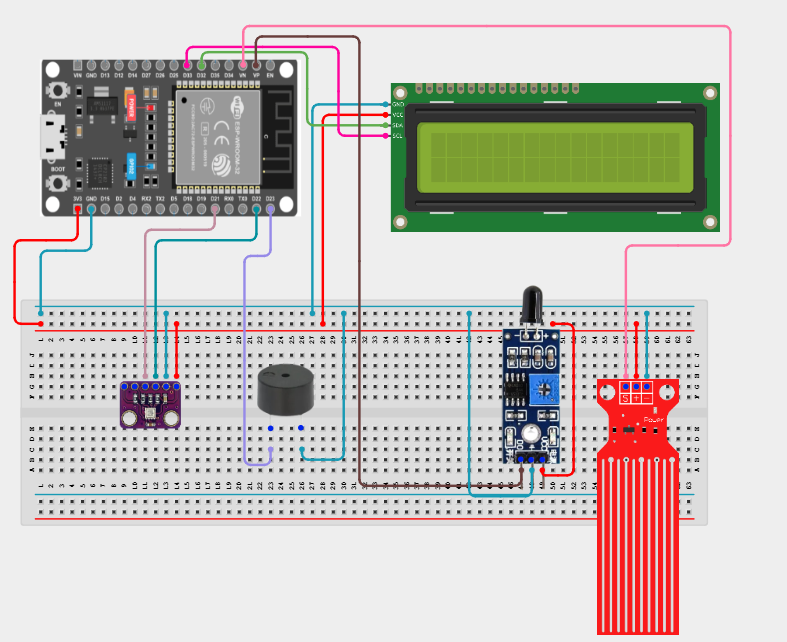

# 4.1.35. Master Safety Monitoring Station

| **Description** | In Project 90, learners will engineer an advanced 'Master Safety Monitoring Station' multi-component system. This design integrates BME280 + Flame Sensor + Water Test Module + IIC 1602 LCD + Buzzer + Relay Module into a cohesive industrial automation unit. |
|------------------|----------------------------------------------------------------|
| **Use case**     |This project can be applied to real-world IoT, safety, and control systems while developing essential master-level engineering skills.|

## Components (Things You will need)

|  |  |  |  |  |  |  | Relay Module |  |  |
| --- | --- | --- | --- | --- | --- | --- | --- | --- | --- |

## Building the circuit

> **Tip:** Use the [ESP32 Pin Mapping](../../assets/esp32_pin_mapping.png) image to locate the correct GPIO pins on your ESP32 board.


Things Needed:

- ESP32 board Core Board = 1

- BME280 = 1

- Flame Sensor = 1

- Water Test Module = 1

- USB Cable & Jumper Wires = 1

- Bread Board

- LCD Display

- Buzzer

- Relay Module

- Bidirectional I²C logic-level shifter = 1 (if the LCD module requires 5V)

## Wiring the circuit

**Step 1:** Connect the BME280 sensor to its I²C bus:
- Connect the BME280 **SDA** to **GPIO 21**.
- Connect the BME280 **SCL** to **GPIO 22**.
- Connect the BME280 **VCC** to **3.3V**.
- Connect the BME280 **GND** to common **GND**.



**Step 2:** Connect the I²C LCD display to a separate I²C bus:
- Connect the LCD **SDA** to **GPIO 32**.
- Connect the LCD **SCL** to **GPIO 33**.
- Connect the LCD **GND** to common **GND**.
- Connect the LCD **VCC** to **3.3V** if supported; otherwise connect it to **5V** and route the LCD **SDA** and **SCL** through a bidirectional I²C logic-level shifter.



**Step 3:** Connect the flame sensor:
- Connect **AO** to **GPIO 36**
- Connect **VCC** to **3.3V**
- Connect **GND** to common **GND**. Keep the output voltage at or below 3.3V.



**Step 4:** Connect the water test module:
- Connect **AO** to **GPIO 39**
- Connect **VCC** to **3.3V**
- Connect **GND** to common **GND**. Keep the output voltage at or below 3.3V.



**Step 5:** Connect the buzzer and relay module:
- Connect the active buzzer **signal/+** to **GPIO 23**.
- Connect the active buzzer **GND/-** to common **GND**.
- Connect relay **IN** to **GPIO 26**
- Connect **VCC** to its rated **5V** supply
- Connect **GND** to common **GND**.
- Use the relay **COM/NO** contacts only with a correctly rated external load supply.

Check all connections and polarities before connecting the USB cable.


_Make sure to connect the Micro USB cable to the ESP32 board._



## PROGRAMMING

**Step 1:** Open your Arduino IDE. See how to set up here: [Getting Started](../../Getting Started/Arduino_IDE_Setup.md).

**Step 2:** Install the **Adafruit BME280** and **Adafruit Unified Sensor** libraries from Arduino IDE Library Manager, then enter and upload this complete program. The LCD uses a separate I²C bus from the BME280.

```cpp
// Project 90: Master Safety Monitoring Station
#include <Wire.h>
#include <Adafruit_BME280.h>

Adafruit_BME280 bme;
TwoWire lcdBus(1);
const int lcdSdaPin = 32;
const int lcdSclPin = 33;
const uint8_t lcdAddress = 0x27;
const uint8_t lcdRs = 0x01;
const uint8_t lcdEnable = 0x04;
const uint8_t lcdBacklight = 0x08;

const int flamePin = 36;
const int waterPin = 39;
const int buzzerPin = 23;
const int relayPin = 26;

void lcdWriteExpander(uint8_t value) {
  lcdBus.beginTransmission(lcdAddress);
  lcdBus.write(value | lcdBacklight);
  lcdBus.endTransmission();
}

void lcdPulseEnable(uint8_t value) {
  lcdWriteExpander(value | lcdEnable);
  delayMicroseconds(1);
  lcdWriteExpander(value & ~lcdEnable);
  delayMicroseconds(50);
}

void lcdWriteNibble(uint8_t value, bool data) {
  const uint8_t output = (value & 0xF0) | (data ? lcdRs : 0);
  lcdWriteExpander(output);
  lcdPulseEnable(output);
}

void lcdSend(uint8_t value, bool data) {
  lcdWriteNibble(value, data);
  lcdWriteNibble(value << 4, data);
}

void lcdCommand(uint8_t command) {
  lcdSend(command, false);
  if (command == 0x01 || command == 0x02) delay(2);
}

void lcdInit() {
  delay(50);
  lcdWriteNibble(0x30, false);
  delay(5);
  lcdWriteNibble(0x30, false);
  delayMicroseconds(150);
  lcdWriteNibble(0x30, false);
  lcdWriteNibble(0x20, false);
  lcdCommand(0x28);
  lcdCommand(0x0C);
  lcdCommand(0x06);
  lcdCommand(0x01);
}

void lcdSetCursor(uint8_t column, uint8_t row) {
  const uint8_t rowOffsets[] = {0x00, 0x40};
  lcdCommand(0x80 | (column + rowOffsets[row % 2]));
}

void lcdPrint(const char *text) {
  while (*text) lcdSend(static_cast<uint8_t>(*text++), true);
}

void lcdPrint(int value) {
  char text[12];
  snprintf(text, sizeof(text), "%d", value);
  lcdPrint(text);
}

void lcdPrint(float value, uint8_t decimals) {
  char text[16];
  dtostrf(value, 1, decimals, text);
  lcdPrint(text);
}

void setup() {
  Serial.begin(9600);
  // BME280 uses I2C controller 0; the LCD uses controller 1 on separate pins.
  Wire.begin(21, 22);
  lcdBus.begin(lcdSdaPin, lcdSclPin, 100000);
  lcdInit();
  if (!bme.begin(0x76) && !bme.begin(0x77)) {
    Serial.println("Could not find a valid BME280 sensor!");
  }
  pinMode(flamePin, INPUT);
  pinMode(waterPin, INPUT);
  pinMode(buzzerPin, OUTPUT);
  pinMode(relayPin, OUTPUT);
  Serial.println("Project 90: Master Safety Monitoring Station Initialized...");
}

void loop() {
  // Read sensor values
  float temperature = bme.readTemperature();
  int flameValue = analogRead(flamePin);
  int waterValue = analogRead(waterPin);

  // Display on LCD
  lcdSetCursor(0, 0);
  lcdPrint("T: ");
  lcdPrint(temperature, 1);
  lcdPrint("C");
  
  // Logic: Trigger alarm if flame detected or water level high
  if (flameValue < 500 || waterValue > 500) {
    digitalWrite(buzzerPin, HIGH);
    digitalWrite(relayPin, HIGH);
    lcdSetCursor(0, 1);
    lcdPrint("ALERT!          ");
  } else {
    digitalWrite(buzzerPin, LOW);
    digitalWrite(relayPin, LOW);
    lcdSetCursor(0, 1);
    lcdPrint("Normal          ");
  }
  delay(500);
}
```

**Step 7:** Save your code. _See the [Getting Started](../../Getting Started/Arduino_IDE_Setup.md) section_

**Step 8:** Select the ESP32 board and port _See the [Getting Started](../../Getting Started/Arduino_IDE_Setup.md) section:Selecting ESP32 board Type and Uploading your code_.

**Step 9:** Upload your code. _See the [Getting Started](../../Getting Started/Arduino_IDE_Setup.md) section:Selecting ESP32 board Type and Uploading your code_

## CONCLUSION

The system responds dynamically when physical conditions cross pre-programmed setpoints, driving output devices reliably.