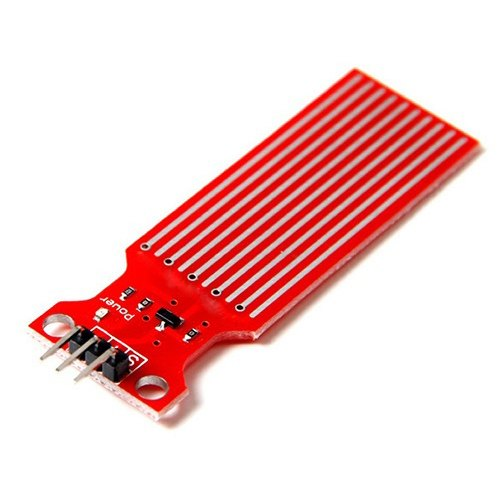
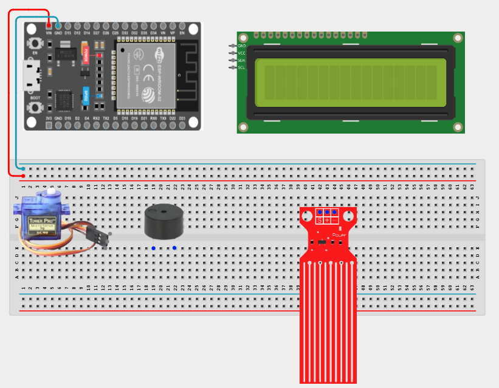
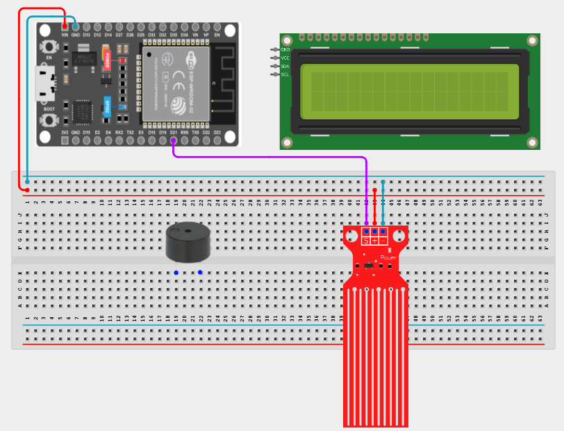
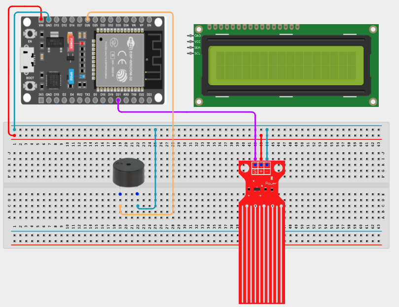
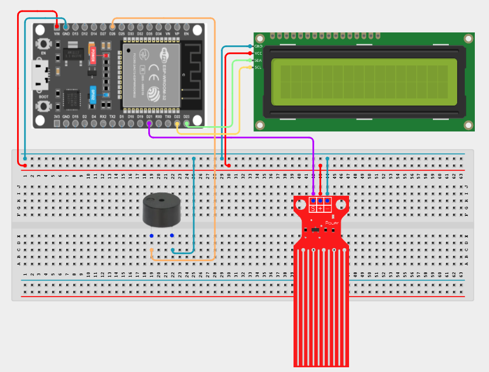

# 4.1.3. Automated Plant Soil & Water Monitor

| **Description** | Students build real-world experience in sensor bus integration, actuation logic, and fault-tolerant system design.|
|------------------|---------------------------------------------------------------- |
| **Use case**     | This project connects to real-world industrial and IoT applications such as: Project 64 provides essential master-level engineering skills for real-world IoT, safety, and control systems. |

## Components (Things You will need)

|  |  |  |  |  |  |  |
| --- | --- | --- | --- | --- | --- | --- |

## Building the circuit

> **Tip:** Use the [ESP32 Pin Mapping](../../assets/esp32_pin_mapping.png) image to locate the correct GPIO pins on your ESP32 board.


Things Needed:

- ESP32 board = 1

- Micro USB cable = 1

- Jumper Wires

- Water Test Module

- LCD Display

- Buzzer

- Bread Board

## Wiring the circuit

**Step 1:** Connect the power rails:

- Connect **5V** on the ESP32 board to the positive (+) rail.
- Connect a **GND** pin on the ESP32 board to the negative (−) rail.



**Step 2:** Connect the water sensor:

- Connect **VCC** to the 5V rail.
- Connect **GND** to the ground rail.
- Connect the signal (**S**) pin to **GPIO 21**.



**Step 3:** Connect the active buzzer:

- Connect the positive (+) terminal to **GPIO 26**.
- Connect the negative (−) terminal to the ground rail.



**Step 4:** Connect the I²C LCD module:

- Connect **VCC** to the 5V rail.
- Connect **GND** to the ground rail.
- Connect **SDA** to **GPIO 23 (SDA)**.
- Connect **SCL** to **GPIO 22 (SCL)**.


_Make sure to connect the Micro USB cable to the ESP32 board after checking all connections._



## PROGRAMMING

**Step 1:** Open your Arduino IDE. See how to set up here: [Getting Started](../../Getting Started/Arduino_IDE_Setup.md).

**Step 2:** Write the complete program implementing the system logic with appropriate pin definitions, setup configuration, and the main control loop.

```cpp
#include <Wire.h>
#include <LiquidCrystal_I2C.h>

// LCD Address (Change to 0x3F if required)
LiquidCrystal_I2C lcd(0x27, 16, 2);

// Pin Definitions
const int waterSensorPin = 21;     // Digital output from Water Sensor
const int buzzerPin = 26;

// Variables
bool waterDetected = false;

void setup()
{
  pinMode(waterSensorPin, INPUT);
  pinMode(buzzerPin, OUTPUT);

  digitalWrite(buzzerPin, LOW);

  Serial.begin(9600);

  lcd.init();
  lcd.backlight();

  lcd.clear();
  lcd.setCursor(0,0);
  lcd.print("Plant Monitor");
  lcd.setCursor(0,1);
  lcd.print("Initializing");

  delay(2000);
  lcd.clear();

  Serial.println("Project 64 Started...");
}

void loop()
{
  waterDetected = digitalRead(waterSensorPin);

  lcd.clear();

  if (waterDetected == HIGH)
  {
    lcd.setCursor(0,0);
    lcd.print("Water Detected");

    lcd.setCursor(0,1);
    lcd.print("Plant is Wet");

    digitalWrite(buzzerPin, LOW);

    Serial.println("Water Detected");
  }
  else
  {
    lcd.setCursor(0,0);
    lcd.print("No Water!");

    lcd.setCursor(0,1);
    lcd.print("Needs Water");

    digitalWrite(buzzerPin, HIGH);

    Serial.println("No Water Detected");

    delay(300);

    digitalWrite(buzzerPin, LOW);

    delay(300);
  }

  delay(500);
}

```

**Step 3:** Save your code. _See the [Getting Started](../../Getting Started/Arduino_IDE_Setup.md) section_

**Step 4:** Select the ESP32 board and port _See the [Getting Started](../../Getting Started/Arduino_IDE_Setup.md) section:Selecting ESP32 board Type and Uploading your code_.

**Step 5:** Upload your code. _See the [Getting Started](../../Getting Started/Arduino_IDE_Setup.md) section:Selecting ESP32 board Type and Uploading your code_

## CONCLUSION

The system responds dynamically when physical conditions cross pre-programmed setpoints, driving output devices reliably.