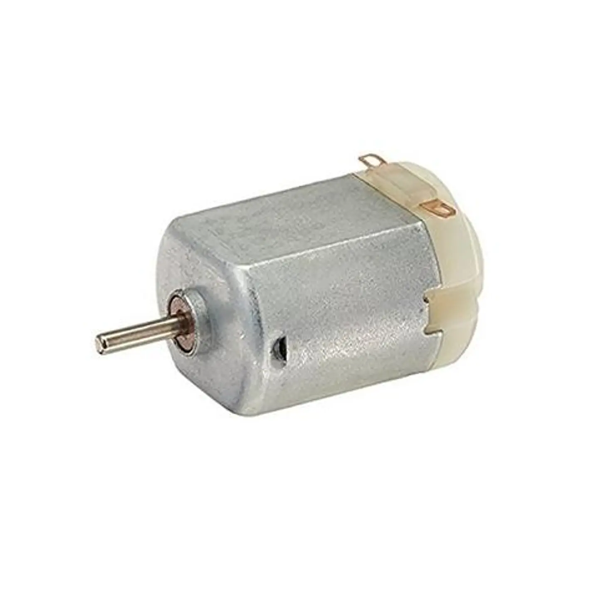
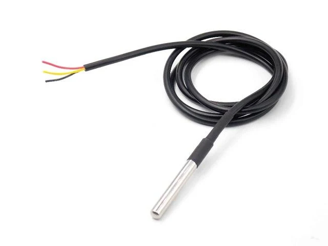

# 4.1.4. Temperature Triggered Cooling Fan

| **Description** | Students build real-world experience in sensor bus integration, actuation logic, and fault-tolerant system design.|
|------------------|---------------------------------------------------------------- |
| **Use case**     | This temperature-triggered fan demonstrates automated thermal management used in equipment enclosures, server rooms, and industrial control cabinets. |

## Components (Things You will need)

|  |  |  |  |  |  |  |  |  |  |  |  |
| --- | --- | --- | --- | --- | --- | --- | --- | --- | --- | --- | --- |

## Building the circuit

> **Tip:** Use the [ESP32 Pin Mapping](../../assets/esp32_pin_mapping.png) image to locate the correct GPIO pins on your ESP32 board.


Things Needed:

- ESP32 board = 1

- Micro USB cable = 1

- Servo motor = 1

- Jumper Wires

- Temperature Sensor

- DC Motor

- Motor Drivers

- Bread Board

- RGB Module

- Resistor

- LED

- Motor Driver

- Fan Blades

## Wiring the circuit

**Step 1:** Connect the DS18B20 temperature sensor:
- Connect **DATA** to **GPIO 2**.
- Connect **VCC** to **5V**.
- Connect **GND** to **GND**.
- Connect a **4.7 kΩ pull-up resistor** between **DATA** and **5V**.


**Step 2:** Connect the L298N motor driver:
- Connect **IN1** to **GPIO 22**.
- Connect **IN2** to **GPIO 23**.
- Connect **ENA** to **GPIO 33**.
- Connect the driver's **5V** pin to **5V**.
- Connect the driver's **GND** pin to **GND**.


**Step 3:** Connect the DC motor:
- Connect one motor terminal to the driver's **OUT1** terminal.
- Connect the other motor terminal to the driver's **OUT2** terminal.


**Step 4:** Connect the RGB LED:
- Connect the red pin through a **220 Ω current-limiting resistor** to **GPIO 4**.
- Connect the green pin through a **220 Ω current-limiting resistor** to **GPIO 18**.
- Connect the blue pin through a **220 Ω current-limiting resistor** to **GPIO 19**.
- Connect the common pin to **GND** for a common-cathode LED or to **5V** for a common-anode LED.


_Make sure to connect the Micro USB cable to the ESP32 board after checking all connections._


## PROGRAMMING

**Step 1:** Open your Arduino IDE. See how to set up here: [Getting Started](../../Getting Started/Arduino_IDE_Setup.md).

**Step 2:** Write the complete program implementing the system logic with appropriate pin definitions, setup configuration, and the main control loop.

```cpp

#include <OneWire.h>
#include <DallasTemperature.h>

// ---------------- Pin Definitions ----------------
#define ONE_WIRE_BUS 2

const int ENA = 33;
const int IN1 = 22;
const int IN2 = 23;

const int RED_LED = 4;
const int GREEN_LED = 18;
const int BLUE_LED = 19;

// ---------------- Temperature Sensor ----------------
OneWire oneWire(ONE_WIRE_BUS);
DallasTemperature sensors(&oneWire);

// Temperature Threshold
const float TEMP_THRESHOLD = 30.0;

void setup()
{
  Serial.begin(9600);

  sensors.begin();

  pinMode(ENA, OUTPUT);
  pinMode(IN1, OUTPUT);
  pinMode(IN2, OUTPUT);

  pinMode(RED_LED, OUTPUT);
  pinMode(GREEN_LED, OUTPUT);
  pinMode(BLUE_LED, OUTPUT);

  stopMotor();
  setLED(0,255,0);

  Serial.println("Project 65: Temperature-Triggered Cooling Fan");
  Serial.println("--------------------------------------------");
}

void loop()
{
  sensors.requestTemperatures();

  float temperature = sensors.getTempCByIndex(0);

  Serial.print("Temperature: ");
  Serial.print(temperature);
  Serial.println(" °C");

  if(temperature >= TEMP_THRESHOLD)
  {
      runMotor();

      // Red LED
      setLED(255,0,0);

      Serial.println("Cooling Fan ON");
  }
  else
  {
      stopMotor();

      // Green LED
      setLED(0,255,0);

      Serial.println("Cooling Fan OFF");
  }

  delay(1000);
}

//---------------- Functions ----------------//

void runMotor()
{
    digitalWrite(IN1,HIGH);
    digitalWrite(IN2,LOW);
    analogWrite(ENA,255);
}

void stopMotor()
{
    digitalWrite(IN1,LOW);
    digitalWrite(IN2,LOW);
    analogWrite(ENA,0);
}

void setLED(int red,int green,int blue)
{
    analogWrite(RED_LED,red);
    analogWrite(GREEN_LED,green);
    analogWrite(BLUE_LED,blue);
}

```

**Step 3:** Save your code. _See the [Getting Started](../../Getting Started/Arduino_IDE_Setup.md) section_

**Step 4:** Select the ESP32 board and port _See the [Getting Started](../../Getting Started/Arduino_IDE_Setup.md) section:Selecting ESP32 board Type and Uploading your code_.

**Step 5:** Upload your code. _See the [Getting Started](../../Getting Started/Arduino_IDE_Setup.md) section:Selecting ESP32 board Type and Uploading your code_

## CONCLUSION

The system responds dynamically when physical conditions cross pre-programmed setpoints, driving output devices reliably.