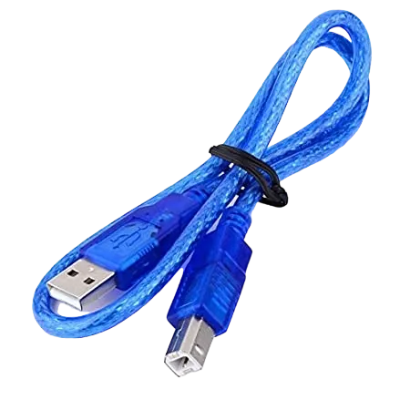
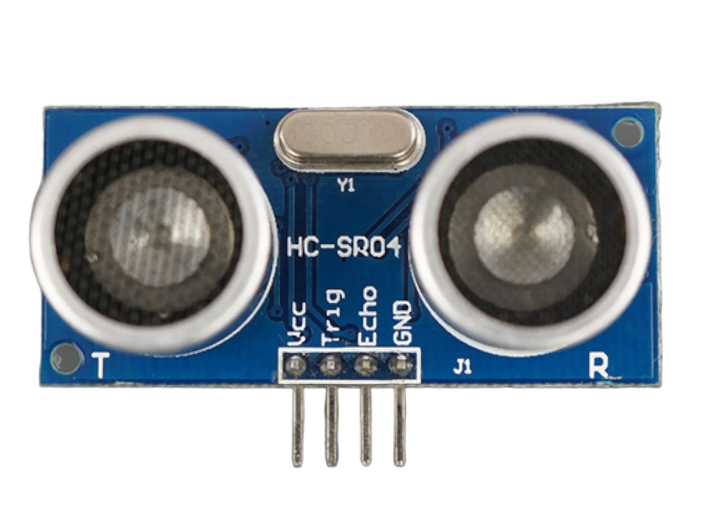
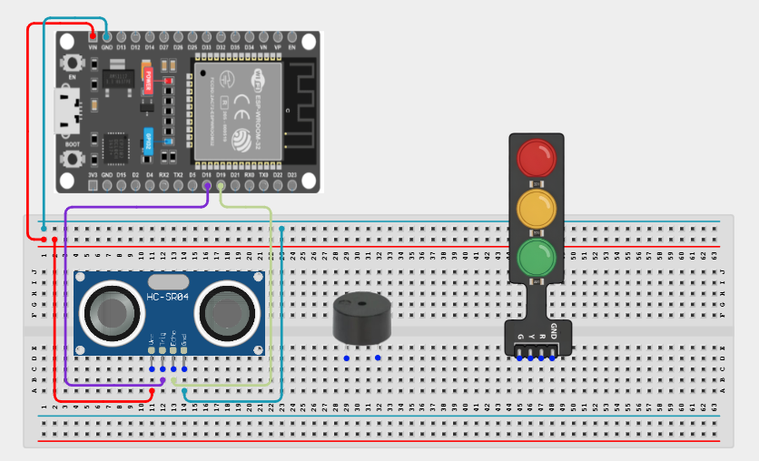
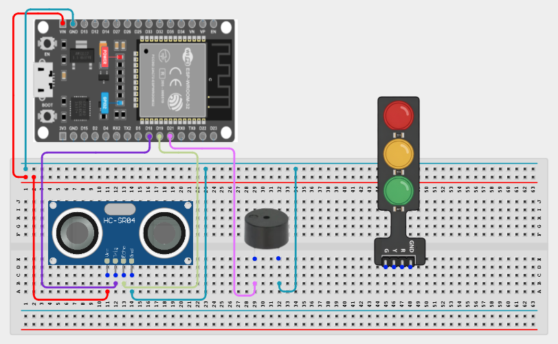
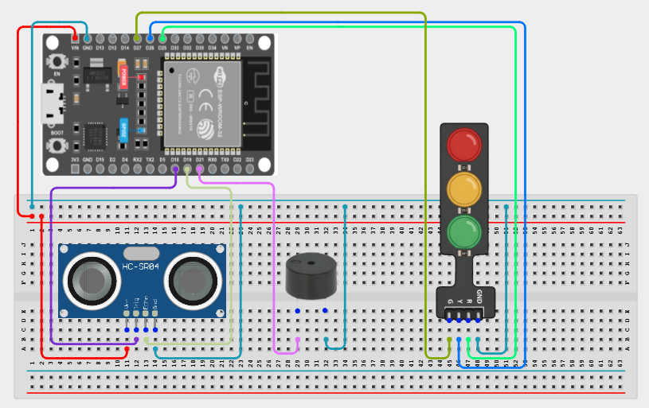

# 4.1.5. Proximity Warning Radar

| **Description** | Learners will engineer an advanced 'Proximity Warning Radar' multi-component system. This design integrates HC-SR04 Ultrasonic + Active Buzzer + Traffic Light Module into a cohesive industrial automation unit.|
|------------------|---------------------------------------------------------------- |
| **Use case**     | This project can be applied to real-world IoT, safety, and control systems while developing essential master-level engineering skills. |

## Components (Things You will need)

|  |  |  |  |  |  |  |
| --- | --- | --- | --- | --- | --- | --- |

## Building the circuit

> **Tip:** Use the [ESP32 Pin Mapping](../../assets/esp32_pin_mapping.png) image to locate the correct GPIO pins on your ESP32 board.


Things Needed:

- ESP32 board = 1

- Micro USB cable = 1

- Jumper Wires

- Ultrasonic Sensor

- Buzzer

- Traffic Light Module

- Bread Board
## Wiring the circuit

**Step 1:** Connect the HC-SR04 ultrasonic sensor:

- Connect **VCC** to the ESP32 **5V/VIN** pin.
- Connect **GND** to ESP32 **GND**.
- Connect **TRIG** to **GPIO 18**.
- Connect **ECHO** to **GPIO 19** on the ESP32.



**Step 2:** Connect the active buzzer:

- Connect the buzzer **signal/+** pin to **GPIO 21**.
- Connect the buzzer **GND/-** pin to ESP32 **GND**.



**Step 3:** Connect the traffic light module:

- Connect **R** to **GPIO 25**.
- Connect **Y** to **GPIO 26**.
- Connect **G** to **GPIO 27**.
- Connect the module **GND** to ESP32 **GND**. The module has onboard current-limiting resistors; do not connect it to 5 V.




## PROGRAMMING

**Step 1:** Open your Arduino IDE. See how to set up here: [Getting Started](../../Getting Started/Arduino_IDE_Setup.md).

**Step 2:** Write the complete program implementing the system logic with appropriate pin definitions, setup configuration, and the main control loop.

```cpp
// Project 66: Proximity Warning Radar
// Target Integration: HC-SR04 Ultrasonic + Active Buzzer + Traffic Light Module

const int trigPin = 18;
const int echoPin = 19;
const int redLed = 25;
const int yellowLed = 26;
const int greenLed = 27;
const int buzzer = 21;

void setup() {
  Serial.begin(9600);
  pinMode(trigPin, OUTPUT);
  pinMode(echoPin, INPUT);
  pinMode(redLed, OUTPUT);
  pinMode(yellowLed, OUTPUT);
  pinMode(greenLed, OUTPUT);
  pinMode(buzzer, OUTPUT);
  Serial.println("Project 66: Proximity Warning Radar Initialized...");
}

void loop() {
  long duration, distance;
  
  // Trigger sensor
  digitalWrite(trigPin, LOW);
  delayMicroseconds(2);
  digitalWrite(trigPin, HIGH);
  delayMicroseconds(10);
  digitalWrite(trigPin, LOW);
  
  // Read echo
  duration = pulseIn(echoPin, HIGH);
  distance = (duration / 2) / 29.1;

  Serial.print("Distance: ");
  Serial.print(distance);
  Serial.println(" cm");

  // Logic control
  if (distance > 0 && distance < 10) {
    // Red Light + Buzzer

    digitalWrite(redLed, HIGH);
    digitalWrite(yellowLed, LOW);
    digitalWrite(greenLed, LOW);
    digitalWrite(buzzer, HIGH);
  } else if (distance >= 10 && distance < 25) {
    // Yellow Light
    digitalWrite(redLed, LOW);
    digitalWrite(yellowLed, HIGH);
    digitalWrite(greenLed, LOW);
    digitalWrite(buzzer, LOW);
  } else {
    // Green Light
    digitalWrite(redLed, LOW);
    digitalWrite(yellowLed, LOW);
    digitalWrite(greenLed, HIGH);
    digitalWrite(buzzer, LOW);
  }
  delay(200);
}

```

**Step 7:** Save your code. _See the [Getting Started](../../Getting Started/Arduino_IDE_Setup.md) section_

**Step 8:** Select the ESP32 board and port _See the [Getting Started](../../Getting Started/Arduino_IDE_Setup.md) section:Selecting ESP32 board Type and Uploading your code_.

**Step 9:** Upload your code. _See the [Getting Started](../../Getting Started/Arduino_IDE_Setup.md) section:Selecting ESP32 board Type and Uploading your code_

## CONCLUSION

By integrating the HC-SR04 sensor, active buzzer, and traffic light module, students gained practical experience in building sensor-based safety and automation systems.

This project strengthens understanding of input processing, actuator control, and real-world IoT applications, preparing learners to develop more advanced monitoring and control solutions.