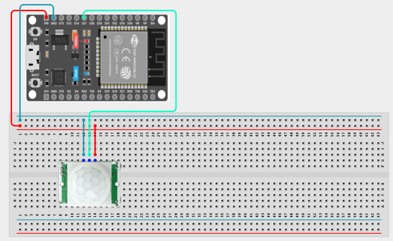
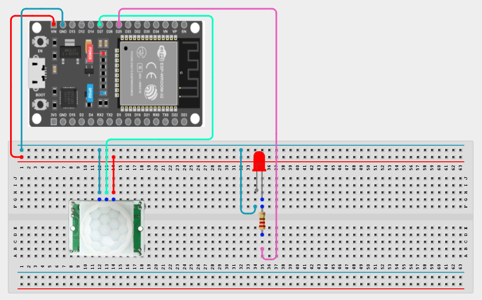

# 4.1.6. Motion-Activated Indicator

| **Description** | Learners use a PIR motion sensor to turn an indicator LED on when movement is detected and off when the area is clear. |
|------------------|---------------------------------------------------------------- |
| **Use case**     | This project can be applied to real-world IoT, safety, and control systems while developing essential master-level engineering skills. |

## Components (Things You will need)

|  |  |  |  |  |  |  |
| --- | --- | --- | --- | --- | --- | --- |

## Building the circuit

> **Tip:** Use the [ESP32 Pin Mapping](../../assets/esp32_pin_mapping.png) image to locate the correct GPIO pins on your ESP32 board.


Things Needed:

- ESP32 board = 1

- Micro USB cable = 1

- Jumper Wires

- PIR Motion Sensor = 1

- Red LED = 1

- 220 Ω resistor = 1

- Bread Board

## Wiring the circuit

**Step 1:** Connect the PIR motion sensor:

- Connect **VCC** to **5V**
- Connect **GND** to common **GND**
- Connect **OUT** to **GPIO 27**.



**Step 2:** Connect the motion indicator LED:

- Connect ESP32 **GPIO 25** to a **220 Ω resistor**.
- Connect the resistor to the LED anode (long leg).
- Connect the LED cathode (short leg/flat side) to ESP32 **GND**.



**Step 3:** Check the PIR and ESP32 grounds, LED polarity, and resistor before connecting USB.


_Make sure to connect the Micro USB cable to the ESP32 board._


## PROGRAMMING

**Step 1:** Open your Arduino IDE. See how to set up here: [Getting Started](../../Getting Started/Arduino_IDE_Setup.md).

**Step 2:** Write the complete program implementing the system logic with appropriate pin definitions, setup configuration, and the main control loop.

```cpp
// Project 66: Motion-Activated Indicator
const int pirPin = 27;
const int statusLedPin = 25;

void setup() {
  Serial.begin(9600);
  pinMode(pirPin, INPUT);
  pinMode(statusLedPin, OUTPUT);
  digitalWrite(statusLedPin, LOW);
  Serial.println("Project 66: Motion-Activated Indicator Initialized...");
}

void loop() {
  const bool motionDetected = digitalRead(pirPin) == HIGH;
  digitalWrite(statusLedPin, motionDetected ? HIGH : LOW);

  if (motionDetected) {
    Serial.println("Motion detected: indicator LED ON");
  } else {
    Serial.println("No motion: indicator LED OFF");
  }
  delay(200);
}

```

**Step 3:** Save your code. _See the [Getting Started](../../Getting Started/Arduino_IDE_Setup.md) section_

**Step 4:** Select the ESP32 board and port _See the [Getting Started](../../Getting Started/Arduino_IDE_Setup.md) section:Selecting ESP32 board Type and Uploading your code_.

**Step 5:** Upload your code. _See the [Getting Started](../../Getting Started/Arduino_IDE_Setup.md) section:Selecting ESP32 board Type and Uploading your code_

## CONCLUSION

By connecting a PIR sensor to an indicator LED, students build a simple motion-triggered alert that clearly shows when movement is detected.

This project strengthens understanding of input processing, actuator control, and real-world IoT applications, preparing learners to develop more advanced monitoring and control solutions.
