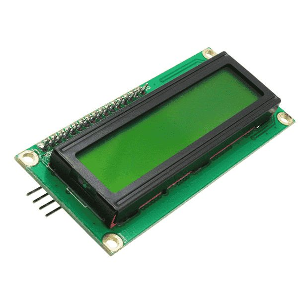
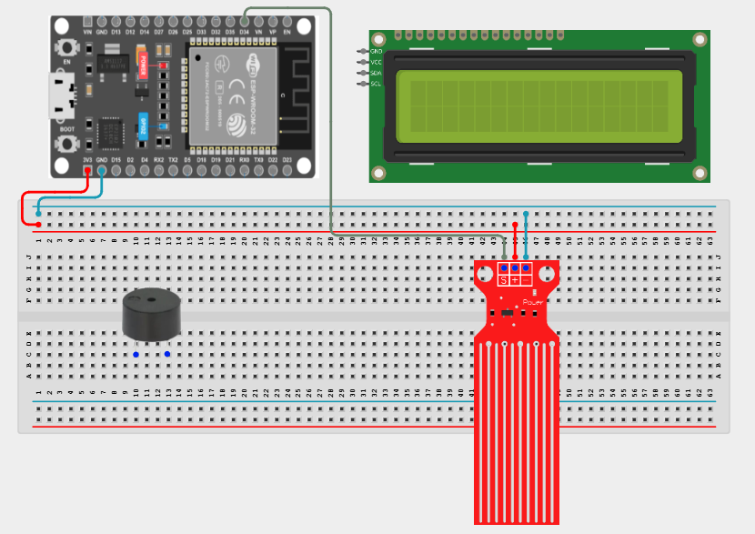
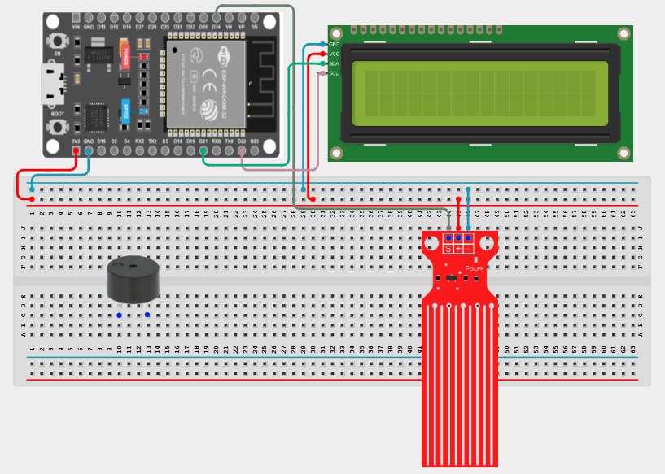
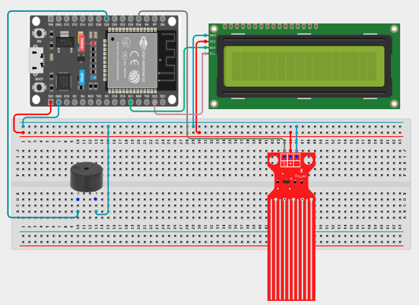

# 4.1.9. Automated Plant Soil  Water Monitor

| **Description** |In this project, learners will engineer an advanced 'Automated Plant Soil & Water Monitor' multi-component system. This design integrates Water Test Module + IIC 1602 LCD + Active Buzzer into a cohesive industrial automation unit.|
|------------------|----------------------------------------------------------------|
| **Use case**     |This project can be applied to real-world IoT, safety, and control systems while developing essential master-level engineering skills.|

## Components (Things You will need)

|  |  |  |  |  |  |  |
| --- | --- | --- | --- | --- | --- | --- |

## Building the circuit

> **Tip:** Use the [ESP32 Pin Mapping](../../assets/esp32_pin_mapping.png) image to locate the correct GPIO pins on your ESP32 board.


Things Needed:

- ESP32 board = 1

- Water Test Module = 1

- IIC 1602 LCD = 1

- Buzzer = 1

- USB Cable = 1

- Jumper Wires

- Bread Board


## Wiring the circuit

**Step 1:** Connect the Water test module:

- Connect **AO** to **GPIO 34**.
- Connect **VCC** to **3.3V**
- Connect **GND** to common **GND**.



**Step 2:** Connect the I2C LCD display:

- Connect **SDA** to **GPIO 21**
- Connect **SCL** to **GPIO 22**
- Connect **GND** to common ground.
- Connect **VCC** to **3.3V** if supported; otherwise use a bidirectional I2C level shifter. Do not allow 5 V pull-ups on the ESP32 I2C lines.



**Step 3:** Connect the Active buzzer:

- Connect **signal/+** to **GPIO 25**.
- Connect **GND/-** to common **GND**.




## PROGRAMMING

**Step 1:** Open your Arduino IDE. See how to set up here: [Getting Started](../../Getting Started/Arduino_IDE_Setup.md).

**Step 2:** Write the complete program implementing the system logic with appropriate pin definitions, setup configuration, and the main control loop.

```cpp
// Project 64: Automated Plant Soil & Water Monitor
// Target Integration: Water Test Module + IIC 1602 LCD + Active Buzzer
// Pin assignments matching the wiring steps.
const int waterPin = 34;
const int buzzerPin = 25;


void setup() {
  Serial.begin(9600);
  Serial.println("Project 64: Automated Plant Soil & Water Monitor Initialized...");
}

void loop() {
  // Multi-component sensing and actuation logic loop
  delay(500);
}
```

**Step 7:** Save your code. _See the [Getting Started](../../Getting Started/Arduino_IDE_Setup.md) section_

**Step 8:** Select the ESP32 board and port _See the [Getting Started](../../Getting Started/Arduino_IDE_Setup.md) section:Selecting ESP32 board Type and Uploading your code_.

**Step 9:** Upload your code. _See the [Getting Started](../../Getting Started/Arduino_IDE_Setup.md) section:Selecting ESP32 board Type and Uploading your code_

## CONCLUSION

The system responds dynamically when physical conditions cross pre-programmed setpoints, driving output devices reliably.
