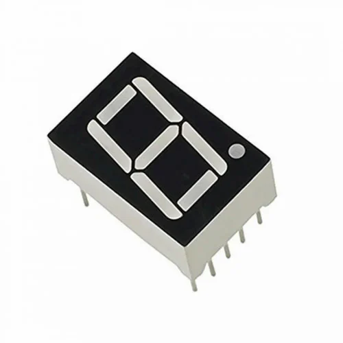
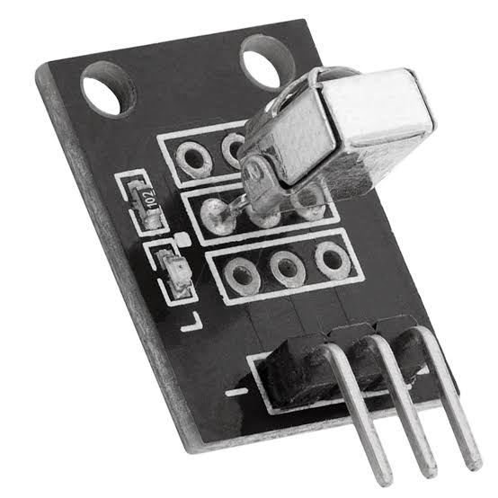
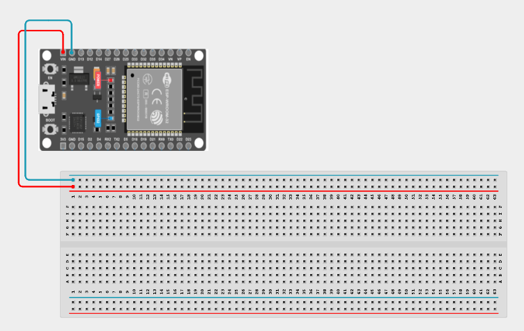
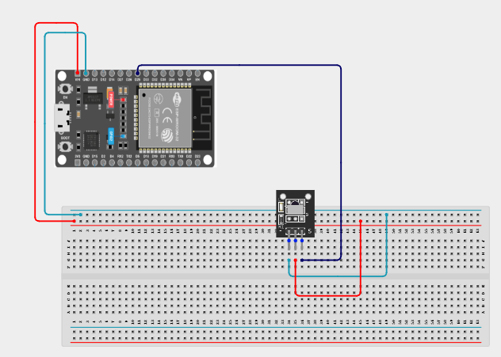
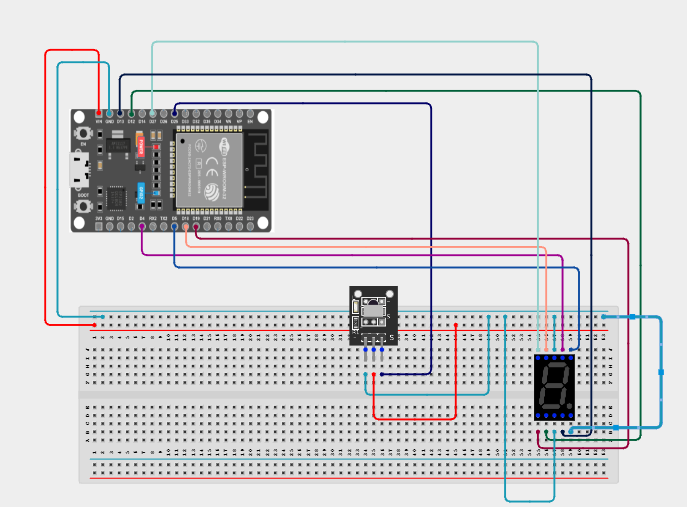
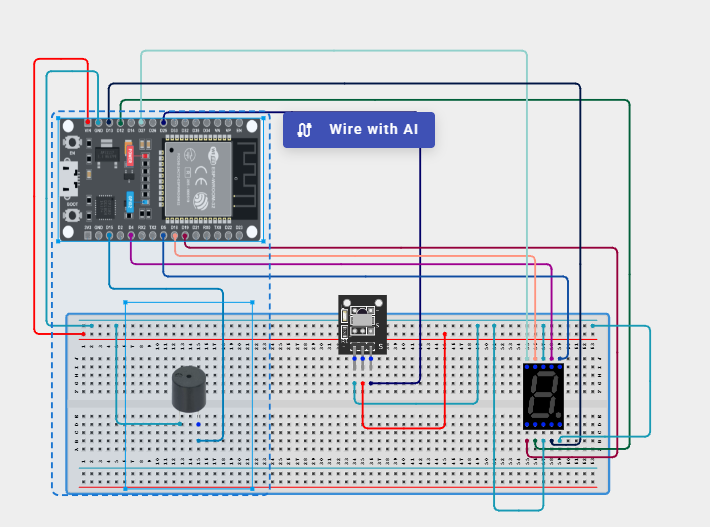

# 4.2.10. Remote Controlled 7 Segment Scorekeeper

| **Description** | In Project 100, learners will construct an expert interactive system titled 'Remote Controlled 7-Segment Scorekeeper'. This manual details the complete synthesis of IR Receiver + Remote + 1-Digit 7-Segment Display + Active Buzzer into an intuitive, high-performance automated control platform. |
| --- | --- |
| **Use case** | This project connects to real-world industrial and IoT applications such as: Project 100 equips students with professional skills in embedded human-machine interface (HMI) design and automated motion control. |

## Components (Things You will need)

|  |  |  |  |  |  |  |
| --- | --- | --- | --- | --- | --- | --- |

## Building the circuit

> **Tip:** Use the [ESP32 Pin Mapping](../../assets/esp32_pin_mapping.png) image to locate the correct GPIO pins on your ESP32 board.


Things Needed:

- ESP32 board Core Board

- IR Receiver

- Remote

- 1-Digit 7-Segment Display

- USB Cable & Jumper Wires

- Buzzer

- Bread Board


## Mounting the component on the breadboard and wiring the circuit

**Step 1:** Connect the ESP32 board 5V pin to the breadboard's positive (+) power rail and the ESP32 board GND pin to the negative (-) power rail.



**Step 2:** Place the IR Receiver on the breadboard.

  - Connect the VCC pin to the 5V power rail on the breadboard
  - Connect the GND pin to the ground rail on the breadboard
  - Connect the OUT/Signal pin to Digital GPIO 25

  


**Step 3:** Place the 1-Digit 7-Segment Display on the breadboard.

  - Connect its control pins (a, b, c, d, e, f, g) to Digital Pins 4, 5, 13, 12, 19, 18, 27 respectively.
  - Connect the common pin(s) to the ground rail on the breadboard (if Common Cathode) or the 5V power rail on the breadboard (if Common Anode)

  


**Step 4:** Place the Buzzer on the breadboard.

  - Connect its positive (+) pin to Digital GPIO 26
  - Connect its negative (-) pin to the ground rail on the breadboard

  

**Step 5:** Ensure all components share a common GND connection, then verify all wiring before connecting the ESP32 board to your computer using the USB cable.

**Step 6:** After confirming that all connections are correct, connect the USB cable to the ESP32 board and the computer to power the circuit.

_Make sure to connect the Micro USB cable to the ESP32 board._

## PROGRAMMING

**Step 1:** Open your Arduino IDE. See how to set up here: [Getting Started](../../Getting Started/Arduino_IDE_Setup.md).

**Step 2:** Write the complete program implementing the system logic with appropriate pin definitions, setup configuration, and the main control loop.

```cpp
// Project 100: Remote Controlled 7-Segment Scorekeeper
#include <IRremote.hpp>

const uint8_t IR_PIN = 25;
const uint8_t BUZZER_PIN = 26;
const uint8_t segmentPins[] = {4, 5, 13, 12, 19, 18, 27}; // a-g

const byte digits[][7] = {
  {1,1,1,1,1,1,0}, // 0
  {0,1,1,0,0,0,0}, // 1
  {1,1,0,1,1,0,1}, // 2
  {1,1,1,1,0,0,1}, // 3
  {0,1,1,0,0,1,1}, // 4
  {1,0,1,1,0,1,1}, // 5
  {1,0,1,1,1,1,1}, // 6
  {1,1,1,0,0,0,0}, // 7
  {1,1,1,1,1,1,1}, // 8
  {1,1,1,1,0,1,1}  // 9
};

int score = 0;

void showDigit(int digit) {
  for (int i = 0; i < 7; i++) {
    digitalWrite(segmentPins[i], digits[digit][i]);
  }
}

void beep() {
  digitalWrite(BUZZER_PIN, HIGH);
  delay(60);
  digitalWrite(BUZZER_PIN, LOW);
}

void setup() {
  for (int i = 0; i < 7; i++) pinMode(segmentPins[i], OUTPUT);
  pinMode(BUZZER_PIN, OUTPUT);
  Serial.begin(9600);
  IrReceiver.begin(IR_PIN, ENABLE_LED_FEEDBACK);
  showDigit(0);
}

void loop() {
  if (IrReceiver.decode()) {
    uint32_t code = IrReceiver.decodedIRData.decodedRawData;

    if (code == 0xE718FF00) { // Typical key 1
      score++;
    } else if (code == 0xAD52FF00) { // Typical key 2
      score--;
    } else if (code == 0xE31CFF00) { // Typical key 0
      score = 0;
    }

    if (score < 0) score = 0;
    if (score > 9) score = 9;

    showDigit(score);
    beep();
    IrReceiver.resume();
  }
}
```

**Step 7:** Save your code. _See the [Getting Started](../../Getting Started/Arduino_IDE_Setup.md) section_

**Step 8:** Select the ESP32 board and port _See the [Getting Started](../../Getting Started/Arduino_IDE_Setup.md) section:Selecting ESP32 board Type and Uploading your code_.

**Step 9:** Upload your code. _See the [Getting Started](../../Getting Started/Arduino_IDE_Setup.md) section:Selecting ESP32 board Type and Uploading your code_

## CONCLUSION

Operating physical input devices instantly modifies actuator behavior and updates visual indicators in real time.
