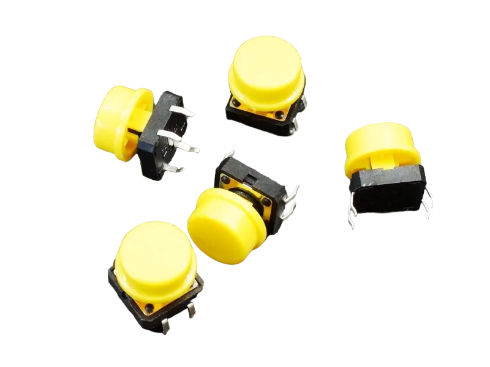
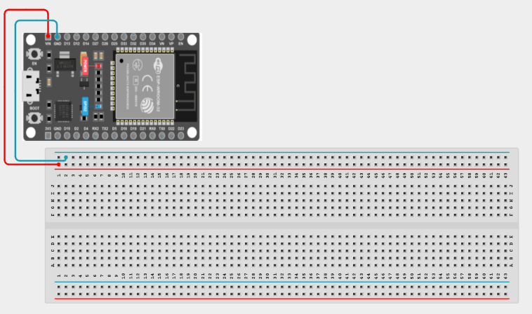
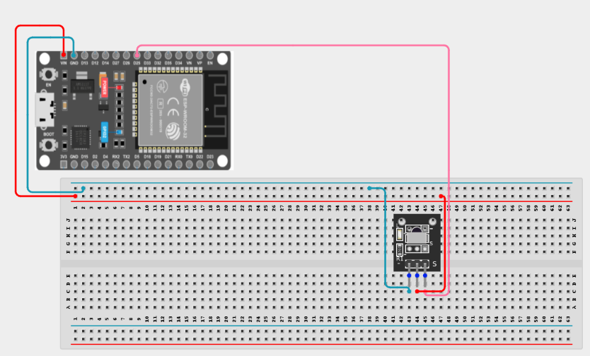
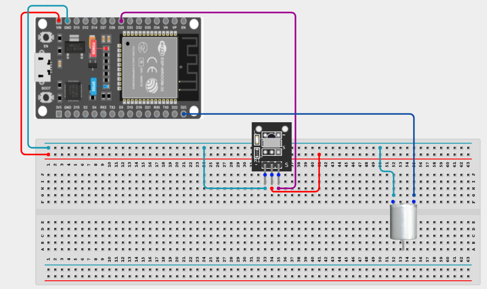

# 4.2.17. Multi Button Remote Fan Speed Switcher

| **Description** In Project 107, learners will construct an expert interactive system titled 'Multi-Button Remote Fan Speed Switcher'. This manual details the complete synthesis of IR Receiver + Remote + DC Motor + IIC 1602 LCD into an intuitive, high-performance automated control platform.|------------------|----------------------------------------------------------------|
| **Use case**     |This project connects to real-world industrial and IoT applications such as: Project 107 equips students with professional skills in embedded human-machine interface (HMI) design and automated motion control.|

## Components (Things You will need)

|  |  |  |  |  |  |  |  |  |
| --- | --- | --- | --- | --- | --- | --- | --- | --- |

## Building the circuit

> **Tip:** Use the [ESP32 Pin Mapping](../../assets/esp32_pin_mapping.png) image to locate the correct GPIO pins on your ESP32 board.


Things Needed:

- ESP32 board Core Board

- IR Receiver

- Remote

- DC Motor

- USB Cable & Jumper Wires

- Bread Board

- LCD Display

- Push Button

- Fan Blades


## Mounting the component on the breadboard and wiring the circuit

**Step 1:** Connect the ESP32 board 5V pin to the breadboard's positive (+) power rail and the ESP32 board GND pin to the negative (-) power rail.



**Step 2:** Place the IR Receiver on the breadboard.

  - Connect the VCC pin to the 5V power rail on the breadboard
  - Connect the GND pin to the ground rail on the breadboard
  - Connect the OUT/Signal pin to Digital GPIO 25



**Step 3:** Place the DC motor on the breadboard without a separate driver board.

  - Connect the motor positive lead to the 5V power rail on the breadboard
  - Connect the motor negative lead to Digital GPIO 23
  - Keep the ESP32 ground and the motor power ground connected together



**Step 4:** Ensure all components share a common GND connection, then verify all wiring before connecting the ESP32 board to your computer using the USB cable.


**Step 5:** After confirming that all connections are correct, connect the USB cable to the ESP32 board and the computer to power the circuit.

_Make sure to connect the Micro USB cable to the ESP32 board._

## PROGRAMMING

**Step 1:** Open your Arduino IDE. See how to set up here: [Getting Started](../../Getting Started/Arduino_IDE_Setup.md).

**Step 2:** Write the complete program implementing the system logic with appropriate pin definitions, setup configuration, and the main control loop.

```cpp
#include <IRremote.h>
#include <Wire.h>
#include <LiquidCrystal_I2C.h>

const int IR_PIN = 25;
const int MOTOR_PIN = 23;

LiquidCrystal_I2C lcd(0x27, 16, 2);

void setup() {
  Serial.begin(9600);
  IrReceiver.begin(IR_PIN);
  lcd.init();
  lcd.backlight();
  pinMode(MOTOR_PIN, OUTPUT);
  Serial.println("System Online");
}

void loop() {
  if (IrReceiver.decode()) {
    analogWrite(MOTOR_PIN, 180);
    IrReceiver.resume();
  }
}
```

**Step 7:** Save your code. _See the [Getting Started](../../Getting Started/Arduino_IDE_Setup.md) section_

**Step 8:** Select the ESP32 board and port _See the [Getting Started](../../Getting Started/Arduino_IDE_Setup.md) section:Selecting ESP32 board Type and Uploading your code_.

**Step 9:** Upload your code. _See the [Getting Started](../../Getting Started/Arduino_IDE_Setup.md) section:Selecting ESP32 board Type and Uploading your code_

## CONCLUSION

Operating physical input devices instantly modifies actuator behavior and updates visual indicators in real time.
