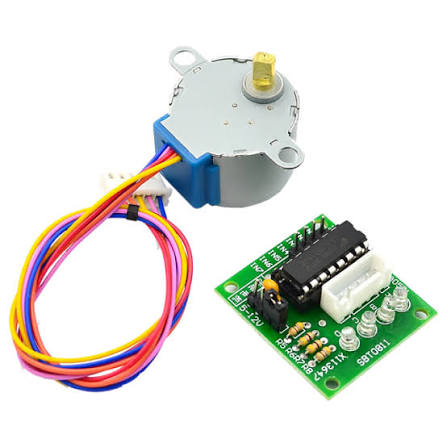
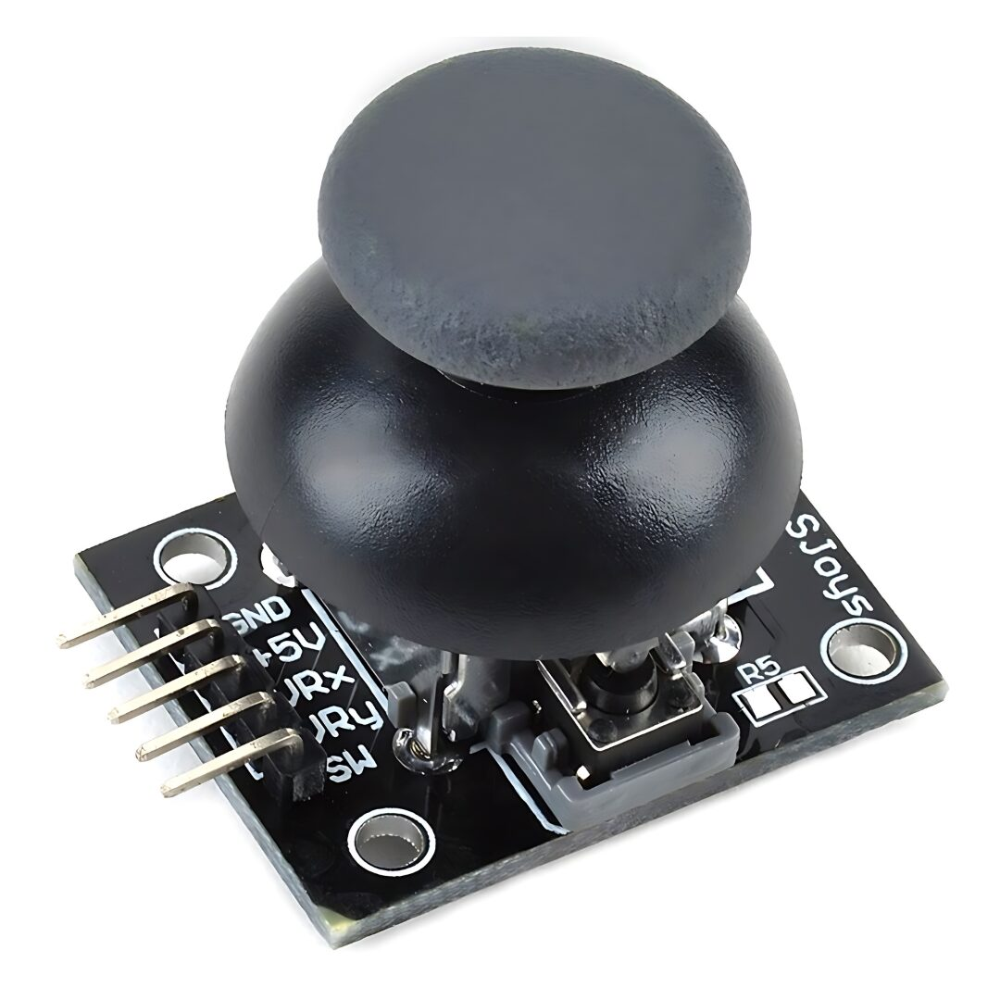
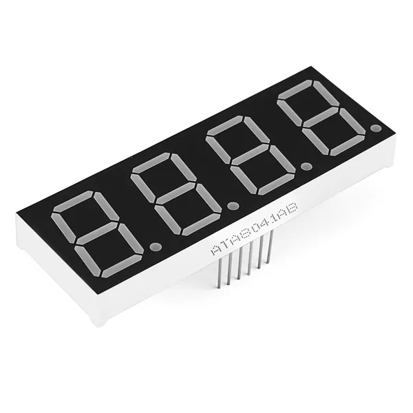
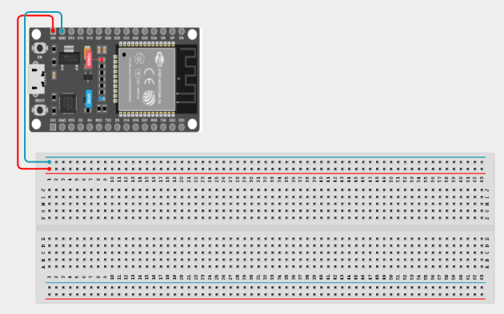
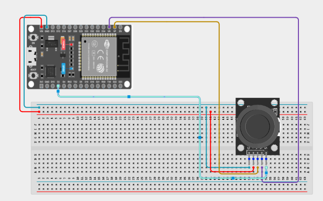
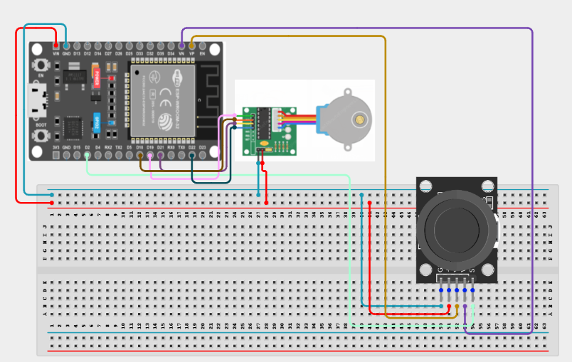
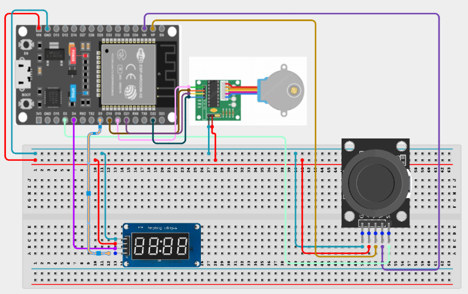

# 4.2.1. Joystick Dual Axis Stepper Arm Controller

| **Description** | In Project 91, learners will build an interactive robotic positioning system combining an XY Joystick Module, a 28BYJ-48 Stepper Motor, and a TM1637 4-Digit Display. Deflecting the joystick along the X-axis controls clockwise and counter-clockwise stepper motor rotation velocity, while the real-time rotational angle or step count is displayed continuously on the 4-digit display screen. |
| --- | --- |
| **Use case** | This project connects to real-world industrial and IoT applications such as: Proportional joystick motor control combined with numeric position feedback forms the standard architecture for industrial CNC machines, camera gimbals, and surgical robotic arms. |

## Components (Things You will need)

|  |  |  |  |  |  |  |
| --- | --- | --- | --- | --- | --- | --- |

## Building the circuit

> **Tip:** Use the [ESP32 Pin Mapping](../../assets/esp32_pin_mapping.png) image to locate the correct GPIO pins on your ESP32 board.


Things Needed:

- ESP32 board Core Board

- XY Joystick Module

- 28BYJ-48 Stepper Motor

- ULN2003 Stepper Motor Driver

- TM1637 4-Digit Display Module

- USB Cable & Jumper Wires

- Bread Board


## Mounting the component on the breadboard and wiring the circuit

**Step 1:** Connect the ESP32 board 5V pin to the breadboard's positive (+) power rail and the ESP32 board GND pin to the negative (-) power rail.



**Step 2:** Place the XY Joystick Module on the breadboard.

  - Connect the VCC pin to the 5V power rail on the breadboard
  - Connect the GND pin to the ground rail on the breadboard
  - Connect the VRx pin to Analog GPIO 36
  - Connect the VRy pin to Analog GPIO 39
  - Connect the SW (switch) pin to Digital GPIO 2



**Step 3:** Connect the 28BYJ-48 stepper motor to the ULN2003 driver board, then connect the driver board to the ESP32.

  - Connect the stepper motor connector to the stepper socket on the ULN2003 driver board
  - Connect the ULN2003 **+** (positive) pin to the 5V breadboard power rail
  - Connect the ULN2003 **−** (negative/GND) pin to the ground rail
  - Connect ULN2003 IN1, IN2, IN3, and IN4 to ESP32 Digital GPIO 8, 9, 10, and 11 respectively
  - Share the ground rail with the ESP32 GND pin so all components have a common negative connection



**Step 4:** Place the TM1637 4-Digit Display Module on the breadboard.

  - Connect the VCC pin to the 5V power rail on the breadboard
  - Connect the GND pin to the ground rail on the breadboard
  - Connect the CLK pin to Digital GPIO 5
  - Connect the DIO pin to Digital GPIO 18



**Step 5:** Ensure all components share a common GND connection, then verify all wiring before connecting the ESP32 board to your computer using the USB cable.

**Step 6:** After confirming that all connections are correct, connect the USB cable to the ESP32 board and the computer to power the circuit.

_Make sure to connect the Micro USB cable to the ESP32 board._

## PROGRAMMING

**Step 1:** Open your Arduino IDE. See how to set up here: [Getting Started](../../Getting Started/Arduino_IDE_Setup.md).

**Step 2:** Write the complete program implementing the system logic with appropriate pin definitions, setup configuration, and the main control loop.

```cpp
// Project 91: Joystick Dual-Axis Stepper Arm Controller
#include <Stepper.h>
#include <TM1637Display.h>

const int STEPS_PER_REV = 2048;
Stepper myStepper(STEPS_PER_REV, 8, 10, 9, 11);
TM1637Display display(5, 18);
int currentAngle = 0;

void setup() {
  display.setBrightness(7);
  display.showNumberDec(currentAngle);
  Serial.begin(9600);
}

void loop() {
  int xVal = analogRead(36);
  if (xVal > 700) {
    myStepper.setSpeed(10);
    myStepper.step(64);
    currentAngle += 10;
    display.showNumberDec(currentAngle);
  } else if (xVal < 300) {
    myStepper.setSpeed(10);
    myStepper.step(-64);
    currentAngle -= 10;
    display.showNumberDec(currentAngle);
  }
  delay(50);
}
```

**Step 7:** Save your code. _See the [Getting Started](../../Getting Started/Arduino_IDE_Setup.md) section_

**Step 8:** Select the ESP32 board and port _See the [Getting Started](../../Getting Started/Arduino_IDE_Setup.md) section:Selecting ESP32 board Type and Uploading your code_.

**Step 9:** Upload your code. _See the [Getting Started](../../Getting Started/Arduino_IDE_Setup.md) section:Selecting ESP32 board Type and Uploading your code_

## CONCLUSION

Deflecting the joystick right rotates the stepper motor clockwise and increments the display count; deflecting left reverses rotation and decrements the display count.
