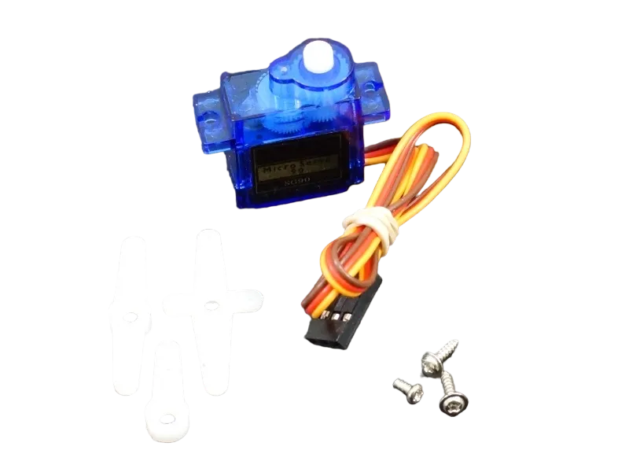
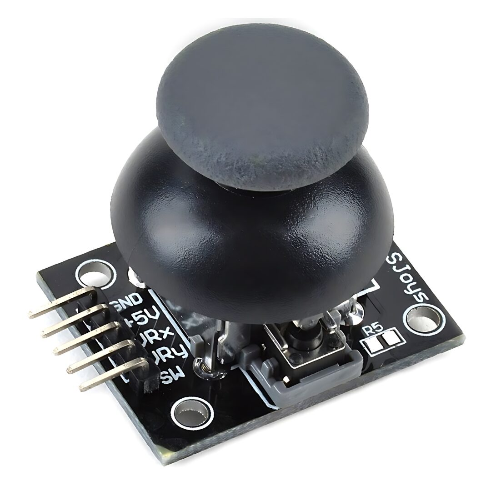
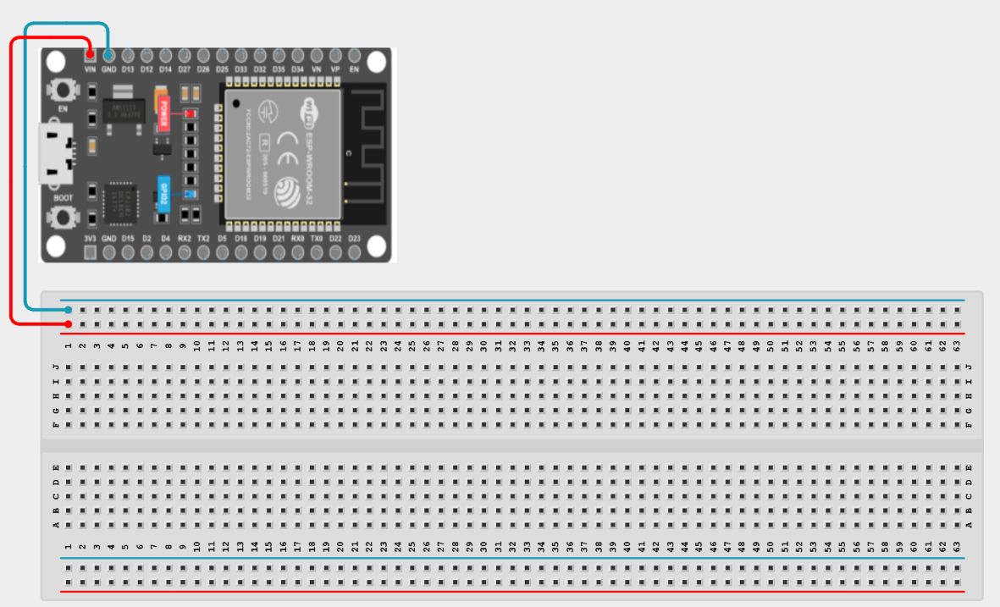
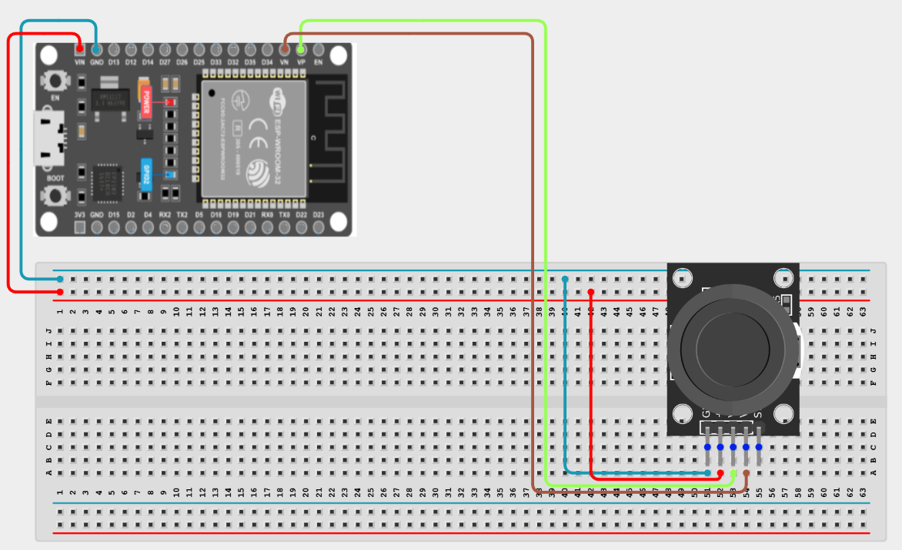
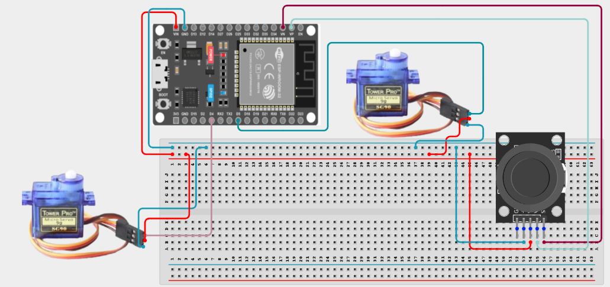
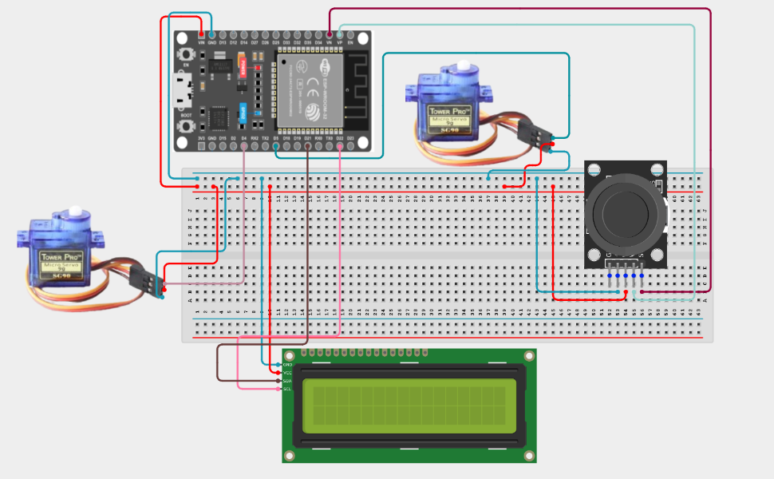

# 4.2.20. Joystick Robotic Arm Controller

| **Description** | In Project 110, learners will construct an expert interactive system titled 'Joystick Robotic Arm Controller'. This manual details the complete synthesis of 1 XY Joystick + 2 Servo Motors SG90 + IIC 1602 LCD into an intuitive, high-performance automated control platform. |
| --- | --- |
| **Use case** | This project connects to real-world industrial and IoT applications such as: Project 110 equips students with professional skills in embedded human-machine interface (HMI) design and automated motion control. |

## Components (Things You will need)

|  |  |  |  |  |  |  |
| --- | --- | --- | --- | --- | --- | --- |

## Building the circuit

> **Tip:** Use the [ESP32 Pin Mapping](../../assets/esp32_pin_mapping.png) image to locate the correct GPIO pins on your ESP32 board.


Things Needed:

- ESP32 board Core Board

- 1 XY Joystick

- 2 Servo Motors SG90

- IIC 1602 LCD

- USB Cable & Jumper Wires

- Bread Board


## Mounting the component on the breadboard and wiring the circuit

**Step 1:** Connect the ESP32 board 5V pin to the breadboard's positive (+) power rail and the ESP32 board GND pin to the negative (-) power rail.



**Step 2:** Place the XY Joystick on the breadboard.

  - Connect the VCC pin to the 5V power rail on the breadboard
  - Connect the GND pin to the ground rail on the breadboard
  - Connect the VRx pin to Analog GPIO 36
  - Connect the VRy pin to Analog GPIO 39



**Step 3:** Place the 2 Servo Motors (SG90) on the breadboard.

  - Connect both red wires to the 5V power rail on the breadboard
  - Connect both brown wires to the ground rail on the breadboard
  - Connect the yellow or orange control wire of Servo 1 to Digital GPIO 9
  - Connect the yellow or orange control wire of Servo 2 to Digital GPIO 10



**Step 4:** Place the IIC 1602 LCD on the breadboard.

  - Connect the VCC pin to the 5V power rail on the breadboard
  - Connect the GND pin to the ground rail on the breadboard
  - Connect the SDA pin to GPIO 21
  - Connect the SCL pin to GPIO 22



**Step 5:** Ensure all components share a common GND connection, then verify all wiring before connecting the ESP32 board to your computer using the USB cable.

**Step 6:** After confirming that all connections are correct, connect the USB cable to the ESP32 board and the computer to power the circuit.

_Make sure to connect the Micro USB cable to the ESP32 board._

## PROGRAMMING

**Step 1:** Open your Arduino IDE. See how to set up here: [Getting Started](../../Getting Started/Arduino_IDE_Setup.md).

**Step 2:** Write the complete program implementing the system logic with appropriate pin definitions, setup configuration, and the main control loop.

```cpp
#include <Wire.h>
#include <LiquidCrystal_I2C.h>
#include <ESP32Servo.h>

Servo servo1;
Servo servo2;
LiquidCrystal_I2C lcd(0x27, 16, 2);

const int JOY_X = 36;
const int JOY_Y = 39;

void setup() {
  servo1.attach(9);
  servo2.attach(10);

  lcd.init();
  lcd.backlight();
  lcd.setCursor(0, 0);
  lcd.print("Robot Arm Ready");
}

void loop() {
  int servo1Position = map(analogRead(JOY_X), 0, 4095, 0, 180);
  int servo2Position = map(analogRead(JOY_Y), 0, 4095, 0, 180);

  servo1.write(servo1Position);
  servo2.write(servo2Position);

  lcd.setCursor(0, 1);
  lcd.print("S1:"); lcd.print(servo1Position);
  lcd.print(" S2:"); lcd.print(servo2Position);
  delay(20);
}
```

**Step 7:** Save your code. _See the [Getting Started](../../Getting Started/Arduino_IDE_Setup.md) section_

**Step 8:** Select the ESP32 board and port _See the [Getting Started](../../Getting Started/Arduino_IDE_Setup.md) section:Selecting ESP32 board Type and Uploading your code_.

**Step 9:** Upload your code. _See the [Getting Started](../../Getting Started/Arduino_IDE_Setup.md) section:Selecting ESP32 board Type and Uploading your code_

## CONCLUSION

Operating physical input devices instantly modifies actuator behavior and updates visual indicators in real time.
