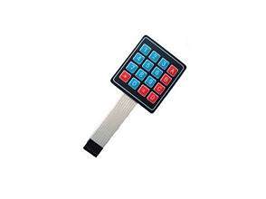
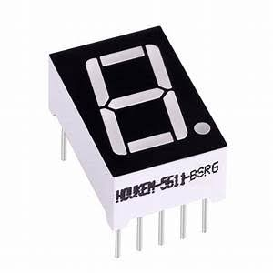
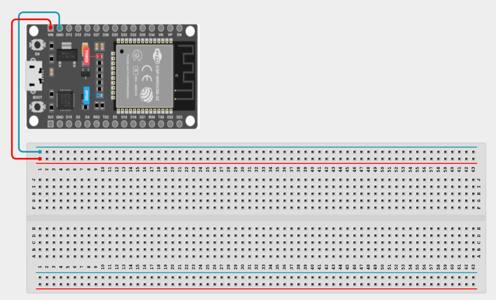
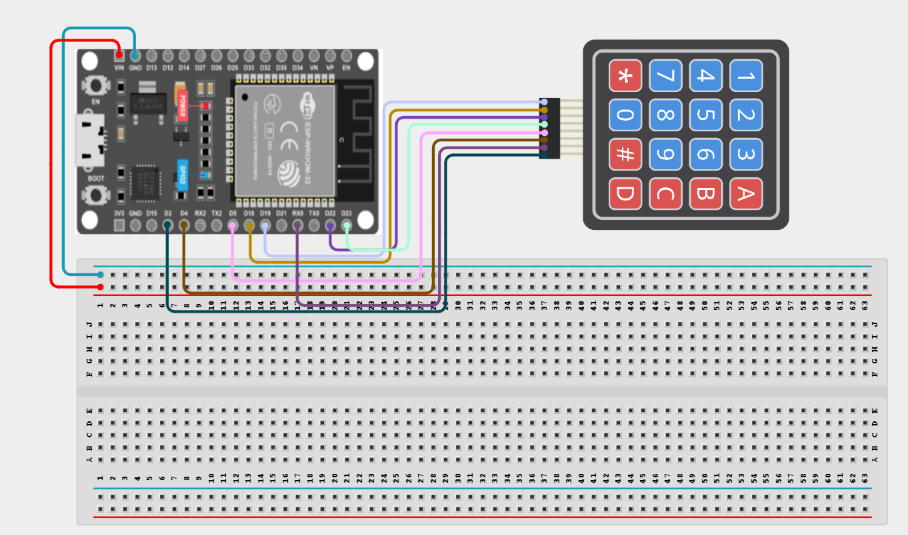
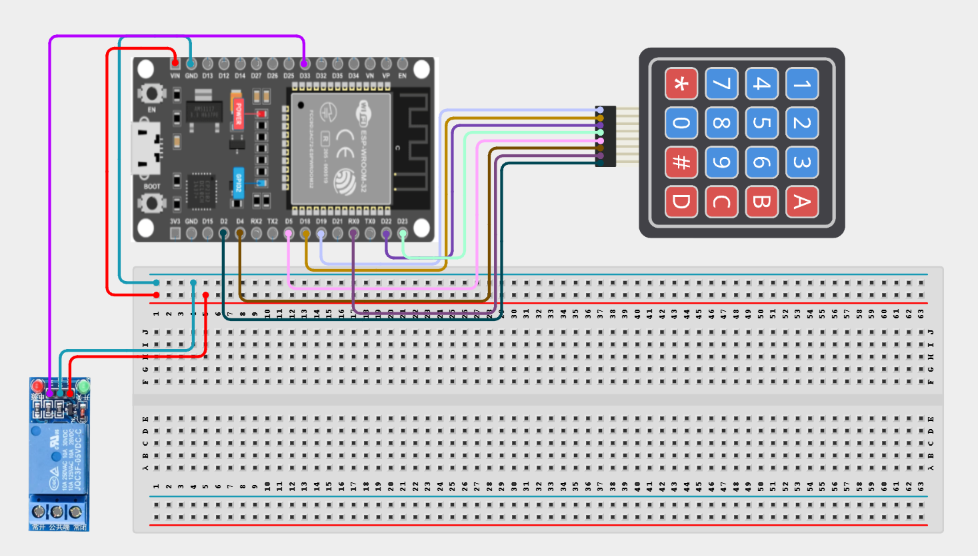
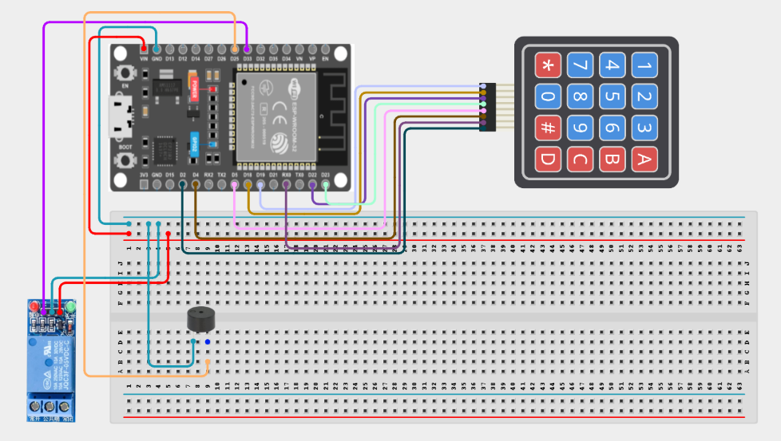
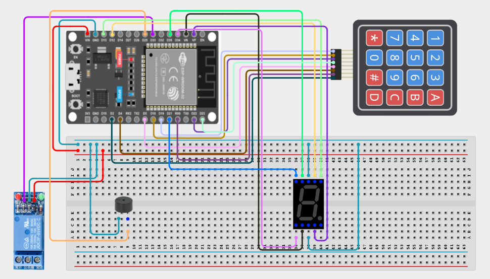

# 4.2.22. Keypad Password Lock with Relay Isolation

| **Description** | In Project 112, learners will construct an expert interactive system titled 'Keypad Password Lock with Relay Isolation'. This manual details the complete synthesis of 4x4 Matrix Keypad + Relay Module + 7-Segment Display + Buzzer into an intuitive, high-performance automated control platform. |
| --- | --- |
| **Use case** | This project connects to real-world industrial and IoT applications such as: Project 112 equips students with professional skills in embedded human-machine interface (HMI) design and automated motion control. |

## Components (Things You will need)

|  |  |  |  |   |  |  |  |
| --- | --- | --- | --- | --- | --- | --- | --- |

## Building the circuit

> **Tip:** Use the [ESP32 Pin Mapping](../../assets/esp32_pin_mapping.png) image to locate the correct GPIO pins on your ESP32 board.


Things Needed:

- ESP32 board Core Board

- 4x4 Matrix Keypad

- Relay Module

- 7-Segment Display

- USB Cable & Jumper Wires

- Bread Board

- Buzzer


## Mounting the component on the breadboard and wiring the circuit

**Step 1:** Connect the ESP32 board 5V pin to the breadboard's positive (+) power rail and the ESP32 board GND pin to the negative (-) power rail.



**Step 2:** Place the 4x4 Matrix Keypad on the breadboard.

  - Connect the 8 row and column pins to Digital Pins 19, 18, 22, 23, 5, 4, 3, and 2 respectively



**Step 3:** Place the Relay Module on the breadboard.

  - Connect the VCC pin to the 5V power rail on the breadboard
  - Connect the GND pin to the ground rail on the breadboard
  - Connect the IN pin to Digital GPIO 33



**Step 4:** Place the Active Buzzer on the breadboard.

  - Connect its positive (+) pin to Digital GPIO 25
  - Connect its negative (-) pin to the ground rail on the breadboard



**Step 5:** Place the 7-Segment Display on the breadboard.

  - Connect its control pins (a, b, c, d, e, f, g) to Digital Pins 12, 13, 14, 27, 26, 32, and 15 respectively
  - Connect the common pin(s) to the ground rail on the breadboard (if Common Cathode) or the 5V power rail on the breadboard (if Common Anode)



**Step 6:** Ensure all components share a common GND connection, then verify all wiring before connecting the ESP32 board to your computer using the USB cable.

**Step 7:** After confirming that all connections are correct, connect the USB cable to the ESP32 board and the computer to power the circuit.

_Make sure to connect the Micro USB cable to the ESP32 board._

## PROGRAMMING

**Step 1:** Open your Arduino IDE. See how to set up here: [Getting Started](../../Getting Started/Arduino_IDE_Setup.md).

**Step 2:** Write the complete program implementing the system logic with appropriate pin definitions, setup configuration, and the main control loop.

```cpp
#include <Keypad.h>

const byte ROWS = 4;
const byte COLS = 4;
char keys[ROWS][COLS] = {
  {'1','2','3','A'},
  {'4','5','6','B'},
  {'7','8','9','C'},
  {'*','0','#','D'}
};
byte rowPins[ROWS] = {19, 18, 22, 23};
byte colPins[COLS] = {5, 4, 3, 2};
Keypad keypad = Keypad(makeKeymap(keys), rowPins, colPins, ROWS, COLS);

const int relayPin = 33;
const int buzzerPin = 25;
int segmentPins[] = {12, 13, 14, 27, 26, 32, 15};
const char password[] = "1234";
String entered = "";

byte digits[10][7] = {
  {1,1,1,1,1,1,0}, {0,1,1,0,0,0,0},
  {1,1,0,1,1,0,1}, {1,1,1,1,0,0,1},
  {0,1,1,0,0,1,1}, {1,0,1,1,0,1,1},
  {1,0,1,1,1,1,1}, {1,1,1,0,0,0,0},
  {1,1,1,1,1,1,1}, {1,1,1,1,0,1,1}
};

void displayDigit(int num) {
  if (num < 0 || num > 9) return;
  for (int i = 0; i < 7; i++) digitalWrite(segmentPins[i], digits[num][i]);
}

void beep(int count) {
  for (int i = 0; i < count; i++) {
    digitalWrite(buzzerPin, HIGH);
    delay(100);
    digitalWrite(buzzerPin, LOW);
    delay(100);
  }
}

void setup() {
  pinMode(relayPin, OUTPUT);
  pinMode(buzzerPin, OUTPUT);
  for (int i = 0; i < 7; i++) pinMode(segmentPins[i], OUTPUT);
  digitalWrite(relayPin, LOW);
  displayDigit(0);
  Serial.begin(9600);
}

void loop() {
  char key = keypad.getKey();
  if (!key) return;

  if (key == '*') {
    entered = "";
    digitalWrite(relayPin, LOW);
    displayDigit(0);
  } else if (key == '#') {
    if (entered == password) {
      digitalWrite(relayPin, HIGH);
      beep(1);
    } else {
      digitalWrite(relayPin, LOW);
      beep(3);
    }
    entered = "";
  } else if (key >= '0' && key <= '9') {
    entered += key;
    if (entered.length() <= 1) displayDigit(key - '0');
  }
}
```

**Step 7:** Save your code. _See the [Getting Started](../../Getting Started/Arduino_IDE_Setup.md) section_

**Step 8:** Select the ESP32 board and port _See the [Getting Started](../../Getting Started/Arduino_IDE_Setup.md) section:Selecting ESP32 board Type and Uploading your code_.

**Step 9:** Upload your code. _See the [Getting Started](../../Getting Started/Arduino_IDE_Setup.md) section:Selecting ESP32 board Type and Uploading your code_

## CONCLUSION

Operating physical input devices instantly modifies actuator behavior and updates visual indicators in real time.
