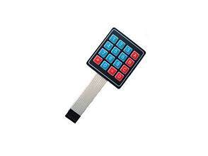
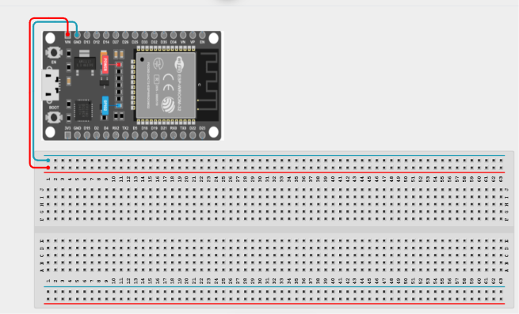
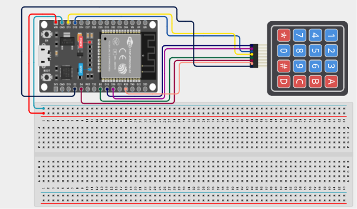
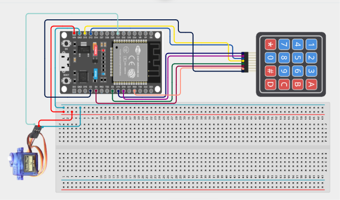
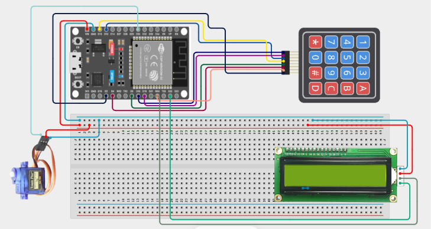

# 4.2.2. Keypad Digital Safe Lock Mechanism

| **Description** | In Project 92, learners will construct an expert interactive system titled 'Keypad Digital Safe Lock Mechanism'. This manual details the complete synthesis of 4x4 Matrix Keypad + Servo Motor SG90 + IIC 1602 LCD + Active Buzzer into an intuitive, high-performance automated control platform. |
| --- | --- |
| **Use case** | This project connects to real-world industrial and IoT applications such as: Project 92 equips students with professional skills in embedded human-machine interface (HMI) design and automated motion control. |

## Components (Things You will need)

|  |  |  |  |  |  |  |  |
| --- | --- | --- | --- | --- | --- | --- | --- |

## Building the circuit

> **Tip:** Use the [ESP32 Pin Mapping](../../assets/esp32_pin_mapping.png) image to locate the correct GPIO pins on your ESP32 board.


Things Needed:

- ESP32 board Core Board

- 4x4 Matrix Keypad

- Servo Motor SG90

- IIC 1602 LCD

- USB Cable & Jumper Wires

- Bread Board

- Buzzer


## Mounting the component on the breadboard and wiring the circuit

**Step 1:** Connect the ESP32 board 5V pin to the breadboard's positive (+) power rail and the ESP32 board GND pin to the negative (-) power rail.



**Step 2:** Place the 4x4 Matrix Keypad on the breadboard.

  - Connect the 8 row and column pins to Digital Pins 18, 19, 12, 13, 5, 4, 3, and 2 respectively 

  

**Step 3:** Place the Servo Motor SG90 on the breadboard.

  - Connect the red wire to the 5V power rail on the breadboard
  - Connect the brown wire to the ground rail on the breadboard
  - Connect the orange/yellow control wire to Digital GPIO 33

    


**Step 4:** Place the IIC 1602 LCD on the breadboard.

  - Connect the VCC pin to the 5V power rail on the breadboard
  - Connect the GND pin to the ground rail on the breadboard
  - Connect the SDA pin to Analog GPIO 21
  - Connect the SCL pin to Analog GPIO 22

  


**Step 5:** Place the Active Buzzer on the breadboard.

  - Connect its positive (+) pin to Digital GPIO 25
  - Connect its negative (-) pin to the ground rail on the breadboard

**Step 6:** Ensure all components share a common GND connection, then verify all wiring before connecting the ESP32 board to your computer using the USB cable.

**Step 7:** After confirming that all connections are correct, connect the USB cable to the ESP32 board and the computer to power the circuit.

_Make sure to connect the Micro USB cable to the ESP32 board._

## PROGRAMMING

**Step 1:** Open your Arduino IDE. See how to set up here: [Getting Started](../../Getting Started/Arduino_IDE_Setup.md).

**Step 2:** Write the complete program implementing the system logic with appropriate pin definitions, setup configuration, and the main control loop.

```cpp
// Project 92: Keypad Digital Safe Lock Mechanism
#include <Keypad.h>
#include <Wire.h>
#include <LiquidCrystal_I2C.h>
#include <ESP32Servo.h>

const byte ROWS = 4;
const byte COLS = 4;
char keys[ROWS][COLS] = {
  {'1','2','3','A'},
  {'4','5','6','B'},
  {'7','8','9','C'},
  {'*','0','#','D'}
};
byte rowPins[ROWS] = {18, 19, 12, 13};
byte colPins[COLS] = {5, 4, 3, 2};
Keypad keypad = Keypad(makeKeymap(keys), rowPins, colPins, ROWS, COLS);

LiquidCrystal_I2C lcd(0x27, 16, 2);
Servo lockServo;

const int SERVO_PIN = 33;
const int BUZZER_PIN = 25;
const char PIN_CODE[] = "1234";
String enteredPin = "";

void beep(int count) {
  for (int i = 0; i < count; i++) {
    digitalWrite(BUZZER_PIN, HIGH);
    delay(120);
    digitalWrite(BUZZER_PIN, LOW);
    delay(120);
  }
}

void showLockedStatus() {
  lcd.clear();
  lcd.setCursor(0, 0);
  lcd.print("Safe Locked");
  lcd.setCursor(0, 1);
  lcd.print("Enter PIN");
}

void setup() {
  Serial.begin(9600);
  pinMode(BUZZER_PIN, OUTPUT);
  lockServo.attach(SERVO_PIN);
  lockServo.write(0); // Locked

  lcd.init();
  lcd.backlight();
  showLockedStatus();
}

void loop() {
  char key = keypad.getKey();
  if (!key) return;

  if (key == '*') {
    enteredPin = "";
    lockServo.write(0);
    showLockedStatus();
  } else if (key == '#') {
    if (enteredPin == PIN_CODE) {
      lcd.clear();
      lcd.setCursor(0, 0);
      lcd.print("Access Granted");
      lockServo.write(90); // Unlocked
      beep(1);
      delay(3000);
      lockServo.write(0); // Lock again
      showLockedStatus();
    } else {
      lcd.clear();
      lcd.setCursor(0, 0);
      lcd.print("Wrong PIN");
      beep(3);
      delay(1000);
      showLockedStatus();
    }
    enteredPin = "";
  } else if (key >= '0' && key <= '9' && enteredPin.length() < 4) {
    enteredPin += key;
    lcd.setCursor(0, 1);
    lcd.print("PIN: ");
    for (int i = 0; i < enteredPin.length(); i++) lcd.print('*');
  }
}
```

**Step 7:** Save your code. _See the [Getting Started](../../Getting Started/Arduino_IDE_Setup.md) section_

**Step 8:** Select the ESP32 board and port _See the [Getting Started](../../Getting Started/Arduino_IDE_Setup.md) section:Selecting ESP32 board Type and Uploading your code_.

**Step 9:** Upload your code. _See the [Getting Started](../../Getting Started/Arduino_IDE_Setup.md) section:Selecting ESP32 board Type and Uploading your code_

## CONCLUSION

Operating physical input devices instantly modifies actuator behavior and updates visual indicators in real time.
