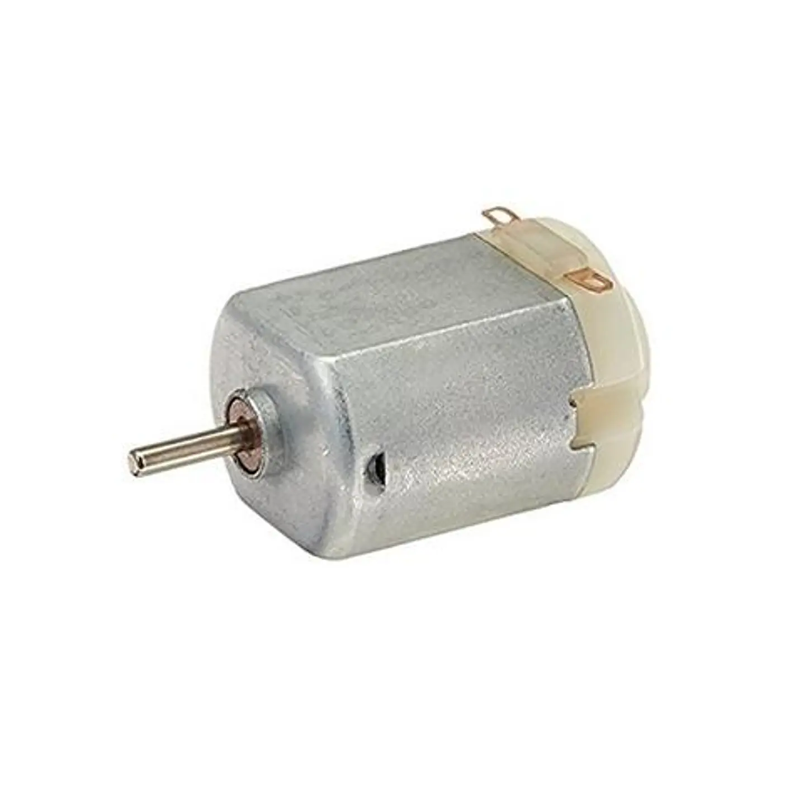
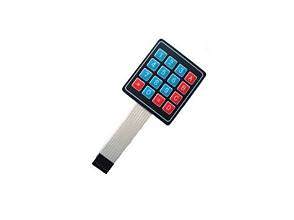
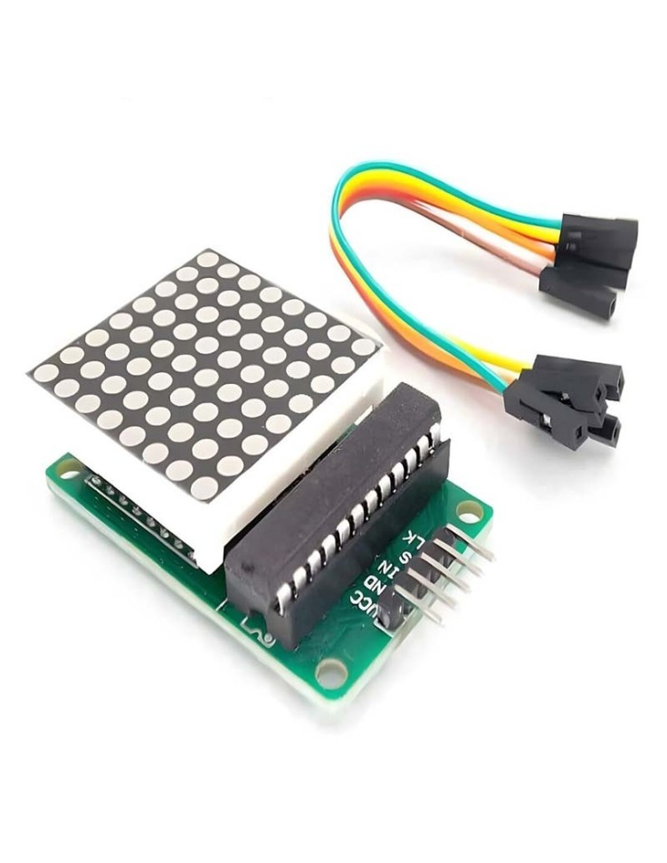
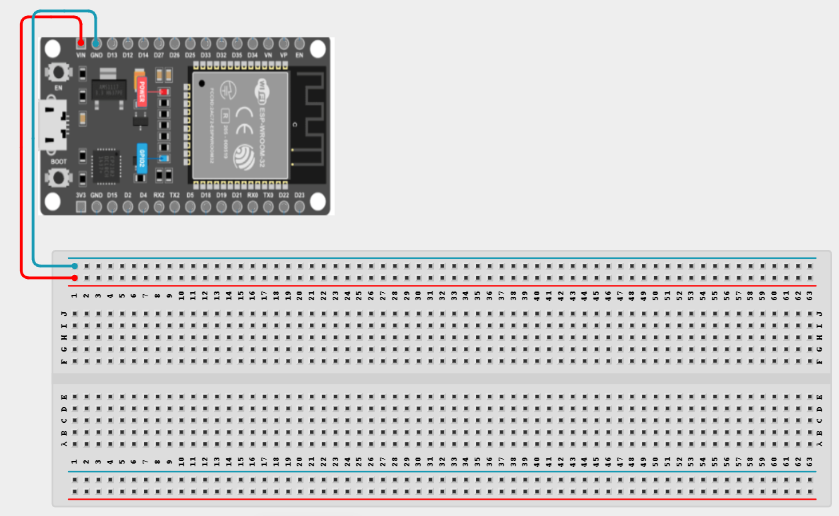
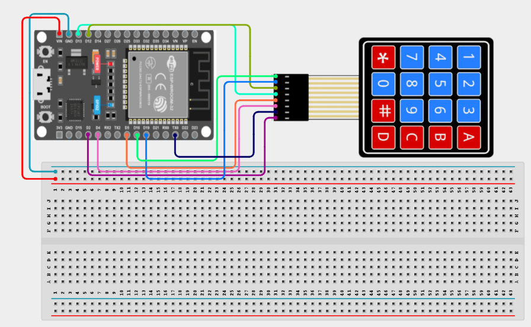
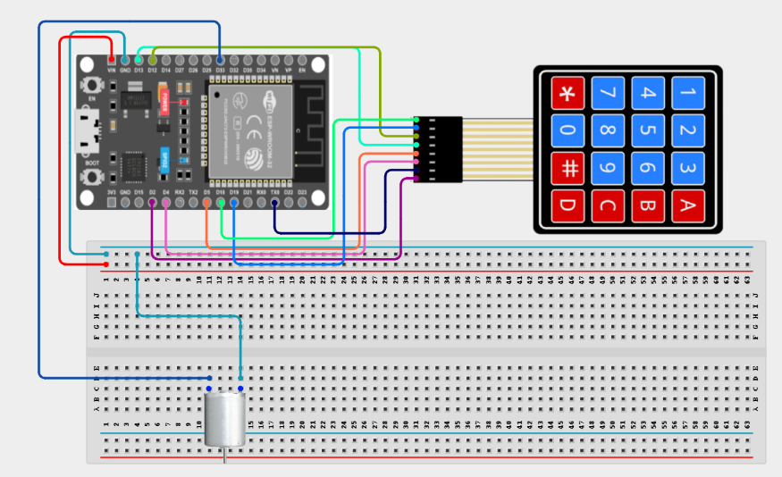

# 4.2.5. Keypad Speed Controlled Fan

| **Description** | In Project 95, learners will construct an expert interactive system titled 'Keypad Speed Controlled Fan'. This manual details the complete synthesis of 4x4 Matrix Keypad + DC Motor + Fan Blade + 7-Segment Display into an intuitive, high-performance automated control platform. |
| --- | --- |
| **Use case** | This project connects to real-world industrial and IoT applications such as: Project 95 equips students with professional skills in embedded human-machine interface (HMI) design and automated motion control. |

## Components (Things You will need)

|  |  |  |  |  |  |  |  |
| --- | --- | --- | --- | --- | --- | --- | --- |

## Building the circuit

> **Tip:** Use the [ESP32 Pin Mapping](../../assets/esp32_pin_mapping.png) image to locate the correct GPIO pins on your ESP32 board.


Things Needed:

- ESP32 board Core Board

- 4x4 Matrix Keypad

- DC Motor

- Fan Blade

- USB Cable & Jumper Wires

- Bread Board


## Mounting the component on the breadboard and wiring the circuit

**Step 1:** Connect the ESP32 board 5V pin to the breadboard's positive (+) power rail and the ESP32 board GND pin to the negative (-) power rail.



**Step 2:** Place the 4x4 Matrix Keypad on the breadboard.

  - Connect the 8 row and column pins to Digital Pins 9, 8, 7, 6, 5, 4, 3, and 2 respectively



**Step 3:** Place the DC Motor (with Fan Blade) on the breadboard without a separate driver board.

  - Connect the motor positive lead to the 5V power rail on the breadboard
  - Connect the motor negative lead to Digital GPIO 33
  - Keep the ESP32 ground and the motor power ground common on the same breadboard rail



**Step 4:** Ensure all components share a common GND connection, then verify all wiring before connecting the ESP32 board to your computer using the USB cable.

**Step 5:** After confirming that all connections are correct, connect the USB cable to the ESP32 board and the computer to power the circuit.

_Make sure to connect the Micro USB cable to the ESP32 board._

## PROGRAMMING

**Step 1:** Open your Arduino IDE. See how to set up here: [Getting Started](../../Getting Started/Arduino_IDE_Setup.md).

**Step 2:** Write the complete program implementing the system logic with appropriate pin definitions, setup configuration, and the main control loop.

```cpp
#include <Keypad.h>

const byte ROWS = 4; const byte COLS = 4;
byte rowPins[ROWS] = {9, 8, 7, 6}; byte colPins[COLS] = {5, 4, 3, 2};
char keys[ROWS][COLS] = {{'1','2','3','A'},{'4','5','6','B'},{'7','8','9','C'},{'*','0','#','D'}};
Keypad kpd = Keypad(makeKeymap(keys), rowPins, colPins, ROWS, COLS);

const int FAN_PIN = 33;

void setup() {
  pinMode(FAN_PIN, OUTPUT);
  Serial.begin(9600);
}

void loop() {
  char key = kpd.getKey();
  if (key) {
    if (key == '1') analogWrite(FAN_PIN, 100);
    else if (key == '2') analogWrite(FAN_PIN, 180);
    else if (key == '3') analogWrite(FAN_PIN, 255);
    else if (key == '0') analogWrite(FAN_PIN, 0);
  }
}
```

**Step 7:** Save your code. _See the [Getting Started](../../Getting Started/Arduino_IDE_Setup.md) section_

**Step 8:** Select the ESP32 board and port _See the [Getting Started](../../Getting Started/Arduino_IDE_Setup.md) section:Selecting ESP32 board Type and Uploading your code_.

**Step 9:** Upload your code. _See the [Getting Started](../../Getting Started/Arduino_IDE_Setup.md) section:Selecting ESP32 board Type and Uploading your code_

## CONCLUSION

Operating physical input devices instantly modifies actuator behavior and updates visual indicators in real time.
