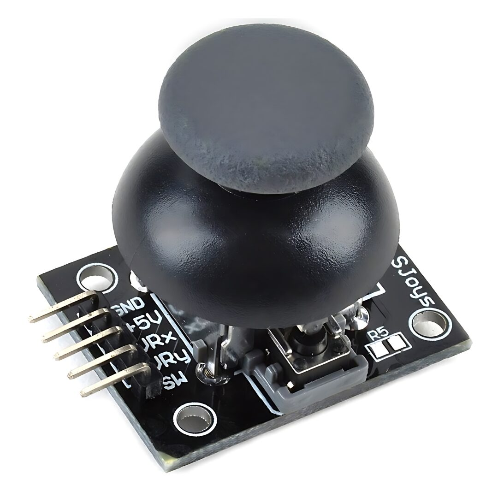
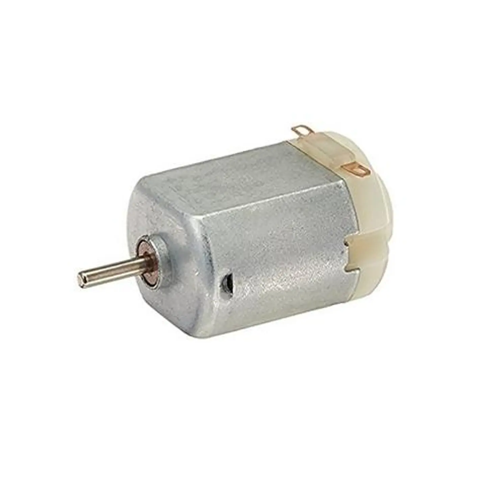
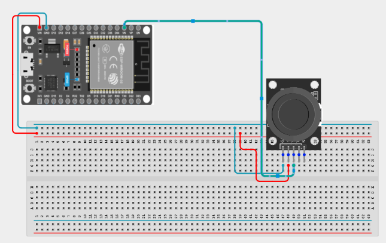

# 4.2.9. Joystick Controlled DC Rover Drive

| **Description** | In Project 99, learners will construct an expert interactive system titled 'Joystick Controlled DC Rover Drive'. This manual details the complete synthesis of XY Joystick + 1 DC Motor into an intuitive, high-performance automated control platform. |
| --- | --- |
| **Use case** | This project connects to real-world industrial and IoT applications such as: Project 99 equips students with professional skills in embedded human-machine interface (HMI) design and automated motion control. |

## Components (Things You will need)

|  |  |  |  |  |  |
| --- | --- | --- | --- | --- | --- |

## Building the circuit

> **Tip:** Use the [ESP32 Pin Mapping](../../assets/esp32_pin_mapping.png) image to locate the correct GPIO pins on your ESP32 board.


Things Needed:

- ESP32 board Core Board

- XY Joystick

- 1 DC Motor

- USB Cable & Jumper Wires

- Bread Board


## Mounting the component on the breadboard and wiring the circuit

**Step 1:** Connect the ESP32 board 5V pin to the breadboard's positive (+) power rail and the ESP32 board GND pin to the negative (-) power rail.


**Step 2:** Place the XY Joystick on the breadboard.

  - Connect the VCC pin to the 5V power rail on the breadboard
  - Connect the GND pin to the ground rail on the breadboard
  - Connect the VRy pin to Analog GPIO 39



**Step 3:** Place the DC motor on the breadboard without a separate driver board.

  - Connect the positive lead of the DC motor to the 5V rail
  - Connect the negative lead of the DC motor to Digital GPIO 23
  - Keep the ESP32 ground and breadboard ground connected together


**Step 4:** Ensure all components share a common GND connection, then verify all wiring before connecting the ESP32 board to your computer using the USB cable.

**Step 5:** After confirming that all connections are correct, connect the USB cable to the ESP32 board and the computer to power the circuit.

_Make sure to connect the Micro USB cable to the ESP32 board._

## PROGRAMMING

**Step 1:** Open your Arduino IDE. See how to set up here: [Getting Started](../../Getting Started/Arduino_IDE_Setup.md).

**Step 2:** Write the complete program implementing the system logic with appropriate pin definitions, setup configuration, and the main control loop.

```cpp
// Project 99: Joystick Controlled DC Rover Drive

const int VRY_PIN = 39;
const int MOTOR_PIN = 23;

void setup() {
  pinMode(MOTOR_PIN, OUTPUT);
  Serial.begin(9600);
}

void loop() {
  int yVal = analogRead(VRY_PIN);

  // The joystick VRy axis controls motor speed.
  // Center stops the motor; movement away from center increases PWM speed.
  int motorSpeed = map(abs(yVal - 2048), 0, 2048, 0, 255);
  motorSpeed = constrain(motorSpeed, 0, 255);

  if (abs(yVal - 2048) < 150) {
    analogWrite(MOTOR_PIN, 0);
  } else {
    analogWrite(MOTOR_PIN, motorSpeed);
  }

  delay(20);
}
```

**Step 7:** Save your code. _See the [Getting Started](../../Getting Started/Arduino_IDE_Setup.md) section_

**Step 8:** Select the ESP32 board and port _See the [Getting Started](../../Getting Started/Arduino_IDE_Setup.md) section:Selecting ESP32 board Type and Uploading your code_.

**Step 9:** Upload your code. _See the [Getting Started](../../Getting Started/Arduino_IDE_Setup.md) section:Selecting ESP32 board Type and Uploading your code_

## CONCLUSION

Operating physical input devices instantly modifies actuator behavior and updates visual indicators in real time.
