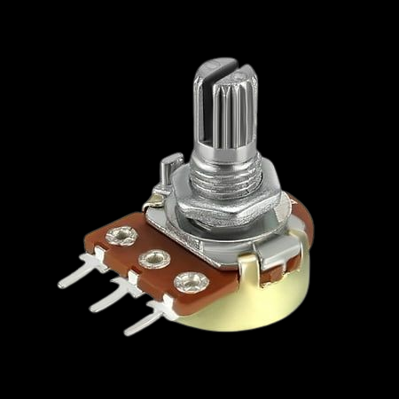
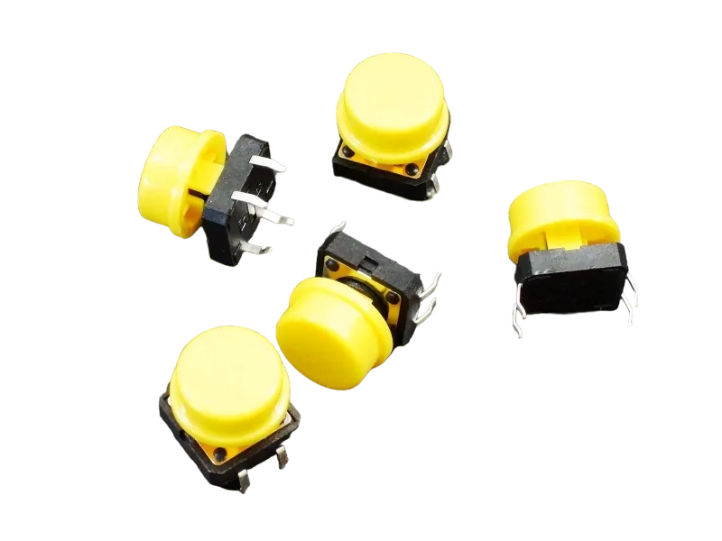
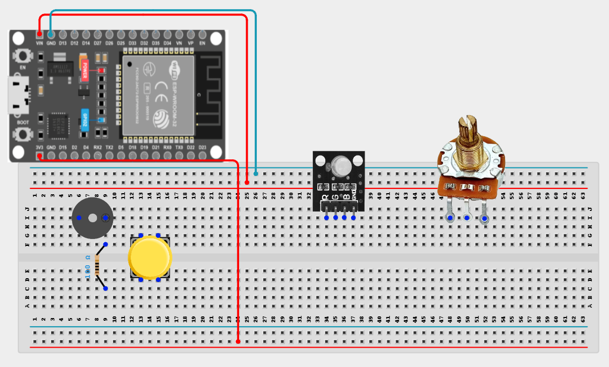
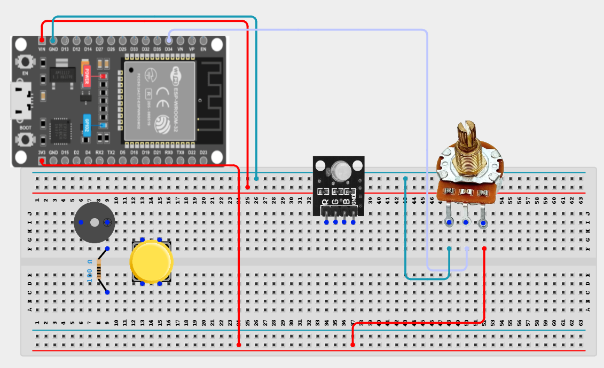
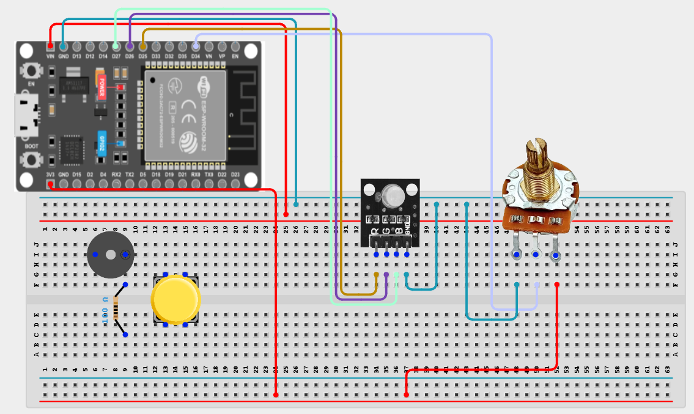
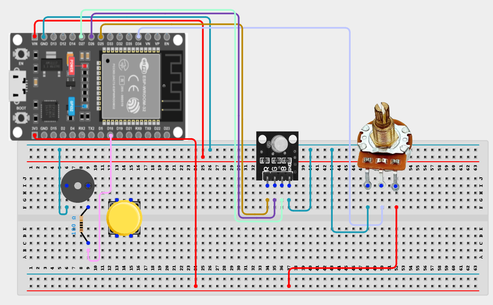
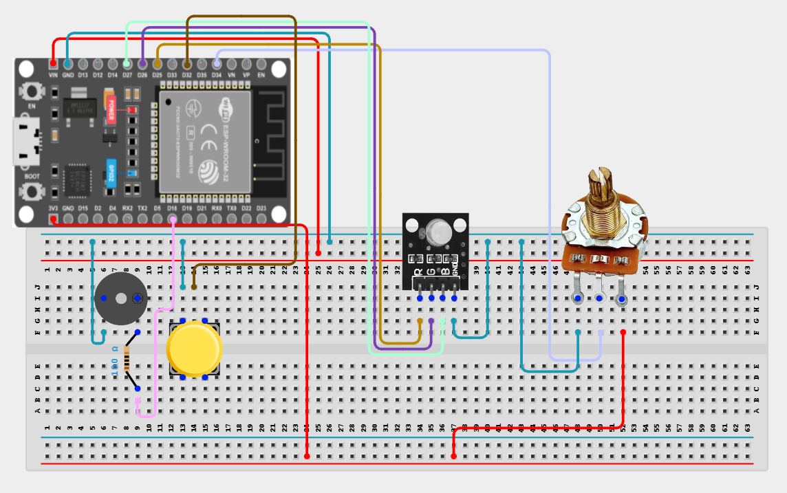

# 4.3.10. Analog Threshold Hysteresis Demonstrator

| **Description** | In Project 130, learners use a potentiometer to simulate a changing analog process signal. The ESP32 applies two thresholds (hysteresis), shows normal, pre-alarm, and alarm states on an RGB module, and sounds the kit buzzer until the alarm is acknowledged. |
|------------------|----------------------------------------------------------------|
| **Use case**     | This is a classroom demonstration of analog measurement, threshold logic, hysteresis, and alarm acknowledgement. The potentiometer simulates a sensor; this is not a real process-safety device. |

## Components (From the kit inventory)

|  |  |  |  |  |  |  |  |  |
| --- | --- | --- | --- | --- | --- | --- | --- | --- |

Things Needed:

- ESP32 board = 1
- 10 kΩ potentiometer = 1
- RGB 3-color LED module = 1
- Kit buzzer = 1
- Tactile pushbutton = 1
- 100 Ω resistor from the kit resistor pack = 1
- Breadboard, jumper wires, and USB cable

## Building the circuit

> **Tip:** See the [ESP32 Pinout Guide](../../Components/ESP32%20Pinout%20and%20Pin%20Assignment%20Guide.md) to locate the GPIO pins.

## Mounting the components

**Step 1:** Disconnect USB. Place the ESP32, potentiometer, RGB module, buzzer, and pushbutton on the breadboard. Keep the wiring to the 3.3V rail only; do not use the 5V pin for the potentiometer or GPIO signals.



## Wiring the circuit

**Step 2:** Connect the potentiometer as the simulated process input:

- Connect one outer potentiometer terminal to ESP32 **3.3V**.
- Connect the other outer terminal to ESP32 **GND**.
- Connect the middle wiper terminal to **GPIO 34 (ADC1 input)**.
- Do not connect the potentiometer to 5V; its wiper voltage must remain between 0V and 3.3V.



**Step 3:** Connect the RGB 3-color module:

- Connect module **R** to **GPIO 25**.
- Connect module **G** to **GPIO 26**.
- Connect module **B** to **GPIO 27**.
- Connect module **- / GND** (common cathode) to ESP32 **GND**.
- The kit's RGB module has onboard current-limiting resistors; do not add another resistor when using that module.



**Step 4:** Connect the kit buzzer:

- Connect ESP32 **GPIO 18** through the kit's **100 Ω** resistor to buzzer **positive (+)**.
- Connect buzzer **negative (-)** to ESP32 **GND**.
- This direct connection is for the kit buzzer at 3.3V only. Do not connect a 5V buzzer supply to a GPIO pin.



**Step 5:** Connect the pushbutton for alarm acknowledgement:

- Connect one side of the button to **GPIO 32**.
- Connect the opposite side to ESP32 **GND**.
- For the kit's 4-pin tactile switch, use one pin from each internally connected side; the two pins on the same side are already connected together.
- The sketch uses the ESP32's internal pull-up, so no additional pull-up resistor is needed.



**Step 6:** Check the 3.3V and GND connections, then connect USB to the ESP32.

## PROGRAMMING

**Step 1:** Open Arduino IDE and select the ESP32 board and port. See [Getting Started](../../Getting%20Started/Arduino_IDE_Setup.md) for setup instructions.

**Step 2:** Enter this sketch. It uses only ESP32 built-in functions and the Arduino-ESP32 core; no additional libraries are required.

```cpp
const byte POT_PIN = 34;
const byte RED_PIN = 25;
const byte GREEN_PIN = 26;
const byte BLUE_PIN = 27;
const byte BUZZER_PIN = 18;
const byte BUTTON_PIN = 32;

const int ADC_MAX = 4095;
const int PREALARM_LEVEL = 2457; // About 60%
const int ALARM_LEVEL = 2867;    // About 70%
const int RESET_LEVEL = 2662;    // About 65%; hysteresis prevents chatter
const unsigned long DEBOUNCE_MS = 30;

bool alarmActive = false;
bool alarmAcknowledged = false;
int lastButtonReading = HIGH;
int stableButtonState = HIGH;
unsigned long lastDebounceTime = 0;
unsigned long lastReportTime = 0;

void setStatusLED(int rawValue) {
  const bool prealarm = alarmActive || rawValue >= PREALARM_LEVEL;
  digitalWrite(RED_PIN, prealarm ? HIGH : LOW);
  digitalWrite(GREEN_PIN, alarmActive ? LOW : HIGH);
  digitalWrite(BLUE_PIN, LOW);
}

void updateAcknowledgeButton() {
  const int reading = digitalRead(BUTTON_PIN);

  if (reading != lastButtonReading) {
    lastDebounceTime = millis();
    lastButtonReading = reading;
  }

  if (millis() - lastDebounceTime >= DEBOUNCE_MS &&
      reading != stableButtonState) {
    stableButtonState = reading;
    if (stableButtonState == LOW && alarmActive) {
      alarmAcknowledged = true;
      Serial.println("Alarm acknowledged; buzzer muted until the input clears.");
    }
  }
}

void setup() {
  Serial.begin(115200);
  analogReadResolution(12);
  analogSetAttenuation(ADC_11db);

  pinMode(RED_PIN, OUTPUT);
  pinMode(GREEN_PIN, OUTPUT);
  pinMode(BLUE_PIN, OUTPUT);
  pinMode(BUZZER_PIN, OUTPUT);
  pinMode(BUTTON_PIN, INPUT_PULLUP);

  digitalWrite(RED_PIN, LOW);
  digitalWrite(GREEN_PIN, HIGH);
  digitalWrite(BLUE_PIN, LOW);
  digitalWrite(BUZZER_PIN, LOW);

  Serial.println("Analog threshold demonstrator ready.");
  Serial.println("Turn the potentiometer to change the simulated input.");
}

void loop() {
  const int rawValue = analogRead(POT_PIN);

  if (!alarmActive && rawValue >= ALARM_LEVEL) {
    alarmActive = true;
    alarmAcknowledged = false;
    Serial.println("ALARM threshold reached.");
  } else if (alarmActive && rawValue <= RESET_LEVEL) {
    alarmActive = false;
    alarmAcknowledged = false;
    Serial.println("Input returned below the reset threshold.");
  }

  updateAcknowledgeButton();
  setStatusLED(rawValue);
  digitalWrite(BUZZER_PIN, alarmActive && !alarmAcknowledged ? HIGH : LOW);

  if (millis() - lastReportTime >= 250) {
    lastReportTime = millis();
    const int percent = (rawValue * 100L) / ADC_MAX;
    const char* state = alarmActive ? "ALARM" :
                        (rawValue >= PREALARM_LEVEL ? "PRE-ALARM" : "NORMAL");
    Serial.printf("ADC: %4d | Input: %3d%% | State: %s\n",
                  rawValue, percent, state);
  }

  delay(10);
}
```

**Step 3:** Upload the sketch and open Serial Monitor at **115200 baud**.

**Step 4:** Turn the potentiometer slowly:

- Below about **60%**, the RGB module shows green and the buzzer is off.
- From about **60%** to the alarm threshold, the module shows yellow (red and green).
- At about **70%**, the module turns red and the buzzer sounds.
- Press the pushbutton to mute the buzzer while the alarm remains active.
- Turn the potentiometer below about **65%** to clear and re-arm the alarm.

The percentage is an approximate ADC reading. The 70% alarm threshold and 65% reset threshold provide hysteresis, so small input fluctuations around the alarm point do not repeatedly switch the buzzer.

## CONCLUSION

This project uses only components listed in the kit inventory. It focuses on simulating an analog process signal and demonstrating threshold hysteresis, visual states, and alarm acknowledgement. It does not control a motor, use an unlisted motor driver, or connect the 5V-pulled-up LCD to the ESP32.
