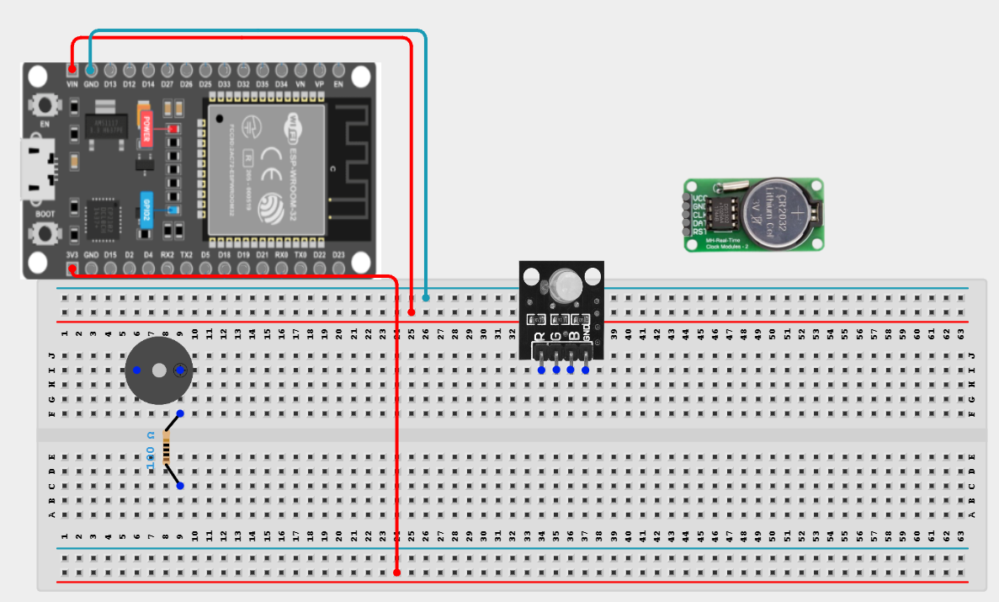
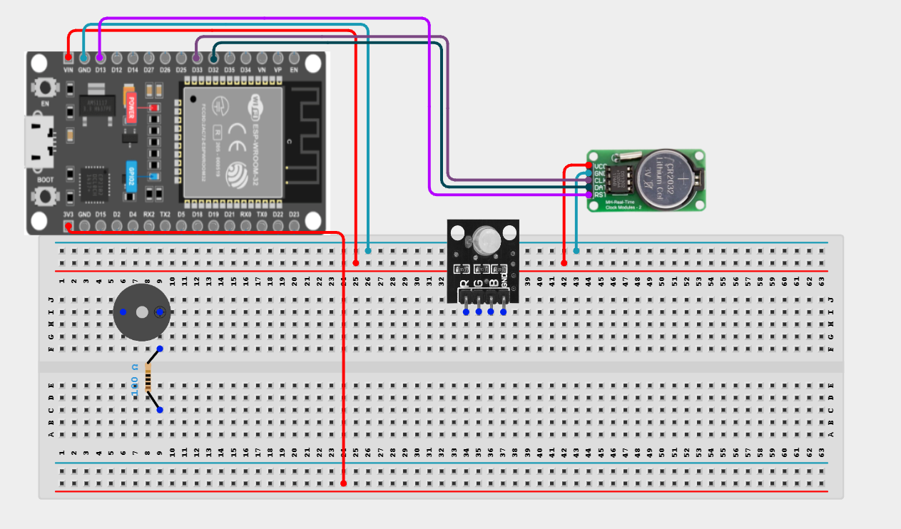
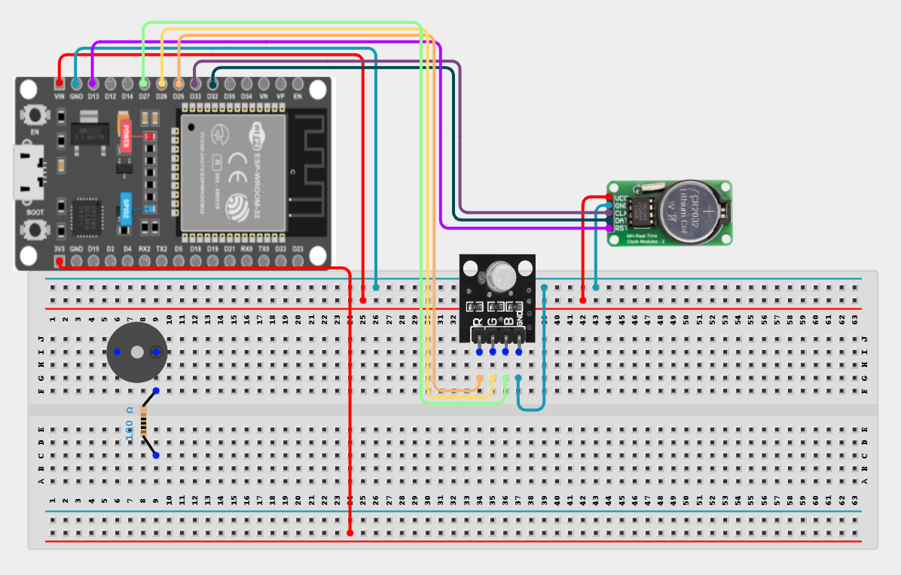
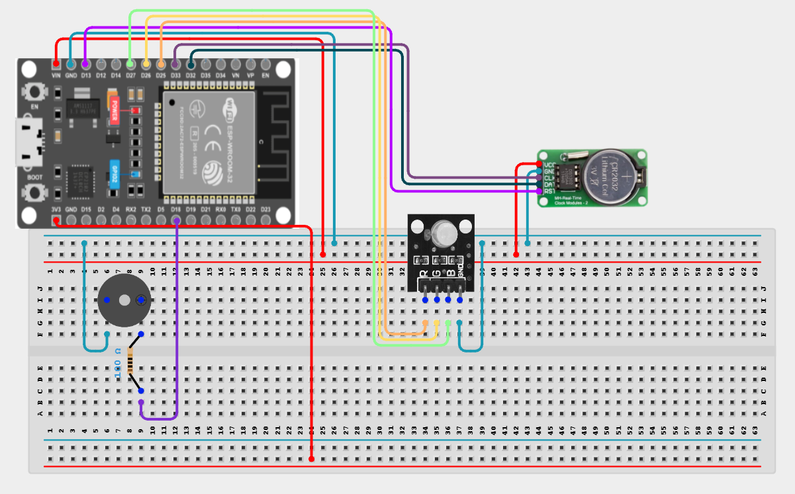

# 4.3.11. Real-Time Clock Industrial Shift Siren

| **Description** | In Project 131, learners use a DS1302 real-time clock to sound a five-second shift-start signal at 08:00. An RGB module shows ready and siren states, while the Serial Monitor reports the current time. |
|------------------|----------------------------------------------------------------|
| **Use case**     | This low-voltage classroom prototype demonstrates RTC scheduling and a one-shot daily alert. It is not a certified industrial safety or personnel-notification system. |

## Components (From the kit inventory)

|  |  |  |  |  |  |  |  |
| --- | --- | --- | --- | --- | --- | --- | --- |

Things Needed:

- ESP32 board = 1
- DS1302 RTC module with backup battery = 1
- Active buzzer = 1
- RGB 3-color LED module = 1
- 100 Ω resistor from the kit resistor pack = 1
- Breadboard, jumper wires, and USB cable

The MAX7219 matrix, relay, and RFID reader are not used. The kit's MAX7219 datasheet requires a 5V logic buffer that is not listed in the inventory, so this guide uses the 3.3V-compatible RGB module instead.

## Building the circuit

> **Tip:** See the [ESP32 Pinout Guide](../../Components/ESP32%20Pinout%20and%20Pin%20Assignment%20Guide.md) to locate the correct GPIO pins.

## Mounting the components

**Step 1:** Disconnect USB. Place the ESP32, DS1302 RTC, RGB module, and buzzer on the breadboard. Keep all wiring within the 3.3V logic system.



## Wiring the circuit

**Step 2:** Connect the DS1302 RTC using its 3-wire interface:

- Connect RTC **VCC** to **3.3V** if supported by the exact module.
- Connect RTC **GND** to ESP32 **GND**.
- Connect RTC **DAT / I/O** to **GPIO 32**.
- Connect RTC **CLK / SCLK** to **GPIO 33**.
- Connect RTC **RST / CE** to **GPIO 13**.
- Match the labels on the RTC module. The DS1302 uses these three signal wires; it does not use I2C.
- If the module requires 5V, do not connect its signal pins directly until you have verified that their voltage never exceeds 3.3V.



**Step 3:** Connect the RGB 3-color module:

- Connect module **R** to **GPIO 25**.
- Connect module **G** to **GPIO 26**.
- Connect module **B** to **GPIO 27**.
- Connect module **- / GND** (common cathode) to ESP32 **GND**.
- The kit RGB module has onboard current-limiting resistors; no additional resistors are needed for its LED channels.



**Step 4:** Connect the active buzzer:

- Connect ESP32 **GPIO 18** through the kit's **100 Ω** resistor to buzzer **positive (+)**.
- Connect buzzer **negative (-)** to ESP32 **GND**.
- This direct connection is for the kit buzzer at 3.3V only. Do not connect a 5V buzzer supply to a GPIO pin.



**Step 5:** Check the RTC signal wiring, common ground, RGB polarity, and buzzer resistor. Then connect USB to the ESP32.

## PROGRAMMING

**Step 1:** Open Arduino IDE and select the ESP32 board and port. See [Getting Started](../../Getting%20Started/Arduino_IDE_Setup.md) for setup instructions.

**Step 2:** Install **Rtc by Makuna** through Arduino IDE's Library Manager, then enter this sketch. The RGB module replaces the MAX7219 matrix, which requires an unlisted 5V logic buffer.

```cpp
#include <ThreeWire.h>
#include <RtcDS1302.h>

constexpr uint8_t rtcDatPin = 32;
constexpr uint8_t rtcClkPin = 33;
constexpr uint8_t rtcRstPin = 13;
constexpr uint8_t redPin = 25;
constexpr uint8_t greenPin = 26;
constexpr uint8_t bluePin = 27;
constexpr uint8_t buzzerPin = 18;
constexpr uint8_t shiftStartHour = 8;
constexpr uint8_t shiftStartMinute = 0;
constexpr uint32_t sirenDurationMs = 5000UL;
constexpr bool setRtcToCompileTime = false;

ThreeWire rtcWire(rtcDatPin, rtcClkPin, rtcRstPin);
RtcDS1302<ThreeWire> rtc(rtcWire);

bool sirenActive = false;
uint32_t sirenStartedAt = 0;
uint32_t lastSirenDate = 0;
uint32_t lastReportAt = 0;

void setIndicator(bool active) {
  digitalWrite(redPin, active ? HIGH : LOW);
  digitalWrite(greenPin, active ? LOW : HIGH);
  digitalWrite(bluePin, LOW);
}

void setup() {
  Serial.begin(115200);

  pinMode(redPin, OUTPUT);
  pinMode(greenPin, OUTPUT);
  pinMode(bluePin, OUTPUT);
  pinMode(buzzerPin, OUTPUT);
  digitalWrite(buzzerPin, LOW);
  setIndicator(false);

  rtc.Begin();
  rtc.SetIsWriteProtected(false);
  if (!rtc.GetIsRunning()) {
    rtc.SetIsRunning(true);
  }

  if (setRtcToCompileTime || !rtc.IsDateTimeValid()) {
    rtc.SetDateTime(RtcDateTime(__DATE__, __TIME__));
    Serial.println("RTC set to sketch compile time.");
  }

  if (!rtc.IsDateTimeValid()) {
    Serial.println("RTC time is invalid. Check the DS1302 wiring and backup battery.");
    while (true) delay(1000);
  }

  Serial.println("Shift siren ready. Scheduled for 08:00 each day.");
}

void loop() {
  const RtcDateTime now = rtc.GetDateTime();
  const uint32_t dateKey = static_cast<uint32_t>(now.Year()) * 10000UL +
                           static_cast<uint32_t>(now.Month()) * 100UL +
                           now.Day();

  if (!sirenActive &&
      now.Hour() == shiftStartHour &&
      now.Minute() == shiftStartMinute &&
      now.Second() < 5 &&
      dateKey != lastSirenDate) {
    sirenActive = true;
    sirenStartedAt = millis();
    lastSirenDate = dateKey;
    Serial.println("Shift start: siren activated.");
  }

  if (sirenActive && millis() - sirenStartedAt >= sirenDurationMs) {
    sirenActive = false;
    Serial.println("Siren finished.");
  }

  digitalWrite(buzzerPin, sirenActive ? HIGH : LOW);
  setIndicator(sirenActive);

  if (millis() - lastReportAt >= 1000UL) {
    lastReportAt = millis();
    Serial.printf("%04d-%02d-%02d %02d:%02d:%02d | %s\n",
                  now.Year(), now.Month(), now.Day(),
                  now.Hour(), now.Minute(), now.Second(),
                  sirenActive ? "SIREN ON" : "READY");
  }

  delay(100);
}
```

**Step 3:** Save and upload the sketch. To set the RTC to the computer's current time, temporarily change `setRtcToCompileTime` to `true`, upload, then set it back to `false` and upload again. Install the RTC backup battery so time is retained when USB power is removed.

**Step 4:** Open Serial Monitor at **115200 baud**. Confirm that the reported RTC time is correct; adjust the RTC before relying on the schedule if it is not.

**Step 5:** For a safe functional test, temporarily change `shiftStartHour` and `shiftStartMinute` to a time one or two minutes ahead, upload, and observe the indicator and buzzer. Restore the shift time to **08:00** when the test is complete.

At the scheduled time, the RGB module turns red and the buzzer sounds for five seconds. The alarm triggers once per calendar day; the green indicator means the controller is ready.

## CONCLUSION

This project uses the kit's DS1302 RTC, RGB module, buzzer, resistor pack, and ESP32 to demonstrate a scheduled shift-start signal. It avoids the unused relay and RFID parts and the MAX7219's unlisted 5V logic buffer. Use it as an educational prototype, not as a real industrial safety siren.
