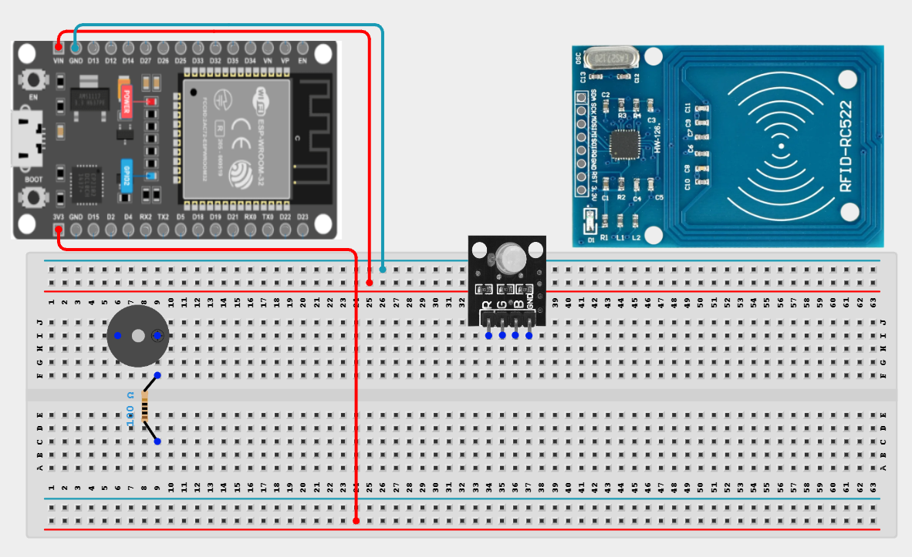
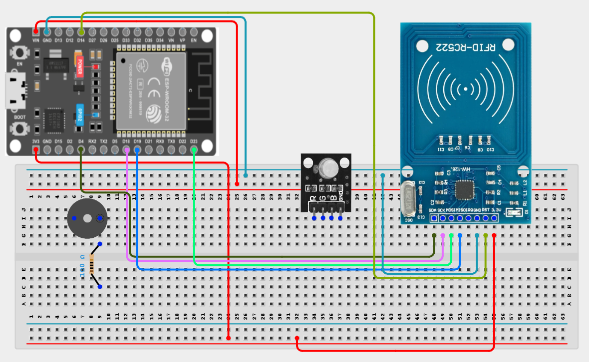
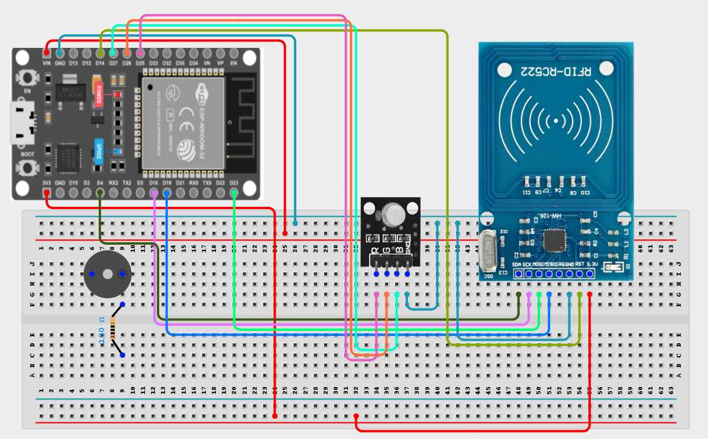
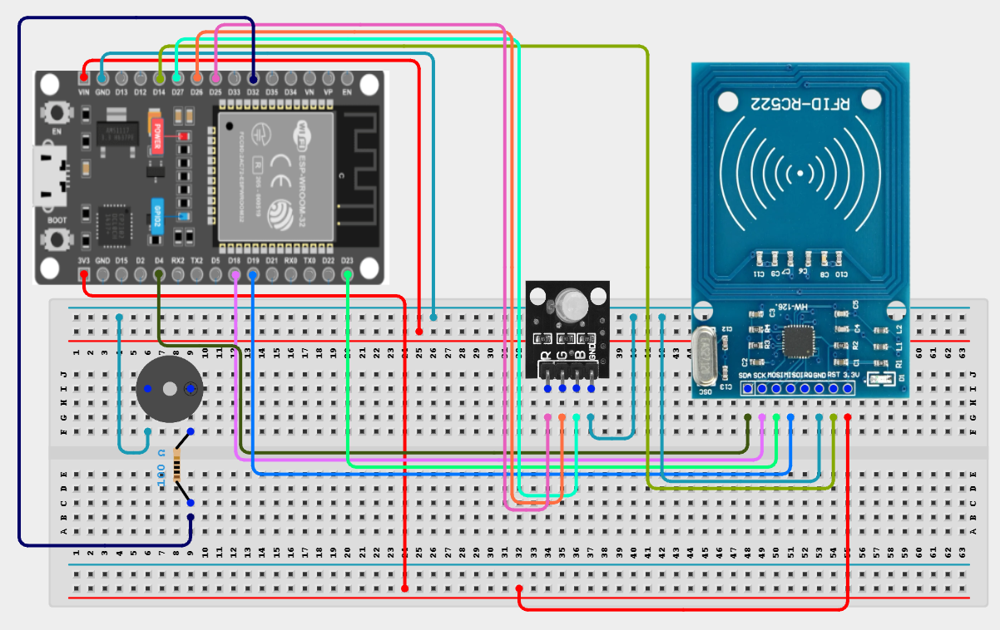

# 4.3.12. RFID Inventory Tag Counter

| **Description** | In Project 132, learners use an RC522 RFID reader to count distinct inventory tags. The Serial Monitor displays each tag's UID and the number of unique tags detected during the current session. |
|------------------|------------------------------------------------------------------------------------------------------------------------------------------|
| **Use case**     | This low-voltage classroom prototype demonstrates RFID identification and duplicate detection. It does not write to tags or save inventory data after reset. |

## Components (From the kit inventory)

|  |  |  |  |  |  |  |  |
| --- | --- | --- | --- | --- | --- | --- | --- |

Things Needed:

- ESP32 board = 1
- RC522 RFID reader = 1
- RFID card or key fob tags from the kit
- RGB 3-color LED module = 1
- Active buzzer = 1
- 100 Ω resistor from the kit resistor pack = 1
- Breadboard, jumper wires, and USB cable

The MAX7219 matrix, relay, and RTC are not used. The MAX7219 requires 5V and a 74HCT125 logic buffer according to its datasheet; that buffer is not listed in the kit inventory. This project reports the count in the Serial Monitor and uses the RGB module for scan feedback.

## Building the circuit

> **Tip:** See the [ESP32 Pinout Guide](../../Components/ESP32%20Pinout%20and%20Pin%20Assignment%20Guide.md) to locate the correct GPIO pins.

## Mounting the components

**Step 1:** Disconnect USB. Place the ESP32, RC522 reader, RGB module, and buzzer on the breadboard.



## Wiring the circuit

**Step 2:** Connect the RC522 RFID reader:

- Connect **VCC** to **3.3V** on the ESP32 board. Do not connect it to 5V.
- Connect **GND** to an ESP32 **GND** pin.
- Connect **SCK** to **GPIO 18 (SCK)**.
- Connect **MISO** to **GPIO 19 (MISO)**.
- Connect **MOSI** to **GPIO 23 (MOSI)**.
- Connect **SDA / SS** to **GPIO 4 (SS)**. On the RC522, **SDA / SS is the SPI chip-select pin, not I2C SDA**.
- Connect **RST** to **GPIO 14 (RST)**.
- Leave **IRQ** unconnected.



**Step 3:** Connect the RGB 3-color module:

- Connect module **R** to **GPIO 25**.
- Connect module **G** to **GPIO 26**.
- Connect module **B** to **GPIO 27**.
- Connect module **- / GND** (common cathode) to ESP32 **GND**.
- The kit RGB module has onboard current-limiting resistors; no additional resistors are needed for its LED channels.



**Step 4:** Connect the active buzzer:

- Connect ESP32 **GPIO 32** through the kit's **100 Ω** resistor to buzzer **positive (+)**.
- Connect buzzer **negative (-)** to ESP32 **GND**.
- This direct connection is for the kit buzzer at 3.3V only. Do not connect a 5V buzzer supply to a GPIO pin.



**Step 5:** Check the RC522's 3.3V supply, SPI pin assignments, common ground, RGB polarity, and buzzer resistor. Then connect USB to the ESP32.

## PROGRAMMING

**Step 1:** Open Arduino IDE and select the ESP32 board and port. See [Getting Started](../../Getting%20Started/Arduino_IDE_Setup.md) for setup instructions.

**Step 2:** Install the **MFRC522** library through Arduino IDE's Library Manager, then enter this sketch:

```cpp
#include <SPI.h>
#include <MFRC522.h>

constexpr uint8_t ssPin = 4;
constexpr uint8_t rstPin = 14;
constexpr uint8_t redPin = 25;
constexpr uint8_t greenPin = 26;
constexpr uint8_t bluePin = 27;
constexpr uint8_t buzzerPin = 32;
constexpr uint8_t maxUidBytes = 10;
constexpr uint8_t maxTrackedTags = 20;

struct TagRecord {
  byte uid[maxUidBytes];
  byte size;
};

MFRC522 reader(ssPin, rstPin);
TagRecord trackedTags[maxTrackedTags] = {};
uint8_t tagCount = 0;

void setColor(bool red, bool green, bool blue) {
  digitalWrite(redPin, red ? HIGH : LOW);
  digitalWrite(greenPin, green ? HIGH : LOW);
  digitalWrite(bluePin, blue ? HIGH : LOW);
}

int findTrackedTag() {
  for (uint8_t recordIndex = 0; recordIndex < tagCount; ++recordIndex) {
    if (trackedTags[recordIndex].size != reader.uid.size) {
      continue;
    }

    bool matches = true;
    for (byte uidIndex = 0; uidIndex < reader.uid.size; ++uidIndex) {
      if (trackedTags[recordIndex].uid[uidIndex] != reader.uid.uidByte[uidIndex]) {
        matches = false;
        break;
      }
    }
    if (matches) {
      return recordIndex;
    }
  }
  return -1;
}

void printUid() {
  for (byte i = 0; i < reader.uid.size; ++i) {
    if (i > 0) {
      Serial.print(':');
    }
    if (reader.uid.uidByte[i] < 0x10) {
      Serial.print('0');
    }
    Serial.print(reader.uid.uidByte[i], HEX);
  }
}

void setup() {
  Serial.begin(115200);

  pinMode(redPin, OUTPUT);
  pinMode(greenPin, OUTPUT);
  pinMode(bluePin, OUTPUT);
  pinMode(buzzerPin, OUTPUT);
  setColor(false, false, false);
  digitalWrite(buzzerPin, LOW);

  SPI.begin(18, 19, 23, ssPin);
  reader.PCD_Init();
  delay(4);
  Serial.println("Inventory tag counter ready. Scan tags one at a time.");
  Serial.println("Unique tags this session: 0");
}

void loop() {
  if (!reader.PICC_IsNewCardPresent() || !reader.PICC_ReadCardSerial()) {
    return;
  }

  Serial.print("Tag UID: ");
  printUid();
  Serial.println();

  if (reader.uid.size > maxUidBytes) {
    Serial.println("UID length is unsupported; tag was not counted.");
    setColor(true, false, false);
  } else {
    const int existingIndex = findTrackedTag();
    if (existingIndex >= 0) {
      Serial.print("Already counted. Unique tags this session: ");
      Serial.println(tagCount);
      setColor(false, false, true);
    } else if (tagCount >= maxTrackedTags) {
      Serial.println("Tag list is full; this tag was not counted.");
      setColor(true, false, false);
    } else {
      trackedTags[tagCount].size = reader.uid.size;
      for (byte i = 0; i < reader.uid.size; ++i) {
        trackedTags[tagCount].uid[i] = reader.uid.uidByte[i];
      }
      ++tagCount;

      Serial.print("New tag counted. Unique tags this session: ");
      Serial.println(tagCount);
      setColor(false, true, false);
      digitalWrite(buzzerPin, HIGH);
      delay(100);
      digitalWrite(buzzerPin, LOW);
    }
  }

  reader.PICC_HaltA();
  reader.PCD_StopCrypto1();
  delay(300);
  setColor(false, false, false);
}
```

**Step 3:** Save and upload the sketch.

**Step 4:** Open Serial Monitor at **115200 baud** and scan each kit tag. A new UID increments the count and gives green light and a short beep; a previously counted UID gives blue light without incrementing; the red light indicates an unsupported UID or a full list.

The sketch tracks up to 20 distinct UIDs in memory. Scanning the same tag again does not increase the count. The count and tag list are cleared when the ESP32 resets or loses power; this prototype does not save inventory records.

## CONCLUSION

This project uses the kit's RC522 reader, RFID tags, RGB module, active buzzer, resistor pack, and ESP32 to demonstrate session-based unique tag counting. It does not provide persistent inventory storage or industrial inventory control.
