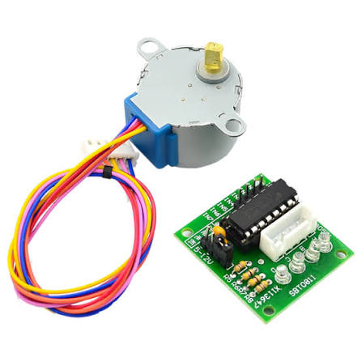
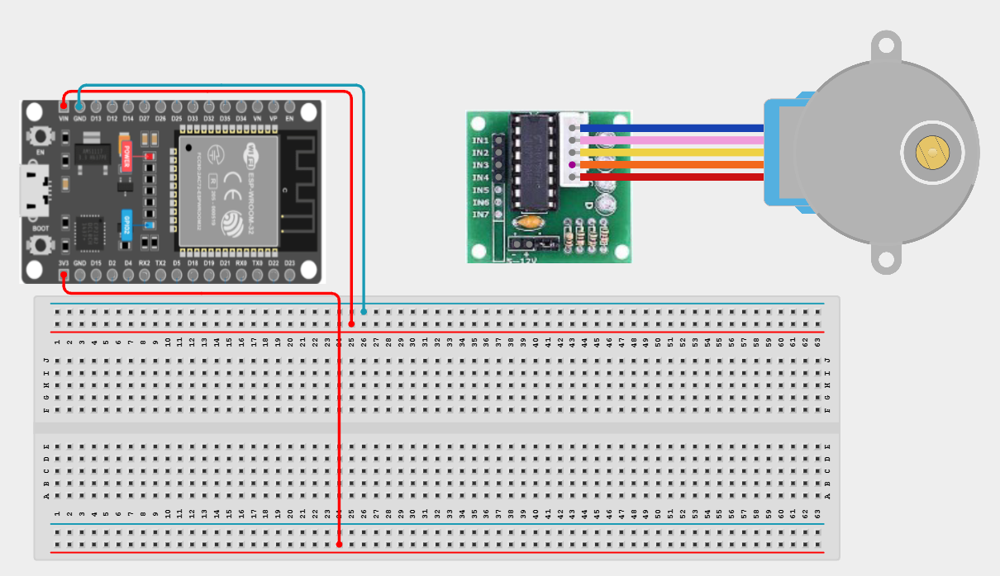
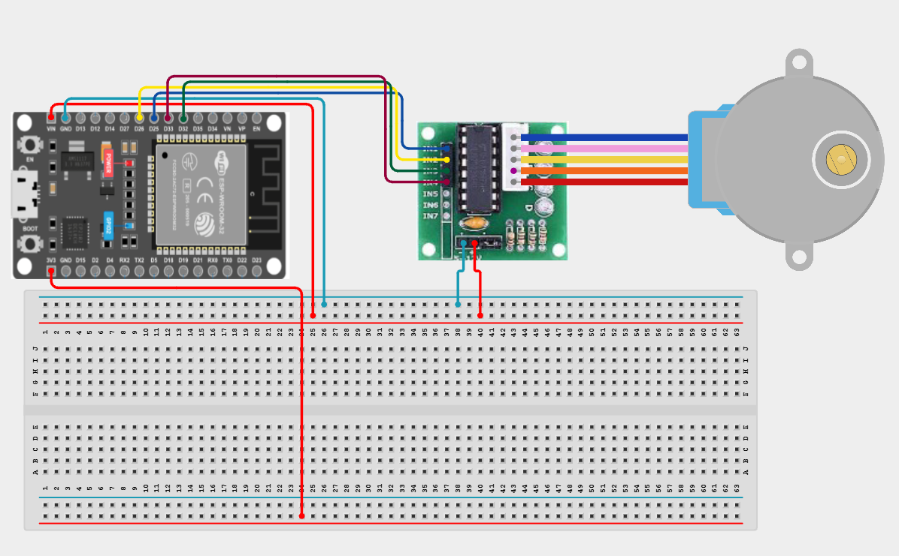

# 4.3.13. Wireless Bluetooth Stepper Motor Controller

| **Description** | In Project 133, learners use the ESP32's built-in Bluetooth Classic radio to control a 28BYJ-48 stepper motor through a ULN2003 driver. Sending **F** or **B** from a Bluetooth serial terminal turns the motor approximately 90 degrees forward or backward. |
|------------------|------------------------------------------------------------------------------------------------------------------------------------------------------------------------------|
| **Use case**     | This low-voltage prototype demonstrates wireless serial commands and stepper-motor sequencing. It is not intended for industrial motion control. |

## Components (From the kit inventory)

|  |  |  |  |  |
| --- | --- | --- | --- | --- |

Things Needed:

- ESP32 board = 1
- 28BYJ-48 stepper motor = 1
- ULN2003 stepper driver board = 1
- Breadboard, jumper wires, and USB cable
- Separate regulated **5V power supply rated for at least 500mA** for the stepper motor; this supply is not included in the kit

## Building the circuit

> **Tip:** See the [ESP32 Pinout Guide](../../Components/ESP32%20Pinout%20and%20Pin%20Assignment%20Guide.md) to locate the correct GPIO pins.

## Mounting the components

**Step 1:** Disconnect the ESP32 from USB and leave the external motor supply off. Place the ESP32, ULN2003 board, and stepper motor on an insulated surface. Connect the motor's keyed plug to the matching socket on the ULN2003 board.



## Wiring the circuit

**Step 2:** Connect the ULN2003 driver and stepper motor:

- Connect driver **IN1** to **GPIO 25**.
- Connect driver **IN2** to **GPIO 26**.
- Connect driver **IN3** to **GPIO 32**.
- Connect driver **IN4** to **GPIO 33**.
- Connect the driver's motor-power **VCC / +** terminal to the separate regulated **5V** supply.
- Connect the driver's **GND / -** terminal to the external supply **GND** and to an ESP32 **GND** pin.
- Do not power the motor from the ESP32 **3.3V**, **5V/VIN**, or USB rail. Do not connect the external supply's positive output to ESP32 **5V/VIN**.



**Step 3:** Use the ESP32's built-in Bluetooth:

- No external Bluetooth module or Bluetooth signal wiring is required.
- The sketch uses Bluetooth Classic Serial Port Profile (SPP). Wi-Fi is not used in this project.

**Step 4:** Recheck the GPIO assignments and the separate motor supply. Confirm that the ESP32 GND, driver GND, and external supply GND are common, then connect USB and turn on the external 5V motor supply.

## PROGRAMMING

**Step 1:** Open Arduino IDE and select the ESP32 board and port. See [Getting Started](../../Getting%20Started/Arduino_IDE_Setup.md) for setup instructions.

**Step 2:** Enter this sketch. `BluetoothSerial` is included with the ESP32 Arduino core; no external Bluetooth module or additional library is required.

```cpp
#include "BluetoothSerial.h"

BluetoothSerial SerialBT;

constexpr uint8_t stepperPins[4] = {25, 26, 32, 33};
constexpr uint8_t stepSequence[8][4] = {
  {1, 0, 0, 0},
  {1, 1, 0, 0},
  {0, 1, 0, 0},
  {0, 1, 1, 0},
  {0, 0, 1, 0},
  {0, 0, 1, 1},
  {0, 0, 0, 1},
  {1, 0, 0, 1}
};
constexpr uint16_t stepsPerQuarterTurn = 1024;
constexpr uint16_t stepDelayUs = 1200;

uint8_t currentStep = 0;

void setStep(uint8_t stepIndex) {
  for (uint8_t pinIndex = 0; pinIndex < 4; ++pinIndex) {
    digitalWrite(stepperPins[pinIndex], stepSequence[stepIndex][pinIndex]);
  }
}

void releaseMotorCoils() {
  for (uint8_t pinIndex = 0; pinIndex < 4; ++pinIndex) {
    digitalWrite(stepperPins[pinIndex], LOW);
  }
}

void moveQuarterTurn(bool forward) {
  for (uint16_t step = 0; step < stepsPerQuarterTurn; ++step) {
    currentStep = forward ? (currentStep + 1) % 8 : (currentStep + 7) % 8;
    setStep(currentStep);
    delayMicroseconds(stepDelayUs);
  }
  releaseMotorCoils();
}

void setup() {
  Serial.begin(115200);
  if (!SerialBT.begin("STEMAIDE Stepper Controller")) {
    Serial.println("Bluetooth initialization failed.");
    while (true) {
      delay(1000);
    }
  }

  for (uint8_t pinIndex = 0; pinIndex < 4; ++pinIndex) {
    pinMode(stepperPins[pinIndex], OUTPUT);
  }
  releaseMotorCoils();

  Serial.println("Bluetooth stepper controller ready. Send F or B.");
}

void loop() {
  while (SerialBT.available() > 0) {
    const char command = SerialBT.read();

    if (command == 'F' || command == 'f') {
      moveQuarterTurn(true);
      Serial.println("Moved forward approximately 90 degrees.");
      SerialBT.println("Moved forward approximately 90 degrees.");
    } else if (command == 'B' || command == 'b') {
      moveQuarterTurn(false);
      Serial.println("Moved backward approximately 90 degrees.");
      SerialBT.println("Moved backward approximately 90 degrees.");
    }
  }
}
```

**Step 3:** Save and upload the sketch while the external motor supply is off.

**Step 4:** Pair a phone or other device that supports Bluetooth Classic SPP with **STEMAIDE Stepper Controller**. A BLE-only terminal app will not work with `BluetoothSerial`. Open Serial Monitor at **115200 baud** if you also want USB status messages. Turn on the external 5V motor supply, then send **F** or **B** from the Bluetooth terminal. Each command moves the motor approximately 90 degrees; the exact angle can vary with the motor's gearbox and load.

## CONCLUSION

This project uses the ESP32's built-in Bluetooth Classic radio with the kit's 28BYJ-48 and ULN2003, so no external Bluetooth module is needed. The motor requires a separate regulated 5V supply; keep its positive rail isolated from the ESP32's USB/5V rail and connect the grounds together.
