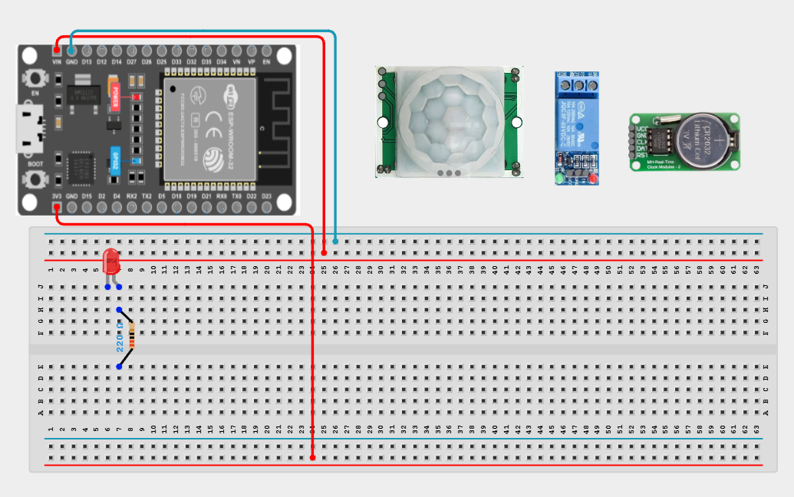
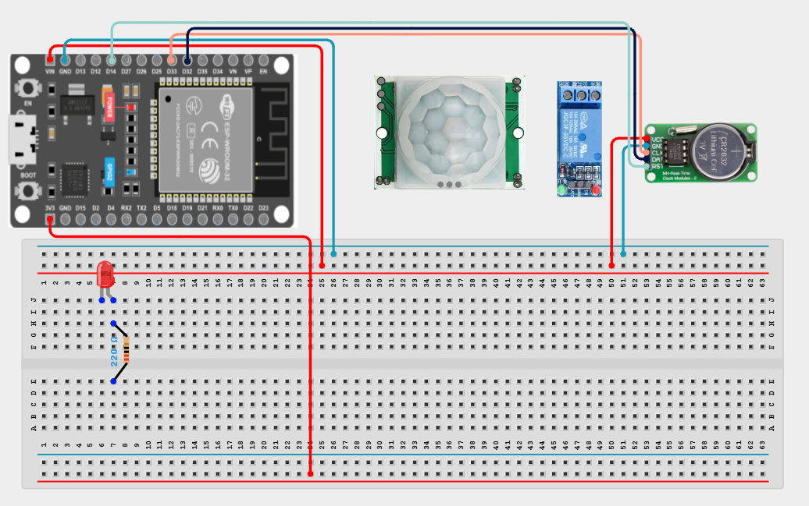
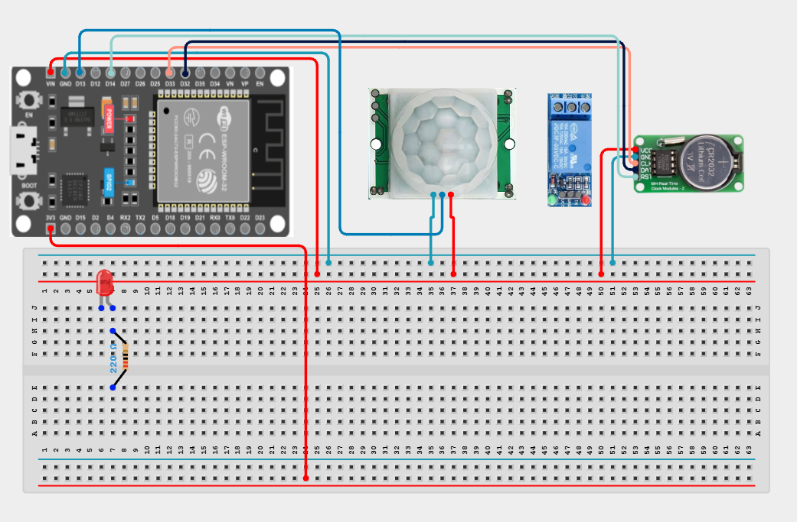
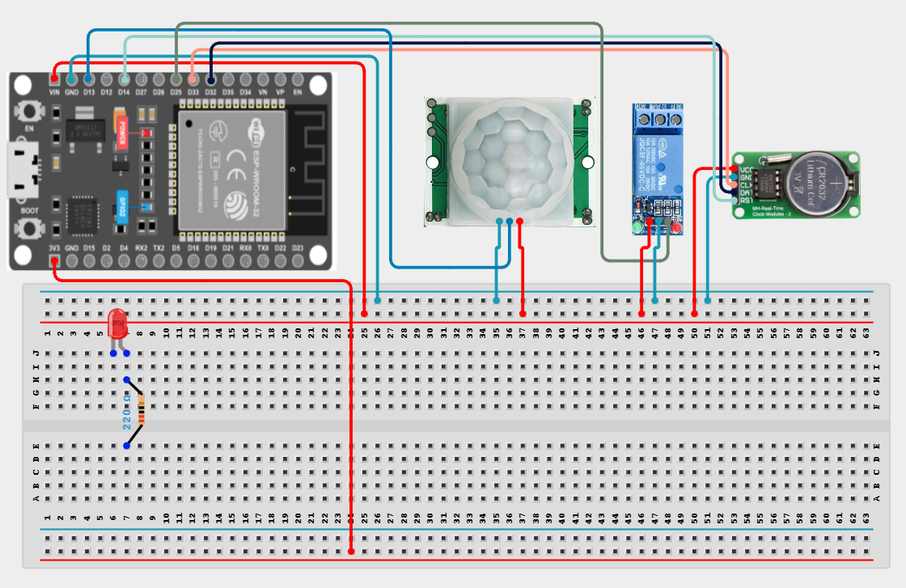
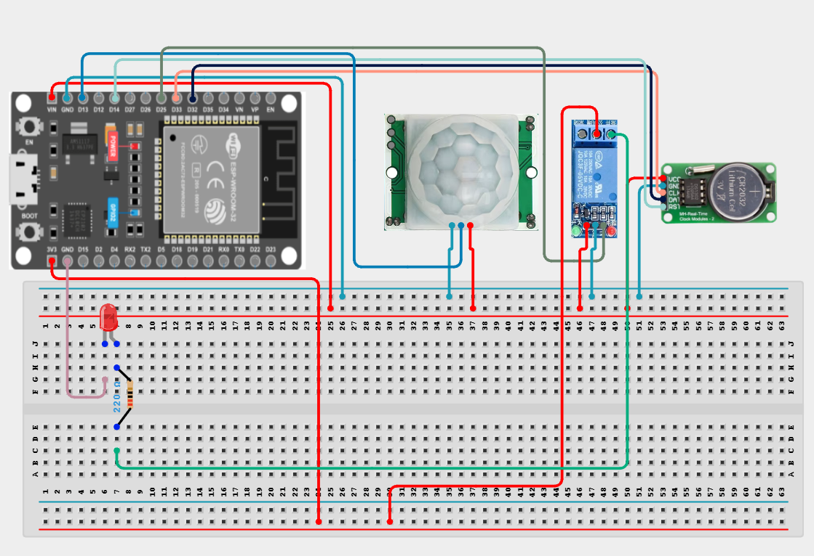

# 4.3.14. Smart RTC Energy Saver

| **Description** | In Project 134, learners use a DS1302 real-time clock and PIR motion sensor to enable a low-voltage LED load only during scheduled hours and when motion is detected. A relay switches the load. |
|------------------|----------------------------------------------------------------------------------------------------------------------------------------------------------------|
| **Use case**     | This classroom prototype demonstrates schedule- and occupancy-based load control. It is not a mains-powered energy-saving system. |

## Components

|  |  |  |  |  |  |  |  |  |
| --- | --- | --- | --- | --- | --- | --- | --- | --- |

Things Needed:

- ESP32 board = 1
- DS1302 RTC module with backup battery = 1
- HC-SR501 PIR motion sensor = 1
- 1-channel relay module with removable **VCC/JD-VCC** jumper = 1
- Red 5mm LED = 1
- 220 Ω resistor from the kit resistor pack = 1
- Breadboard, jumper wires, and USB cable

> **RTC model note:** This sketch targets the DS1302 module previously confirmed for your hardware. The published kit inventory lists DS1307/DS3231 modules instead; those use different wiring and code. Check the module label before wiring. Do not use this 3-wire sketch with a DS3231.

## Building the circuit

> **Tip:** See the [ESP32 Pinout Guide](../../Components/ESP32%20Pinout%20and%20Pin%20Assignment%20Guide.md) to locate the correct GPIO pins.

## Mounting the components

**Step 1:** Disconnect USB and keep the relay load disconnected. Place the ESP32, RTC, PIR sensor, relay module, LED, and resistor on the breadboard. Keep this demonstration entirely low-voltage.



## Wiring the circuit

**Step 2:** Connect the DS1302 RTC:

- Connect RTC **VCC** to **3.3V** only if the exact module supports 3.3V operation.
- Connect RTC **GND** to ESP32 **GND**.
- Connect RTC **DAT / I/O** to **GPIO 32**.
- Connect RTC **CLK / SCLK** to **GPIO 33**.
- Connect RTC **RST / CE** to **GPIO 14**.
- Match the labels on the RTC module. The DS1302 uses these three signal wires; it does not use I2C.
- If the module requires 5V or pulls its data pin above 3.3V, do not connect its signal pins directly to the ESP32.



**Step 3:** Connect the HC-SR501 PIR motion sensor:

- Connect sensor **VCC** to ESP32 **5V/VIN** while the board is powered by USB.
- Connect sensor **GND** to ESP32 **GND**.
- Connect sensor **OUT** to **GPIO 13**. The kit sensor's output is 3.3V logic.
- Allow the sensor to stabilize for 30 seconds after power-up; its output can change during warm-up.



**Step 4:** Connect the relay module's control and coil supplies:

- Remove the relay board's jumper connecting **VCC** and **JD-VCC**.
- Connect relay **VCC** to ESP32 **3.3V**.
- Connect relay **JD-VCC** to ESP32 **5V/VIN** while the board is powered by USB.
- Connect relay **GND** to ESP32 **GND**.
- Connect relay **IN** to **GPIO 25**.
- The sketch assumes the module is active-low: **LOW** energizes the relay, **HIGH** turns it off. If the board does not have the removable VCC/JD-VCC jumper, stop and verify its wiring requirements before use.
- With the LED load still disconnected, verify the relay's trigger polarity. If the module is active-high, invert the logic in `setRelay()` before continuing.



**Step 5:** Wire the low-voltage LED load to the relay contacts:

- Connect ESP32 **3.3V** to relay **COM**.
- Connect relay **NO** to one end of the **220 Ω** resistor.
- Connect the other end of the resistor to the red LED's **anode (+)**.
- Connect the LED's **cathode (-)** to ESP32 **GND**.
- Leave **NC** unused. Do not connect mains voltage or an unverified external load to the relay.



**Step 6:** Check the RTC model and supply, relay jumper removal, common ground, and LED polarity. Then connect USB to the ESP32.

## PROGRAMMING

**Step 1:** Open Arduino IDE and select the ESP32 board and port. See [Getting Started](../../Getting%20Started/Arduino_IDE_Setup.md) for setup instructions.

**Step 2:** Install **Rtc by Makuna** through Arduino IDE's Library Manager, then enter this sketch:

```cpp
#include <ThreeWire.h>
#include <RtcDS1302.h>

constexpr uint8_t rtcDatPin = 32;
constexpr uint8_t rtcClkPin = 33;
constexpr uint8_t rtcRstPin = 14;
constexpr uint8_t pirPin = 13;
constexpr uint8_t relayPin = 25;
constexpr uint8_t startHour = 8;
constexpr uint8_t endHour = 17;
constexpr bool setRtcToCompileTime = false;

ThreeWire rtcWire(rtcDatPin, rtcClkPin, rtcRstPin);
RtcDS1302<ThreeWire> rtc(rtcWire);

uint32_t lastReportAt = 0;

void setRelay(bool on) {
  digitalWrite(relayPin, on ? LOW : HIGH);
}

void setup() {
  Serial.begin(115200);

  digitalWrite(relayPin, HIGH);
  pinMode(relayPin, OUTPUT);
  pinMode(pirPin, INPUT);
  setRelay(false);

  rtc.Begin();
  rtc.SetIsWriteProtected(false);
  if (!rtc.GetIsRunning()) {
    rtc.SetIsRunning(true);
  }

  if (setRtcToCompileTime || !rtc.IsDateTimeValid()) {
    rtc.SetDateTime(RtcDateTime(__DATE__, __TIME__));
    Serial.println("RTC set to sketch compile time.");
  }

  if (!rtc.IsDateTimeValid()) {
    Serial.println("RTC time is invalid. Check the DS1302 wiring and backup battery.");
    while (true) {
      setRelay(false);
      delay(1000);
    }
  }

  Serial.println("Allowing 30 seconds for PIR sensor warm-up; relay remains off.");
  delay(30000UL);
  Serial.println("Energy saver ready. Active schedule: 08:00 to 17:00.");
}

void loop() {
  const RtcDateTime now = rtc.GetDateTime();
  const bool withinSchedule = now.Hour() >= startHour && now.Hour() < endHour;
  const bool motionDetected = digitalRead(pirPin) == HIGH;
  const bool loadOn = withinSchedule && motionDetected;

  setRelay(loadOn);

  if (millis() - lastReportAt >= 1000UL) {
    lastReportAt = millis();
    Serial.printf("%04d-%02d-%02d %02d:%02d:%02d | Schedule: %s | Motion: %s | LED load: %s\n",
                  now.Year(), now.Month(), now.Day(),
                  now.Hour(), now.Minute(), now.Second(),
                  withinSchedule ? "ACTIVE" : "OFF",
                  motionDetected ? "YES" : "NO",
                  loadOn ? "ON" : "OFF");
  }

  delay(100);
}
```

**Step 3:** Save and upload the sketch. To set the RTC to the computer's current time, temporarily change `setRtcToCompileTime` to `true`, upload, then set it back to `false` and upload again. Install the RTC backup battery so time is retained when USB power is removed.

**Step 4:** Open Serial Monitor at **115200 baud** and verify the time. Allow the PIR sensor to warm up. During **08:00–16:59**, detected motion energizes the relay and lights the LED; outside those hours or when motion is not detected, the relay turns off and the LED goes out.

**Step 5:** For a safe test outside the normal schedule, temporarily adjust `startHour` and `endHour` to include the current RTC hour, upload the sketch, and test using only the wired low-voltage LED. Restore the hours to **08:00–17:00** when finished.

## CONCLUSION

This project combines the DS1302 RTC schedule with PIR occupancy detection to control a low-voltage LED through the relay. The relay's coil uses the ESP32's USB-powered 5V/VIN rail, while its input side uses 3.3V logic. Do not use mains voltage for this classroom demonstration.
