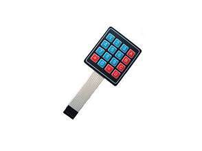
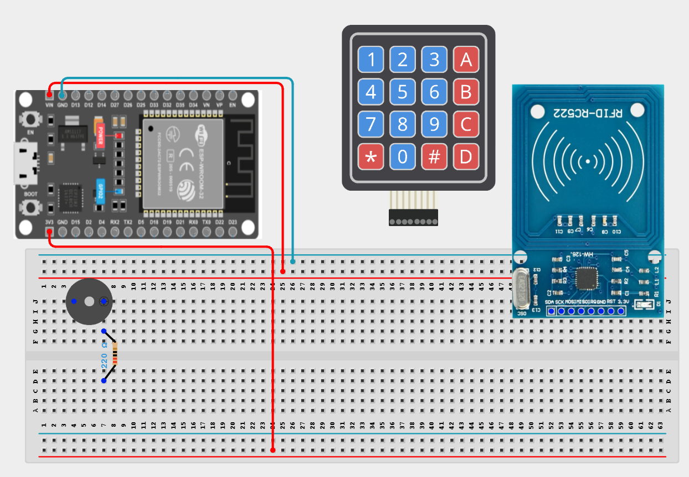
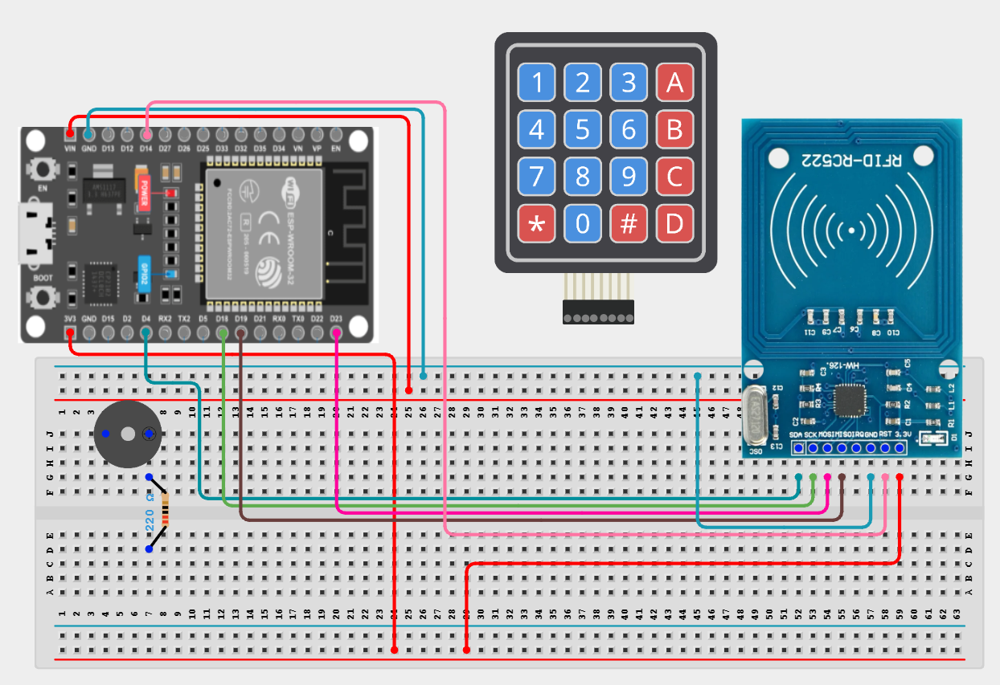
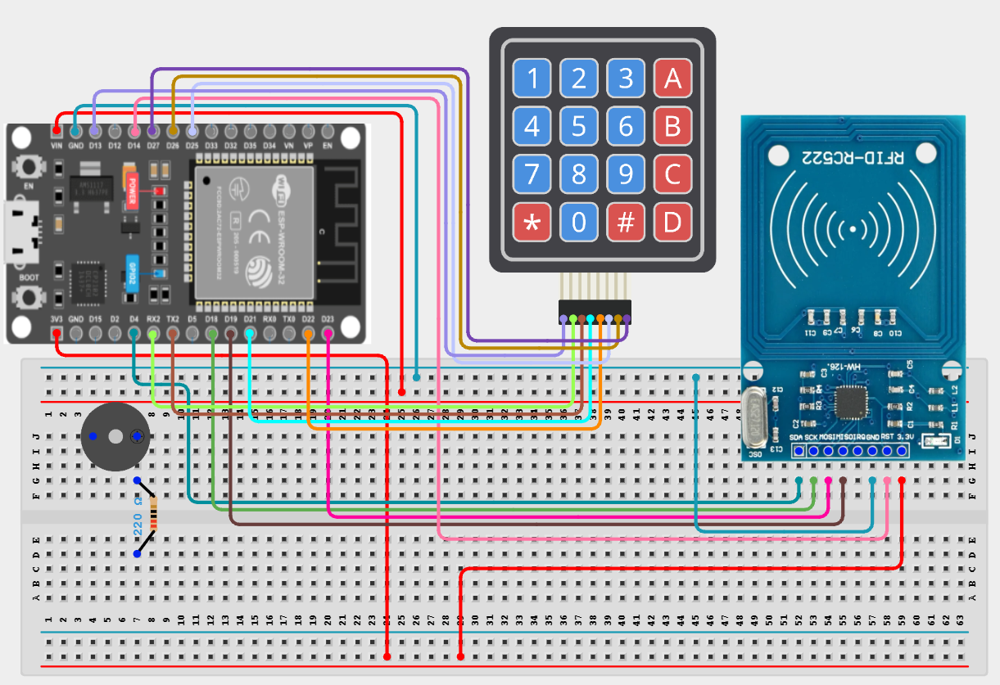
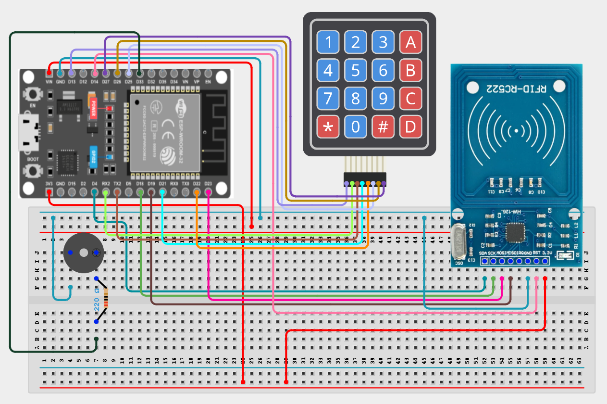

# 4.3.15. RFID Access Logging System

| **Description** | In Project 135, learners scan an RFID tag and enter a four-digit PIN using the keypad. The Serial Monitor logs the tag UID, result, and time since the ESP32 started; the buzzer signals the result. |
|------------------|-----------------------------------------------------------------------------------------------------------------------------------------------------------------------|
| **Use case**     | This low-voltage classroom prototype demonstrates RFID reading, keypad input, and session logging. It is not a secure access-control system. |

## Components (From the kit inventory)

|  |  |  |  |  |  |  |  |
| --- | --- | --- | --- | --- | --- | --- | --- |

Things Needed:

- ESP32 board = 1
- RC522 RFID reader = 1
- RFID card or key fob tag from the kit
- 4x4 matrix keypad = 1
- Active buzzer = 1
- 100 Ω resistor from the kit resistor pack = 1
- Breadboard, jumper wires, and USB cable

The IIC 1602 LCD, relay, RTC, and MAX7219 matrix are not used. The kit LCD backpack pulls its I2C lines up to 5V, which is unsafe for direct ESP32 connections; this guide uses the Serial Monitor instead of adding an unlisted level shifter.

## Building the circuit

> **Tip:** See the [ESP32 Pinout Guide](../../Components/ESP32%20Pinout%20and%20Pin%20Assignment%20Guide.md) to locate the correct GPIO pins.

## Mounting the components

**Step 1:** Disconnect USB. Place the ESP32, RC522 reader, keypad, and buzzer on the breadboard.



## Wiring the circuit

**Step 2:** Connect the RC522 RFID reader:

- Connect **VCC** to **3.3V** on the ESP32 board. Do not connect it to 5V.
- Connect **GND** to an ESP32 **GND** pin.
- Connect **SCK** to **GPIO 18 (SCK)**.
- Connect **MISO** to **GPIO 19 (MISO)**.
- Connect **MOSI** to **GPIO 23 (MOSI)**.
- Connect **SDA / SS** to **GPIO 4 (SS)**. On the RC522, **SDA / SS is the SPI chip-select pin, not I2C SDA**.
- Connect **RST** to **GPIO 14 (RST)**.
- Leave **IRQ** unconnected.



**Step 3:** Connect the 4x4 keypad's eight-pin connector in this order:

- Connect keypad **R1** to **GPIO 13**.
- Connect keypad **R2** to **GPIO 16**.
- Connect keypad **R3** to **GPIO 17**.
- Connect keypad **R4** to **GPIO 21**.
- Connect keypad **C1** to **GPIO 22**.
- Connect keypad **C2** to **GPIO 25**.
- Connect keypad **C3** to **GPIO 26**.
- Connect keypad **C4** to **GPIO 27**.



**Step 4:** Connect the active buzzer:

- Connect ESP32 **GPIO 33** through the kit's **100 Ω** resistor to buzzer **positive (+)**.
- Connect buzzer **negative (-)** to ESP32 **GND**.
- This direct connection is for the kit buzzer at 3.3V only. Do not connect a 5V buzzer supply to a GPIO pin.



**Step 5:** Verify the RC522's 3.3V supply, SPI wiring, keypad pin order, and common ground. Then connect USB to the ESP32.

## PROGRAMMING

**Step 1:** Open Arduino IDE and select the ESP32 board and port. See [Getting Started](../../Getting%20Started/Arduino_IDE_Setup.md) for setup instructions.

**Step 2:** Install the **MFRC522** and **Keypad** libraries through Arduino IDE's Library Manager, then enter this sketch:

```cpp
#include <SPI.h>
#include <MFRC522.h>
#include <Keypad.h>

constexpr uint8_t ssPin = 4;
constexpr uint8_t rstPin = 14;
constexpr uint8_t buzzerPin = 33;
constexpr uint8_t rows = 4;
constexpr uint8_t columns = 4;
constexpr uint8_t pinLength = 4;
constexpr uint8_t maxUidBytes = 10;
constexpr uint32_t pinTimeoutMs = 20000UL;

const char accessPin[pinLength + 1] = "1234";

char keys[rows][columns] = {
  {'1', '2', '3', 'A'},
  {'4', '5', '6', 'B'},
  {'7', '8', '9', 'C'},
  {'*', '0', '#', 'D'}
};

byte rowPins[rows] = {13, 16, 17, 21};
byte columnPins[columns] = {22, 25, 26, 27};

MFRC522 reader(ssPin, rstPin);
Keypad keypad = Keypad(makeKeymap(keys), rowPins, columnPins, rows, columns);

byte lastUid[maxUidBytes] = {};
byte lastUidSize = 0;
char enteredPin[pinLength + 1] = {};
uint8_t enteredPinLength = 0;
uint32_t pinEntryStartedAt = 0;
bool awaitingPin = false;

void clearEnteredPin() {
  enteredPinLength = 0;
  enteredPin[0] = '\0';
}

void beep(uint8_t count) {
  for (uint8_t i = 0; i < count; ++i) {
    digitalWrite(buzzerPin, HIGH);
    delay(100);
    digitalWrite(buzzerPin, LOW);
    delay(100);
  }
}

void printLastUid() {
  for (byte i = 0; i < lastUidSize; ++i) {
    if (i > 0) {
      Serial.print(':');
    }
    if (lastUid[i] < 0x10) {
      Serial.print('0');
    }
    Serial.print(lastUid[i], HEX);
  }
}

void logAttempt(bool granted, const char* reason) {
  Serial.printf("Uptime %lu ms | UID ", static_cast<unsigned long>(millis()));
  printLastUid();
  Serial.printf(" | Access %s: %s\n", granted ? "GRANTED" : "DENIED", reason);
}

bool pinIsCorrect() {
  if (enteredPinLength != pinLength) {
    return false;
  }
  for (uint8_t i = 0; i < pinLength; ++i) {
    if (enteredPin[i] != accessPin[i]) {
      return false;
    }
  }
  return true;
}

void finishAttempt(bool granted, const char* reason) {
  logAttempt(granted, reason);
  beep(granted ? 2 : 1);
  awaitingPin = false;
  clearEnteredPin();
  Serial.println("Scan an RFID tag to begin another attempt.");
}

void scanForTag() {
  if (!reader.PICC_IsNewCardPresent() || !reader.PICC_ReadCardSerial()) {
    return;
  }

  if (reader.uid.size == 0 || reader.uid.size > maxUidBytes) {
    Serial.println("Unsupported tag UID length; tag was not processed.");
    reader.PICC_HaltA();
    reader.PCD_StopCrypto1();
    return;
  }

  lastUidSize = reader.uid.size;
  for (byte i = 0; i < lastUidSize; ++i) {
    lastUid[i] = reader.uid.uidByte[i];
  }

  reader.PICC_HaltA();
  reader.PCD_StopCrypto1();
  clearEnteredPin();
  pinEntryStartedAt = millis();
  awaitingPin = true;

  Serial.print("Tag UID: ");
  printLastUid();
  Serial.println();
  Serial.println("Enter four PIN digits, then press #. Press * to clear.");
}

void handleKey(char key) {
  if (key >= '0' && key <= '9') {
    if (enteredPinLength < pinLength) {
      enteredPin[enteredPinLength++] = key;
      enteredPin[enteredPinLength] = '\0';
      Serial.print('*');
    }
    return;
  }

  if (key == '*') {
    clearEnteredPin();
    Serial.println("\nPIN cleared.");
    return;
  }

  if (key == '#') {
    Serial.println();
    if (enteredPinLength != pinLength) {
      Serial.println("Enter all four digits before pressing #.");
    } else if (pinIsCorrect()) {
      finishAttempt(true, "PIN accepted");
    } else {
      finishAttempt(false, "incorrect PIN");
    }
  }
}

void setup() {
  Serial.begin(115200);
  pinMode(buzzerPin, OUTPUT);
  digitalWrite(buzzerPin, LOW);

  SPI.begin(18, 19, 23, ssPin);
  reader.PCD_Init();
  delay(4);

  Serial.println("RFID access log ready.");
  Serial.println("Scan a tag, then enter the PIN. Default demo PIN: 1234.");
  Serial.println("Change accessPin in the sketch before using.");
}

void loop() {
  if (!awaitingPin) {
    scanForTag();
    return;
  }

  if (millis() - pinEntryStartedAt >= pinTimeoutMs) {
    finishAttempt(false, "PIN entry timed out");
    return;
  }

  const char key = keypad.getKey();
  if (key) {
    handleKey(key);
  }
}
```

**Step 3:** Change `accessPin` from the demonstration value before uploading. Save and upload the sketch.

**Step 4:** Open Serial Monitor at **115200 baud**. Scan an RFID tag, remove it from the reader, enter the four-digit PIN on the keypad, then press **#**. Press **\*** to clear the entered digits. The buzzer gives two short beeps for a successful PIN and one for a denial or timeout. Remove the tag before scanning again.

The Serial Monitor logs each completed attempt with the tag UID and uptime in milliseconds. The log is not saved after reset, and the sketch does not maintain an authorized-UID list: any readable tag can start a PIN attempt. This is a classroom prototype, not a secure access-control system.

## CONCLUSION

This project uses the kit's RC522 reader, keypad, and active buzzer to demonstrate PIN entry and RFID access-event logging. The Serial Monitor replaces the unsafe-to-connect LCD interface, and the log remains available only for the current powered session.
