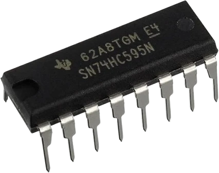
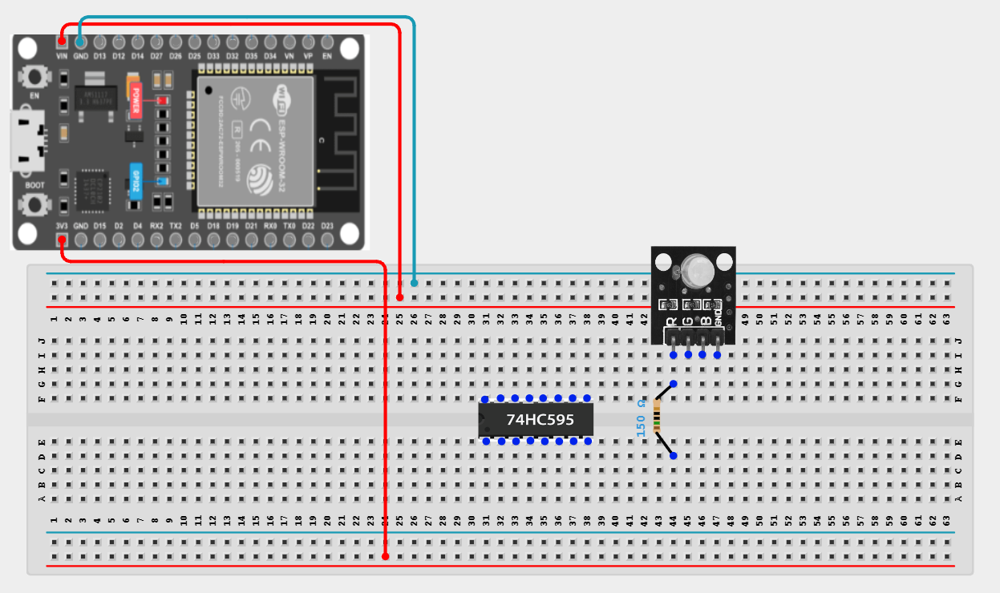
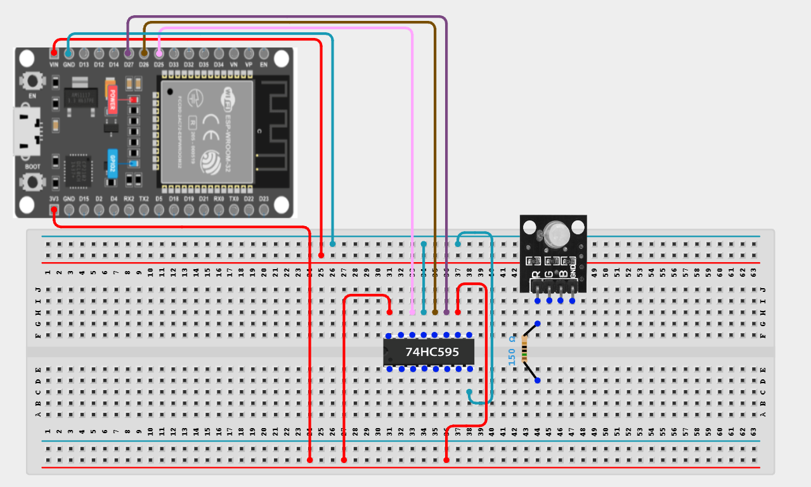
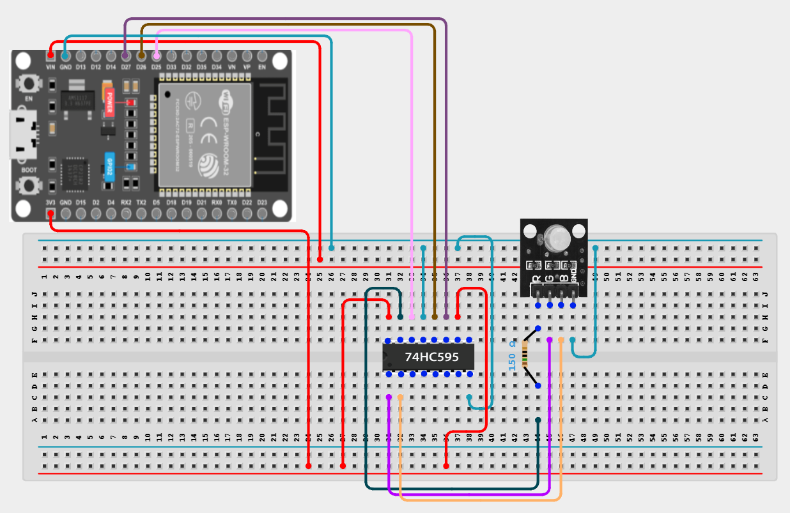

# 4.3.16. Bluetooth Multi-Color Mood Lighting Console

| **Description** | In Project 136, learners use the ESP32's built-in Bluetooth Classic radio to select RGB LED colors through a 74HC595 shift register. A phone sends **R**, **G**, **B**, **W**, or **0** from a Bluetooth serial terminal. |
|------------------|------------------------------------------------------------------------------------------------------------------------------------------------------------------------------|
| **Use case**     | This low-voltage prototype demonstrates wireless serial commands and shift-register output control. |

## Components (From the kit inventory)

|  |  |  |  |  |  |
| --- | --- | --- | --- | --- | --- |

Things Needed:

- ESP32 board = 1
- 74HC595 shift register = 1
- RGB 3-color LED module = 1
- 150 Ω resistor from the kit resistor pack = 1
- Breadboard, jumper wires, and USB cable

No external Bluetooth module, relay, RTC, or RFID reader is used. The ESP32-WROOM-32D provides Bluetooth Classic SPP; Wi-Fi is not used in this project.

## Building the circuit

> **Tip:** See the [ESP32 Pinout Guide](../../Components/ESP32%20Pinout%20and%20Pin%20Assignment%20Guide.md) to locate the correct GPIO pins.

## Mounting the components

**Step 1:** Disconnect USB. Place the ESP32, 74HC595, and RGB module on the breadboard. Check the shift register's notch to identify pin 1 before wiring.



## Wiring the circuit

**Step 2:** Connect the 74HC595 shift register:

- Connect chip **pin 16 (VCC)** to ESP32 **3.3V**.
- Connect chip **pin 8 (GND)** to ESP32 **GND**.
- Connect **pin 14 (DS / SER)** to **GPIO 25**.
- Connect **pin 12 (STCP / RCLK)** to **GPIO 26**.
- Connect **pin 11 (SHCP / SRCLK)** to **GPIO 27**.
- Connect **pin 13 (OE)** to **GND** to enable the outputs.
- Connect **pin 10 (MR / SRCLR)** to **3.3V** to keep reset inactive.
- Leave **pin 9 (Q7S)** unconnected.



**Step 3:** Connect the RGB module through the shift-register outputs:

- Connect shift-register **Q0 (pin 15)** through a **150 Ω** resistor to RGB **R**.
- Connect shift-register **Q1 (pin 1)** directly to RGB **G**.
- Connect shift-register **Q2 (pin 2)** directly to RGB **B**.
- Connect RGB module **- / GND** (common cathode) to ESP32 **GND**.
- This wiring assumes the kit's RGB module has onboard current-limiting resistors. The additional resistor on red keeps that channel within the 74HC595's per-pin output-current limit; the module's green and blue channels draw less current. If your RGB board has no onboard resistors, add suitable resistors to all three channels before connecting it.



**Step 4:** Check the 74HC595 notch and pin numbers, 3.3V supply, common ground, RGB polarity, and series resistors. Then connect USB to the ESP32.

## PROGRAMMING

**Step 1:** Open Arduino IDE and select the ESP32 board and port. See [Getting Started](../../Getting%20Started/Arduino_IDE_Setup.md) for setup instructions.

**Step 2:** Enter this sketch. `BluetoothSerial` is included with the ESP32 Arduino core; no external Bluetooth module or additional library is required.

```cpp
#include "BluetoothSerial.h"

BluetoothSerial SerialBT;

constexpr uint8_t dataPin = 25;
constexpr uint8_t latchPin = 26;
constexpr uint8_t clockPin = 27;

void updateColor(uint8_t pattern) {
  digitalWrite(latchPin, LOW);
  shiftOut(dataPin, clockPin, MSBFIRST, pattern);
  digitalWrite(latchPin, HIGH);
}

void setup() {
  Serial.begin(115200);
  pinMode(dataPin, OUTPUT);
  pinMode(latchPin, OUTPUT);
  pinMode(clockPin, OUTPUT);
  updateColor(0);

  if (!SerialBT.begin("STEMAIDE Mood Light")) {
    Serial.println("Bluetooth initialization failed.");
    while (true) {
      delay(1000);
    }
  }

  Serial.println("Mood light ready. Send R, G, B, W, or 0.");
}

void loop() {
  while (SerialBT.available() > 0) {
    char command = SerialBT.read();
    uint8_t pattern = 0;
    const char* colorName = nullptr;

    switch (command) {
      case 'R':
      case 'r':
        pattern = 0b00000001;
        colorName = "red";
        break;
      case 'G':
      case 'g':
        pattern = 0b00000010;
        colorName = "green";
        break;
      case 'B':
      case 'b':
        pattern = 0b00000100;
        colorName = "blue";
        break;
      case 'W':
      case 'w':
        pattern = 0b00000111;
        colorName = "white";
        break;
      case '0':
        pattern = 0;
        colorName = "off";
        break;
      case '\r':
      case '\n':
        continue;
      default:
        SerialBT.println("Unknown command. Send R, G, B, W, or 0.");
        continue;
    }

    updateColor(pattern);
    Serial.print("Color set to ");
    Serial.println(colorName);
    SerialBT.print("Color set to ");
    SerialBT.println(colorName);
  }
}
```

**Step 3:** Save and upload the sketch.

**Step 4:** Pair a phone or other device that supports Bluetooth Classic SPP with **STEMAIDE Mood Light**. A BLE-only terminal app will not work with `BluetoothSerial`. Send **R**, **G**, **B**, **W**, or **0** to set red, green, blue, white, or off. Open Serial Monitor at **115200 baud** to see command confirmations.

## CONCLUSION

This project uses the ESP32's built-in Bluetooth Classic radio, the kit's 74HC595 shift register, and the RGB module. The shift register is powered at 3.3V, and the red channel has an additional series resistor to keep its output current within specification.
