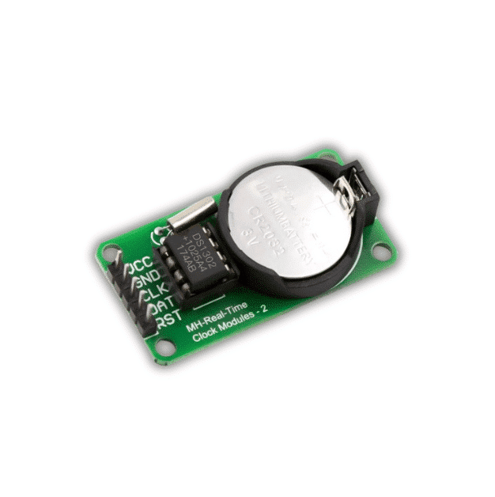
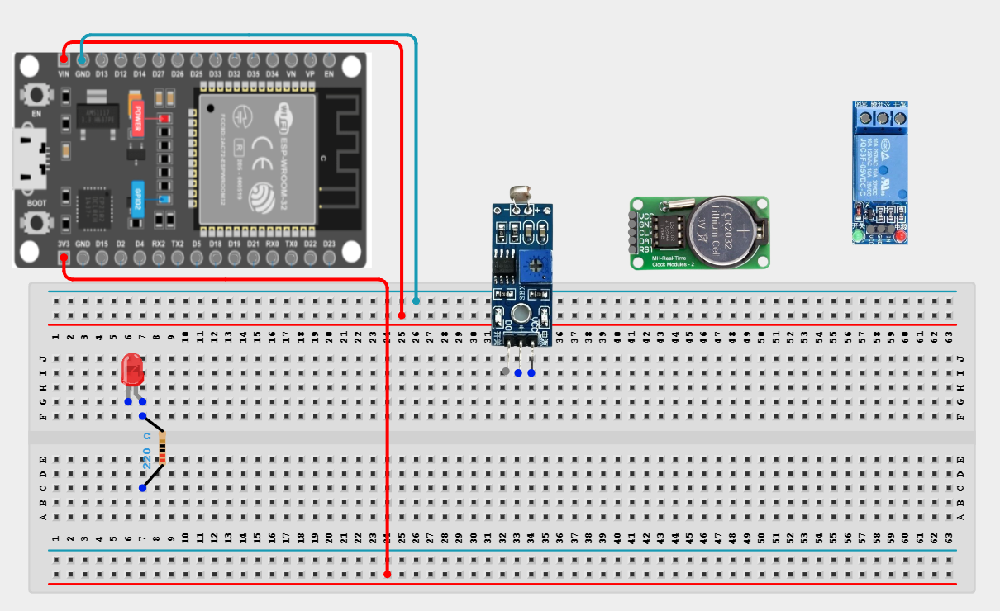
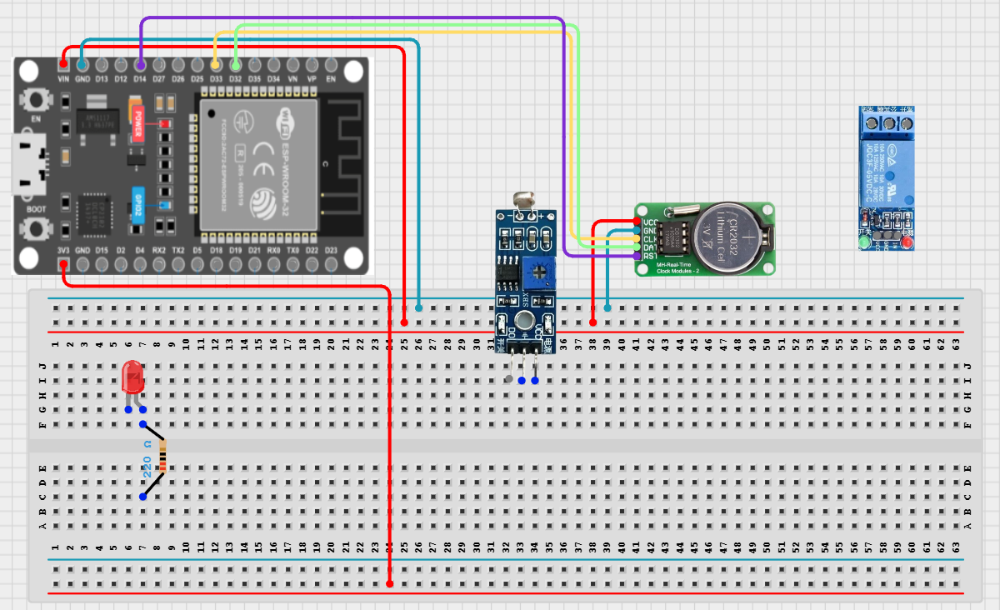
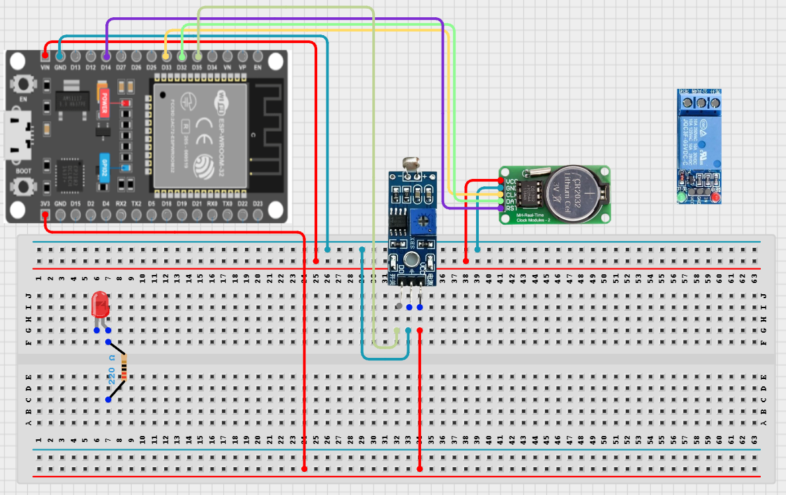
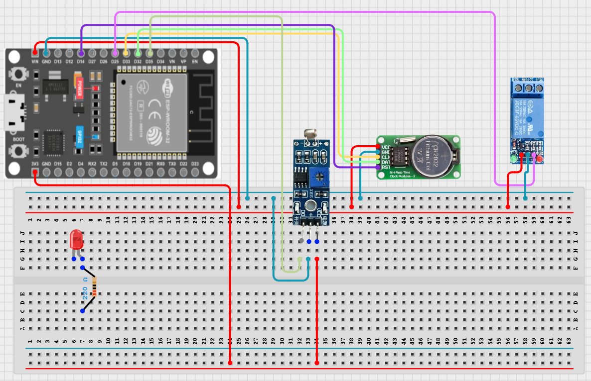
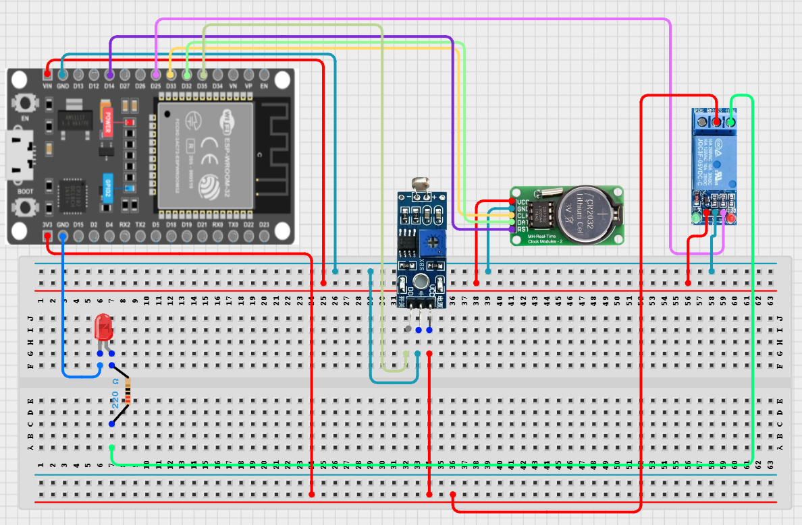

# 4.3.17. Real-Time Clock Greenhouse Light Automation

| **Description** | In Project 137, learners use a DS1302 real-time clock and photoresistor to switch a low-voltage greenhouse light on only when it is dark and within the scheduled hours of 06:00–20:00. |
|------------------|----------------------------------------------------------------------------------------------------------------------------------------------------------------|
| **Use case**     | This classroom prototype demonstrates schedule- and light-based control. It does not control mains lighting or provide environmental regulation. |

## Components

|  |  |  |  |  | **3-pin LDR module** |  |  |  |
| --- | --- | --- | --- | --- | --- | --- | --- | --- |

Things Needed:

- ESP32 board = 1
- DS1302 RTC module with backup battery = 1
- 3-pin LDR sensor module with **VCC**, **GND**, **OUT**, and an adjustable sensitivity trimmer = 1
- 1-channel relay module with removable **VCC/JD-VCC** jumper = 1
- Red 5mm LED = 1
- 220 Ω resistor for the LED = 1
- Breadboard, jumper wires, and USB cable

> **RTC model note:** This sketch targets the DS1302 module previously confirmed for your hardware. The published kit inventory lists DS1307/DS3231 modules instead; those use different wiring and code. Check the module label before wiring. Do not use this 3-wire sketch with a DS3231.

The IIC 1602 LCD listed in the original description is not used. Its backpack pulls I2C lines up to 5V, which is unsafe for direct ESP32 connections; this guide uses the Serial Monitor instead of an unlisted level shifter. The RFID reader is also not used.

## Building the circuit

> **Tip:** See the [ESP32 Pinout Guide](../../Components/ESP32%20Pinout%20and%20Pin%20Assignment%20Guide.md) to locate the correct GPIO pins.

## Mounting the components

**Step 1:** Disconnect USB and leave the relay load disconnected. Place the ESP32, RTC, 3-pin LDR module, relay module, LED, and resistor on the breadboard. Keep this demonstration entirely low-voltage.



## Wiring the circuit

**Step 2:** Connect the DS1302 RTC:

- Connect RTC **VCC** to **3.3V** only if the exact module supports 3.3V operation.
- Connect RTC **GND** to ESP32 **GND**.
- Connect RTC **DAT / I/O** to **GPIO 32**.
- Connect RTC **CLK / SCLK** to **GPIO 33**.
- Connect RTC **RST / CE** to **GPIO 14**.
- Match the labels on the RTC module. The DS1302 uses these three signal wires; it does not use I2C.
- If the module requires 5V or pulls its data pin above 3.3V, do not connect its signal pins directly to the ESP32.



**Step 3:** Connect the 3-pin LDR module:

- Connect module **VCC** to ESP32 **3.3V**.
- Connect module **GND** to ESP32 **GND**.
- Connect module **OUT** to **GPIO 35**.
- Power the module from **3.3V**, not 5V, so its output stays within the ESP32's logic-voltage range. GPIO 35 is input-only and is used here as a digital input.
- The onboard trimmer sets the light threshold. This module provides a digital HIGH/LOW output, so no external LDR divider resistor is needed.



**Step 4:** Connect the relay module's control and coil supplies:

- Remove the relay board's jumper connecting **VCC** and **JD-VCC**.
- Connect relay **VCC** to ESP32 **3.3V**.
- Connect relay **JD-VCC** to ESP32 **5V/VIN** while the board is powered by USB.
- Connect relay **GND** to ESP32 **GND**.
- Connect relay **IN** to **GPIO 25**.
- The sketch assumes the module is active-low: **LOW** energizes the relay, **HIGH** turns it off. If the board does not have the removable VCC/JD-VCC jumper, stop and verify its wiring requirements before use.
- With the LED load disconnected, verify the relay's trigger polarity. If the module is active-high, invert the logic in `setRelay()` before continuing.



**Step 5:** Wire the low-voltage LED load to the relay contacts:

- Connect ESP32 **3.3V** to relay **COM**.
- Connect relay **NO** to one end of the **220 Ω** resistor.
- Connect the other end of the resistor to the red LED's **anode (+)**.
- Connect the LED's **cathode (-)** to ESP32 **GND**.
- Leave **NC** unused. Do not connect mains voltage or an unverified external load to the relay.



**Step 6:** Check the RTC model and supply, LDR module pin labels and 3.3V supply, relay jumper removal, common ground, and LED polarity. Then connect USB to the ESP32.

## PROGRAMMING

**Step 1:** Open Arduino IDE and select the ESP32 board and port. See [Getting Started](../../Getting%20Started/Arduino_IDE_Setup.md) for setup instructions.

**Step 2:** Install **Rtc by Makuna** through Arduino IDE's Library Manager, then enter this sketch:

```cpp
#include <ThreeWire.h>
#include <RtcDS1302.h>

constexpr uint8_t rtcDatPin = 32;
constexpr uint8_t rtcClkPin = 33;
constexpr uint8_t rtcRstPin = 14;
constexpr uint8_t ldrOutPin = 35;
constexpr uint8_t relayPin = 25;
constexpr uint8_t startHour = 6;
constexpr uint8_t endHour = 20;
constexpr uint8_t darkLevel = LOW;
constexpr bool setRtcToCompileTime = false;

ThreeWire rtcWire(rtcDatPin, rtcClkPin, rtcRstPin);
RtcDS1302<ThreeWire> rtc(rtcWire);

bool darkEnough = false;
bool pendingDark = false;
bool ldrInitialized = false;
uint32_t pendingSince = 0;
uint32_t lastReportAt = 0;

void setRelay(bool on) {
  digitalWrite(relayPin, on ? LOW : HIGH);
}

void setup() {
  Serial.begin(115200);

  digitalWrite(relayPin, HIGH);
  pinMode(relayPin, OUTPUT);
  pinMode(ldrOutPin, INPUT);
  setRelay(false);

  rtc.Begin();
  rtc.SetIsWriteProtected(false);
  if (!rtc.GetIsRunning()) {
    rtc.SetIsRunning(true);
  }

  if (setRtcToCompileTime || !rtc.IsDateTimeValid()) {
    rtc.SetDateTime(RtcDateTime(__DATE__, __TIME__));
    Serial.println("RTC set to sketch compile time.");
  }

  if (!rtc.IsDateTimeValid()) {
    Serial.println("RTC time is invalid. Check the DS1302 wiring and backup battery.");
    while (true) {
      setRelay(false);
      delay(1000);
    }
  }

  Serial.println("Greenhouse light controller ready.");
  Serial.println("Check the LDR OUT level in bright and dark conditions, then set darkLevel.");
}

void loop() {
  const RtcDateTime now = rtc.GetDateTime();
  const uint8_t ldrOutput = digitalRead(ldrOutPin);
  const bool readingDark = ldrOutput == darkLevel;
  const uint32_t currentTime = millis();

  if (!ldrInitialized) {
    darkEnough = readingDark;
    pendingDark = readingDark;
    pendingSince = currentTime;
    ldrInitialized = true;
  } else if (readingDark != pendingDark) {
    pendingDark = readingDark;
    pendingSince = currentTime;
  } else if (pendingDark != darkEnough && currentTime - pendingSince >= 300UL) {
    darkEnough = pendingDark;
  }

  const bool withinSchedule = now.Hour() >= startHour && now.Hour() < endHour;
  const bool lightOn = withinSchedule && darkEnough;
  setRelay(lightOn);

  if (millis() - lastReportAt >= 1000UL) {
    lastReportAt = millis();
    Serial.printf("%04d-%02d-%02d %02d:%02d:%02d | LDR OUT: %s | Schedule: %s | Dark: %s | LED load: %s\n",
                  now.Year(), now.Month(), now.Day(),
                  now.Hour(), now.Minute(), now.Second(),
                  ldrOutput == HIGH ? "HIGH" : "LOW",
                  withinSchedule ? "ACTIVE" : "OFF",
                  darkEnough ? "YES" : "NO",
                  lightOn ? "ON" : "OFF");
  }

  delay(100);
}
```

**Step 3:** Save and upload the sketch. To set the RTC to the computer's current time, temporarily change `setRtcToCompileTime` to `true`, upload, then set it back to `false` and upload again. Install the RTC backup battery so time is retained when USB power is removed.

**Step 4:** Open Serial Monitor at **115200 baud**. Verify the RTC time and observe `LDR OUT` while covering and uncovering the sensor. Set `darkLevel` to `LOW` if the covered sensor reads LOW, or to `HIGH` if it reads HIGH; upload the sketch again after changing it. Slowly adjust the module's trimmer to set the light/dark switching point. The sketch requires the reading to remain stable for 300 ms before changing the light state.

**Step 5:** For a safe functional test, temporarily change `startHour` and `endHour` so the current RTC hour is within the schedule. Cover the LDR to simulate darkness and uncover it to simulate brightness. The relay should light the LED only when it is dark and within the schedule. Restore the hours to **06:00–20:00** when finished.

## CONCLUSION

This project combines the DS1302 schedule with the LDR module's digital light/dark output to control a low-voltage LED through the relay. Power the LDR module from 3.3V, the relay coil from the USB-powered 5V/VIN rail, and the relay input with 3.3V logic. Do not use mains voltage for this classroom demonstration.
